# Create By Two Curves

- Source PDF: Matrix 9 User Manual Addendum (matrix9.0_addendum.pdf)
- Page range: 45-47
- Section title: Create By Two Curves
- Section id: m9addendum-039-create-by-two-curves
- Note: boundary page(s) are shared with a neighbouring section (two-column layout); text/images may include neighbour content.

---
<!-- section m9addendum-039-create-by-two-curves | Create By Two Curves | m9addendum pages 45-47 -->

<!-- page 45 -->

### Cap Start Modes:
Polygonal: Creates a cap by adding poly-
gonal faces.
Ngon: Creates a cap using a single Clayoo
face resulting in an n-gon shaped face.
None: Creates a Clayoo surface with no
cap.
Figure 1: Polygon Cap Figure 2: Ngon Cap Figure 3: None
### Create By Two Curves
'ClayCreateBy2Curves'
Creates a Clayoo surface or solid from two
open curves.
Where is this Command:
Figure 1: Polygon Cap Figure 2: Ngon Cap Figure 3: None
Access this command from SubD>Create
By Two Curves
Steps:
Cap End: Creates a cap by adding a face
or faces to the end of the Clayoo surface.
Select the desired mode from the drop-
down menu.
### Cap End Modes:
Click Create by Two Curves in the
Clayoo Menu.
Select two open curves from the
viewport. Press Enter when done.
Set the Parameters in the Create By
Two Curves builder.
Polygonal: Creates a cap by adding poly-
gonal faces.
Ngon: Creates a cap using a single Clayoo
face resulting in an n-gon shaped face.
When the parameters of the surface
are set as needed click 'OK' to add
the geometry to the viewport, or
'Cancel' to cancel the command.
None: Creates a Clayoo surface with no
cap.
### Options:
When the parameters of the surface are
set as needed, click the check mark to add
the geometry to the viewport, or the ‘X’ to
cancel the command.
Distance: Controls the bulge of the Clayoo
surface between the two input curves.
Adjust in the builder by running the slider
or typing a value in the input box on the
left.
- 39 -

<!-- page 46 -->

Note: For the Symmetry option to work, the dis-
tance must not be set to zero
Flip Curve : Flips the direction of the input
curve. For best results, both input curves
should be facing the same direction.
Figure 1: Distance=0 Figure 2: Distance=4
Segments: Controls the number of seg-
ments or faces running perpendicular to
the input curve(s) of the surface. Adjust in
the builder by running the slider or typing
a value in the input box on the left.
Figure 1: Curves with mismatched directions Figure 2: Curves
with matching directions
Cap Start: Creates a cap by adding a face
or faces to the start of the Clayoo surface.
Select the desired mode from the drop-
down menu.
Figure 1: Segments=8 Figure 2: Segments=16
### Cap Start Modes:
Polygonal: Creates a cap by adding poly-
gonal faces.
Segments Along: Controls the number of
segments or faces running perpendicular
to the input profile(s) of the surface.
Adjust in the builder by running the slider
or typing a value in the input box on the
left.
Ngon: Creates a cap using a single Clayoo
face resulting in an n-gon shaped face.
None: Creates a Clayoo surface with no
cap.
Figure 1: Segments Along=8 Figure 2: Segments Along=16
Figure 1: Polygon Cap Figure 2: Ngon Cap
Symmetry: Extrudes a Clayoo surface
from both sides of the input curve(s). With
this option selected, distance and division
parameters are double the value set in the
builder.
Cap End: Creates a cap by adding a face
or faces to the end of the Clayoo surface.
Select the desired mode from the drop-
down menu.
### Cap End Modes:
Polygonal: Creates a cap by adding poly-
gonal faces.
Ngon: Creates a cap using a single Clayoo
face resulting in an n-gon shaped face.
Figure 1: Symmetry=Off Figure 2: Symmetry=On
- 40 -

<!-- page 47 -->

None: Creates a Clayoo surface with no
cap.
Figure 1: Select Entire Object Figure 2: All holes filled.
Figure 1: Polygon Cap Figure 2: Ngon Cap
### Clayoo Shell
'ClayShell'
When the parameters of the surface are
set as needed, click the check mark to add
the geometry to the viewport, or the ‘X’ to
cancel the command.
Creates a hollowed out shell of a solid
Clayoo surface while removing selected
faces.
Where is this Command:
Access this command from SubD > Shell
### Clayoo Fill
Steps:
'ClayFill'
Creates a Clayoo face to close any open-
ings in a Clayoo surface.
Select Shell from the Clayoo toolbar.
Select faces on the Clayoo surface
to remove.
Where is this Command:
Press Enter when done.
Access this command from SubD>Fill
Steps (for single hole):
Specify the thickness in the Com-
mand Line or dynamically using the
Viewport Control Handles.
Press Enter to add the geometry to
the viewport.
Select Fill from the Clayoo toolbar.
Select an edge or edges along the
hole to fill.
Press Enter when done.
Figure 1: Before Shell Figure 2: After Shell
### Options:
Figure 1: Select edge along one hole. Figure 2: Hole filled
Steps (all holes):
Distance: Controls the thickness of the
Clayoo surface. Adjust using the Viewport
Control Handles or by typing a value in the
Command Line
Select Fill from the Clayoo toolbar.
Select the entire Clayoo object.
### Clayoo Extract
Press Enter when done.
'ClayooExtract'
- 41 -

---

## Images

- 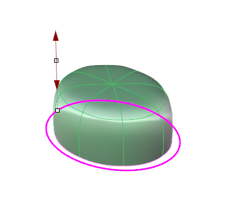 page 45 (shared page)
- 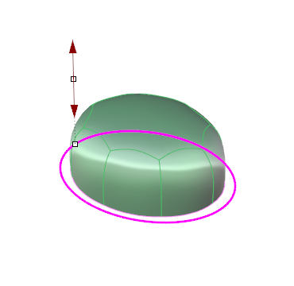 page 45 (shared page)
- 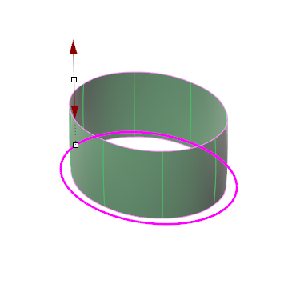 page 45 (shared page)
- 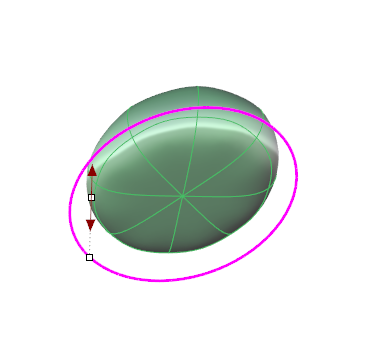 page 45 (shared page)
- 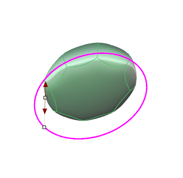 page 45 (shared page)
- 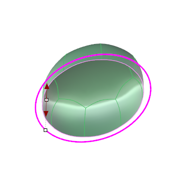 page 45 (shared page)
-  page 46
- 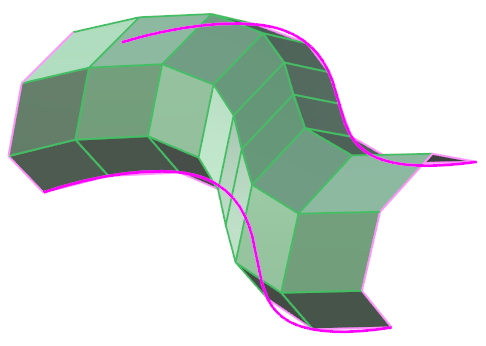 page 46
- 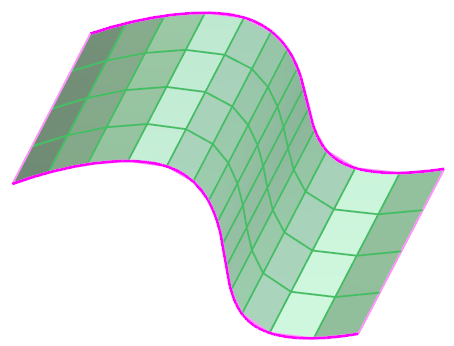 page 46
- 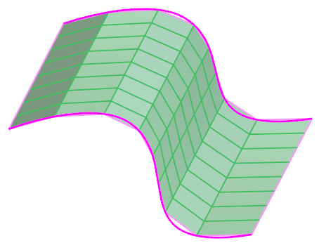 page 46
- 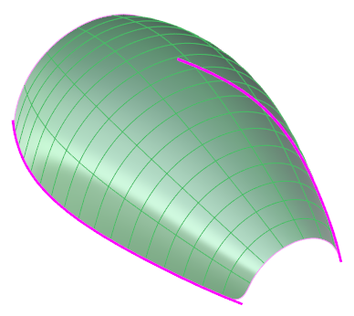 page 46
- 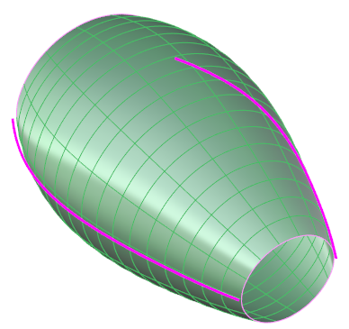 page 46
- 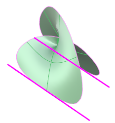 page 46
- 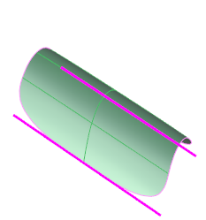 page 46
- 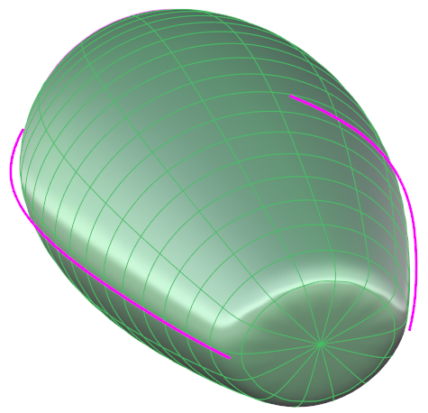 page 46
- 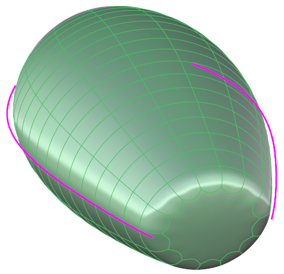 page 46
- 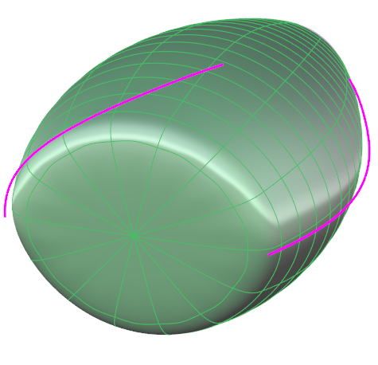 page 47 (shared page)
-  page 47 (shared page)
- 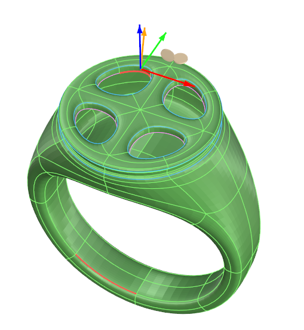 page 47 (shared page)
-  page 47 (shared page)
-  page 47 (shared page)
- 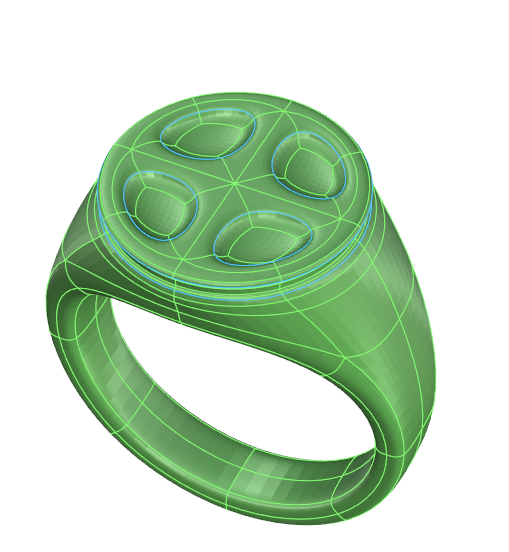 page 47 (shared page)
-  page 47 (shared page)
-  page 47 (shared page)
