# Clayoo Ring

- Source PDF: Matrix 9 User Manual Addendum (matrix9.0_addendum.pdf)
- Page range: 22-24
- Section title: Clayoo Ring
- Section id: m9addendum-019-clayoo-ring
- Note: boundary page(s) are shared with a neighbouring section (two-column layout); text/images may include neighbour content.

---
<!-- section m9addendum-019-clayoo-ring | Clayoo Ring | m9addendum pages 22-24 -->

<!-- page 22 -->

(beige disc) in the viewport. Click and
drag the arrow near the top edge or
double click and type in a value.
Bottom Thickness: Bottom Thickness con-
trols the size of the bezel near the bottom
of the bezel. Adjust in the builder by run-
ning the slider, or typing a value in the
input box on the left. The Bottom Thick-
ness can also be adjusted dynamically by
using the corresponding Viewport Control
Handle (red arrow) in the viewport. Click
and drag the arrow near the bottom edge,
or double click and type in a value.
Note: The same beige handle controls both the
Seat Length and Seat Angle.
### Clayoo Ring
'ClayRing'
Creates a simple band from a Clayoo sur-
face.
Global Height: Global Height controls the
overall height of the bezel. Adjust in the
builder by running the slider, or typing a
value in the input box on the left. The
Global Height can also be adjusted dynam-
ically by using the corresponding View-
port Control Handle (beige disc) in the
viewport. Click and drag the disc near the
bottom of bezel.
Where is this Command:
Access this command from SubD > Ring
Steps:
Select Ring from the Clayoo toolbar.
Set the parameters for the surface
using the builder or by using the
Viewport Control Handles.
Click 'OK' in the builder or press
Enter to add the geometry to the
viewport.
Bezel Angle: Bezel Angle controls the
angle of the outside of the bezel. Adjust in
the builder by running the slider, or typing
a value in the input box on the left. The
Bezel Angle can also be adjusted dynam-
ically by using the corresponding View-
port Control Handle (beige disc) in the
viewport. Click and drag the disc near the
bottom of bezel.
### Options:
Region: Set the region to be used for the
finger size. Select the desired region from
the drop-down menu.
Note: The same beige handle controls both the
Seat Length and Seat Angle.
- 16 -

<!-- page 23 -->

Size: Controls the finger size of the Clayoo
Ring. Select desired size from the drop-
down menu.
Diameter: Controls the diameter of the
inside of the ring. Optionally use this
instead of ring size. Adjust in the builder
by running the slider or typing a value in
the input box on the left.
Figure 1: Left Segments=1 Figure 2: Left Sements=5
Segments: Controls the number of seg-
ments or faces running perpendicular to
the circumference of the surface. Adjust in
the builder by running the slider or typing
a value in the input box on the left.
Right Segments: Controls the divisions on
the right surface (front) of the ring. Adjust
in the builder by running the slider, or typ-
ing a value in the input box on the left.
Figure 1: Segments=10 Figure 2: Segments=20
Figure 1: Right Segments=1 Figure 2: Right Sements=5
Outer Segments: Controls the divisions on
the outside surface of the ring. Adjust in
the builder by running the slider, or typing
a value in the input box on the left.
Top Width: Controls the width of the top
of the ring. Adjust in the builder by running
the slider, or typing a value in the input
box on the left. The Top Width can also be
adjusted dynamically using the cor-
responding Viewport Control Handle (red
arrow). Click and drag the arrow to adjust
the dimension.
Figure 1: Outer Segments=1 Figure 2: Outer Segments=5
Inner Segments: Controls the divisions on
the inside surface of the ring. Adjust in the
builder by running the slider, or typing a
value in the input box on the left.
Figure 1: Top Width=3 Figure 2: Top Width=5
Top Height: Controls the height of the top
of the ring. Adjust in the builder by running
the slider, or typing a value in the input
box on the left. The Top Height can also
be adjusted dynamically using the cor-
responding Viewport Control Handle
(green arrow). Click and drag the arrow to
adjust the dimension.
Figure 1: Inner Segments=1 Figure 2: Inner Segments=5
Left Segments: Controls the divisions on
the left surface (back) of the ring. Adjust
in the builder by running the slider, or typ-
ing a value in the input box on the left.
- 17 -

<!-- page 24 -->

Handle (red arrow). Click and drag the
arrow to adjust the dimension.
Figure 1: Top Height=2 Figure 2: Top Height=4
Figure 1: Bottom Width=3 Figure 2: Bottom Width=1.5
Middle Width: Controls the width of the
side of the ring. Adjust in the builder by
running the slider, or typing a value in the
input box on the left. The Middle Width
can also be adjusted dynamically using
the corresponding Viewport Control
Handle (red arrow). Click and drag the
arrow to adjust the dimension.
Bottom Height: Controls the height of the
bottom of the ring. Adjust in the builder by
running the slider, or typing a value in the
input box on the left. The Top Height can
also be adjusted dynamically using the cor-
responding Viewport Control Handle
(green arrow). Click and drag the arrow to
adjust the dimension.
Figure 1: Middle Width=3 Figure 2: Middle Width= 1.5
Figure 1: Bottom Height=1.7 Figure 2: Bottom Height=3
When the parameters of the surface are
set as needed click 'OK' to add the geo-
metry to the viewport, or 'Cancel' to cancel
the command.
Middle Height: Controls the height of the
middle of the ring. Adjust in the builder by
running the slider, or typing a value in the
input box on the left. The Middle Height
can also be adjusted dynamically using
the corresponding Viewport Control
Handle (green arrow). Click and drag the
arrow to adjust the dimension.
### Clayoo Signet Ring
'ClaySignetRing'
Creates a Clayoo Signet Ring.
Where is this Command:
Access this command from SubD > Signet
Ring.
Steps:
Select Signet from the Clayoo menu.
Figure 1: Middle Height=1.7 Figure 2: Middle Height=3
Set the parameters for the surface
using the builder or by using the
Viewport Control Handles.
Click 'OK' in the builder or press
Enter to add the geometry to the
viewport.
Bottom Width: Controls the width of the
bottom of the ring. Adjust in the builder by
running the slider, or typing a value in the
input box on the left. The Bottom Width
can also be adjusted dynamically using
the corresponding Viewport Control

---

## Images

-  page 22 (shared page)
- 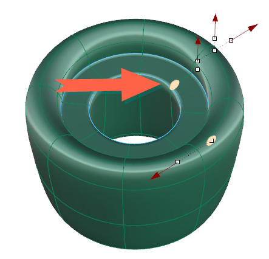 page 22 (shared page)
- 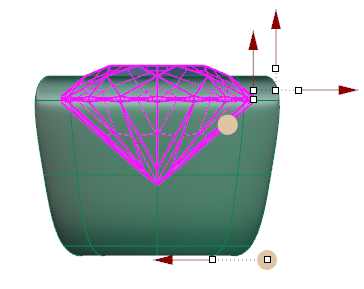 page 22 (shared page)
-  page 22 (shared page)
- 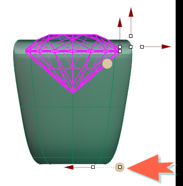 page 22 (shared page)
- 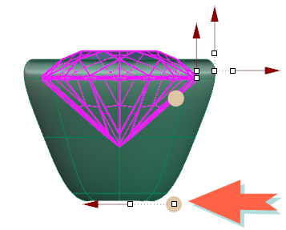 page 22 (shared page)
- 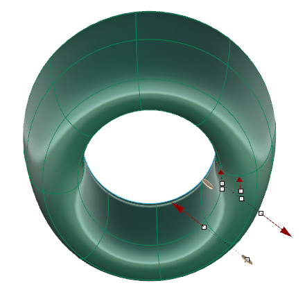 page 22 (shared page)
- 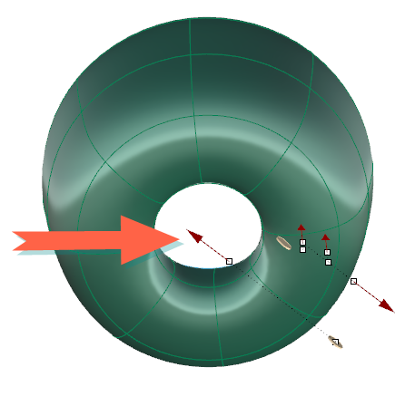 page 22 (shared page)
- 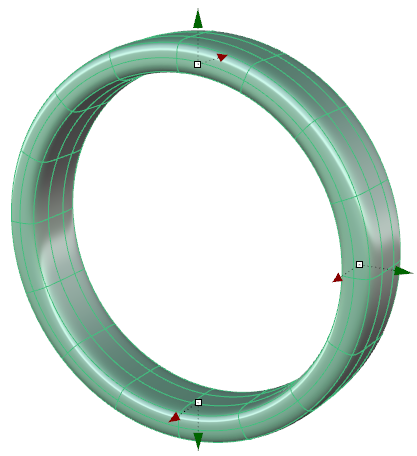 page 22 (shared page)
- 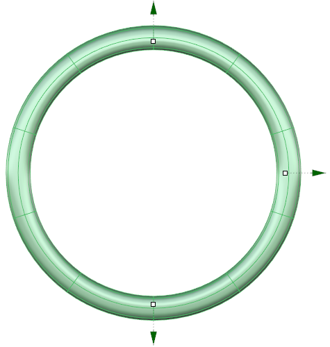 page 23
- 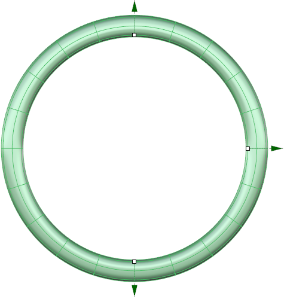 page 23
- 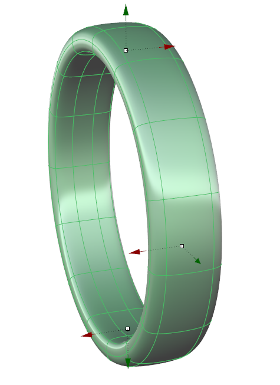 page 23
- 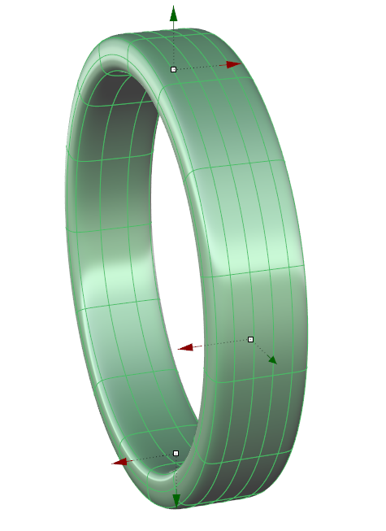 page 23
- 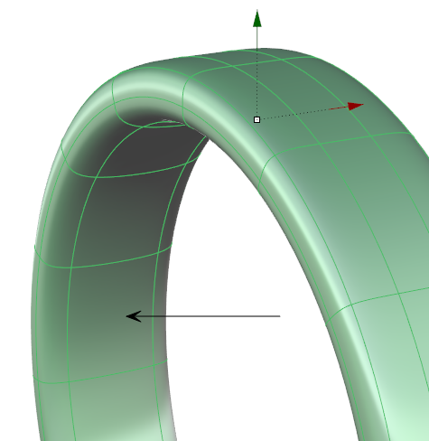 page 23
- 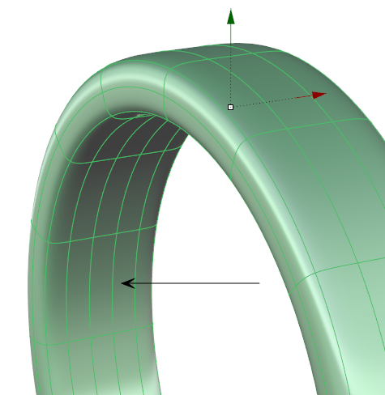 page 23
- 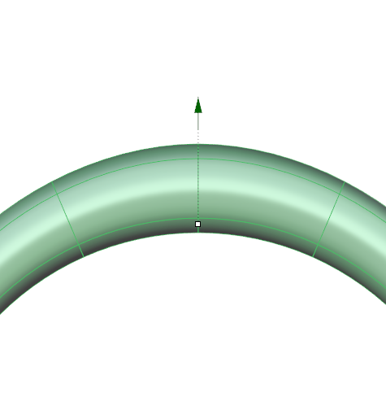 page 23
- 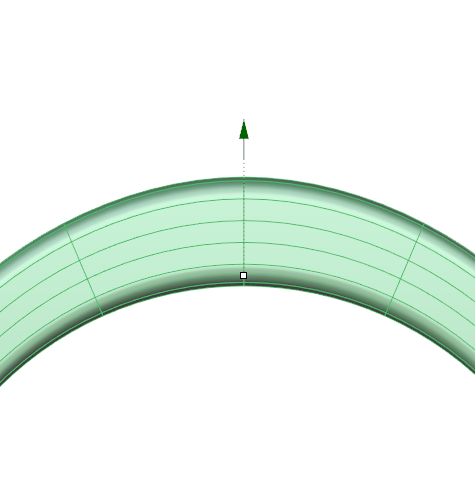 page 23
- 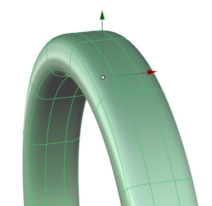 page 23
- 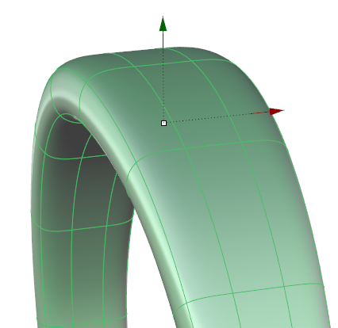 page 23
-  page 24 (shared page)
- 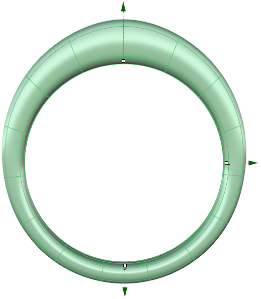 page 24 (shared page)
-  page 24 (shared page)
- 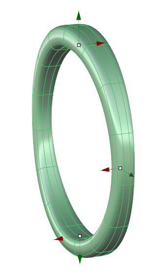 page 24 (shared page)
- 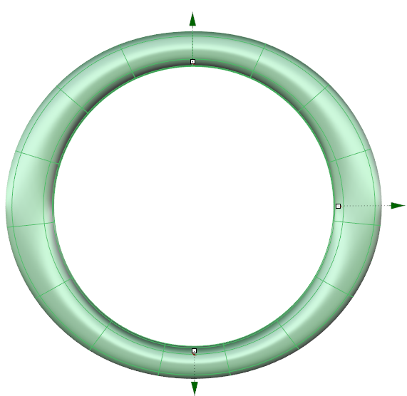 page 24 (shared page)
-  page 24 (shared page)
-  page 24 (shared page)
