# Clayoo Signet Ring

- Source PDF: Matrix 9 User Manual Addendum (matrix9.0_addendum.pdf)
- Page range: 24-26
- Section title: Clayoo Signet Ring
- Section id: m9addendum-020-clayoo-signet-ring
- Note: boundary page(s) are shared with a neighbouring section (two-column layout); text/images may include neighbour content.

---
<!-- section m9addendum-020-clayoo-signet-ring | Clayoo Signet Ring | m9addendum pages 24-26 -->

<!-- page 24 -->

Handle (red arrow). Click and drag the
arrow to adjust the dimension.
Figure 1: Top Height=2 Figure 2: Top Height=4
Figure 1: Bottom Width=3 Figure 2: Bottom Width=1.5
Middle Width: Controls the width of the
side of the ring. Adjust in the builder by
running the slider, or typing a value in the
input box on the left. The Middle Width
can also be adjusted dynamically using
the corresponding Viewport Control
Handle (red arrow). Click and drag the
arrow to adjust the dimension.
Bottom Height: Controls the height of the
bottom of the ring. Adjust in the builder by
running the slider, or typing a value in the
input box on the left. The Top Height can
also be adjusted dynamically using the cor-
responding Viewport Control Handle
(green arrow). Click and drag the arrow to
adjust the dimension.
Figure 1: Middle Width=3 Figure 2: Middle Width= 1.5
Figure 1: Bottom Height=1.7 Figure 2: Bottom Height=3
When the parameters of the surface are
set as needed click 'OK' to add the geo-
metry to the viewport, or 'Cancel' to cancel
the command.
Middle Height: Controls the height of the
middle of the ring. Adjust in the builder by
running the slider, or typing a value in the
input box on the left. The Middle Height
can also be adjusted dynamically using
the corresponding Viewport Control
Handle (green arrow). Click and drag the
arrow to adjust the dimension.
### Clayoo Signet Ring
'ClaySignetRing'
Creates a Clayoo Signet Ring.
Where is this Command:
Access this command from SubD > Signet
Ring.
Steps:
Select Signet from the Clayoo menu.
Figure 1: Middle Height=1.7 Figure 2: Middle Height=3
Set the parameters for the surface
using the builder or by using the
Viewport Control Handles.
Click 'OK' in the builder or press
Enter to add the geometry to the
viewport.
Bottom Width: Controls the width of the
bottom of the ring. Adjust in the builder by
running the slider, or typing a value in the
input box on the left. The Bottom Width
can also be adjusted dynamically using
the corresponding Viewport Control

<!-- page 25 -->

### Options:
Region: Set the region to be used for the
finger size. Select the desired region from
the drop-down menu.
Size: Controls the finger size of the Clayoo
Signet.
Figure 1: Corner Width=.0001 Figure 2: Corner Width=9
Diameter: Controls the diameter of the
inside of the ring. Optionally use this
instead of ring size. Adjust in the builder
by running the slider or typing a value in
the input box on the left.
Corner Depth: Affects the shape of the
seal of the signet. Adjust in the builder by
running the slider, or typing a value in the
input box on the left.
Seal Width: Controls the width of the top
of the signet. Adjust in the builder by run-
ning the slider, or typing a value in the
input box on the left. The Seal Width can
also be adjusted dynamically using the cor-
responding Viewport Control Handle (red
arrow). Click and drag the arrow to adjust
the dimension.
Figure 1: Corner Depth=.0001 Figure 2: Corner Depth=9
Figure 1: Seal Width=14 Figure 2: Seal Width= 18
Top Width: Controls the width of the area
of the signet below the seal. Adjust in the
builder by running the slider, or typing a
value in the input box on the left. The Top
Width can also be adjusted dynamically
using the corresponding Viewport Control
Handle (green arrow). Click and drag the
arrow to adjust the dimension.
Seal Depth: Controls the depth of the top
of the Signet. Adjust in the builder by run-
ning the slider, or typing a value in the
input box on the left. The Seal Depth can
also be adjusted dynamically using the cor-
responding Viewport Control Handle
(green arrow). Click and drag the arrow to
adjust the dimension.
Figure 1: Top Width=15 Figure 2: Top Width=20
Figure 1: Seal Depth=14 Figure 2: Seal Depth=18
Corner Width: Affects the shape of the
seal of the signet. Adjust in the builder by
running the slider, or typing a value in the
input box on the left.
Top Thickness: Controls the height of the
top of the seal. Adjust in the builder by run-
ning the slider, or typing a value in the
input box on the left. The Top Thickness
can also be adjusted dynamically using
the corresponding Viewport Control
Handle (red arrow). Click and drag the
arrow to adjust the dimension.
- 19 -

<!-- page 26 -->

Middle Width: Controls the width of the
band of the signet at the 3 O'clock pos-
ition. Adjust in the builder by running the
slider, or typing a value in the input box on
the left. The Middle Width can also be
adjusted dynamically using the cor-
responding Viewport Control Handle
(green arrow). Click and drag the arrow to
adjust the dimension.
Figure 1: Top Thickness=.36 Figure 2: Top Thickness=2
Figure 1: Middle Width=4 Figure 2: Middle Width=1.8
Shoulder Width: Controls the width of the
side of the ring below the seal. Adjust in
the builder by running the slider, or typing
a value in the input box on the left. The
Shoulder Width can also be adjusted
dynamically using the corresponding View-
port Control Handle (green arrow). Click
and drag the arrow to adjust the dimen-
sion.
Middle Thickness: Controls the band thick-
ness. Adjust in the builder by running the
slider, or typing a value in the input box on
the left. The Middle Thickness can also be
adjusted dynamically using the cor-
responding Viewport Control Handle (red
arrow). Click and drag the arrow to adjust
the dimension.
Figure 1: Shoulder Width=10 Figure 2: Shoulder Width=15
Figure 1: Middle Thickness=2 Figure 2:Middle Thickness=3
Shoulder Thickness: Controls the thick-
ness of the ring below the seal. Adjust in
the builder by running the slider, or typing
a value in the input box on the left. The
Shoulder Thickness can also be adjusted
dynamically using the corresponding View-
port Control Handle (red arrow). Click and
drag the arrow to adjust the dimension.
Bottom Width: Controls the width of the
bottom of the ring. Adjust in the builder by
running the slider, or typing a value in the
input box on the left. The Bottom Thick-
ness can also be adjusted dynamically
using the corresponding Viewport Control
Handle (red arrow). Click and drag the
arrow to adjust the dimension.
Figure 1: Shoulder Thickness=3 Figure 2: Shoulder Thick-
ness=5
- 20 -

---

## Images

- 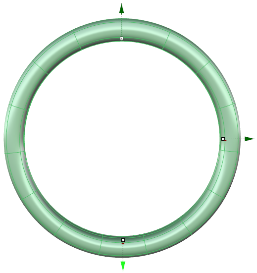 page 24 (shared page)
-  page 24 (shared page)
- 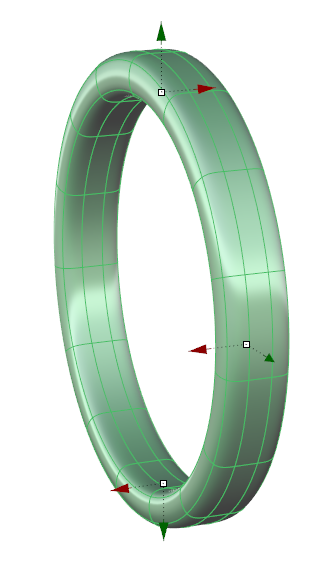 page 24 (shared page)
-  page 24 (shared page)
-  page 24 (shared page)
- 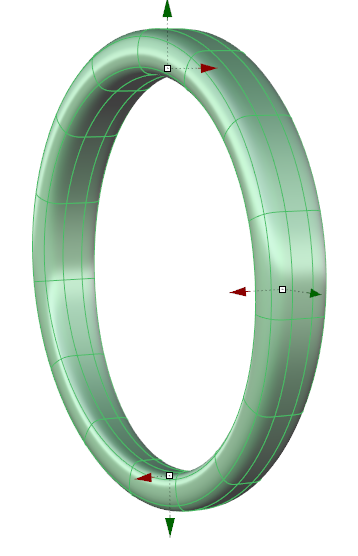 page 24 (shared page)
- 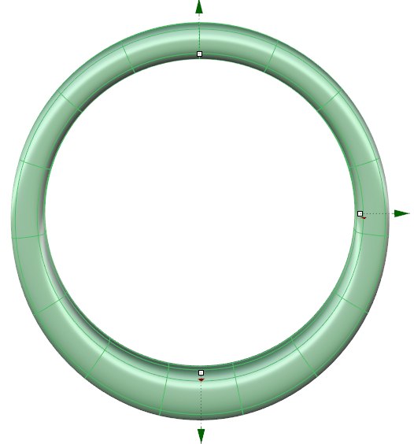 page 24 (shared page)
- 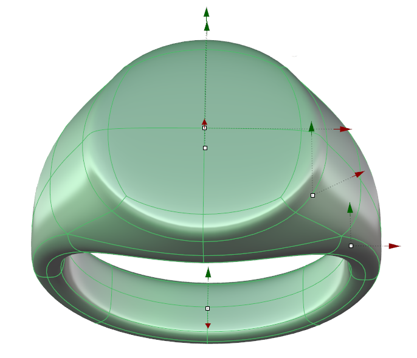 page 25
- 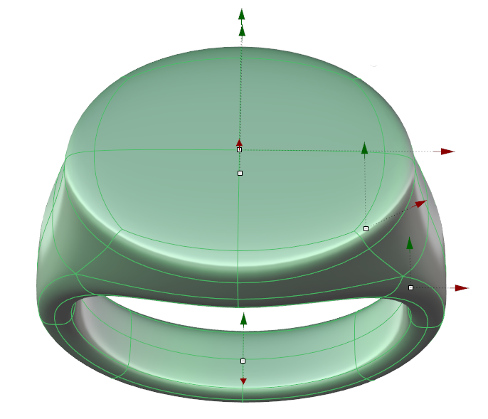 page 25
- 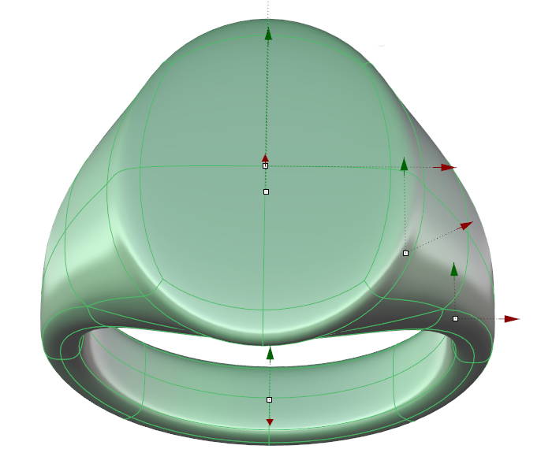 page 25
- 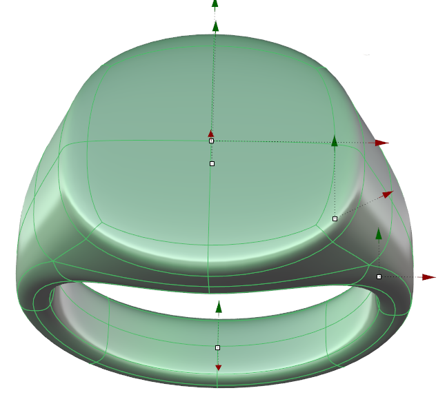 page 25
- 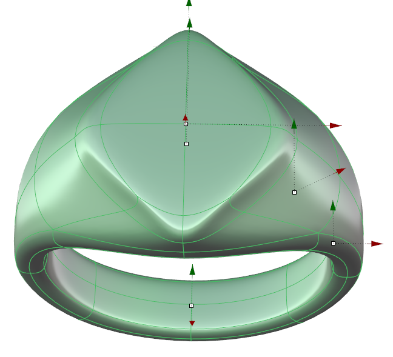 page 25
- 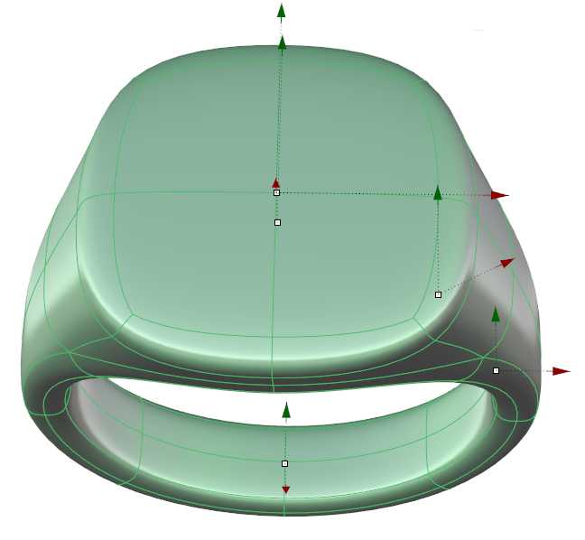 page 25
- 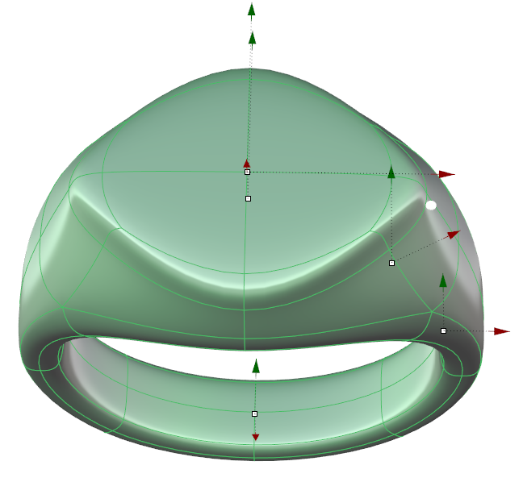 page 25
- 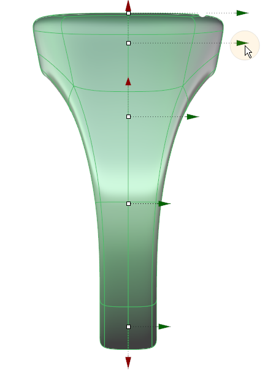 page 25
- 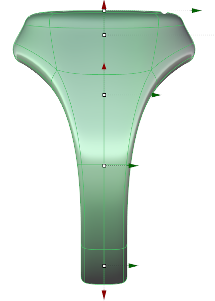 page 25
-  page 26
- 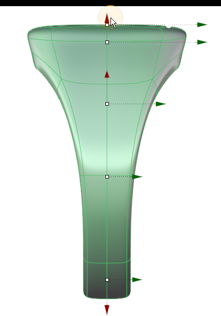 page 26
- 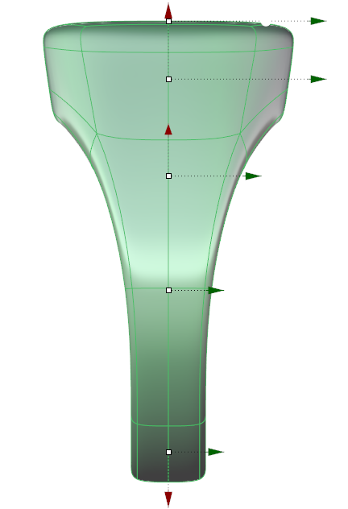 page 26
- 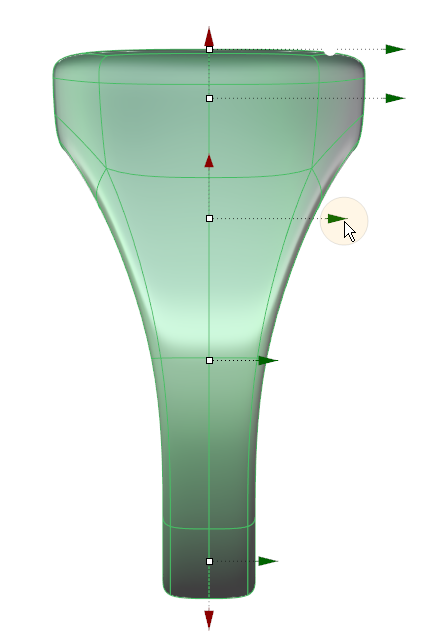 page 26
- 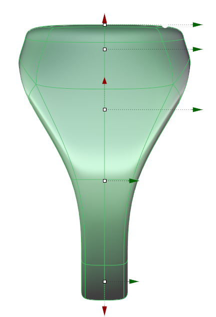 page 26
- 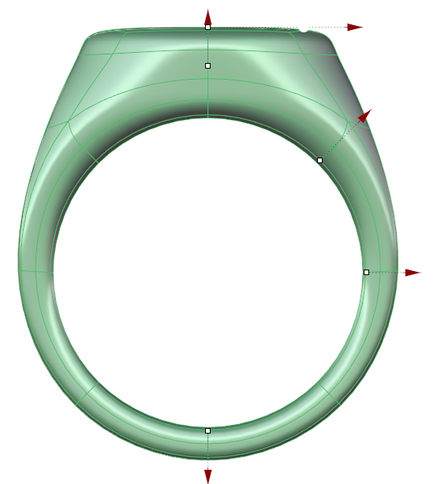 page 26
- 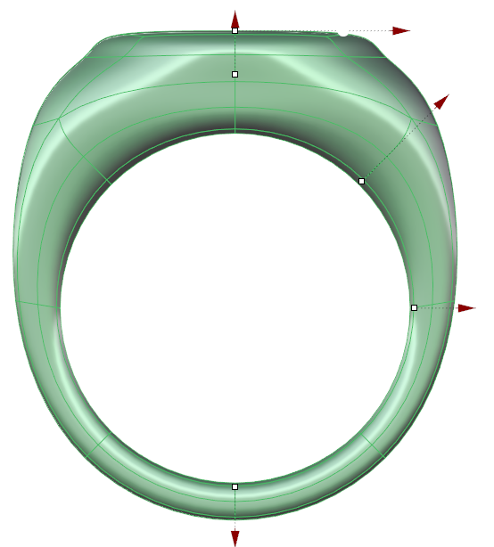 page 26
- 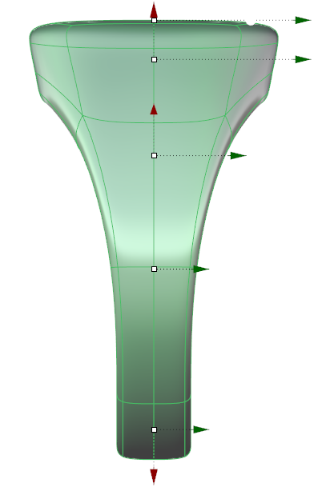 page 26
- 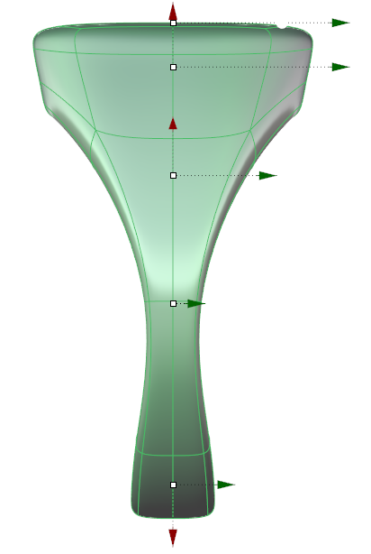 page 26
- 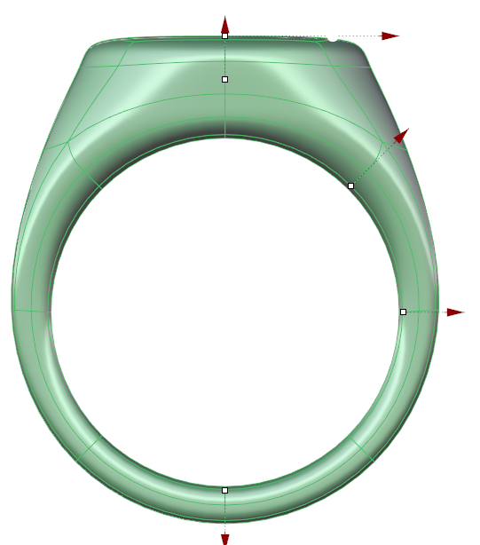 page 26
- 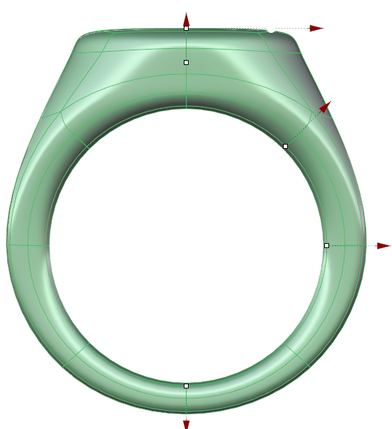 page 26
