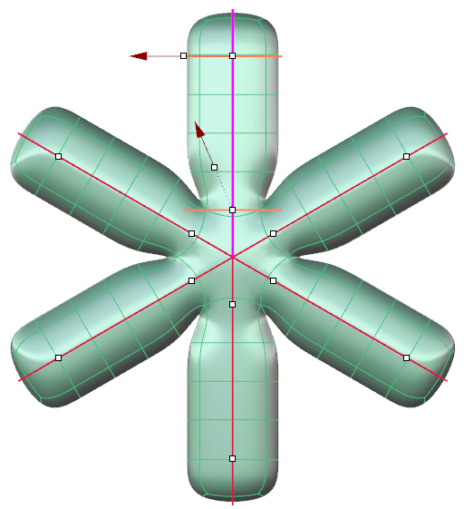
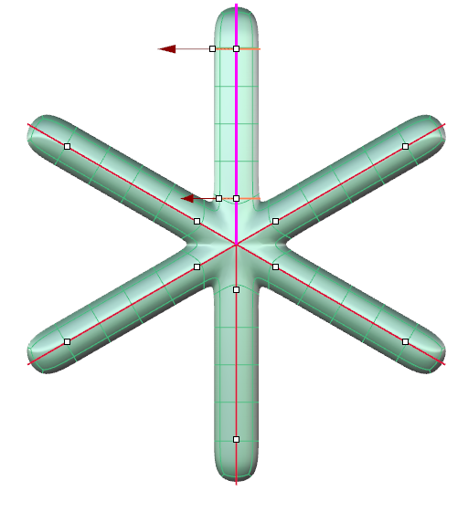
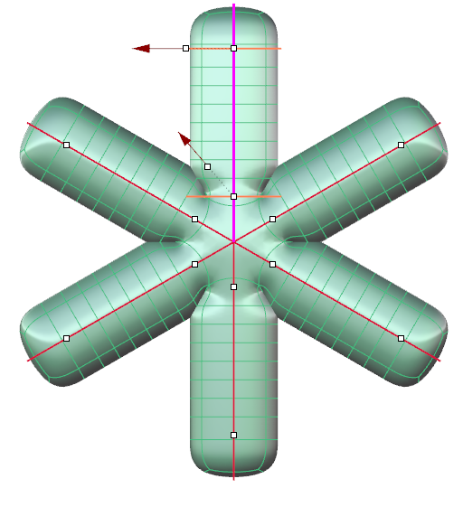
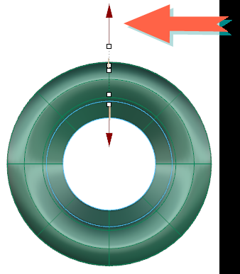
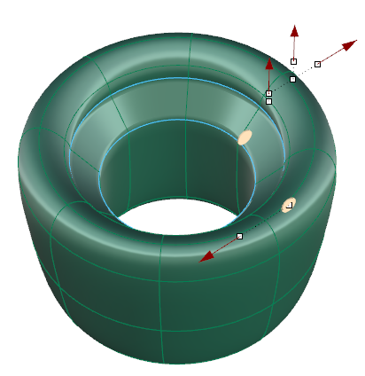
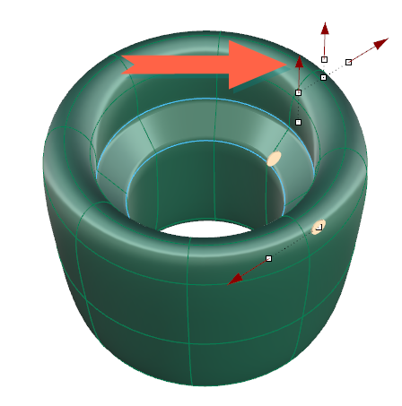
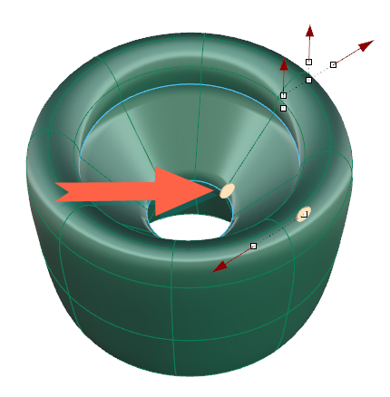
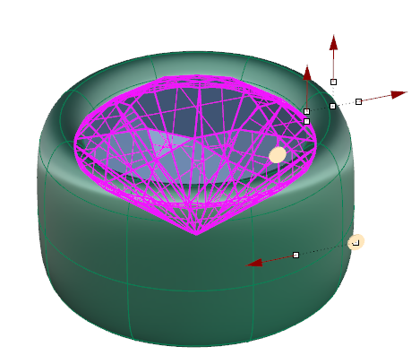
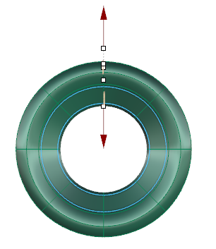

# Clayoo Bezel

- Source PDF: Matrix 9 User Manual Addendum (matrix9.0_addendum.pdf)
- Page range: 20-22
- Section title: Clayoo Bezel
- Section id: m9addendum-018-clayoo-bezel
- Note: boundary page(s) are shared with a neighbouring section (two-column layout); text/images may include neighbour content.

---
<!-- section m9addendum-018-clayoo-bezel | Clayoo Bezel | m9addendum pages 20-22 -->

<!-- page 20 -->

Figure 1: Radius End=1 Figure 2: Radius Edn+3
Segments: Controls the number of seg-
ments or faces running perpendicular to
the input curve(s) of the surface. Adjust in
the builder by running the slider or typing
a value in the input box on the left.
Figure 1: Global Segments=4 Figure 2: Global Segments=8
### Command Line Options:
These options only appear in the com-
mand line.
Figure 1: Segments=4 Figure 2: Segments=8
Edit Mode: Controls what the options in
the command line controls.
### Joint Options:
These options affect the joints or inter-
sections in a multipipe operation.
Global Parameters: Command
line options affect the piped
surface globaly.
Start Align: Rotates the joint at the start of
the active curve 90 degrees.
End Align: Rotates the joint at the end of
the active curve 90 degrees.
EndCurveParameters: Com-
mand line options control the
piped surface at the end of the
curve.
### Global Options:
StartCurveParameters: Com-
mand line options control the
piped surface at the start of
the curve.
Global Radius: Controls the radius of the
entire piped surface regardless of which
curve is active. Adjust in the builder by run-
ning the slider, or typing a value in the
input box on the left.
Distance: Controls the pipe profiles dis-
tance from the ends of the curve. Adjust in
the viewport by clicking and dragging the
white dot at the center of the profile or in
the command line by clicking on the
option and typing a value.
### EndCurve/StartCurve Options:
These options only appear when use either
end curve
Figure 1: Global Radius=1 Figure 2: Global Radius=2
Angle: Rotates the seam point of the pipe
profile creating a twisting surface. Adjust
in the viewport by clicking and dragging
on the pipe profile (orange curve) or in the
command line by clicking on the option
and typing a value.
### Clayoo Bezel
Global Segments:Controls the number of
segments or faces of the entire piped sur-
face regardless of which curve is active.
Adjust in the builder by running the slider,
or typing a value in the input box on the
left.
‘ClayBezel’
Creates a Clayoo bezel around an existing
gem.
Where is this Command:
- 14 -

<!-- page 21 -->

Access this builder from SubD > Clayoo
Bezel
or from the F6 menu when a gem is selec-
ted
Steps:
Select Clayoo Bezel from the SubD
menu. (Also located in the Settings
Menu or from the F6 menu with a
stone selected.)
Put the selected stone into the Bezel
Builder input box (not necessary if
you used F6).
Matrix will generate a preview of the
bezel.
Adjust the parameters as desired
and click OK to validate.
Seat Height: Seat Height controls how
deep the gem sits in the bezel. Adjust in
the builder by running the slider, or typing
a value in the input box on the left. The
Seat Height can also be adjusted dynam-
ically by using the corresponding View-
port Control Handle (red vertical arrow) in
the viewport. Click and drag the arrow
near the top edge or double click and type
in a value.
### Editing Parameters:
Seat Length: Seat Length controls how far
down the pavilion of the stone the seat of
the bezel extends. Adjust in the builder by
running the slider, or typing a value in the
input box on the left. The Seat Length can
also be adjusted dynamically by using the
corresponding Viewport Control Handle
(beige disc) in the viewport. Click and
drag the arrow near the top edge or
double click and type in a value.
Dome Height: Dome Height extends the
rounded edge on the top of the bezel.
Adjust in the builder by running the slider
or typing a value in the input box on the
left. The Dome Height can also be adjus-
ted dynamically by using the cor-
responding Viewport Control Handle (red
vertical arrow) in the viewport. Click and
drag the arrow near the top edge or
double click and type in a value.
Top Thickness: Top Thickness controls the
size of the bezel near the girdle of the
stone. Adjust in the builder by running the
slider, or typing a value in the input box on
the left. The Top Thickness can also be
adjusted dynamically by using the cor-
responding Viewport Control Handle (red
horizontal arrow) in the viewport. Click
and drag the arrow near the top edge or
double click and type in a value.
Seat Angle: Seat Angle controls the seat
of the bezel. Adjust in the builder by run-
ning the slider, or typing a value in the
input box on the left. The Seat Angle can
also be adjusted dynamically by using the
corresponding Viewport Control Handle

<!-- page 22 -->

(beige disc) in the viewport. Click and
drag the arrow near the top edge or
double click and type in a value.
Bottom Thickness: Bottom Thickness con-
trols the size of the bezel near the bottom
of the bezel. Adjust in the builder by run-
ning the slider, or typing a value in the
input box on the left. The Bottom Thick-
ness can also be adjusted dynamically by
using the corresponding Viewport Control
Handle (red arrow) in the viewport. Click
and drag the arrow near the bottom edge,
or double click and type in a value.
Note: The same beige handle controls both the
Seat Length and Seat Angle.
### Clayoo Ring
'ClayRing'
Creates a simple band from a Clayoo sur-
face.
Global Height: Global Height controls the
overall height of the bezel. Adjust in the
builder by running the slider, or typing a
value in the input box on the left. The
Global Height can also be adjusted dynam-
ically by using the corresponding View-
port Control Handle (beige disc) in the
viewport. Click and drag the disc near the
bottom of bezel.
Where is this Command:
Access this command from SubD > Ring
Steps:
Select Ring from the Clayoo toolbar.
Set the parameters for the surface
using the builder or by using the
Viewport Control Handles.
Click 'OK' in the builder or press
Enter to add the geometry to the
viewport.
Bezel Angle: Bezel Angle controls the
angle of the outside of the bezel. Adjust in
the builder by running the slider, or typing
a value in the input box on the left. The
Bezel Angle can also be adjusted dynam-
ically by using the corresponding View-
port Control Handle (beige disc) in the
viewport. Click and drag the disc near the
bottom of bezel.
### Options:
Region: Set the region to be used for the
finger size. Select the desired region from
the drop-down menu.
Note: The same beige handle controls both the
Seat Length and Seat Angle.
- 16 -

---

## Images

-  page 20 (shared page)
-  page 20 (shared page)
-  page 20 (shared page)
-  page 20 (shared page)
-  page 20 (shared page)
-  page 21
-  page 21
-  page 21
-  page 21
-  page 21
-  page 21
-  page 21
-  page 22 (shared page)
-  page 22 (shared page)
-  page 22 (shared page)
-  page 22 (shared page)
-  page 22 (shared page)
-  page 22 (shared page)
-  page 22 (shared page)
-  page 22 (shared page)
