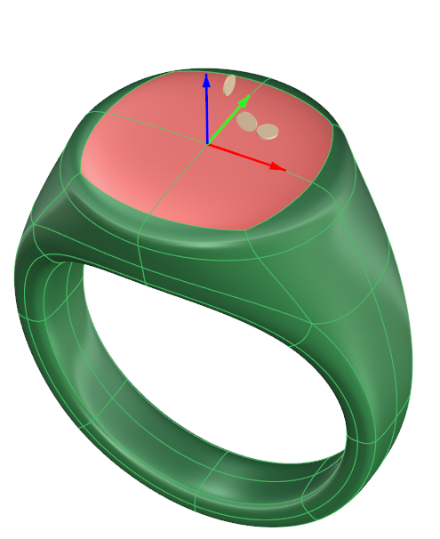
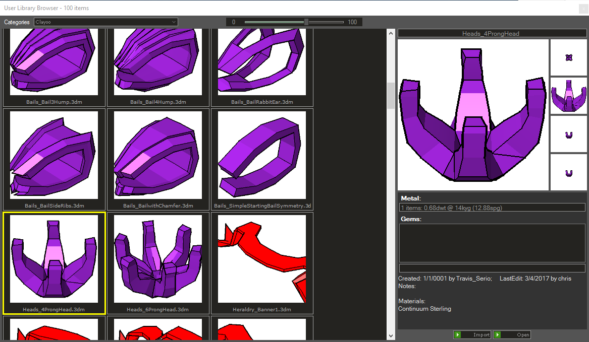

# Clayoo Library

- Source PDF: Matrix 9 User Manual Addendum (matrix9.0_addendum.pdf)
- Page range: 56-57
- Section title: Clayoo Library
- Section id: m9addendum-064-clayoo-library
- Note: boundary page(s) are shared with a neighbouring section (two-column layout); text/images may include neighbour content.

---
<!-- section m9addendum-064-clayoo-library | Clayoo Library | m9addendum pages 56-57 -->

<!-- page 56 -->

Figure 1: Original Selection Figure 2: Selection after running
the Select Naked Edges command.
Adjust SubDivision Level Per Object
Steps:
Select Clayoo objects.
### Select Coplanar
'ClaySelectCoplanar'
Selects geometry (faces, edges or ver-
tices) that share the same plane.
Select SubDivision Level from the
SubD menu.
Select Increase or Decrease from the
command line.
Where is this Command:
Note: Subdivision Level can be set from 1-5. The
default is 3. Use 1 or 2 for improved performance.
Access this command from SubD > Select
Coplanar
Using higher than 4 may result in reduced per-
formance on some systems.
Steps:
### Options:
Increase: Increases the subdivision level
by 1.
Select either a face, edge or vertex
on a Clayoo surface.
Select 'Select Coplanar' from the
Clayoo menu.
All faces/edges/vertices that are on
the same plane as the selected geo-
metry will be selected.
Decrease: Decreases the subdivision level
by 1.
SubDivision Level Default:
Set the Default SubDivision Level in the
Clayoo Options in the Rhino Option menu.
Figure 1: Original Selection Figure 2: Selection after Select
Coplanar
### Subdivision Level
Controls how accurately the Clayoo mesh
displays the object. Low Subdivision
Levels will improve performance but won't
display as smoothly on the screen. High
Subdivision Levels will display more
smoothly but may affect performance on
complicated designs.
### Clayoo Library
Where is this Command:
‘gvUserLibraryCustom’
Access this command from SubD>Su-
division Level
Adjust Global Subdivision Level Steps:
A wide variety of pre-built Clayoo designs
are available within the Clayoo Library.
Begin designing from one of the many
Starting Point Inventory models or add to
an existing design.
Where is this Command:
Select SubDivision Level from the
SubD menu.
Select Increase or Decrease from the
command line.
- 50 -

<!-- page 57 -->

Access this command from SubD >
Clayoo Library
Steps:
Open the Clayoo Library from the
SubD menu.
Click once on a thumbnail to select
a model from the browser to load
into Matrix. (Be sure the appropriate
layer color is turned on in the Layers
menu.)
### Options:
Browser Thumbnail Size: Change the size
of the browser thumbnail by moving the
slider to the right to increase the thumb-
nail size, or moving it to the left to
decrease the thumbnail size.
Import: This will import the selected
model into the current document.
Open: This will close the current document
and open the selected design.
- 51 -

---

## Images

-  page 56 (shared page)
-  page 56 (shared page)
-  page 56 (shared page)
-  page 57
