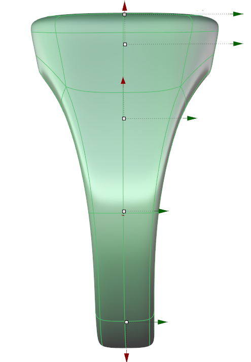
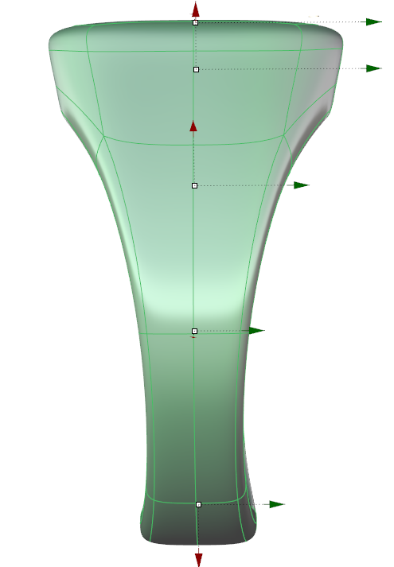
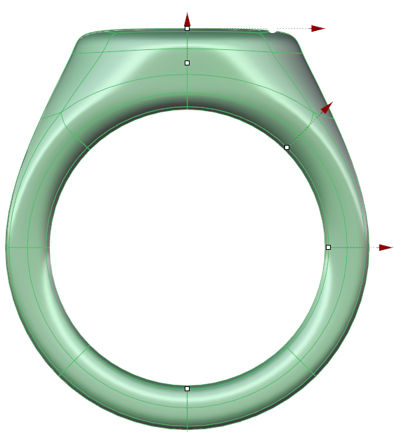
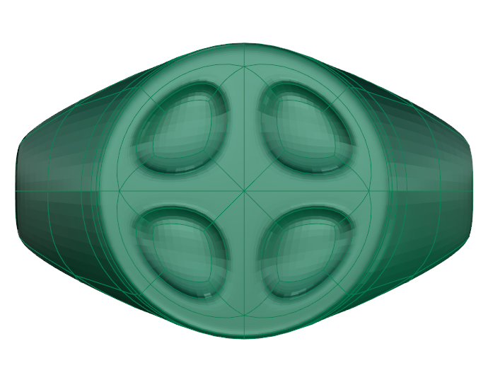
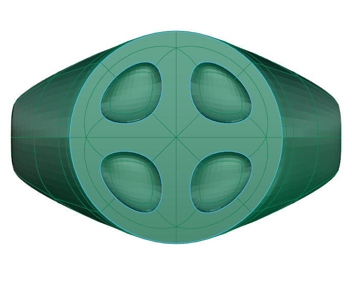

# Uncrease Edges

- Source PDF: Matrix 9 User Manual Addendum (matrix9.0_addendum.pdf)
- Page range: 27-27
- Section title: Uncrease Edges
- Section id: m9addendum-022-uncrease-edges
- Note: boundary page(s) are shared with a neighbouring section (two-column layout); text/images may include neighbour content.

---
<!-- section m9addendum-022-uncrease-edges | Uncrease Edges | m9addendum pages 27-27 -->

<!-- page 27 -->

### Options:
CreaseEdges All/OnlyBorders: When All
is selected, each edge of the faces selec-
ted will be creased. When OnlyBorders is
selected only the outer most edges of the
faces selected will be creased.
Note: These options only appear when multiple
faces have been selected.
Figure 1: Bottom Width=4 Figure 2: Bottom Width=6
### Uncrease Edges
'ClayUncrease'
Removes creases from edges.
Bottom Thickness: Controls the height of
the bottom of the ring. Adjust in the
builder by running the slider, or typing a
value in the input box on the left. The Top
Height can also be adjusted dynamically
using the corresponding Viewport Control
Handle (green arrow). Click and drag the
arrow to adjust the dimension.
Where is this Command:
Access this command from SubD >Un-
crease Edges
Steps:
Select edges or faces to uncrease.
Select Uncrease Edges from the
Clayoo toolbar.
Figure 1: Bottom Thickness=2 Figure 2: Bottom Thickness= 3
### Crease Edges
'ClayCrease'
Adds sharp edges to a Clayoo surface.
Figure 1: Surface creased edges Figure 2: Surface after run-
ning the Uncrease command.
Where is this Command:
Access this command from SubD > Crease
Note: When a face is selected all of the face's edges
Steps:
are uncreased.
Select Clayoo edges or faces.
Select Crease from the Clayoo tool-
bar.
### Clayoo Project to Plane
'ClayProjectToPlane'
Projects to a plane any selected geometry,
either by faces, vertices, edges or the
whole object. Many commands benefit
from having contiguous points or edges;
this command is often used to this end.
Access this command from SubD >Project
to Plane
Figure 1: Surface Uncreased edges Figure 2: Surface after
running the crease command.
Steps:
- 21 -

---

## Images

-  page 27 (shared page)
-  page 27 (shared page)
-  page 27 (shared page)
-  page 27 (shared page)
-  page 27 (shared page)
-  page 27 (shared page)
