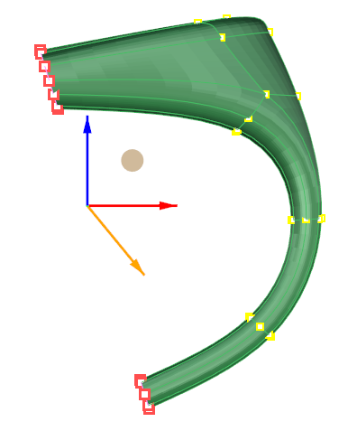
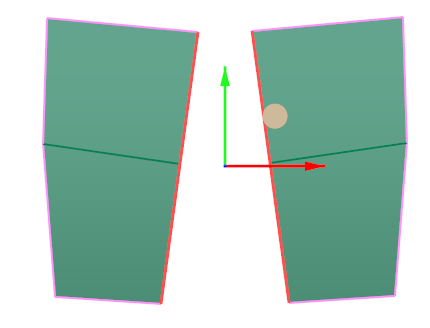
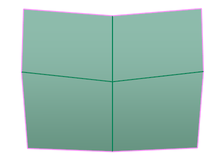
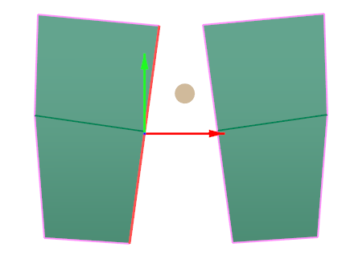
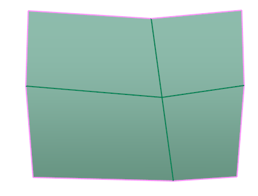
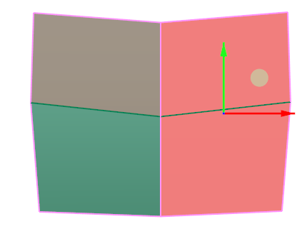
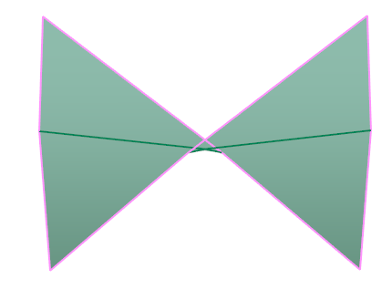
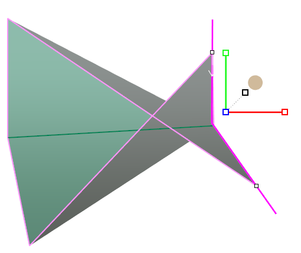
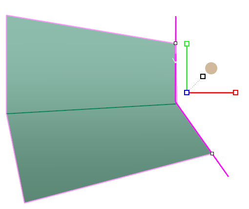
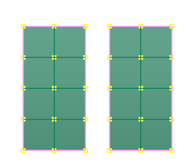

# Match

- Source PDF: Matrix 9 User Manual Addendum (matrix9.0_addendum.pdf)
- Page range: 28-30
- Section title: Match
- Section id: m9addendum-025-match
- Note: boundary page(s) are shared with a neighbouring section (two-column layout); text/images may include neighbour content.

---
<!-- section m9addendum-025-match | Match | m9addendum pages 28-30 -->

<!-- page 28 -->

Figure 1: User defined plane Figure 2: Points Projected to
plane.
Dynamic: Use to create a plane parallel to
an existing surface.
Dynamic Steps:
Select the geometry to be projected
to a plane (either vertices, edges,
faces or object).
Select Project to Plane from the
Clayoo toolbar.
Select the plane to project the geo-
metry to.
Cursor will change to a plane.
Pick a point to define the location of
the plane. If the cursor is on an exist-
ing surface the plane will be parallel
to that surface.
### Collapse
'ClayCollapse'
This tool joins all vertices of the selected
geometry in the center of the selection. It
works with faces, vertices and edges.
### Options:
Where is this Command:
Cplane: Projects the selected geometry to
the active construction plane.
Access this command from SubD > Col-
lapse
Steps:
XY: Projects the selected geometry to the
XY construction plane, indicated in blue.
Select by clicking on the blue plane or
selecting XY from the command line.
Select Collapse from the Clayoo
toolbar.
Select the vertices to Collapse.
Press Enter when done.
YZ: Projects the selected geometry to the
YZ construction plane, indicated in red.
Select by clicking on the red plane or
selecting YZ from the command line.
ZX: Projects the selected geometry to the
ZX construction plane, indicated in green.
Select by clicking on the green plane or
selecting ZX from the command line.
SetPlaneByLine: Projects the selected geo-
metry to a user defined line.
Set Plane by Line Steps:
Figure 1: Selection of verts Figures 2: Collapsed verts
Pick the fist point for line.
Pick the second point for line.
### Match
'ClayMatch'
The Match command can be used to con-
nect Clayoo surfaces to other Clayoo sur-
faces or Clayoo edges to a target curve.
Where is this Command:
Access this command from SubD>Match
The Match command's default options
change based on the order of operation.
Both approaches are outlined below. The
options can always be changed in the com-
- 22 -

<!-- page 29 -->

Figure 1: Edges Match and then weld. Figure 2: Edges Match
without welding.
mand line regardless of the order in which
the edges were selected.
Match Average Steps:
Average=Yes/No: When set to Yes selec-
ted edges will move towards each other.
When set to No the first selected set of
edges moves towards the second.
Select the Match command from
SubD menu.
Select edges to match to one
another (hold Shift to select multiple
edges).
Press Enter when done.
Figure 1: Average=Yes Figure 2: Average=No
Figure 1: Original Selection Figure 2: Match Result
Align: Changes the orientation of the sur-
faces to one another. Toggle the option if
the Match command results in a twisted
surface.
Match Edges to a Curve or Another set of
Edges Steps:
Figure 1: Twisted surface Figure 2: Surface after Align
### Match to Curve Options:
These options only appear when a curve is
selected as a target.
Select the Match command from
SubD menu.
Select the edges or edges you wish
to match to either a curve or edge
(s). This first selection will move
towards the second.
Press Enter
Select the Target Edges or Curve.
This is what the first selection will
move to.
Press Enter when done.
Flip: If the match command results in a
twisted surface flip the direction to rem-
edy.
Figure 1: Original Selection Figure 2: Match Result
Figure 1: Flipped surface Figure 2: Surface after running Flip
### Options:
Domain 1: Controls the point along the
curve where the Match starts. Type a value
between 0 and 1 (zero being the start of
the curve and 1 being the end) or by drag-
gin the white points along the curve.
Domain 1 defaults to 0.
Weld=Yes/No: When set to Yes upon
matching the surface edges the vertices
are welded together creating a single
Clayoo surface. When set to No vertices
remain unwelded and therefore two dis-
tinct Clayoo surfaces.
Domain 2: Controls the point along the
curve where the Match starts. Type a value
between 0 and 1 (zero being the start of
the curve and 1 being the end) or by drag-
gin the white points along the curve .Do-
main 2 defaults to 1.

<!-- page 30 -->

Figure 1: Domain 1=0 Domain 2=1 Figure 2: Domain 1=.15
First Vert moves to the second.
Domain 2=.85
### Options:
### Weld
Average=Yes/No: When this option is set
to Yes vertices move to the average
(middle) or the selected verts. When set to
no the first vert that is selected will move
to the second.
The Weld command is used to connect
Clayoo surfaces to one another, or back to
themselves. Weld connects vertices or
points to each other in a Clayoo surface.
The order of the selection affects the
defaults of the command.
Weld=Yes/No: When this option is set to
yeas vertices are welded after they are
matched. Set to No the verts will remain
unwelded.
Where is this Command:
Access this command from SubD>Weld
Tolerance: Sets the maximum distance
apart verts can be to be matched and wel-
ded.
### Clayoo Symmetry
'ClaySymmetry'
Note: If two points are preselected, the
Weld command will average the distances
between them. If the points are selected
after the command is run, the first point
will be moved to the position of the
second point.
Steps:
Applies symmetry (mirroring) along the X,
Y, or Z axis (axial) to a Clayoo surface.
You can discover existing Symmetry on a
complete model, or add new Symmetry to
a complete a partial model.
Select points (Verts) to Weld.
Select the Weld command in the T-
Spline menu.
Where is this Command:
Access this command from SubD>Sym-
metry
Symmetry By Plane Steps:
Both Verts are joined and meet in the middle
Select Symmetry from the Clayoo
menu
Select the Clayoo object.
Select Plane from the command line.
Pick two points to define symmetry
plane.
Click on the Weld command in the
T-Spline menu.
Click on the first Vert. Press Enter.
Click on the second Vert. Press
enter.
- 24 -

---

## Images

-  page 28 (shared page)
-  page 28 (shared page)
-  page 28 (shared page)
-  page 28 (shared page)
-  page 28 (shared page)
-  page 29
-  page 29
-  page 29
-  page 29
-  page 29
-  page 29
-  page 29
-  page 29
-  page 30 (shared page)
-  page 30 (shared page)
-  page 30 (shared page)
-  page 30 (shared page)
-  page 30 (shared page)
