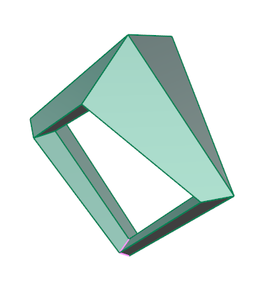
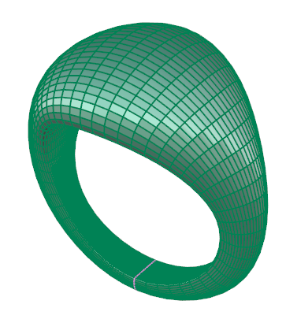
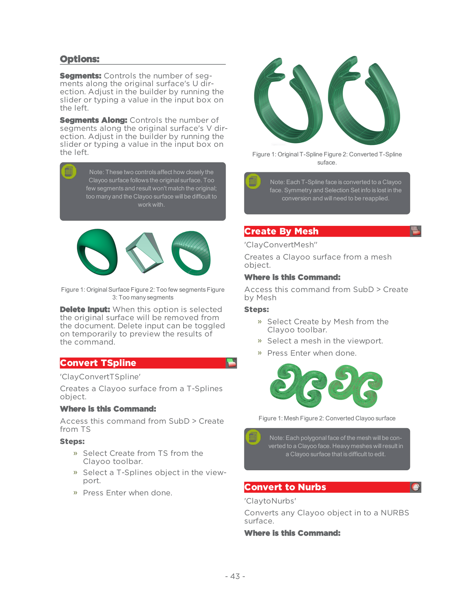
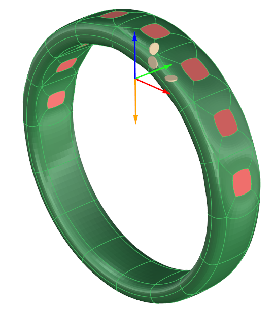

# Convert to Nurbs

- Source PDF: Matrix 9 User Manual Addendum (matrix9.0_addendum.pdf)
- Page range: 49-50
- Section title: Convert to Nurbs
- Section id: m9addendum-047-convert-to-nurbs
- Note: boundary page(s) are shared with a neighbouring section (two-column layout); text/images may include neighbour content.

---
<!-- section m9addendum-047-convert-to-nurbs | Convert to Nurbs | m9addendum pages 49-50 -->

<!-- page 49 -->

### Options:
Segments: Controls the number of seg-
ments along the original surface's U dir-
ection. Adjust in the builder by running the
slider or typing a value in the input box on
the left.
Segments Along: Controls the number of
segments along the original surface's V dir-
ection. Adjust in the builder by running the
slider or typing a value in the input box on
the left.
Figure 1: Original T-Spline Figure 2: Converted T-Spline
suface.
Note: Each T-Spline face is converted to a Clayoo
face. Symmetry and Selection Set info is lost in the
Note: These two controls affect how closely the
Clayoo surface follows the original surface. Too
few segments and result won't match the original;
too many and the Clayoo surface will be difficult to
conversion and will need to be reapplied.
work with.
### Create By Mesh
'ClayConvertMesh''
Creates a Clayoo surface from a mesh
object.
Where is this Command:
Figure 1: Original Surface Figure 2: Too few segments Figure
3: Too many segments
Access this command from SubD > Create
by Mesh
Steps:
Select Create by Mesh from the
Clayoo toolbar.
Select a mesh in the viewport.
Delete Input: When this option is selected
the original surface will be removed from
the document. Delete input can be toggled
on temporarily to preview the results of
the command.
Press Enter when done.
### Convert TSpline
'ClayConvertTSpline'
Creates a Clayoo surface from a T-Splines
object.
Where is this Command:
Figure 1: Mesh Figure 2: Converted Clayoo surface
Access this command from SubD > Create
from TS
Steps:
Note: Each polygonal face of the mesh will be con-
verted to a Clayoo face. Heavy meshes will result in
a Clayoo surface that is difficult to edit.
Select Create from TS from the
Clayoo toolbar.
Select a T-Splines object in the view-
port.
### Convert to Nurbs
Press Enter when done.
'ClaytoNurbs'
Converts any Clayoo object in to a NURBS
surface.
Where is this Command:

<!-- page 50 -->

Access this command from
SubD> Convert to Nurbs
An additional empty selection set
will be created after the first is recor-
ded.
Steps:
Select Convert to NURBS from the
Clayoo menu.
Select Clayoo object(s) to convert.
Press Enter when done.
Select to either keep or delete the
original Clayoo surface from the pop
up window.
Loading a Saved Selection Steps:
Click on the Play button (green tri-
angle)
The recorded selection will be
loaded.
Figure 1: Clayoo Surface Figure 2: Poly Surface after con-
version
### Options:
Delete Original Object Yes/No: When Yes
is selected the original Clayoo object will
be deleted after the command is com-
pleted. If No is selected the Clayoo sur-
face will remain.
### Clayoo Sets
'ClaySets'
### Options:
Saves selection groups of vertices, edges,
faces or Clayoo objects.
Where is this Command:
Access this command from SubD > Sets
Record: Save a selection. With the
desired Clayoo groups selected, press the
record button. A new selection group will
be saved.
Saving Selection Steps:
Play: Loads the saved selection.
Set Name: Text box in which a name for
selection set can be typed.
Delete: Deletes the selection set.
Note: Clayoo Sets do not save to the document.
Click on Sets from the Clayoo tool-
bar
The Clayoo Sets dialog will open.
Select a group of vertices, edges,
faces or Clayoo objects.
Click on the 'Record' button (red
circle) in the Clayoo Sets dialog
box.
Enter a set name in the text box to
the right of the Play button (Green tri-
angle) if desired.
- 44 -

---

## Images

-  page 49 (shared page)
-  page 49 (shared page)
-  page 49 (shared page)
-  page 49 (shared page)
-  page 49 (shared page)
-  page 49 (shared page)
-  page 49 (shared page)
-  page 49 (shared page)
-  page 50 (shared page)
-  page 50 (shared page)
-  page 50 (shared page)
-  page 50 (shared page)
-  page 50 (shared page)
