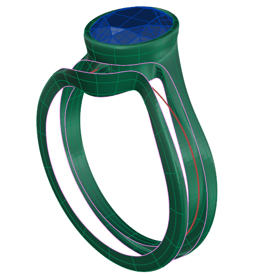
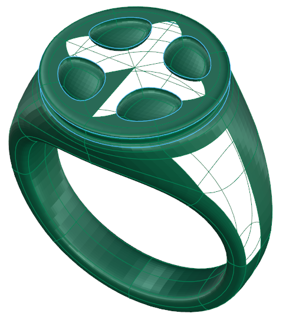
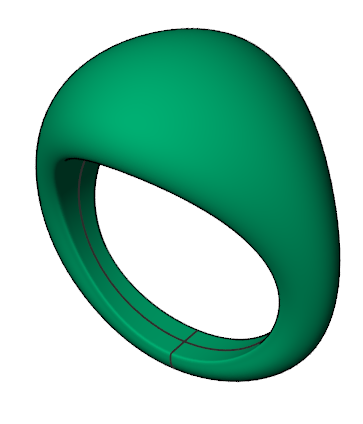
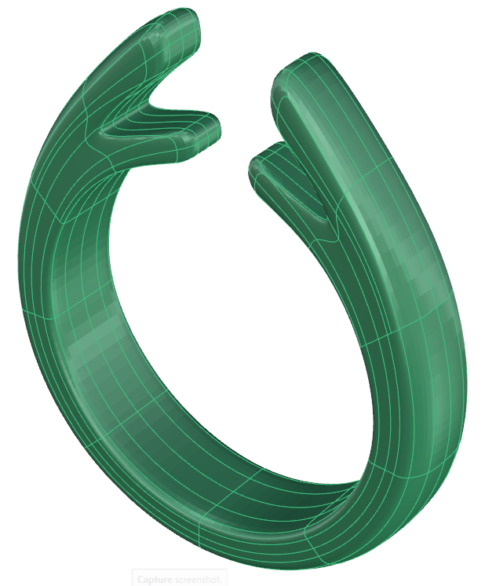
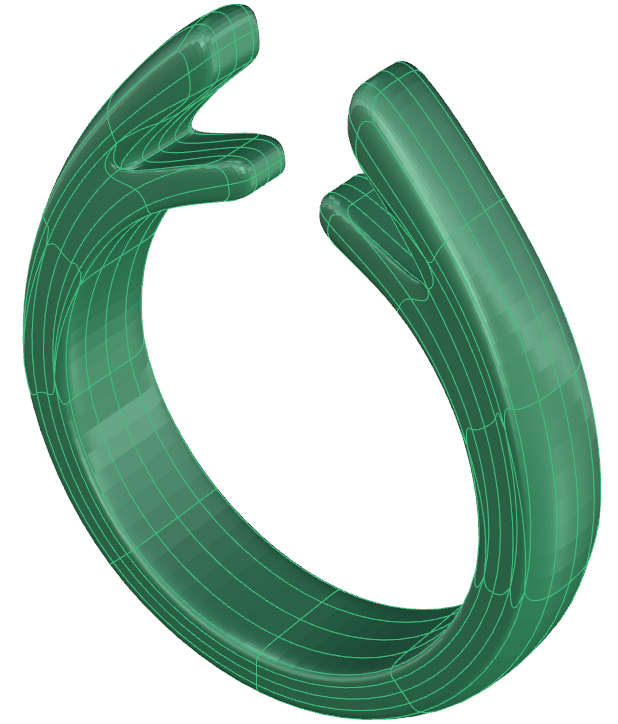
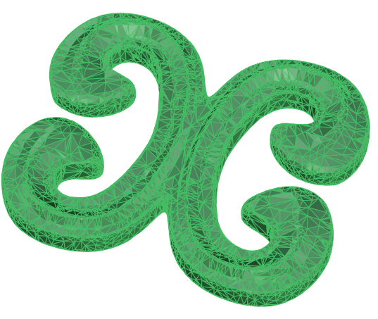
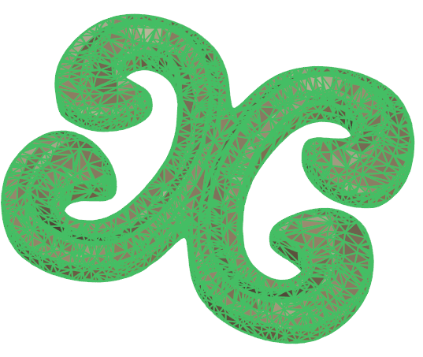

# Convert Surfaces

- Source PDF: Matrix 9 User Manual Addendum (matrix9.0_addendum.pdf)
- Page range: 48-49
- Section title: Convert Surfaces
- Section id: m9addendum-044-convert-surfaces
- Note: boundary page(s) are shared with a neighbouring section (two-column layout); text/images may include neighbour content.

---
<!-- section m9addendum-044-convert-surfaces | Convert Surfaces | m9addendum pages 48-49 -->

<!-- page 48 -->

Either duplicate existing Clayoo faces or
remove Clayoo faces from an existing
Clayoo model.
Where is this Command:
Access this command from SubD>Extract
Steps:
Figure 1: Surface with Flipped Normals Figure 2: Surface after
Select Clayoo Faces to be Extrac-
ted.
Select Extract from the Clayoo tool-
bar.
running the flip normals command.
Note: Surface normals will sometimes flip when
manipulating a Clayoo surface. All surfaces nor-
mals should be facing out prior to converting into an
NURBS object.
Unify Normals Steps:
Figure 1: Extract Surface selection Figure 2: Extract Surface
result (faces moved to illustrate extraction)
Select the Clayoo surface to have
the normals unified.
Select Unify Normals from the
Clayoo toolbar.
### Options:
Copy Yes/No: With copy Yes selected this
command will duplicate the selected
Clayoo faces in place. When copy is set to
No the selected Clayoo faces are extrac-
ted from the Clayoo object without mak-
ing a copy.
### Clayoo Flip Normals
'ClayFlip'
Figure 1: Surface with Flipped Normals Figure 2: Surface after
running the Unify normals command.
Changes the normal direction of a Clayoo
surface. Use when a Clayoo surface has
turned itself inside out.
### Convert Surfaces
Where is this Command:
Access this command from SubD > Flip
Creates a Clayoo surface based on a sur-
face or polysurface.
Right Click command: Unify Normals
'ClayConvertSurface''
Makes sure that all face normals on a
Clayoo surface point the same direction.
Where is this Command:
Steps:
Access this command from SubD>Create
By Surfaces
Steps:
Select the faces or surfaces to flip
their normals.
Select Flip Normals from the Clayoo
toolbar.
Select a surface or polysurface in
the viewport.
Click on the Create by Surfaces com-
mand.
- 42 -

<!-- page 49 -->

### Options:
Segments: Controls the number of seg-
ments along the original surface's U dir-
ection. Adjust in the builder by running the
slider or typing a value in the input box on
the left.
Segments Along: Controls the number of
segments along the original surface's V dir-
ection. Adjust in the builder by running the
slider or typing a value in the input box on
the left.
Figure 1: Original T-Spline Figure 2: Converted T-Spline
suface.
Note: Each T-Spline face is converted to a Clayoo
face. Symmetry and Selection Set info is lost in the
Note: These two controls affect how closely the
Clayoo surface follows the original surface. Too
few segments and result won't match the original;
too many and the Clayoo surface will be difficult to
conversion and will need to be reapplied.
work with.
### Create By Mesh
'ClayConvertMesh''
Creates a Clayoo surface from a mesh
object.
Where is this Command:
Figure 1: Original Surface Figure 2: Too few segments Figure
3: Too many segments
Access this command from SubD > Create
by Mesh
Steps:
Select Create by Mesh from the
Clayoo toolbar.
Select a mesh in the viewport.
Delete Input: When this option is selected
the original surface will be removed from
the document. Delete input can be toggled
on temporarily to preview the results of
the command.
Press Enter when done.
### Convert TSpline
'ClayConvertTSpline'
Creates a Clayoo surface from a T-Splines
object.
Where is this Command:
Figure 1: Mesh Figure 2: Converted Clayoo surface
Access this command from SubD > Create
from TS
Steps:
Note: Each polygonal face of the mesh will be con-
verted to a Clayoo face. Heavy meshes will result in
a Clayoo surface that is difficult to edit.
Select Create from TS from the
Clayoo toolbar.
Select a T-Splines object in the view-
port.
### Convert to Nurbs
Press Enter when done.
'ClaytoNurbs'
Converts any Clayoo object in to a NURBS
surface.
Where is this Command:

---

## Images

-  page 48 (shared page)
-  page 48 (shared page)
-  page 48 (shared page)
-  page 48 (shared page)
-  page 48 (shared page)
-  page 49 (shared page)
-  page 49 (shared page)
-  page 49 (shared page)
-  page 49 (shared page)
-  page 49 (shared page)
-  page 49 (shared page)
-  page 49 (shared page)
-  page 49 (shared page)
