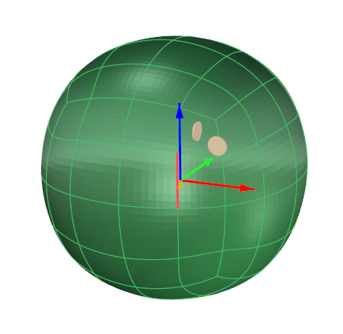
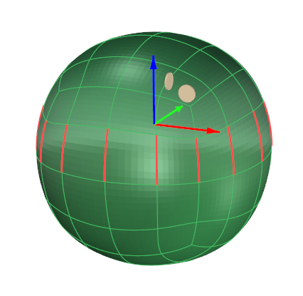
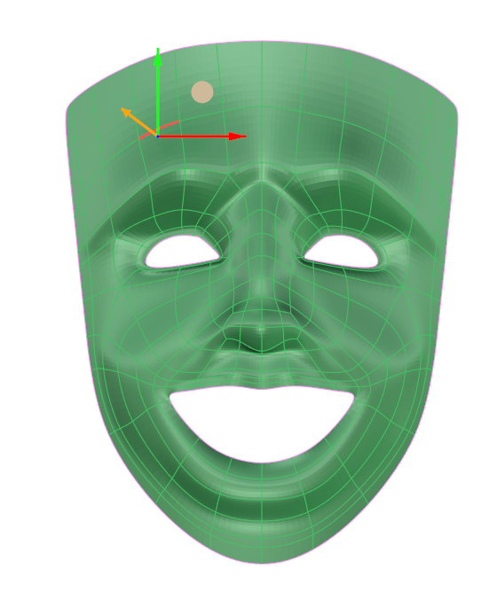
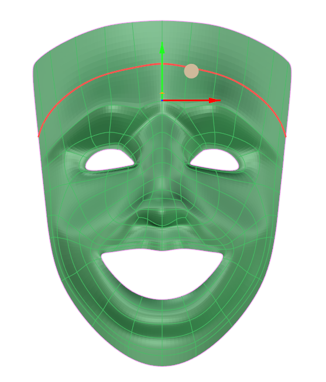
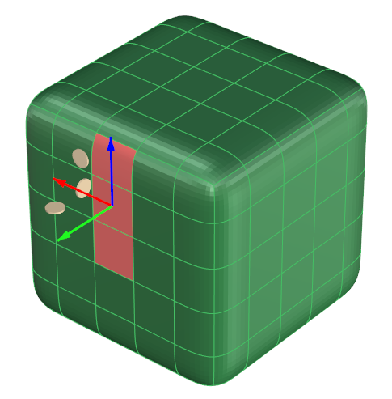
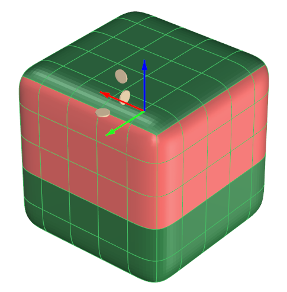
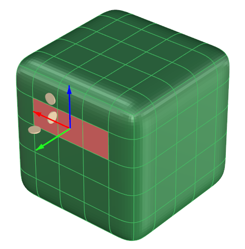
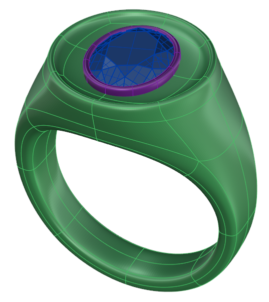

# Select V

- Source PDF: Matrix 9 User Manual Addendum (matrix9.0_addendum.pdf)
- Page range: 51-52
- Section title: Select V
- Section id: m9addendum-052-select-v
- Note: boundary page(s) are shared with a neighbouring section (two-column layout); text/images may include neighbour content.

---
<!-- section m9addendum-052-select-v | Select V | m9addendum pages 51-52 -->

<!-- page 51 -->

### Clayoo Ring Selection
'ClaySelectRingEdges'
Ring Select, like Loop Select makes select-
ing groups of edges easier. Ring Select
selects edges that are parallel to one
another as opposed to continuous edges.
Where is this Command:
Access this command from SubD > Select
ring edges
Figure 1: Original Selection Figure 2: Selection after running
Steps:
the Loop Select command.
### Select U
Select an edge on a Clayoo surface.
Select 'Ring Selection' from the
Clayoo toolbar.
'ClaySelectUV'
Selects all contiguous faces in the U dir-
ection from the current selection.
Where is this Command:
SubD>Select U
Steps:
Figure 1: Original Selection Figure 2: Selection after running
Select a face or series of faces on a
Clayoo surface.
Select 'Select U' from the Clayoo
menu.
the Ring Select command.
### Clayoo Loop Selection
'ClaySelectEdgeLoop'
With one edge selected this command will
select the entire, continuous loop of
edges.
Where is this Command:
Figure 1: Original Selection Figure 2: Selection after running
Access this command from SubD > Loop
Selection
the Select U command.
Steps:
### Select V
'ClaySelectUV'
Select an edge on a Clayoo surface.
Select 'Loop Selection' from the
Clayoo menu.
Selects all contiguous faces in the V dir-
ection from the current selection.
Or, with an edge selected double-
click on the selected edge.
Where is this Command:
SubD>Select V
Steps:
Select a face or series of faces on a
Clayoo surface.
Select 'Select V' from the Clayoo
menu.

<!-- page 52 -->

Vertex selection mode:
Figure 1: Original Selection Figure 2: Selection after running
Select all vertices of all objects in the doc-
ument.
the Select V command.
### Clayoo Select All
'ClaySelectAll'
Selects all Clayoo objects in the viewport.
Selects vertices, edges, faces or objects
based on the active selection mode.
Where is this Command:
Note: This command ignores hidden objects.
Access this command from Clayoo >
SubD > Selection > Select All
Steps:
### Clayoo Select None
Select 'Select All' from the Clayoo
toolbar.
'ClaySelectNone'
Object selection mode:
Select all objects in the document.
Deselects all Clayoo objects in the view-
port.
Where is this Command:
Access this command from SubD > Select
None
Steps:
Select 'Select None' from the Clayoo toolbar.
Faces selection mode:
Select all faces of all objects in the doc-
ument.
Figure 1: All Clayoo objects selected Figure 2: All Clayoo
objects deselected
Note: This command ignores hidden objects.
Edges selection mode:
### Clayoo Paint Selection
Select all edges of all objects in the doc-
ument.
'ClayPaintSelection'
- 46 -

---

## Images

-  page 51 (shared page)
-  page 51 (shared page)
-  page 51 (shared page)
-  page 51 (shared page)
-  page 51 (shared page)
-  page 51 (shared page)
-  page 52 (shared page)
-  page 52 (shared page)
-  page 52 (shared page)
-  page 52 (shared page)
-  page 52 (shared page)
-  page 52 (shared page)
-  page 52 (shared page)
