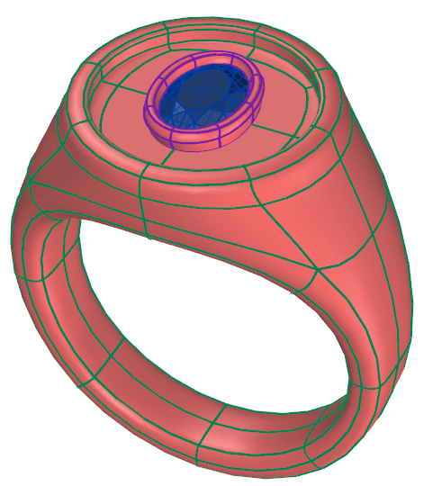

# Clayoo Select None

- Source PDF: Matrix 9 User Manual Addendum (matrix9.0_addendum.pdf)
- Page range: 52-52
- Section title: Clayoo Select None
- Section id: m9addendum-054-clayoo-select-none
- Note: boundary page(s) are shared with a neighbouring section (two-column layout); text/images may include neighbour content.

---
<!-- section m9addendum-054-clayoo-select-none | Clayoo Select None | m9addendum pages 52-52 -->

<!-- page 52 -->

Vertex selection mode:
Figure 1: Original Selection Figure 2: Selection after running
Select all vertices of all objects in the doc-
ument.
the Select V command.
### Clayoo Select All
'ClaySelectAll'
Selects all Clayoo objects in the viewport.
Selects vertices, edges, faces or objects
based on the active selection mode.
Where is this Command:
Note: This command ignores hidden objects.
Access this command from Clayoo >
SubD > Selection > Select All
Steps:
### Clayoo Select None
Select 'Select All' from the Clayoo
toolbar.
'ClaySelectNone'
Object selection mode:
Select all objects in the document.
Deselects all Clayoo objects in the view-
port.
Where is this Command:
Access this command from SubD > Select
None
Steps:
Select 'Select None' from the Clayoo toolbar.
Faces selection mode:
Select all faces of all objects in the doc-
ument.
Figure 1: All Clayoo objects selected Figure 2: All Clayoo
objects deselected
Note: This command ignores hidden objects.
Edges selection mode:
### Clayoo Paint Selection
Select all edges of all objects in the doc-
ument.
'ClayPaintSelection'
- 46 -

---

## Images

-  page 52 (shared page)
-  page 52 (shared page)
-  page 52 (shared page)
-  page 52 (shared page)
-  page 52 (shared page)
-  page 52 (shared page)
-  page 52 (shared page)
