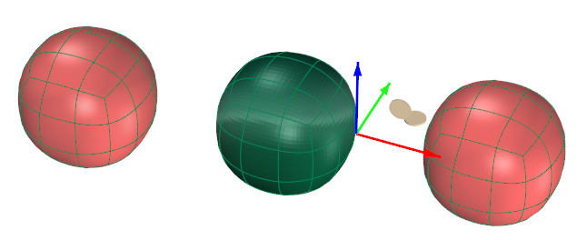
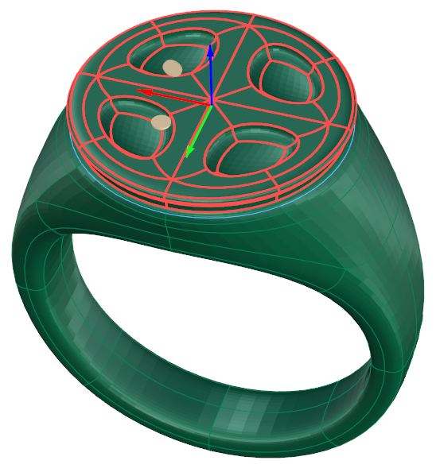

# Clayoo Invert

- Source PDF: Matrix 9 User Manual Addendum (matrix9.0_addendum.pdf)
- Page range: 53-54
- Section title: Clayoo Invert
- Section id: m9addendum-058-clayoo-invert
- Note: boundary page(s) are shared with a neighbouring section (two-column layout); text/images may include neighbour content.

---
<!-- section m9addendum-058-clayoo-invert | Clayoo Invert | m9addendum pages 53-54 -->

<!-- page 53 -->

Select 'Selection Grow' from the
Clayoo menu.
Allows you to add geometry to the selec-
tion by simply clicking and dragging the
cursor across them. Paint Selection works
with any of the selection modes.
Where is this Command:
Access this command from SubD > Paint
Selection
Steps:
Figure 1: Original Selection Figure 2: Selection after Selection
Grow.
Select 'Paint Selection' from the
Clayoo toolbar.
Hold down the left mouse button
and move the cursor over objects to
select.
Release the left mouse button to end
the command.
### Clayoo Selection Shrink
'ClaySelectionShrink'
Decrease the size of your selection by one
in each direction. This works with faces,
edges or vertices.
Where is this Command:
Access this command from SubD > Selec-
tion Shrink
Steps:
Select either faces, edges or vertices
on a Clayoo surface.
Select 'Selection Shrink' from the
Clayoo menu.
Paint selection by clicking and dragging the cursor over geo-
metry.
Note: Hold down CRTL to remove objects from the
selection.
### Clayoo Selection Grow
'ClaySelectionGrow'
Figure 1: Original Selection Figure 2: Selection after Selection
Shrink.
Increases the size of your selection by one
in each direction. This works with faces,
edges or vertices.
### Clayoo Invert
Where is this Command:
'ClayInvert'
Access this command from Clayoo >
Selection Grow
Inverts the current selection. The result
depends on the selection mode.
Steps:
Where is this Command:
Access this Command from SubD > Invert
Select either faces, edges or vertices
on a Clayoo surface.
Steps:
- 47 -

<!-- page 54 -->

Select 'Select Invert' from the
Clayoo toolbar.
The current selection is inverted
based on the active selection mode.
Object selection mode:
Invert the selection of all objects in the
document. Those selected are deselected,
and unselected are selected.
Vertex selection mode:
Invert the selection of the vertices of all
objects in the document.
Figure 1: Original Selection (Object selection mode)
Note: This command ignores hidden objects.
Figure 2: Selection after running the Invert selection com-
### Clayoo Select Crease Edges
mand.
'ClaySelectCrease"
Faces selection mode:
Invert the selection of the faces of all
objects in the document.
Selects creased edges in the viewport. If
no edges are selected, all creased edges
in the viewport will be selected. If an edge
or edges are selected, only edges con-
tiguous to the selected edges will be selec-
ted.
Where is this Command:
Access this command from SubD > Selec-
tion Crease
Steps:
Figure 1: Original Selection Figure 2: Selection after running
theInvert Selection command.
Edges selection mode:
Select 'Select Crease Edges' from
the Clayoo toolbar.
Results will vary depending on if
edges were already selected when
the command was run. See the
example below.
Invert the selection of the edges of all
objects in the document.

---

## Images

-  page 53 (shared page)
-  page 53 (shared page)
-  page 53 (shared page)
-  page 54 (shared page)
-  page 54 (shared page)
-  page 54 (shared page)
-  page 54 (shared page)
-  page 54 (shared page)
-  page 54 (shared page)
-  page 54 (shared page)
-  page 54 (shared page)
