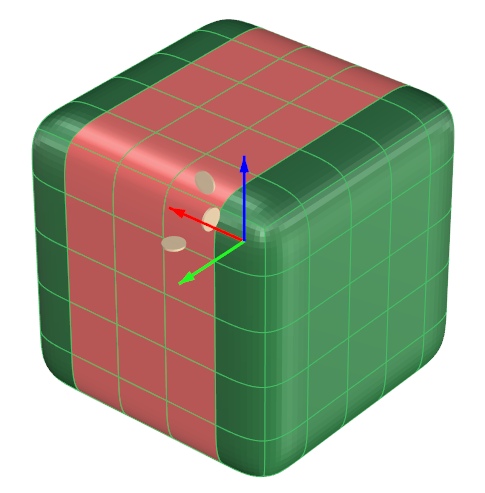
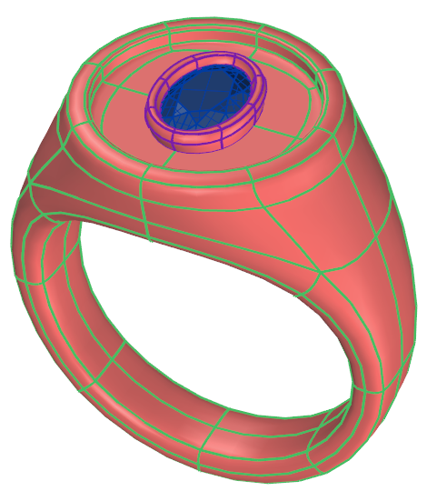
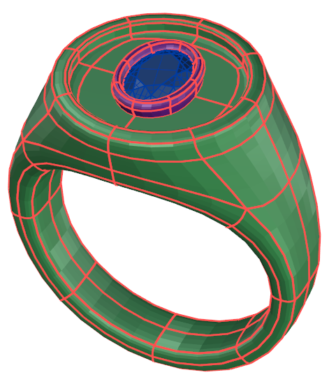
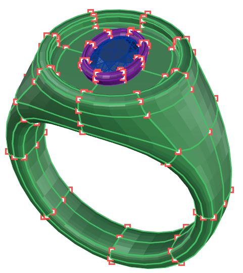
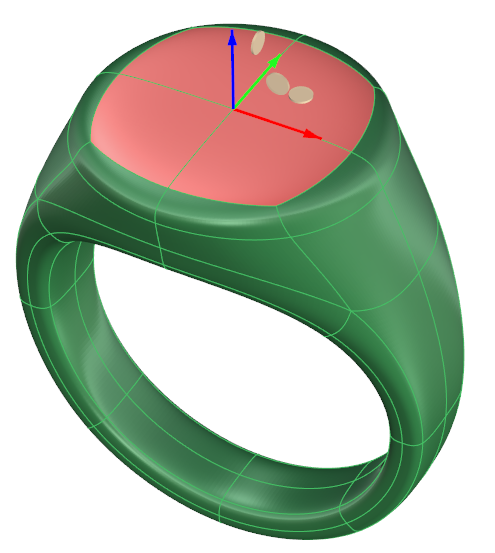

# Clayoo Paint Selection

- Source PDF: Matrix 9 User Manual Addendum (matrix9.0_addendum.pdf)
- Page range: 52-53
- Section title: Clayoo Paint Selection
- Section id: m9addendum-055-clayoo-paint-selection
- Note: boundary page(s) are shared with a neighbouring section (two-column layout); text/images may include neighbour content.

---
<!-- section m9addendum-055-clayoo-paint-selection | Clayoo Paint Selection | m9addendum pages 52-53 -->

<!-- page 52 -->

Vertex selection mode:
Figure 1: Original Selection Figure 2: Selection after running
Select all vertices of all objects in the doc-
ument.
the Select V command.
### Clayoo Select All
'ClaySelectAll'
Selects all Clayoo objects in the viewport.
Selects vertices, edges, faces or objects
based on the active selection mode.
Where is this Command:
Note: This command ignores hidden objects.
Access this command from Clayoo >
SubD > Selection > Select All
Steps:
### Clayoo Select None
Select 'Select All' from the Clayoo
toolbar.
'ClaySelectNone'
Object selection mode:
Select all objects in the document.
Deselects all Clayoo objects in the view-
port.
Where is this Command:
Access this command from SubD > Select
None
Steps:
Select 'Select None' from the Clayoo toolbar.
Faces selection mode:
Select all faces of all objects in the doc-
ument.
Figure 1: All Clayoo objects selected Figure 2: All Clayoo
objects deselected
Note: This command ignores hidden objects.
Edges selection mode:
### Clayoo Paint Selection
Select all edges of all objects in the doc-
ument.
'ClayPaintSelection'
- 46 -

<!-- page 53 -->

Select 'Selection Grow' from the
Clayoo menu.
Allows you to add geometry to the selec-
tion by simply clicking and dragging the
cursor across them. Paint Selection works
with any of the selection modes.
Where is this Command:
Access this command from SubD > Paint
Selection
Steps:
Figure 1: Original Selection Figure 2: Selection after Selection
Grow.
Select 'Paint Selection' from the
Clayoo toolbar.
Hold down the left mouse button
and move the cursor over objects to
select.
Release the left mouse button to end
the command.
### Clayoo Selection Shrink
'ClaySelectionShrink'
Decrease the size of your selection by one
in each direction. This works with faces,
edges or vertices.
Where is this Command:
Access this command from SubD > Selec-
tion Shrink
Steps:
Select either faces, edges or vertices
on a Clayoo surface.
Select 'Selection Shrink' from the
Clayoo menu.
Paint selection by clicking and dragging the cursor over geo-
metry.
Note: Hold down CRTL to remove objects from the
selection.
### Clayoo Selection Grow
'ClaySelectionGrow'
Figure 1: Original Selection Figure 2: Selection after Selection
Shrink.
Increases the size of your selection by one
in each direction. This works with faces,
edges or vertices.
### Clayoo Invert
Where is this Command:
'ClayInvert'
Access this command from Clayoo >
Selection Grow
Inverts the current selection. The result
depends on the selection mode.
Steps:
Where is this Command:
Access this Command from SubD > Invert
Select either faces, edges or vertices
on a Clayoo surface.
Steps:
- 47 -

---

## Images

-  page 52 (shared page)
-  page 52 (shared page)
-  page 52 (shared page)
-  page 52 (shared page)
-  page 52 (shared page)
-  page 52 (shared page)
-  page 52 (shared page)
-  page 53 (shared page)
-  page 53 (shared page)
-  page 53 (shared page)
