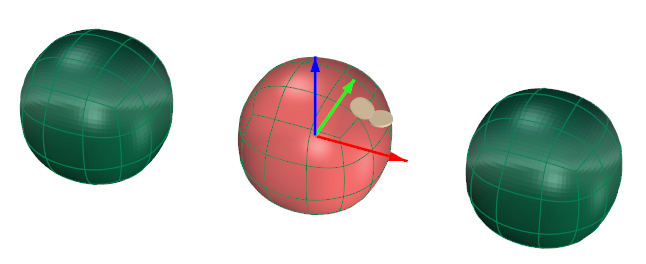
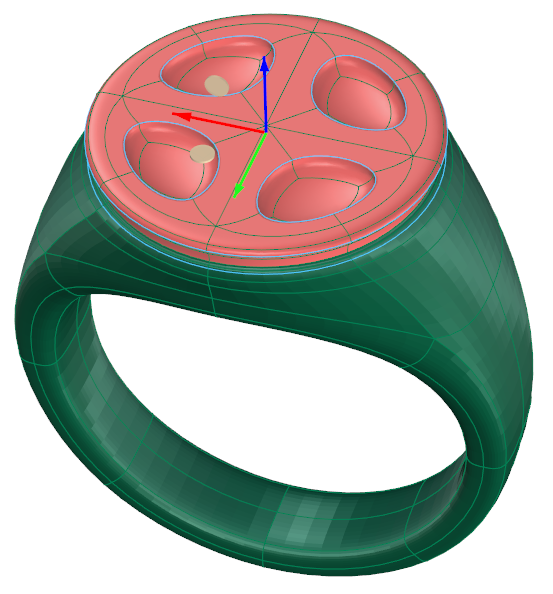
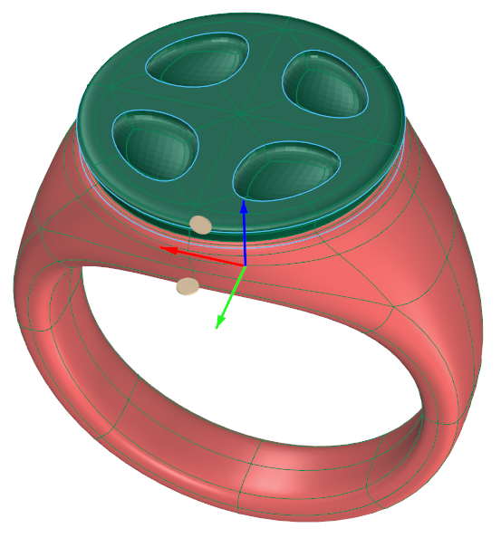
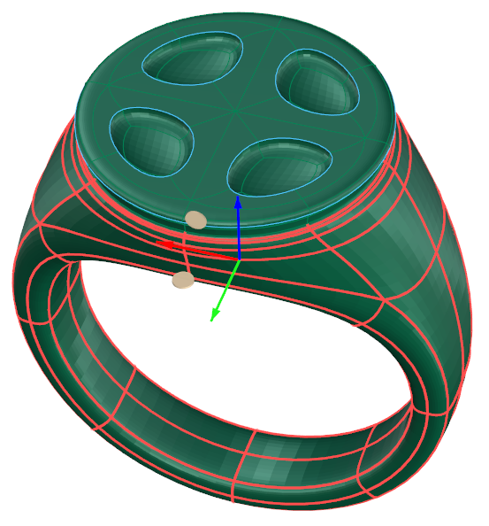
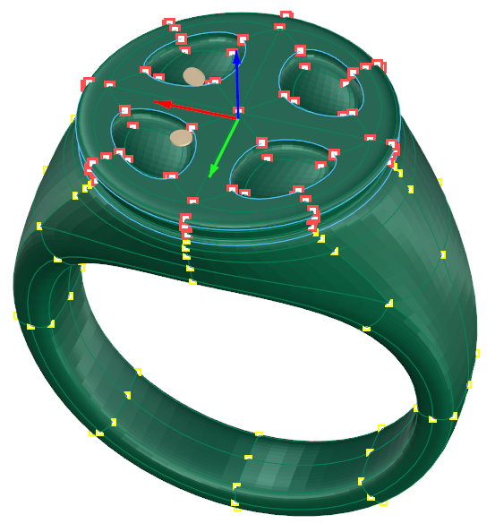
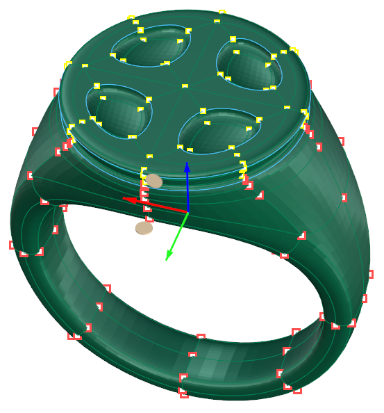

# Clayoo Select Crease Edges

- Source PDF: Matrix 9 User Manual Addendum (matrix9.0_addendum.pdf)
- Page range: 54-55
- Section title: Clayoo Select Crease Edges
- Section id: m9addendum-059-clayoo-select-crease-edges
- Note: boundary page(s) are shared with a neighbouring section (two-column layout); text/images may include neighbour content.

---
<!-- section m9addendum-059-clayoo-select-crease-edges | Clayoo Select Crease Edges | m9addendum pages 54-55 -->

<!-- page 54 -->

Select 'Select Invert' from the
Clayoo toolbar.
The current selection is inverted
based on the active selection mode.
Object selection mode:
Invert the selection of all objects in the
document. Those selected are deselected,
and unselected are selected.
Vertex selection mode:
Invert the selection of the vertices of all
objects in the document.
Figure 1: Original Selection (Object selection mode)
Note: This command ignores hidden objects.
Figure 2: Selection after running the Invert selection com-
### Clayoo Select Crease Edges
mand.
'ClaySelectCrease"
Faces selection mode:
Invert the selection of the faces of all
objects in the document.
Selects creased edges in the viewport. If
no edges are selected, all creased edges
in the viewport will be selected. If an edge
or edges are selected, only edges con-
tiguous to the selected edges will be selec-
ted.
Where is this Command:
Access this command from SubD > Selec-
tion Crease
Steps:
Figure 1: Original Selection Figure 2: Selection after running
theInvert Selection command.
Edges selection mode:
Select 'Select Crease Edges' from
the Clayoo toolbar.
Results will vary depending on if
edges were already selected when
the command was run. See the
example below.
Invert the selection of the edges of all
objects in the document.

<!-- page 55 -->

Figure 1: Original Selection Figure 2: Selection after running
the Select Uncreased Edges command.
### Clayoo Select Naked Edges
'ClaySelectNakedEdges'
Selects Naked Edges on Clayoo surfaces.
If no naked edges are selected all naked
edges in the viewport will be selected. If
some naked edges are selected only con-
tiguous edges will be selected.
Figure 1: Original Selection (no edges selected) Figure 2:
Selection after running the Select Creased Edges command.
Where is this Command:
Access this command from SubD > Select
Naked Edges
Steps:
Select 'Select Naked Edges' from
the Clayoo toolbar.
Results will vary depending on if
naked edges were already selected
when the command was run. See the
examples below.
Figure 1: Original Selection (single creased edge selected) Fig-
ure 2: Selection after running the Select Creased Edges com-
mand.
### Clayoo Select Uncrease Edges
'ClaySelectUncrease"
Selects uncreased edges in the viewport.
Where is this Command:
Access this command from SubD > Selec-
tion Uncrease
Steps:
Figure 1: Original Selection (no edge selected) Figure 2: Selec-
tion after running the Select Naked Edges command.
Select 'Select Uncrease Edges' from
the Clayoo toolbar.
Results will vary depending on if
edges were already selected when
the command was run. See the
examples below.
- 49 -

---

## Images

-  page 54 (shared page)
-  page 54 (shared page)
-  page 54 (shared page)
-  page 54 (shared page)
-  page 54 (shared page)
-  page 54 (shared page)
-  page 54 (shared page)
-  page 54 (shared page)
-  page 55 (shared page)
-  page 55 (shared page)
-  page 55 (shared page)
-  page 55 (shared page)
-  page 55 (shared page)
-  page 55 (shared page)
-  page 55 (shared page)
-  page 55 (shared page)
-  page 55 (shared page)
