# Clayoo Select Naked Edges

- Source PDF: Matrix 9 User Manual Addendum (matrix9.0_addendum.pdf)
- Page range: 55-56
- Section title: Clayoo Select Naked Edges
- Section id: m9addendum-061-clayoo-select-naked-edges
- Note: boundary page(s) are shared with a neighbouring section (two-column layout); text/images may include neighbour content.

---
<!-- section m9addendum-061-clayoo-select-naked-edges | Clayoo Select Naked Edges | m9addendum pages 55-56 -->

<!-- page 55 -->

Figure 1: Original Selection Figure 2: Selection after running
the Select Uncreased Edges command.
### Clayoo Select Naked Edges
'ClaySelectNakedEdges'
Selects Naked Edges on Clayoo surfaces.
If no naked edges are selected all naked
edges in the viewport will be selected. If
some naked edges are selected only con-
tiguous edges will be selected.
Figure 1: Original Selection (no edges selected) Figure 2:
Selection after running the Select Creased Edges command.
Where is this Command:
Access this command from SubD > Select
Naked Edges
Steps:
Select 'Select Naked Edges' from
the Clayoo toolbar.
Results will vary depending on if
naked edges were already selected
when the command was run. See the
examples below.
Figure 1: Original Selection (single creased edge selected) Fig-
ure 2: Selection after running the Select Creased Edges com-
mand.
### Clayoo Select Uncrease Edges
'ClaySelectUncrease"
Selects uncreased edges in the viewport.
Where is this Command:
Access this command from SubD > Selec-
tion Uncrease
Steps:
Figure 1: Original Selection (no edge selected) Figure 2: Selec-
tion after running the Select Naked Edges command.
Select 'Select Uncrease Edges' from
the Clayoo toolbar.
Results will vary depending on if
edges were already selected when
the command was run. See the
examples below.
- 49 -

<!-- page 56 -->

Figure 1: Original Selection Figure 2: Selection after running
the Select Naked Edges command.
Adjust SubDivision Level Per Object
Steps:
Select Clayoo objects.
### Select Coplanar
'ClaySelectCoplanar'
Selects geometry (faces, edges or ver-
tices) that share the same plane.
Select SubDivision Level from the
SubD menu.
Select Increase or Decrease from the
command line.
Where is this Command:
Note: Subdivision Level can be set from 1-5. The
default is 3. Use 1 or 2 for improved performance.
Access this command from SubD > Select
Coplanar
Using higher than 4 may result in reduced per-
formance on some systems.
Steps:
### Options:
Increase: Increases the subdivision level
by 1.
Select either a face, edge or vertex
on a Clayoo surface.
Select 'Select Coplanar' from the
Clayoo menu.
All faces/edges/vertices that are on
the same plane as the selected geo-
metry will be selected.
Decrease: Decreases the subdivision level
by 1.
SubDivision Level Default:
Set the Default SubDivision Level in the
Clayoo Options in the Rhino Option menu.
Figure 1: Original Selection Figure 2: Selection after Select
Coplanar
### Subdivision Level
Controls how accurately the Clayoo mesh
displays the object. Low Subdivision
Levels will improve performance but won't
display as smoothly on the screen. High
Subdivision Levels will display more
smoothly but may affect performance on
complicated designs.
### Clayoo Library
Where is this Command:
‘gvUserLibraryCustom’
Access this command from SubD>Su-
division Level
Adjust Global Subdivision Level Steps:
A wide variety of pre-built Clayoo designs
are available within the Clayoo Library.
Begin designing from one of the many
Starting Point Inventory models or add to
an existing design.
Where is this Command:
Select SubDivision Level from the
SubD menu.
Select Increase or Decrease from the
command line.
- 50 -

---

## Images

- 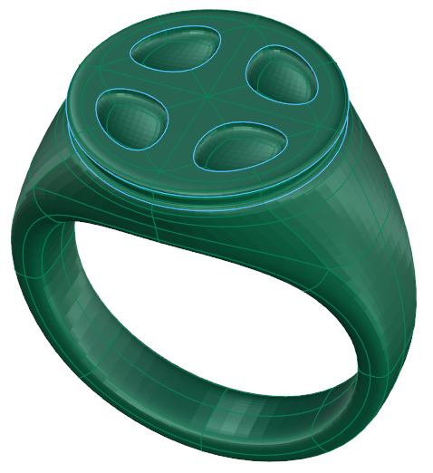 page 55 (shared page)
- 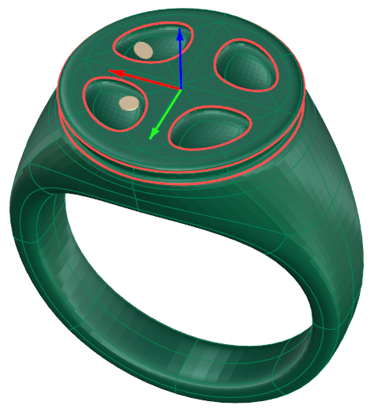 page 55 (shared page)
- 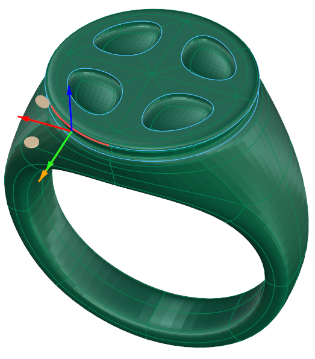 page 55 (shared page)
- 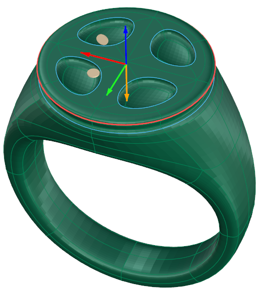 page 55 (shared page)
- 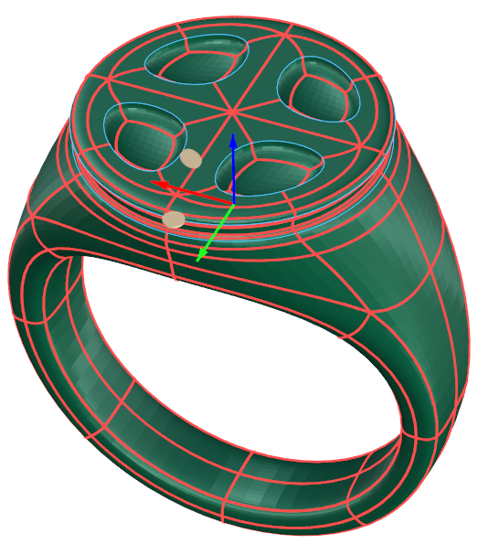 page 55 (shared page)
- 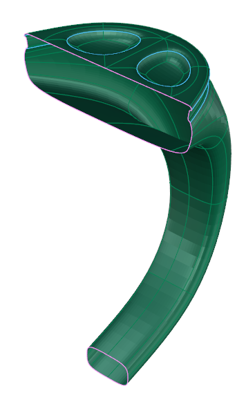 page 55 (shared page)
- 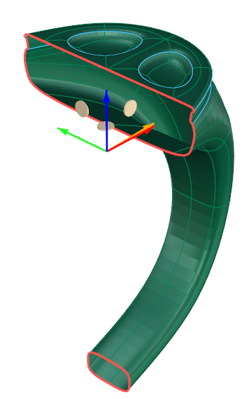 page 55 (shared page)
- 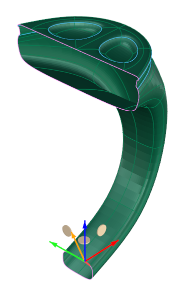 page 55 (shared page)
- 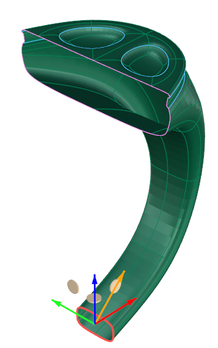 page 55 (shared page)
- 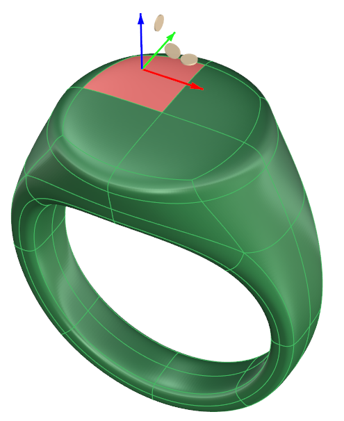 page 56 (shared page)
-  page 56 (shared page)
- 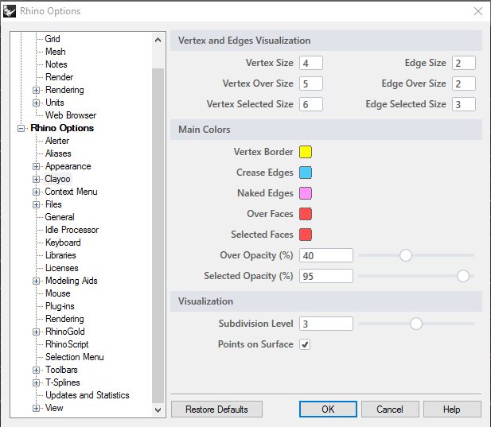 page 56 (shared page)
