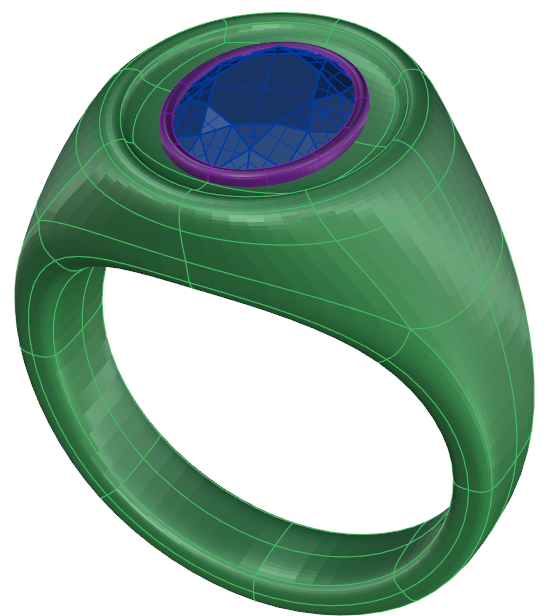
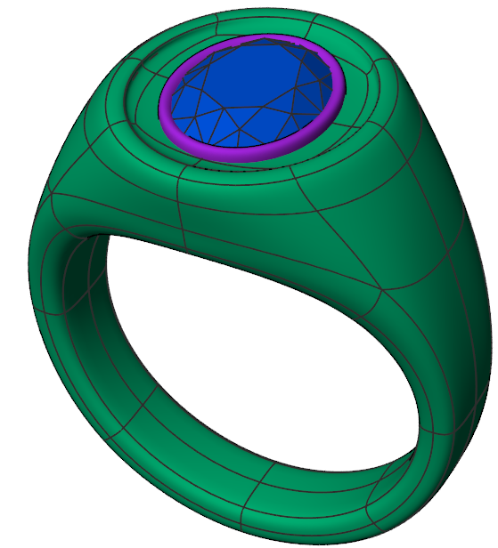
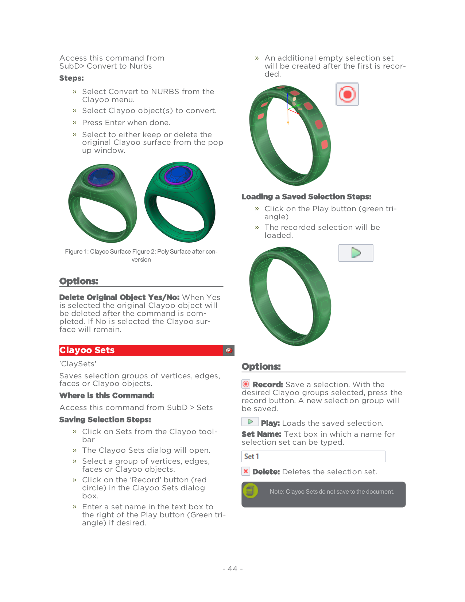

# Clayoo Sets

- Source PDF: Matrix 9 User Manual Addendum (matrix9.0_addendum.pdf)
- Page range: 50-50
- Section title: Clayoo Sets
- Section id: m9addendum-048-clayoo-sets
- Note: boundary page(s) are shared with a neighbouring section (two-column layout); text/images may include neighbour content.

---
<!-- section m9addendum-048-clayoo-sets | Clayoo Sets | m9addendum pages 50-50 -->

<!-- page 50 -->

Access this command from
SubD> Convert to Nurbs
An additional empty selection set
will be created after the first is recor-
ded.
Steps:
Select Convert to NURBS from the
Clayoo menu.
Select Clayoo object(s) to convert.
Press Enter when done.
Select to either keep or delete the
original Clayoo surface from the pop
up window.
Loading a Saved Selection Steps:
Click on the Play button (green tri-
angle)
The recorded selection will be
loaded.
Figure 1: Clayoo Surface Figure 2: Poly Surface after con-
version
### Options:
Delete Original Object Yes/No: When Yes
is selected the original Clayoo object will
be deleted after the command is com-
pleted. If No is selected the Clayoo sur-
face will remain.
### Clayoo Sets
'ClaySets'
### Options:
Saves selection groups of vertices, edges,
faces or Clayoo objects.
Where is this Command:
Access this command from SubD > Sets
Record: Save a selection. With the
desired Clayoo groups selected, press the
record button. A new selection group will
be saved.
Saving Selection Steps:
Play: Loads the saved selection.
Set Name: Text box in which a name for
selection set can be typed.
Delete: Deletes the selection set.
Note: Clayoo Sets do not save to the document.
Click on Sets from the Clayoo tool-
bar
The Clayoo Sets dialog will open.
Select a group of vertices, edges,
faces or Clayoo objects.
Click on the 'Record' button (red
circle) in the Clayoo Sets dialog
box.
Enter a set name in the text box to
the right of the Play button (Green tri-
angle) if desired.
- 44 -

---

## Images

-  page 50 (shared page)
-  page 50 (shared page)
-  page 50 (shared page)
-  page 50 (shared page)
-  page 50 (shared page)
