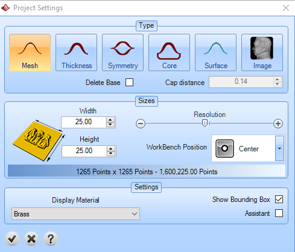
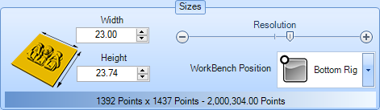
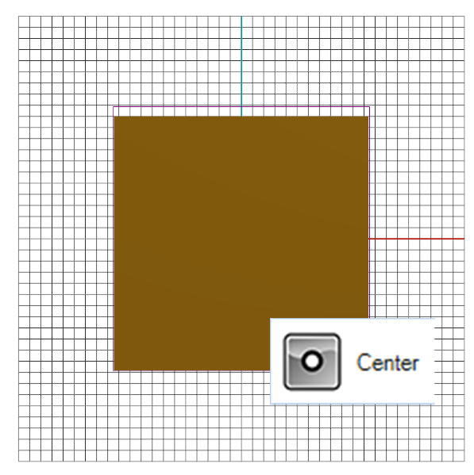
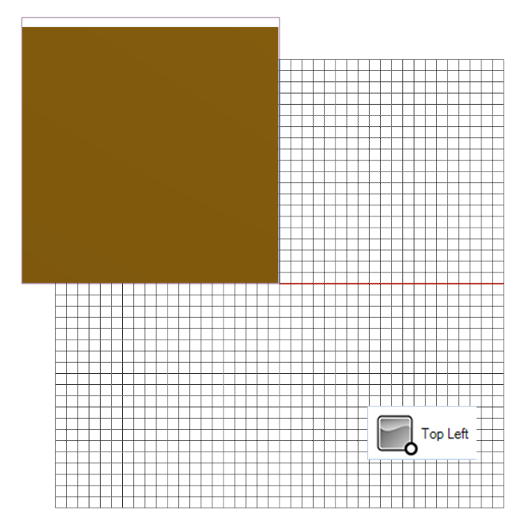
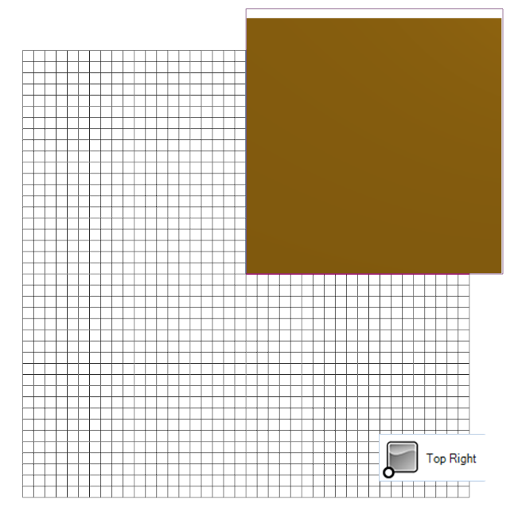
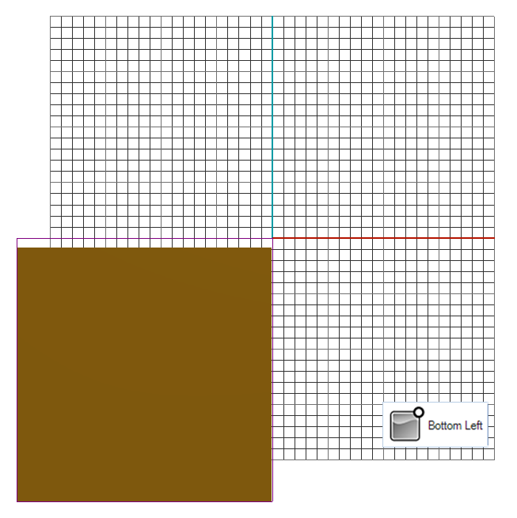
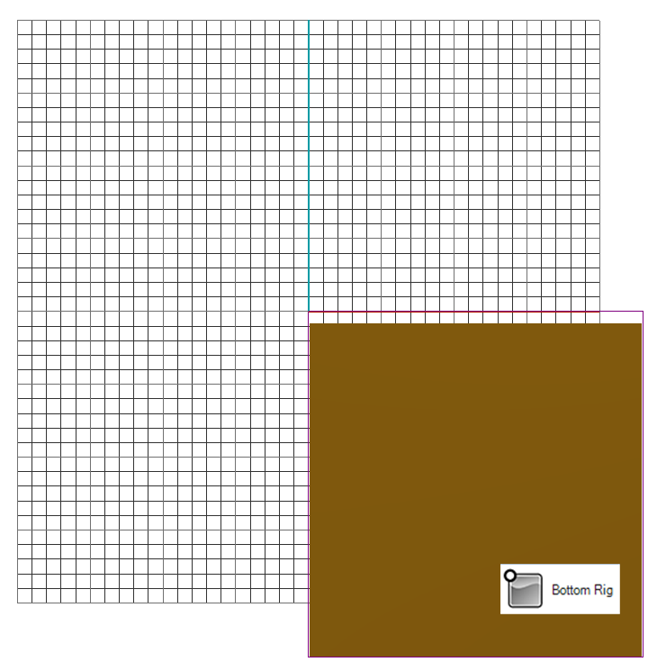
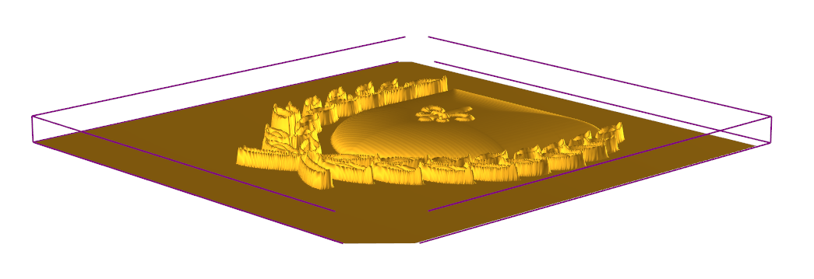
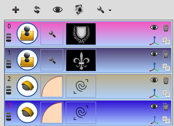
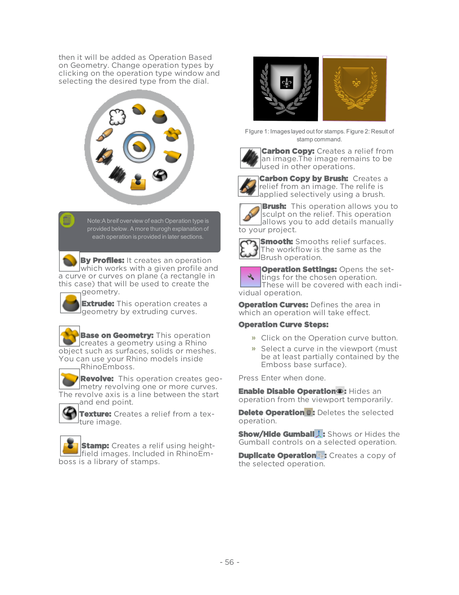

# Emboss

- Source PDF: Matrix 9 User Manual Addendum (matrix9.0_addendum.pdf)
- Page range: 59-62
- Section title: Emboss
- Section id: m9addendum-066-emboss

---
<!-- section m9addendum-066-emboss | Emboss | m9addendum pages 59-62 -->

<!-- page 59 -->

Y axis.
### Emboss
'ClayEmboss'
Creates reliefs from curves, images, and
geometry.
Core: When selected Emboss
creates a solid mesh with a
planar surface cap. Specify the
thickness of the mesh in the
Cap Distance field.
Where is this Command:
Access this command from Emboss>Em-
boss
Surface: When selected
Emboss creates a NURBS sur-
face.
Steps:
Note: Surface creates a heavier model. The Object
Display mode will be set to Wireframe to ensure the
system run efficiently.
Image: When selected Emboss
creates a 2D image as a 16 bit
Tiff. This image can be used
for Heightfeild commands
Select Emboss from the Emboss
menu.
Select the desired settings from the
'New Project' window (outlined
below in the Project Settings sec-
tion).
Click on the check-mark in the New
Project window. The Emboss panel
will open.
See the steps for the Emboss panel
below.
Delete Base: When selected Emboss will
trim the mesh to match the outermost
shape. Otherwise the mesh will be created
on top of the rectangle defined by the
Sizes settings below. This option is not
available when using Symmetry, Surface
or Image.
Figure 1: Delete Based=No Figure 2: Delete Base=Yes
Cap Distance: This value is used in thick-
ness , core and symmetry cap types.
Adjust by typing a value in the field or
using the up and down arrows.
### Project Settings:
Sizes: These options allow you to define
the size of the project, the resolution and
position.
Type: Defines the type of Emboss project.
Mesh: When selected Emboss
creates an open mesh.
Thickness: When selected
Emboss creates a solid mesh
with a specific thickness. Spe-
cify the thickness of the mesh
in the Cap Distance field.
Width: Controls the width of the Emboss
base. Adjust by typing a value in the field
or using the up and down arrows.
Symmetry: Mirrors the
Emboss command across the

<!-- page 60 -->

Height: Control the Height of the Emboss
base. Adjust by typing a value in the field
or using the up and down arrows.
WorkBench Position: Defines the position
of the project in the viewport. The default
is centered on the Origin World XY Plane.
Center: Center of the Emboss
project is centered on the Ori-
gin World XY Plane.
Bottom Right: Bottom, right
corner of the Emboss project
is on the Origin World
XY Plane.
Top Left: Top, left corner of
the Emboss project is on the
Origin World XY Plane.
Resolution: Increasing the resolution of
the surface will provide more detail at the
cost of creating a heavier (more com-
putationally complex surface). Adjust the
resolution by dragging the slider or click-
ing on the plus and minus buttons on
either side of the slider. The total number
of points on the surface will display below
the slider.
Settings:
Top Right: Top, right corner of
the Emboss project is on the
Origin World XY Plane.
Display Material: Set the mater-
ial to display the preview geo-
metry. Select a material from
the drop-down.
Show Bounding Box: With this
option enabled a bounding
box will display around the
Emboss project.
Bottom Left: Bottom, left
corner of the Emboss project
is on the Origin World XY
Plane.
- 54 -

<!-- page 61 -->

Show/Hide Relief
: Hides the Emboss
relief temporarily.
Assistant: With this option on
Emboss will guide users
through the process.
### Emboss:
Steps:
Click on the Plus button to add an
Emboss operation.
Adjust the parameters of the oper-
ation.
Add additional operations if desired.
Click on the refresh button.
Click on the check-mark to calidate
the command.
The decimator will load.
Select a decimation percentage.
Click on the check mark to add the
geometry to the viewport.
Place Image
:
Project Settings
### Options:
Add Operation
: Reopens the New Pro-
ject window. Click on the disclosure arrow
for the Save heightfield image and Save
project options
Save heightfield Image: Saves
the current output of the
builder as a Heightfield image.
: Adds an Emboss oper-
ation to the project. Embossed operations
are outlined below. Click on the plus sign
to add an operation. New operations
appear at the bottom of the list. Oper-
ations can be mixed and matched to
achieve the desired result.
Save Project:Saves the
Emboss project so that it can
be loaded in the future. If a
Emboss project is saved a dia-
log box will appear prompting
you to start a new project or
load an existing project.
### Operation Controls:
Position: Adjust the position (up or down)
of an operation relative to the other opper-
ations in the project. The position of an
operation can affect the results. Click and
drag on the three horizontal lines to
change the position.
Refresh
: Updates the Emboss project-
offering a preview of the emboss project
with the curent operations and settings.
Operation Type: There are ten types of
operations. Each type has its own prop-
erties and settings. By default when an
operation is added a new operation is set
as Operation By Profile,unless geometry is
selected when the operation is added.,

<!-- page 62 -->

then it will be added as Operation Based
on Geometry. Change operation types by
clicking on the operation type window and
selecting the desired type from the dial.
FIgure 1: Images layed out for stamps. Figure 2: Result of
stamp command.
Carbon Copy: Creates a relief from
an image.The image remains to be
used in other operations.
Carbon Copy by Brush: Creates a
relief from an image. The relife is
applied selectively using a brush.
Note:A breif overview of each Operation type is
provided below. A more thurogh explanation of
Brush: This operation allows you to
sculpt on the relief. This operation
allows you to add details manually
to your project.
each operation is provided in later sections.
Smooth: Smooths relief surfaces.
The workflow is the same as the
Brush operation.
By Profiles: It creates an operation
which works with a given profile and
a curve or curves on plane (a rectangle in
this case) that will be used to create the
geometry.
Operation Settings: Opens the set-
tings for the chosen operation.
These will be covered with each indi-
vidual operation.
Extrude: This operation creates a
geometry by extruding curves.
Operation Curves: Defines the area in
which an operation will take effect.
Operation Curve Steps:
Base on Geometry: This operation
creates a geometry using a Rhino
object such as surfaces, solids or meshes.
You can use your Rhino models inside
Click on the Operation curve button.
Select a curve in the viewport (must
be at least partially contained by the
Emboss base surface).
RhinoEmboss.
Press Enter when done.
Enable Disable Operation
Revolve:  This operation creates geo-
metry revolving one or more curves.
The revolve axis is a line between the start
: Hides an
operation from the viewport temporarily.
and end point.
Delete Operation
: Deletes the selected
operation.
Texture: Creates a relief from a tex-
ture image.
Show/Hide Gumball
: Shows or Hides the
Gumball controls on a selected operation.
Duplicate Operation
Stamp: Creates a relif using height-
field images. Included in RhinoEm-
boss is a library of stamps.
: Creates a copy of
the selected operation.
- 56 -

---

## Images

-  page 59
-  page 59
-  page 59
-  page 59
-  page 60
-  page 60
-  page 60
-  page 60
-  page 60
-  page 60
-  page 61
-  page 61
-  page 62
-  page 62
-  page 62
-  page 62
