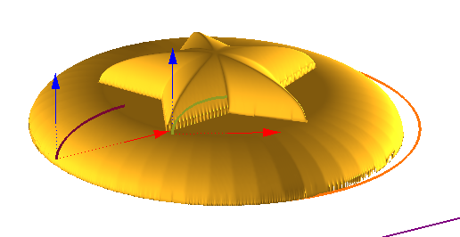
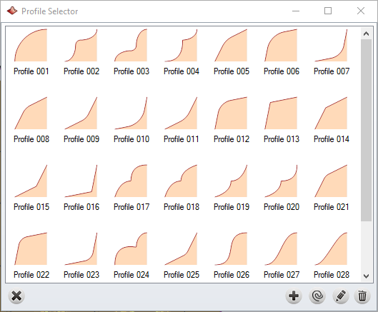
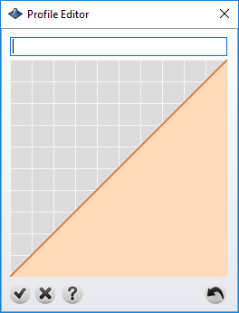
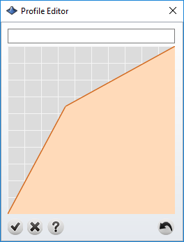
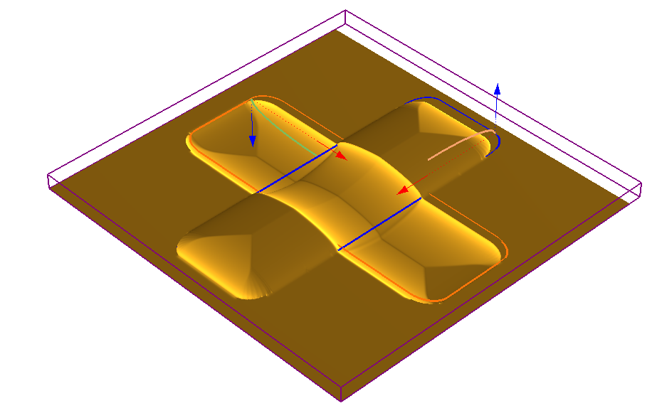

# By Profile

- Source PDF: Matrix 9 User Manual Addendum (matrix9.0_addendum.pdf)
- Page range: 63-66
- Section title: By Profile
- Section id: m9addendum-067-by-profile
- Note: boundary page(s) are shared with a neighbouring section (two-column layout); text/images may include neighbour content.

---
<!-- section m9addendum-067-by-profile | By Profile | m9addendum pages 63-66 -->

<!-- page 63 -->

### By Profile
By Profile is an operation that creates a
surface from a selected profile and Oper-
ation Curve(s). All of these operations
exist within the Emboss command.
Where is this Command:
Emboss>Operation Selector>By Profile
Steps:
Click on the Add New Operation but-
ton in the main control panel.
Add Profile: Brings up the Profile Editor to
create a new profile to add to the Profile
Selector.
Select By Profile from the Operation
Selector.
Click on the Operation Curve input
box.
Select a curve or curves to apply the
operation to.
Press Enter when done.
Adjust the parameters of the Oper-
ation using the Operation Settings or
using the gumball in the viewport.
Add Profile Steps:
Click on the Add Profile button in
the Profile Selector Window.
Type a profile name into the text
field at the top of the Profile Editor
Window.
### Operation Settings:
Click in the gray grid to add points
for the profile to pass through.
Click and drag the points to adjust
the profile shape.
Profile Selector: Click on the Profile Pre-
view to open the Profile Selector Window.
Here, a new profile can be selected from
the library, existing profiles can be edited
or new profiles can be created.
When done, click on the check mark
to add the profile to the Profile
Selector.
### Options:
Undo
: Reverses the last
action.
Ok
: Adds the profile to the
Profile Selector Window.
- 57 -

<!-- page 64 -->

Cancel
Delete Profile: Removes a profile from the
Profile Selector window.
Delete Profile Steps:
: Will close the Pro-
file Editor without adding a
profile to the Profile Selector
window.
Select a profile from the Profile
Selector.
Click on the Delete Profile button.
Delete Control Point: Right-
click on a control point to
delete it.
### By Profile Options:
Add 'Sharp Point': Adds a con-
trol point that has G1 con-
tinuity with the point closest to
it creating a sharp, as opposed
to rounded, point. Hold down
Shift and left-click to add a
'sharp' point.
Height: Controls the height of the profile.
Adjust in the Operation Settings by using
the up or down arrows or typing a value in
the corresponding input box . The height
can also be adjusted dynamically by using
the corresponding Viewport Control
Handle (blue arrow). Click and drag the
arrow to adjust the dimension or double-
click to type an exact value in the input
box.
Add Profile From Curve
: Adds a profile
to the Profile Selector Window from the
viewport.
Width: Controls the width of the profile.
Adjust in the Operation Settings by using
the up or down arrows or typing a value in
the corresponding input box . The width
can also be adjusted dynamically by using
the corresponding Viewport Control
Handle (red arrow). Click and drag the
arrow to adjust the dimension or double-
click to type an exact value in the input
box.
Note: Profile curves must be open.
Edit Profile Steps
:
Click on the Edit Profile button in the
Profile Selector Window.
Type a profile name into the text
field at the top of the Profile Editor
Window.
Height=Blue Arrow Width=Red Arrow
Click in the gray grid to add points
for the profile to pass through.
Click and drag the points to adjust
the profile shape.
When done, click on the check mark
to add the profile to the Profile
Selector.
Starting Height: Controls the profile's loc-
ation on the Z-axis. Adjust in the Operation
Settings by using the up or down arrows or
typing a value in the corresponding input
box. The Starting Height can also be adjus-
ted dynamically by using the Height View-
port Control Handle while holding down
the Shift key on the keyboard.
Note: If editing one of the default profiles you must
rename the profile in order for your changes to be
Auto Smooth: Applies a Smooth oper-
ation to the Emboss operation.
saved.
Styles: Emboss has 5 styles that control
how each operation is affected or affect
the operations below it.

<!-- page 65 -->

Lowest Union: When oper-
ations will be computed it will
keep the lowest points of gen-
erated geometry.
Add: With this style selected
the Emboss operation will be
added to the operations that
proceed it. The operations
(and the resulting height) are
cumulative.
Both Opperations set to Lowest Union
Both Operations set to Add
Subtract: With this style selec-
ted the Emboss operation will
be subtracted from the oper-
ation that proceed it.
Absolute: With this style selec-
ted the Emboss operation will
not merge intersecting oper-
ations. The operation will only
concern itself with the abso-
lute dimensions of each oper-
ation.
Both Operations set to Subtract
Both Operations set to Absolute
Highest Union: With this style
selected the Emboss oper-
ation will unify all operations,
but it will not affect the oper-
ations height.
Note: The preceding examples
use By Profile as the Operation
Type. Styles and Operation pos-
ition will affect the Emboss project
similarly regardless of the Oper-
ation used. In each example the
curve that runs from the lower-left
to upper-right is in the first pos-
ition.
Delete Inside Region: When this option is
selected regions inside nested curves are
deleted.
Both Operations set to Highest Union
Change Color: Use this option to color
code each operation.
- 59 -

<!-- page 66 -->

click to type an exact value in the input
box.
### Extrude
Figure 1: Extrude input curves Figure 2: Extrude Height con-
troled by red viewport control handles.
Creates geometry by extruding the oper-
ation curve. Unlike By Profile this will res-
ult in a surface with straight sides.
Where is this Command:
Emboss>Operation Selector>Extrude
Steps:
Starting Height: Controls the profile's loc-
ation on the Z-axis. Adjust in the Operation
Settings by using the up or down arrows or
typing a value in the corresponding input
box. The Starting Height can also be adjus-
ted dynamically by using the Height View-
port Control Handle while holding down
the Shift key on the keyboard.
Select Extrude from the Operation
Type selector.
Click on the Operation Curve input
and then select a curve in the view-
port and press Enter.
Adjust the Extrude parameters in the
viewport or by using the Operation
Settings.
Z Height Control
Styles: Emboss has 5 styles that control
how each operation is affected or affect
the operations below it.
Add: With this style selected
the Emboss operation will be
added to the operations that
proceed it. The operations
(and the resulting height) are
cumulative.
Figure 1: Extrude input curves Figure 2: Extrude operation out-
put.
### Options:
Both Operations set to Add
Height: Controls the height of the extru-
sion. Adjust in the Operation Settings by
using the up or down arrows or typing a
value in the corresponding input box . The
height can also be adjusted dynamically
by using the corresponding Viewport Con-
trol Handle (red arrow). Click and drag the
arrow to adjust the dimension or double-
Subtract: With this style selec-
ted the Emboss operation will
be subtracted from the oper-
ation that proceed it.
- 60 -

---

## Images

-  page 63
-  page 63
-  page 63
-  page 64
-  page 65
-  page 65
-  page 65
-  page 65
-  page 65
-  page 66 (shared page)
-  page 66 (shared page)
-  page 66 (shared page)
-  page 66 (shared page)
-  page 66 (shared page)
