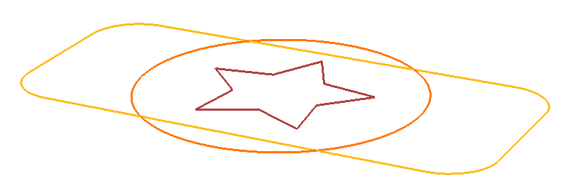
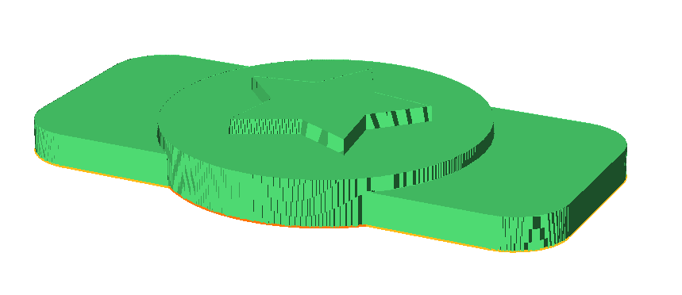
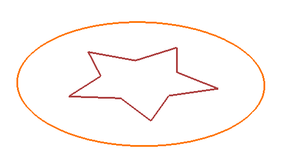
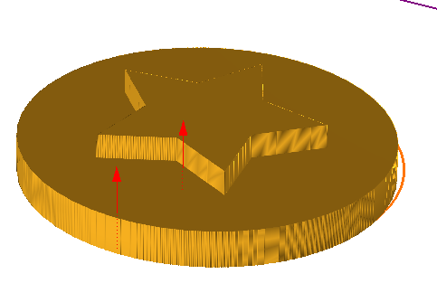
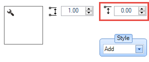
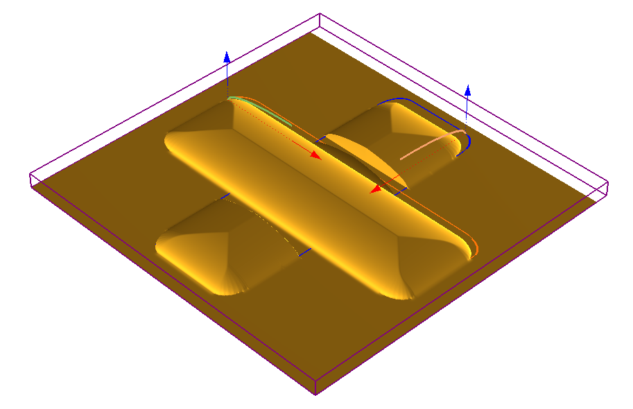

# Extrude

- Source PDF: Matrix 9 User Manual Addendum (matrix9.0_addendum.pdf)
- Page range: 66-67
- Section title: Extrude
- Section id: m9addendum-068-extrude
- Note: boundary page(s) are shared with a neighbouring section (two-column layout); text/images may include neighbour content.

---
<!-- section m9addendum-068-extrude | Extrude | m9addendum pages 66-67 -->

<!-- page 66 -->

click to type an exact value in the input
box.
### Extrude
Figure 1: Extrude input curves Figure 2: Extrude Height con-
troled by red viewport control handles.
Creates geometry by extruding the oper-
ation curve. Unlike By Profile this will res-
ult in a surface with straight sides.
Where is this Command:
Emboss>Operation Selector>Extrude
Steps:
Starting Height: Controls the profile's loc-
ation on the Z-axis. Adjust in the Operation
Settings by using the up or down arrows or
typing a value in the corresponding input
box. The Starting Height can also be adjus-
ted dynamically by using the Height View-
port Control Handle while holding down
the Shift key on the keyboard.
Select Extrude from the Operation
Type selector.
Click on the Operation Curve input
and then select a curve in the view-
port and press Enter.
Adjust the Extrude parameters in the
viewport or by using the Operation
Settings.
Z Height Control
Styles: Emboss has 5 styles that control
how each operation is affected or affect
the operations below it.
Add: With this style selected
the Emboss operation will be
added to the operations that
proceed it. The operations
(and the resulting height) are
cumulative.
Figure 1: Extrude input curves Figure 2: Extrude operation out-
put.
### Options:
Both Operations set to Add
Height: Controls the height of the extru-
sion. Adjust in the Operation Settings by
using the up or down arrows or typing a
value in the corresponding input box . The
height can also be adjusted dynamically
by using the corresponding Viewport Con-
trol Handle (red arrow). Click and drag the
arrow to adjust the dimension or double-
Subtract: With this style selec-
ted the Emboss operation will
be subtracted from the oper-
ation that proceed it.
- 60 -

<!-- page 67 -->

Both Operations set to Subtract
Both Operations set to Absolute
Highest Union: With this style
selected the Emboss oper-
ation will unify all operations,
but it will not affect the oper-
ations height.
Note: The preceding examples
use By Profile as the Operation
Type. Styles and Operation pos-
ition will affect the Emboss project
similarly regardless of the Oper-
ation used. In each example the
curve that runs from the lower-left
to upper-right is in the first pos-
ition.
Delete Inside Region: When this option is
selected regions inside nested curves are
deleted.
Change Color: Use this option to color
code each operation.
Both Operations set to Highest Union
### Base On Geometry
Lowest Union: When oper-
ations will be computed it will
keep the lowest points of gen-
erated geometry.
This operation uses surfaces, solids or
meshes, as opposed to curves, to create
the emboss. The embossed surface will be
draped over the Rhino geometry.
Where is this Command:
Emboss>Operation Selector>Base On Geo-
metry
Steps:
Both Opperations set to Lowest Union
Select Base on Geometry from the
Operation Type selector.
Click on the Operation Curve input
and then select a surface, solid or
mesh in the viewport and press
Enter.
Adjust the parameters in the Oper-
ation Settings.
Absolute: With this style selec-
ted the Emboss operation will
not merge intersecting oper-
ations. The operation will only
concern itself with the abso-
lute dimensions of each oper-
ation.
- 61 -

---

## Images

-  page 66 (shared page)
-  page 66 (shared page)
-  page 66 (shared page)
-  page 66 (shared page)
-  page 66 (shared page)
-  page 66 (shared page)
-  page 67 (shared page)
-  page 67 (shared page)
-  page 67 (shared page)
-  page 67 (shared page)
