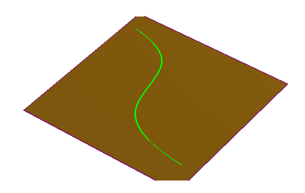
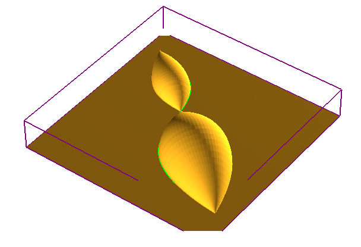
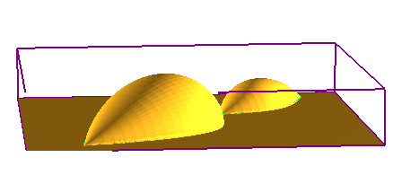
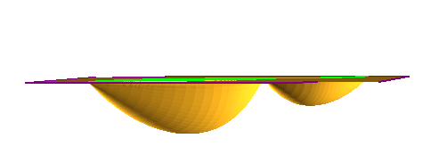

# Revolve

- Source PDF: Matrix 9 User Manual Addendum (matrix9.0_addendum.pdf)
- Page range: 69-70
- Section title: Revolve
- Section id: m9addendum-070-revolve
- Note: boundary page(s) are shared with a neighbouring section (two-column layout); text/images may include neighbour content.

---
<!-- section m9addendum-070-revolve | Revolve | m9addendum pages 69-70 -->

<!-- page 69 -->

Figure 1: Revolve Input Figure 2: Revolve
Output.
### Options:
Both Operations set to Absolute
Side: Controls whether the surface uses
the highest or lowest part of the Operation
Geometry. Select the desired option from
the drop-down menu.
Note: The preceding examples
use By Profile as the Operation
Type. Styles and Operation pos-
ition will affect the Emboss project
Up: Uses the highest part of
the geometry.
similarly regardless of the Oper-
ation used. In each example the
curve that runs from the lower-left
to upper-right is in the first pos-
ition.
Change Color: Use this option to color
code each operation.
Down: Uses the lowest part of
the geometry.
### Revolve
This command revolves open planar
curves to create a surface. The revolve
axis runs from the start point to end point
of the curve.
Where is this Command:
Emboss>Operation Selector>Revolve
Styles: Emboss has 5 styles that control
how each operation is affected or affect
the operations below it.
Steps:
Select Revolve from the Operation
Type selector.
Click on the Operation Curve input
and then select an open planar
curve.
Add: With this style selected
the Emboss operation will be
added to the operations that
proceed it. The operations
(and the resulting height) are
cumulative.
Adjust the parameters in the Oper-
ation Settings.
Note: Curve must be coplanar on the Emboss sur-
face.

<!-- page 70 -->

Both Operations set to Add
Both Opperations set to Lowest Union
Subtract: With this style selec-
ted the Emboss operation will
be subtracted from the oper-
ation that proceed it.
Absolute: With this style selec-
ted the Emboss operation will
not merge intersecting oper-
ations. The operation will only
concern itself with the abso-
lute dimensions of each oper-
ation.
Both Operations set to Subtract
Both Operations set to Absolute
Highest Union: With this style
selected the Emboss oper-
ation will unify all operations,
but it will not affect the oper-
ations height.
Note: The preceding examples
use By Profile as the Operation
Type. Styles and Operation pos-
ition will affect the Emboss project
similarly regardless of the Oper-
ation used. In each example the
curve that runs from the lower-left
to upper-right is in the first pos-
ition.
Change Color: Use this option to color
code each operation.
Both Operations set to Highest Union
### Texture
Lowest Union: When oper-
ations will be computed it will
keep the lowest points of gen-
erated geometry.
Creates a relief from an image.
Where is this Command:
Emboss>Operation Selector> Texture
Steps:
- 64 -

---

## Images

-  page 69
-  page 69
-  page 69
-  page 69
-  page 69
-  page 70 (shared page)
-  page 70 (shared page)
-  page 70 (shared page)
-  page 70 (shared page)
