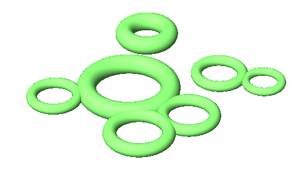
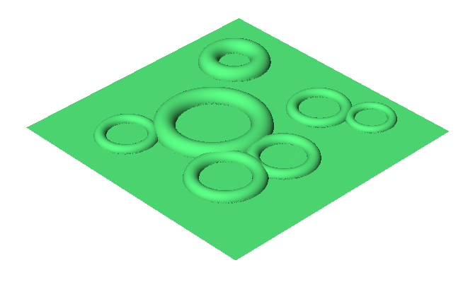
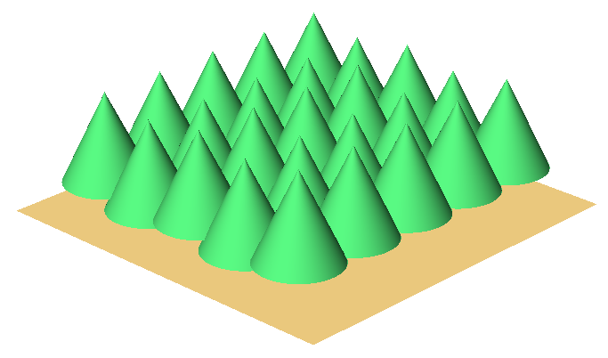
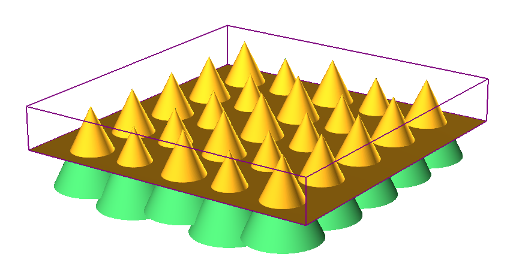
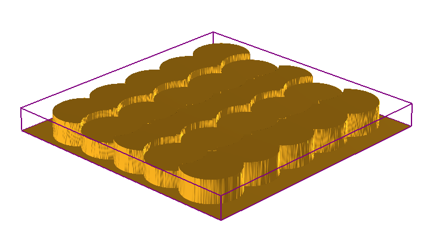

# Base On Geometry

- Source PDF: Matrix 9 User Manual Addendum (matrix9.0_addendum.pdf)
- Page range: 67-68
- Section title: Base On Geometry
- Section id: m9addendum-069-base-on-geometry
- Note: boundary page(s) are shared with a neighbouring section (two-column layout); text/images may include neighbour content.

---
<!-- section m9addendum-069-base-on-geometry | Base On Geometry | m9addendum pages 67-68 -->

<!-- page 67 -->

Both Operations set to Subtract
Both Operations set to Absolute
Highest Union: With this style
selected the Emboss oper-
ation will unify all operations,
but it will not affect the oper-
ations height.
Note: The preceding examples
use By Profile as the Operation
Type. Styles and Operation pos-
ition will affect the Emboss project
similarly regardless of the Oper-
ation used. In each example the
curve that runs from the lower-left
to upper-right is in the first pos-
ition.
Delete Inside Region: When this option is
selected regions inside nested curves are
deleted.
Change Color: Use this option to color
code each operation.
Both Operations set to Highest Union
### Base On Geometry
Lowest Union: When oper-
ations will be computed it will
keep the lowest points of gen-
erated geometry.
This operation uses surfaces, solids or
meshes, as opposed to curves, to create
the emboss. The embossed surface will be
draped over the Rhino geometry.
Where is this Command:
Emboss>Operation Selector>Base On Geo-
metry
Steps:
Both Opperations set to Lowest Union
Select Base on Geometry from the
Operation Type selector.
Click on the Operation Curve input
and then select a surface, solid or
mesh in the viewport and press
Enter.
Adjust the parameters in the Oper-
ation Settings.
Absolute: With this style selec-
ted the Emboss operation will
not merge intersecting oper-
ations. The operation will only
concern itself with the abso-
lute dimensions of each oper-
ation.
- 61 -

<!-- page 68 -->

Figure 1: Geometry input Figure 2: Mesh Output
### Options:
Both Operations set to Subtract
Side: Controls whether the surface uses
the highest or lowest part of the Operation
Geometry. Select the desired option from
the drop-down menu.
Up: Uses the highest part of
the geometry.
Highest Union: With this style
selected the Emboss oper-
ation will unify all operations,
but it will not affect the oper-
ations height.
Down: Uses the lowest part of
the geometry.
Both Operations set to Highest Union
Styles: Emboss has 5 styles that control
how each operation is affected or affect
the operations below it.
Lowest Union: When oper-
ations will be computed it will
keep the lowest points of gen-
erated geometry.
Add: With this style selected
the Emboss operation will be
added to the operations that
proceed it. The operations
(and the resulting height) are
cumulative.
Both Opperations set to Lowest Union
Both Operations set to Add
Subtract: With this style selec-
ted the Emboss operation will
be subtracted from the oper-
ation that proceed it.
Absolute: With this style selec-
ted the Emboss operation will
not merge intersecting oper-
ations. The operation will only
concern itself with the abso-
lute dimensions of each oper-
ation.
- 62 -

---

## Images

-  page 67 (shared page)
-  page 67 (shared page)
-  page 67 (shared page)
-  page 67 (shared page)
-  page 68
-  page 68
-  page 68
-  page 68
-  page 68
-  page 68
