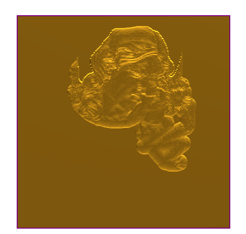

# Carbon Copy

- Source PDF: Matrix 9 User Manual Addendum (matrix9.0_addendum.pdf)
- Page range: 73-75
- Section title: Carbon Copy
- Section id: m9addendum-073-carbon-copy
- Note: boundary page(s) are shared with a neighbouring section (two-column layout); text/images may include neighbour content.

---
<!-- section m9addendum-073-carbon-copy | Carbon Copy | m9addendum pages 73-75 -->

<!-- page 73 -->

keep the lowest points of gen-
erated geometry.
the Emboss operation will be
added to the operations that
proceed it. The operations
(and the resulting height) are
cumulative.
Both Opperations set to Lowest Union
Both Operations set to Add
Subtract: With this style selec-
ted the Emboss operation will
be subtracted from the oper-
ation that proceed it.
Absolute: With this style selec-
ted the Emboss operation will
not merge intersecting oper-
ations. The operation will only
concern itself with the abso-
lute dimensions of each oper-
ation.
Both Operations set to Subtract
Both Operations set to Absolute
Highest Union: With this style
selected the Emboss oper-
ation will unify all operations,
but it will not affect the oper-
ations height.
Note: The preceding examples
use By Profile as the Operation
Type. Styles and Operation pos-
ition will affect the Emboss project
similarly regardless of the Oper-
ation used. In each example the
curve that runs from the lower-left
to upper-right is in the first pos-
ition.
Change Color: Use this option to color
code each operation.
Both Operations set to Highest Union
### Carbon Copy
Lowest Union: When oper-
ations will be computed it will
Creates a relief surface from an image. The
picture remains so that it can be use in
- 67 -

<!-- page 74 -->

conjunction with other operations.
Where is this Command:
Emboss>Operation Selector>Carbon Copy
Steps:
Click on the Add New Operation but-
ton in the main control panel.
Both Operations set to Add
Select Carbon Copy from the Oper-
ation Selector.
Adjust the parameters of the Oper-
ation using the Operation Settings or
using the gumball in the viewport.
Note: An Operation Curve can be used, in which
Subtract: With this style selec-
ted the Emboss operation will
be subtracted from the oper-
ation that proceed it.
case, the relief surface will only affect the area
inside the curve.
Both Operations set to Subtract
Figure 1: Carbon Copy Input Figure 2: Carbon Copy Output
### Operation Settings:
Highest Union: With this style
selected the Emboss oper-
ation will unify all operations,
but it will not affect the oper-
ations height.
Height: Controls the height of the relief.
Adjust in the Operation Settings by using
the up or down arrows or typing a value in
the corresponding input box .
Starting Height: Controls the profile's loc-
ation on the Z-axis. Adjust in the Operation
Settings by using the up or down arrows or
typing a value in the corresponding input
box.
Styles: Emboss has 5 styles that control
how each operation is affected or affect
the operations below it.
Both Operations set to Highest Union
Lowest Union: When oper-
ations will be computed it will
keep the lowest points of gen-
erated geometry.
Add: With this style selected
the Emboss operation will be
added to the operations that
proceed it. The operations
(and the resulting height) are
cumulative.

<!-- page 75 -->

Where is this Command:
Emboss>Operation Selector>Carbon Copy
by Brush
Steps:
Click on the Add New Operation but-
ton in the main control panel.
Both Opperations set to Lowest Union
Select Carbon Copy by Brush from
the Operation Selector.
Adjust the parameters of the Oper-
ation using the Operation Settings.
Left-click and hold over the Emboss
surface to bring out the underlying
texture from the image.
Press Enter when done.
Absolute: With this style selec-
ted the Emboss operation will
not merge intersecting oper-
ations. The operation will only
concern itself with the abso-
lute dimensions of each oper-
ation.
Both Operations set to Absolute
Note: The preceding examples
use By Profile as the Operation
Type. Styles and Operation pos-
ition will affect the Emboss project
similarly regardless of the Oper-
ation used. In each example the
curve that runs from the lower-left
to upper-right is in the first pos-
Note: The green button in the operation indicates
Carbon Copy brush is enabled when red the Car-
ition.
bon Copy brush is disabled.
Change Color: Use this option to color
code each operation.
### Operation Settings:
### Carbon Copy By Brush
Height: Controls the height of the brush in
the Brush command. Adjust in the Oper-
ation Settings by using the up or down
arrows or typing a value in the cor-
responding input box .
Width: Controls the width of the brush in
the Brush command. Adjust in the Oper-
ation Settings by using the up or down
Creates a relief surface from an image
using a brush to selectively apply the
affect. The picture remains so that it can
be use in conjunction with other oper-
ations.
- 69 -

---

## Images

-  page 73 (shared page)
-  page 73 (shared page)
-  page 73 (shared page)
-  page 73 (shared page)
-  page 73 (shared page)
-  page 74
-  page 75 (shared page)
