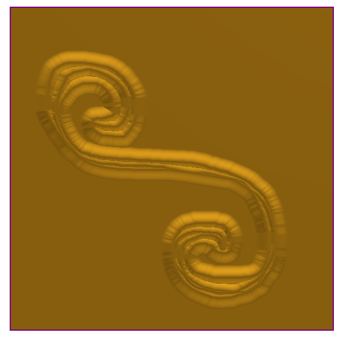
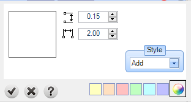

# Brush

- Source PDF: Matrix 9 User Manual Addendum (matrix9.0_addendum.pdf)
- Page range: 77-78
- Section title: Brush
- Section id: m9addendum-075-brush
- Note: boundary page(s) are shared with a neighbouring section (two-column layout); text/images may include neighbour content.

---
<!-- section m9addendum-075-brush | Brush | m9addendum pages 77-78 -->

<!-- page 77 -->

### Operation Settings:
position will affect the Emboss pro-
ject similarly regardless of the
Operation used. In each example
the curve that runs from the
lower-left to upper-right is in the
first position.
Change Color: Use this option to color
code each operation.
### Brush
Height: Controls the height of the brush in
the Carbon copy by Brush command.
Adjust in the Operation Settings by using
the up or down arrows or typing a value in
the corresponding input box .
Adds details to the Emboss surface manu-
ally with the Brush function.
Where is this Command:
Emboss>Operation Selector> Brush
Steps:
Width: Controls the width of the brush in
the Carbon copy by Brush command.
Adjust in the Operation Settings by using
the up or down arrows or typing a value in
the corresponding input box.
Click on the Add New Operation but-
ton in the main control panel.
Accumulate: With this option on each
pass of the brush will increase the height
of the relief. When this option is off the
height of the relief will be constrained to
that set in the Operation Settings.
Styles: Emboss has 5 styles that control
how each operation is affected or affect
the operations below it.
Select Brush from the Operation
Selector.
Adjust the parameters of the Oper-
ation using the Operation Settings.
Left-click and hold over the Emboss
surface to sculpt in additional detail.
Click on the green button in the oper-
ation to close the brush command.
Add: With this style selected
the Emboss operation will be
added to the operations that
proceed it. The operations
(and the resulting height) are
cumulative.
Add details to the Emboss surface using the Brush Operation.
Both Operations set to Add
Subtract: With this style selec-
ted the Emboss operation will
be subtracted from the oper-
ation that proceed it.
- 71 -

<!-- page 78 -->

Both Operations set to Subtract
Both Operations set to Absolute
Highest Union: With this style
selected the Emboss oper-
ation will unify all operations,
but it will not affect the oper-
ations height.
Note: The preceding examples
use By Profile as the Operation
Type. Styles and Operation pos-
ition will affect the Emboss project
similarly regardless of the Oper-
ation used. In each example the
curve that runs from the lower-left
to upper-right is in the first pos-
ition.
Change Color: Use this option to color
code each operation.
Both Operations set to Highest Union
### Smooth
Smooth applies a manual smoothing
effect to the Emboss surface. The work-
flow is similar to the Brush command.
Lowest Union: When oper-
ations will be computed it will
keep the lowest points of gen-
erated geometry.
Where is this Command:
Emboss > Operation Selector > Smooth
Click on the Add New Operation but-
ton in the main control panel.
Both Opperations set to Lowest Union
Select Smooth from the Operation
Selector.
Adjust the parameters of the Oper-
ation using the Operation Settings or
using the gumball in the viewport.
Apply smoothing to the Emboss sur-
face by left-clicking and moving
your mouse over the desired area.
Click on the green button in the oper-
ation to close the command.
Absolute: With this style selec-
ted the Emboss operation will
not merge intersecting oper-
ations. The operation will only
concern itself with the abso-
lute dimensions of each oper-
ation.
- 72 -

---

## Images

-  page 77 (shared page)
-  page 77 (shared page)
-  page 77 (shared page)
-  page 78 (shared page)
-  page 78 (shared page)
-  page 78 (shared page)
-  page 78 (shared page)
