# Sculpting

- Source PDF: Matrix 9 User Manual Addendum (matrix9.0_addendum.pdf)
- Page range: 79-81
- Section title: Sculpting
- Section id: m9addendum-077-sculpting
- Note: boundary page(s) are shared with a neighbouring section (two-column layout); text/images may include neighbour content.

---
<!-- section m9addendum-077-sculpting | Sculpting | m9addendum pages 79-81 -->

<!-- page 79 -->

Figure 1: Emboss before Smoothing Figure
2: Smoothing applied to right side.
Note: Optionally use the Operation Curve to con-
strain the smoothing effect to the inside of a selec-
ted curve. When a brush operation is active you
can't switch between operations.
### Operation Settings:
### Options:
Height: Controls the height of the brush in
the Brush command. Adjust in the Oper-
ation Settings by using the up or down
arrows or typing a value in the cor-
responding input box .
Remesh:
Resolution:
Width: Controls the width of the brush in
the Brush command. Adjust in the Oper-
ation Settings by using the up or down
arrows or typing a value in the cor-
responding input box
SubDivision: Increases the number of sub-
divisions on the sculpt surface by a factor
of 4.
Change Color: Use this option to color
code each operation.
### Sculpting
Radius: Controls the size of the sculpting
brush. The size of the brush is in terms of
pixels on the screen so the absolute size
(relative to the model) of the brush will
vary based on the zoom amount. Adjust in
the builder by using the slider in the
builder or the plus and minus buttons on
either side of the slider.
Where is this Command:
Access this command from Emboss >
Sculpt
Steps:
Intensity: Controls the strength of the
sculpt brush or how much of an effect
each pass has on the model. Adjust in the
builder by using the slider in the builder or
the plus and minus buttons on either side
of the slider.
Select object to convert to sculpting
mesh.
Symmetry
Click on Sculpt in the Emboss menu.
: When activated, the sculpt-
ing effects will be mirrored across the Y
axis
Select a Sculpt brush from the HUD.
Adjust brush and Sculpt mesh parameters
from the builder.
When done sculpting click on the check-
mark to close the Sculpt command.

<!-- page 80 -->

Note: Because this function pushes the surface
down when then the negative option is selected the
surface will be raised instead of lowered.
Inflate
: Moves the surface
up relative to its normal.
.
A bright line indicates the symmetry plane
Negative
: Reverses the effect of the
sculpt brush relative to the surface's nor-
mal.
Modes: The Sculpt command has 8
modes. These appear in the HUD on the
screen when Sculpt is activated.
Pinch: Pulls the vertices of the
mesh together, towards the
cursor.
Brush
: Smoothly lifts the
mesh surface.
Smooth: Applies a smoothing
effect to the rough surfaces.
Crease
: Creates edges or
creases along the brush area.
Twist: Warps the surface
Flatten
: Pushes the mesh
down, creating a flat surface.
- 74 -

<!-- page 81 -->

Drag: Moves the surface in the
direction of the cursor.
Hot Keys: Toggles on and off Sculpt hot
keys. Hot keys are used to quickly change
between Sculpt brushes. Edit hot keys in
Clayoo options.
### Options:
Resolution: Sets the dimensions of the
heightfield image.
Resolution Y: Controls the
dimension of the heightfield
image along the Y Axis. Adjust
in the builder by clicking on
the up or down arrows or typ-
ing a value in the text field.
### Heightfield Image
Resolution X: Controls the
dimension of the heightfield
image along the X Axis. Adjust
in the builder by clicking on
the up or down arrows or typ-
ing a value in the text field.
Creates heightfield images that can be
used either in the Texture Operation or
Stamp Operation
Where is this Command:
Emboss> Heightfield Images
Steps:
Constrain Proportions:
When this option is
toggled on, adjusting the
X or Y resolution will
adjust both parameters main-
taining the original pro-
portions.
Select the > Heightfield Image from
the Emboss menu.
Select geometry from the viewport
and add it to the builder.
Adjust the parameters in the builder.
Click on the check-mark to save the
Heightfield image.
Specify the library to save to from
the drop-down menu.
Type a name in the text field.
Click on the check mark to save.

---

## Images

-  page 79 (shared page)
- 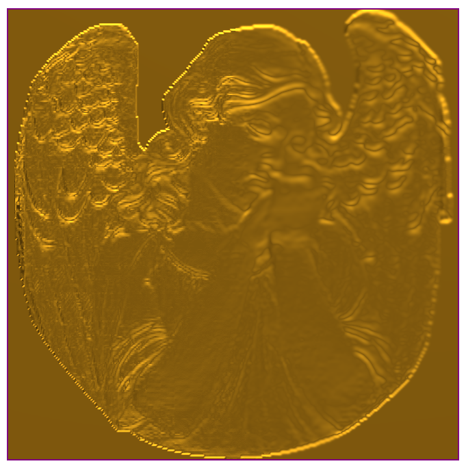 page 79 (shared page)
- 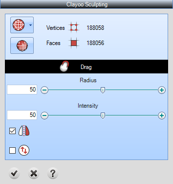 page 79 (shared page)
- 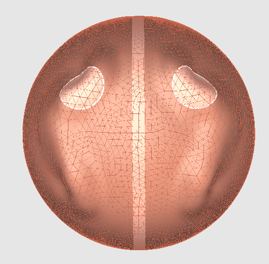 page 80
- 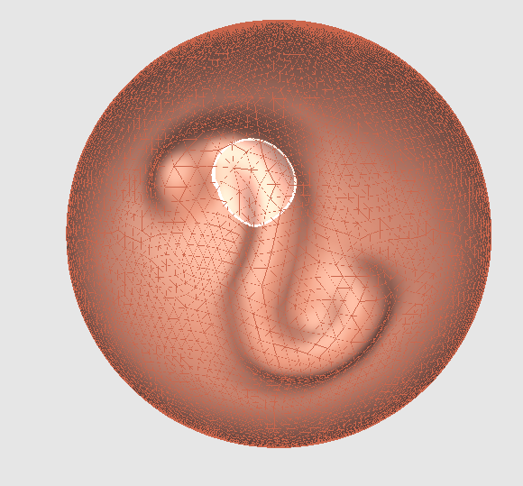 page 80
- 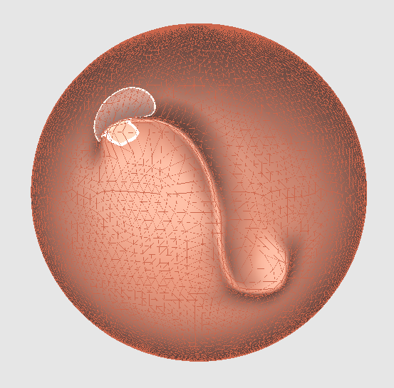 page 80
- 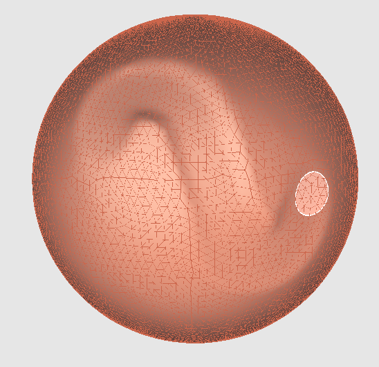 page 80
- 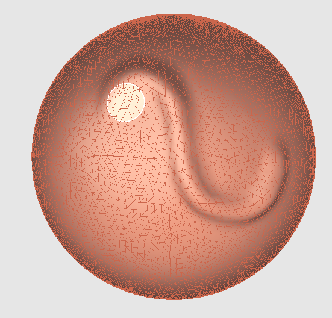 page 80
- 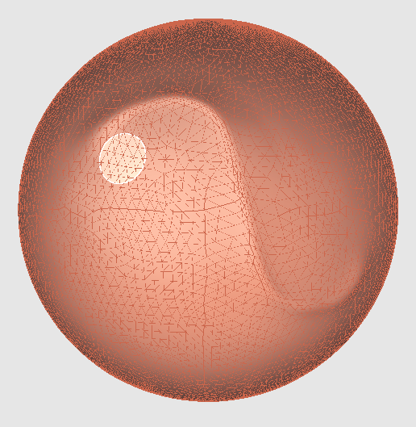 page 80
- 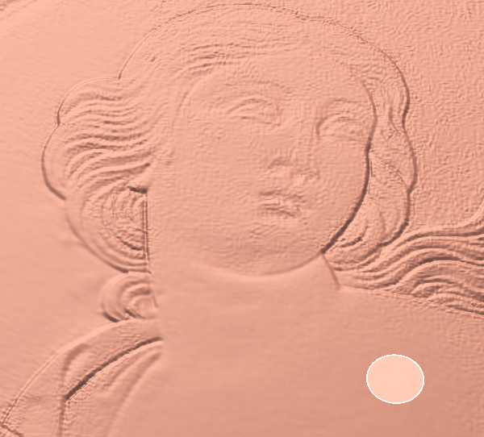 page 80
- 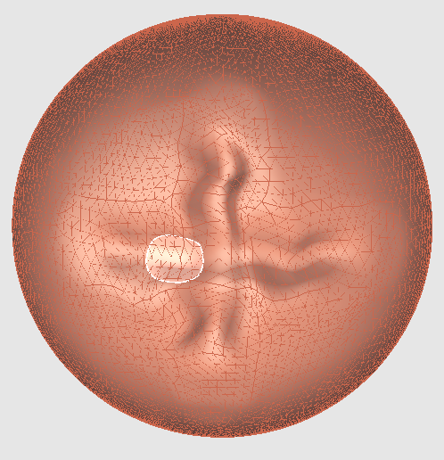 page 80
-  page 81 (shared page)
- 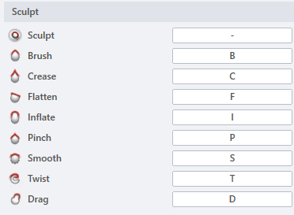 page 81 (shared page)
- 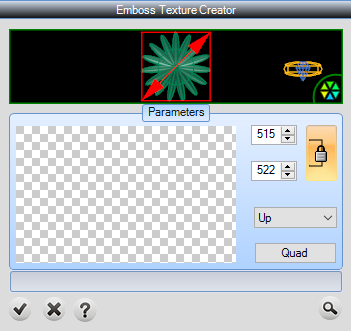 page 81 (shared page)
