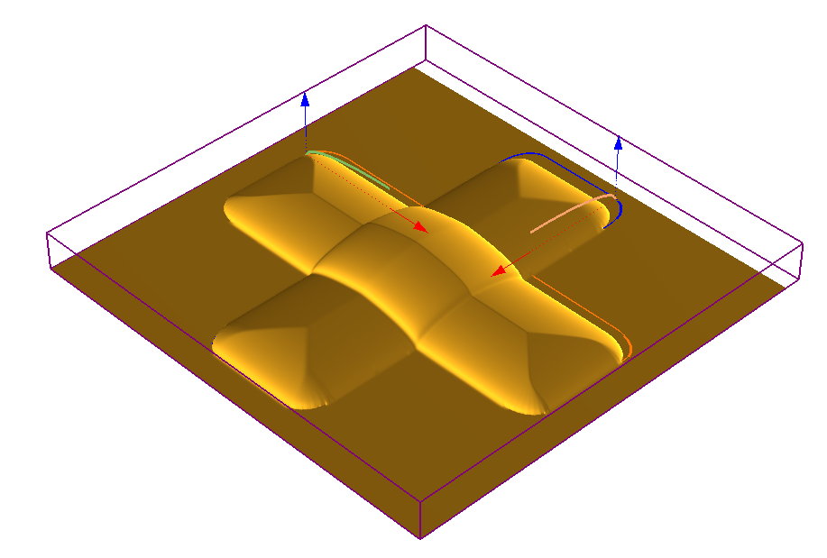
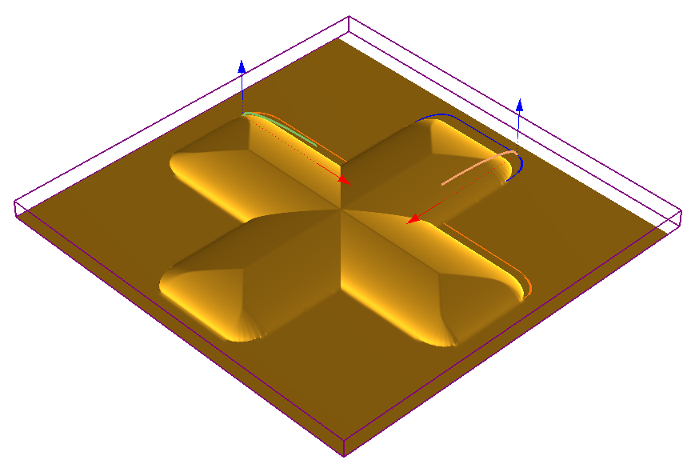
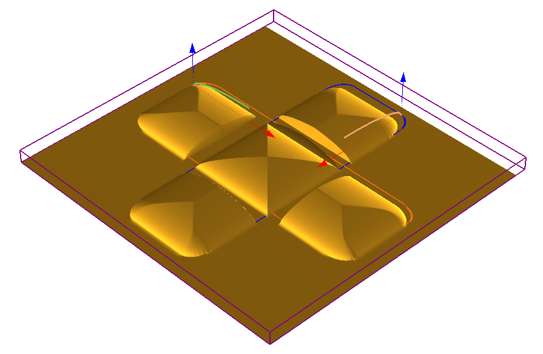
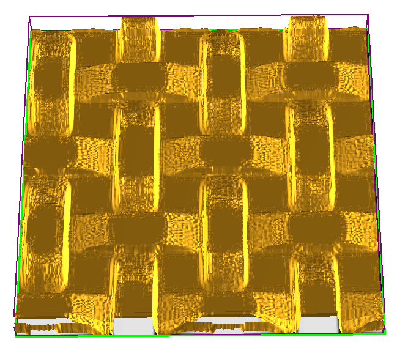
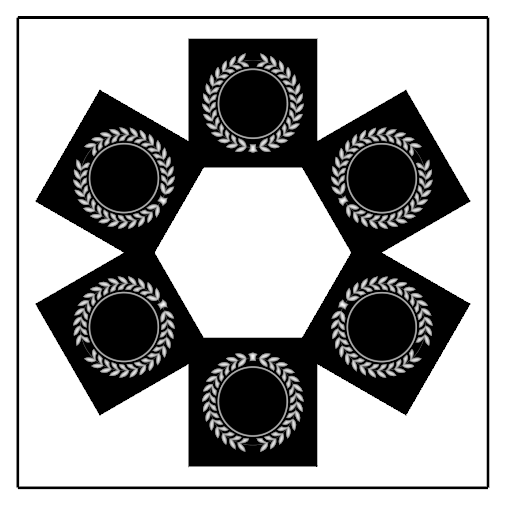
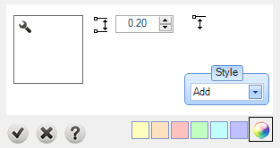

# Texture

- Source PDF: Matrix 9 User Manual Addendum (matrix9.0_addendum.pdf)
- Page range: 70-72
- Section title: Texture
- Section id: m9addendum-071-texture
- Note: boundary page(s) are shared with a neighbouring section (two-column layout); text/images may include neighbour content.

---
<!-- section m9addendum-071-texture | Texture | m9addendum pages 70-72 -->

<!-- page 70 -->

Both Operations set to Add
Both Opperations set to Lowest Union
Subtract: With this style selec-
ted the Emboss operation will
be subtracted from the oper-
ation that proceed it.
Absolute: With this style selec-
ted the Emboss operation will
not merge intersecting oper-
ations. The operation will only
concern itself with the abso-
lute dimensions of each oper-
ation.
Both Operations set to Subtract
Both Operations set to Absolute
Highest Union: With this style
selected the Emboss oper-
ation will unify all operations,
but it will not affect the oper-
ations height.
Note: The preceding examples
use By Profile as the Operation
Type. Styles and Operation pos-
ition will affect the Emboss project
similarly regardless of the Oper-
ation used. In each example the
curve that runs from the lower-left
to upper-right is in the first pos-
ition.
Change Color: Use this option to color
code each operation.
Both Operations set to Highest Union
### Texture
Lowest Union: When oper-
ations will be computed it will
keep the lowest points of gen-
erated geometry.
Creates a relief from an image.
Where is this Command:
Emboss>Operation Selector> Texture
Steps:
- 64 -

<!-- page 71 -->

Select Texture from the Operation
Type selector.
Click on the Operation Curve input
and select a closed curve or curves
from the viewport.
Adjust the parameters in the Oper-
ation Settings.
Both Operations set to Add
Subtract: With this style selec-
ted the Emboss operation will
be subtracted from the oper-
ation that proceed it.
Figure 1: Texture Image Figure 2: Texture Result
Note: Any gray scale image can be added to the
resource library and used to create a texture. The
lights are highs and the darks lows on the resulting
mesh.
### Options:
Both Operations set to Subtract
Height: Controls the height of the relief.
Adjust in the Operation Settings by using
the up or down arrows or typing a value in
the corresponding input box .
Highest Union: With this style
selected the Emboss oper-
ation will unify all operations,
but it will not affect the oper-
ations height.
Rotation: This parameter will rotate the
texture. Adjust in the Operation Settings
by using the up or down arrows or typing a
value in the corresponding input box.
Starting Height: Controls the profile's loc-
ation on the Z-axis. Adjust in the Operation
Settings by using the up or down arrows or
typing a value in the corresponding input
box.
Styles: Emboss has 5 styles that control
how each operation is affected or affect
the operations below it.
Both Operations set to Highest Union
Add: With this style selected
the Emboss operation will be
added to the operations that
proceed it. The operations
(and the resulting height) are
cumulative.
Lowest Union: When oper-
ations will be computed it will
keep the lowest points of gen-
erated geometry.

<!-- page 72 -->

Steps:
Both Opperations set to Lowest Union
Click on the 'Add New Operation'
button in the main control panel.
Select 'Stamp' from the Operation
Selector.
Click on the Operation Curve input
box.
Select a stamp from the Resource
Library.
Adjust the parameters of the oper-
ation using the Operation Settings.
The stamps can be manipulated like
any other Rhino object.
Absolute: With this style selec-
ted the Emboss operation will
not merge intersecting oper-
ations. The operation will only
concern itself with the abso-
lute dimensions of each oper-
ation.
Figure 1: Stamp Layout Figure 2: Resulting Mesh
### Operation Settings:
Both Operations set to Absolute
Note: The preceding examples
use By Profile as the Operation
Type. Styles and Operation pos-
ition will affect the Emboss project
similarly regardless of the Oper-
ation used. In each example the
curve that runs from the lower-left
to upper-right is in the first pos-
ition.
Change Color: Use this option to color
code each operation.
### Stamp
Height: Controls the height of the profile.
Adjust in the Operation Settings by using
the up or down arrows or typing a value in
the corresponding input box . The height
can also be adjusted dynamically by using
the corresponding Viewport Control
Handle (blue arrow). Click and drag the
arrow to adjust the dimension or double-
click to type an exact value in the input
box.
Uses heightfield images from the resource
library to create a relief.
Where is this Command:
Styles: Emboss has 5 styles that control
how each operation is affected or affect
the operations below it.
Emboss> Operation Selector> Stamp
Add: With this style selected
- 66 -

---

## Images

-  page 70 (shared page)
-  page 70 (shared page)
-  page 70 (shared page)
-  page 70 (shared page)
-  page 70 (shared page)
-  page 71
-  page 72 (shared page)
-  page 72 (shared page)
-  page 72 (shared page)
