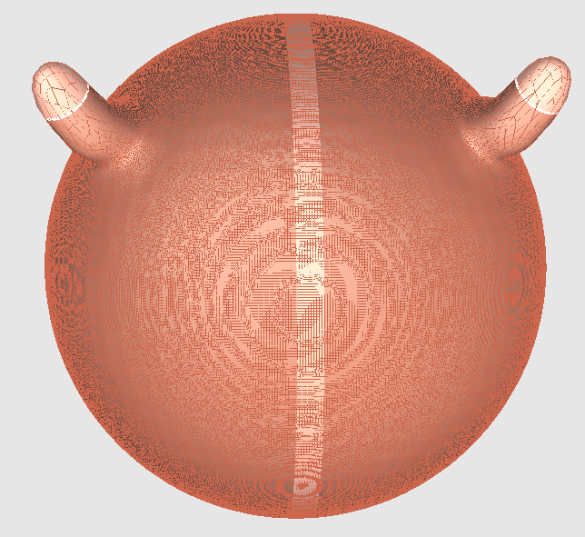
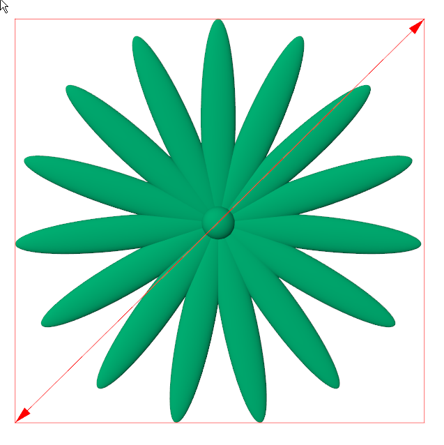
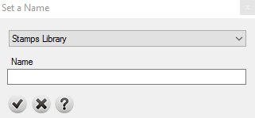

# Heightfield Image

- Source PDF: Matrix 9 User Manual Addendum (matrix9.0_addendum.pdf)
- Page range: 81-82
- Section title: Heightfield Image
- Section id: m9addendum-078-heightfield-image
- Note: boundary page(s) are shared with a neighbouring section (two-column layout); text/images may include neighbour content.

---
<!-- section m9addendum-078-heightfield-image | Heightfield Image | m9addendum pages 81-82 -->

<!-- page 81 -->

Drag: Moves the surface in the
direction of the cursor.
Hot Keys: Toggles on and off Sculpt hot
keys. Hot keys are used to quickly change
between Sculpt brushes. Edit hot keys in
Clayoo options.
### Options:
Resolution: Sets the dimensions of the
heightfield image.
Resolution Y: Controls the
dimension of the heightfield
image along the Y Axis. Adjust
in the builder by clicking on
the up or down arrows or typ-
ing a value in the text field.
### Heightfield Image
Resolution X: Controls the
dimension of the heightfield
image along the X Axis. Adjust
in the builder by clicking on
the up or down arrows or typ-
ing a value in the text field.
Creates heightfield images that can be
used either in the Texture Operation or
Stamp Operation
Where is this Command:
Emboss> Heightfield Images
Steps:
Constrain Proportions:
When this option is
toggled on, adjusting the
X or Y resolution will
adjust both parameters main-
taining the original pro-
portions.
Select the > Heightfield Image from
the Emboss menu.
Select geometry from the viewport
and add it to the builder.
Adjust the parameters in the builder.
Click on the check-mark to save the
Heightfield image.
Specify the library to save to from
the drop-down menu.
Type a name in the text field.
Click on the check mark to save.

<!-- page 82 -->

Location: Specify from the drop-down to
save the heightfield image to either the
Textures Library or the Stamps Library.
Name: Enter a name into the text field.
### Clay Emboss Resources
The red bounding box indicates the res-
olution of the texture. The dimensions can be
editted by dragging the red arrows on either
corner.
Libraries of profiles, texture images and
heightfield images used by the By Profile,
Texture and Stamp Operations. From the
Resources Manager you can add or delete
resources used in the Emboss command.
Where is this Command:
Side: Controls whether the surface uses
the highest or lowest part of the Operation
Geometry. Select the desired option from
the drop-down menu.
Emboss > Clay Emboss Resources
Steps:
Up: Uses the highest part of
the geometry.
Down: Uses the lowest part of
the geometry.
Select Clay Emboss Resources from
the Emboss menu. The Resource
Manager window will open.
Preview
There are three different kinds of
resources:
: Displays a preview of the heigh-
field image that will be created with the
given parameters.
Profiles: The brushes are used
on Emboss command > By pro-
file.
Textures: The textures are
used on Emboss command >
Texture.
Stamps: The stamps are used
on Emboss command >
Stamp.
Select the library to manage.
Save Options: These will appear in a 'Set a
Name' window after clicking on the check-
mark in the builder.
- 76 -

---

## Images

-  page 81 (shared page)
-  page 81 (shared page)
-  page 81 (shared page)
-  page 82 (shared page)
-  page 82 (shared page)
-  page 82 (shared page)
-  page 82 (shared page)
