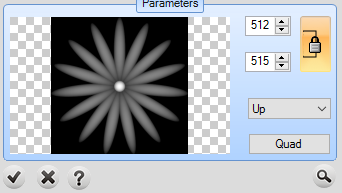
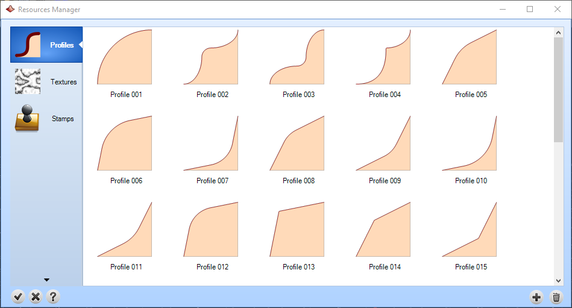
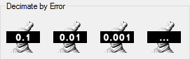
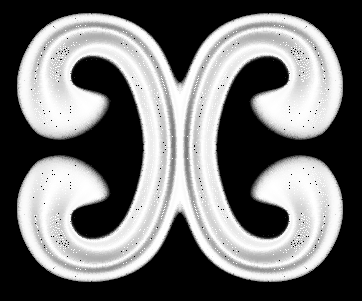
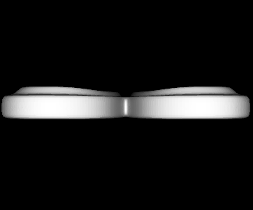

# Clay Emboss Resources

- Source PDF: Matrix 9 User Manual Addendum (matrix9.0_addendum.pdf)
- Page range: 82-83
- Section title: Clay Emboss Resources
- Section id: m9addendum-079-clay-emboss-resources
- Note: boundary page(s) are shared with a neighbouring section (two-column layout); text/images may include neighbour content.

---
<!-- section m9addendum-079-clay-emboss-resources | Clay Emboss Resources | m9addendum pages 82-83 -->

<!-- page 82 -->

Location: Specify from the drop-down to
save the heightfield image to either the
Textures Library or the Stamps Library.
Name: Enter a name into the text field.
### Clay Emboss Resources
The red bounding box indicates the res-
olution of the texture. The dimensions can be
editted by dragging the red arrows on either
corner.
Libraries of profiles, texture images and
heightfield images used by the By Profile,
Texture and Stamp Operations. From the
Resources Manager you can add or delete
resources used in the Emboss command.
Where is this Command:
Side: Controls whether the surface uses
the highest or lowest part of the Operation
Geometry. Select the desired option from
the drop-down menu.
Emboss > Clay Emboss Resources
Steps:
Up: Uses the highest part of
the geometry.
Down: Uses the lowest part of
the geometry.
Select Clay Emboss Resources from
the Emboss menu. The Resource
Manager window will open.
Preview
There are three different kinds of
resources:
: Displays a preview of the heigh-
field image that will be created with the
given parameters.
Profiles: The brushes are used
on Emboss command > By pro-
file.
Textures: The textures are
used on Emboss command >
Texture.
Stamps: The stamps are used
on Emboss command >
Stamp.
Select the library to manage.
Save Options: These will appear in a 'Set a
Name' window after clicking on the check-
mark in the builder.
- 76 -

<!-- page 83 -->

### Options:
ments of 10%, or specify your own per-
centage.
Add: Adds a resource to the selected lib-
rary.
Steps:
Decimate By Error: Specify an error per-
centage in the decimated surface. Presets
are in 10th, 100th, and 1000th of per-
centage.
Click on the Add icon.
Select a heightfield image from the
file browser or, for profiles, an open
curve from the viewport.
Delete: Removes a resource from the
selected library.
Select a resource in the library and
click on the delete button.
Zoom Extents
: Centers and zooms the
model in the viewport.
All these files are in C:\Users\<User
Name>\AppData\Roaming\TDM Solu-
tions\RhinoEmboss\2.0.
Display Mode
: Toggles between display
modes: wireframe, shaded and points.
### Decimator
Reduces the density of meshes while
retaining detail. This can significantly
reduce file sizes for detailed meshes.
Display Mode toggle changes based on the selected mode.
Where is this Command:
From left to right Shaded, Wireframe, Points.
Access this command from Tools > Decim-
ator
Steps:
Figure 1: Shaded Figure 2: Wireframe Figure 3: Points
Set View:
Front: Aligns the view to the
front of the object.
Select Decimator from the Clayoo
toolbar
Select Mesh to reduce density.
Click on one of the Density icons; by
percentage or by error.
Once you have the parameters set,
click on the check mark to accept
the decimated geometry to the view-
port.
Side: Aligns the view to the
side of the object.
### Options:
Decimate By Percentage: Reduces the
model mesh by a set percentage in incre-
- 77 -

---

## Images

-  page 82 (shared page)
-  page 82 (shared page)
-  page 82 (shared page)
-  page 82 (shared page)
-  page 83 (shared page)
-  page 83 (shared page)
-  page 83 (shared page)
-  page 83 (shared page)
-  page 83 (shared page)
-  page 83 (shared page)
-  page 83 (shared page)
