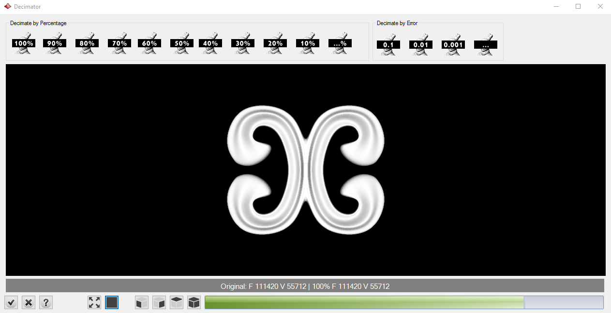
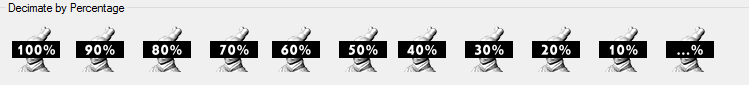
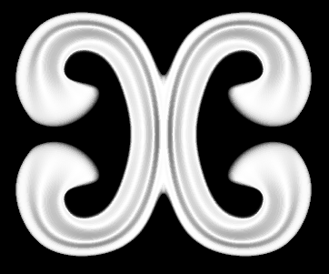
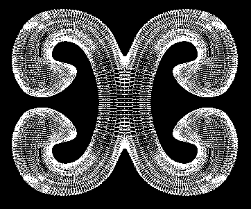
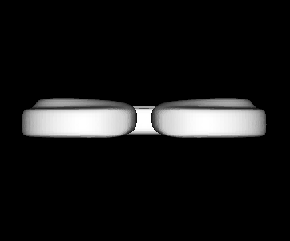
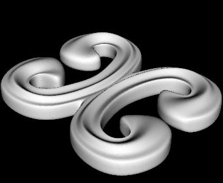

# Decimator

- Source PDF: Matrix 9 User Manual Addendum (matrix9.0_addendum.pdf)
- Page range: 83-84
- Section title: Decimator
- Section id: m9addendum-080-decimator
- Note: boundary page(s) are shared with a neighbouring section (two-column layout); text/images may include neighbour content.

---
<!-- section m9addendum-080-decimator | Decimator | m9addendum pages 83-84 -->

<!-- page 83 -->

### Options:
ments of 10%, or specify your own per-
centage.
Add: Adds a resource to the selected lib-
rary.
Steps:
Decimate By Error: Specify an error per-
centage in the decimated surface. Presets
are in 10th, 100th, and 1000th of per-
centage.
Click on the Add icon.
Select a heightfield image from the
file browser or, for profiles, an open
curve from the viewport.
Delete: Removes a resource from the
selected library.
Select a resource in the library and
click on the delete button.
Zoom Extents
: Centers and zooms the
model in the viewport.
All these files are in C:\Users\<User
Name>\AppData\Roaming\TDM Solu-
tions\RhinoEmboss\2.0.
Display Mode
: Toggles between display
modes: wireframe, shaded and points.
### Decimator
Reduces the density of meshes while
retaining detail. This can significantly
reduce file sizes for detailed meshes.
Display Mode toggle changes based on the selected mode.
Where is this Command:
From left to right Shaded, Wireframe, Points.
Access this command from Tools > Decim-
ator
Steps:
Figure 1: Shaded Figure 2: Wireframe Figure 3: Points
Set View:
Front: Aligns the view to the
front of the object.
Select Decimator from the Clayoo
toolbar
Select Mesh to reduce density.
Click on one of the Density icons; by
percentage or by error.
Once you have the parameters set,
click on the check mark to accept
the decimated geometry to the view-
port.
Side: Aligns the view to the
side of the object.
### Options:
Decimate By Percentage: Reduces the
model mesh by a set percentage in incre-
- 77 -

<!-- page 84 -->

Top: Aligns the view to the top
of the object.
Perspective: Allows you to
freely rotate the model so you
can view it from any angle. In
Perspective view rotate using
the LEFT mouse button (not
the right as in Rhino).
Model information: Describes the original
model and decimated model details as
number of faces and vertices.
When the parameters of the surface are
set as needed, click the check mark to add
the geometry to the viewport, or the ‘X’ to
cancel the command.

---

## Images

-  page 83 (shared page)
-  page 83 (shared page)
-  page 83 (shared page)
-  page 83 (shared page)
-  page 83 (shared page)
-  page 83 (shared page)
-  page 83 (shared page)
-  page 84
-  page 84
