# Text On Curve

- Source PDF: Matrix 9 User Manual Addendum (matrix9.0_addendum.pdf)
- Page range: 88-91
- Section title: Text On Curve
- Section id: m9addendum-085-text-on-curve
- Note: boundary page(s) are shared with a neighbouring section (two-column layout); text/images may include neighbour content.

---
<!-- section m9addendum-085-text-on-curve | Text On Curve | m9addendum pages 88-91 -->

<!-- page 88 -->

### Parameters:
TileX: Controls the number of times the
texture repeats along the X axis. Adjust in
the builder by selecting the Tile X icon at
the left and running the slider below or typ-
ing a value in the text box.
TileY: Controls the number of times the
texture repeats along the Y axis. Adjust in
the builder by selecting the Tile Y icon at
the left and running the slider below or typ-
ing a value in the text box.
Rotation: Rotates the texture. Adjust in the
builder by selecting the Rotation icon at
the left and running the slider below or typ-
### Cap Options:
ing a value between 1-180 in the
text box.
None: Threads will have no caps resulting
in open surfaces.
Flat: Threads will have flat caps.
BlackHeight: Controls the height
of the black areas of the image..
Adjust in the builder by selecting the
Black Height icon at the left and running
Round: Threads will have rounded caps.
the slider below or typing a value
in the text box.
### Parameters:
Thread Size:
WhiteHeight: Controls the height
of the white areas of the image..
Adjust in the builder by selecting the
White Height at the left and running the
slider below or typing a value in
the text box.
Controls the diameter of
each thread. Adjust in the builder
by selecting the Twist Size at the
left, running the slider below, or
typing a value in the box.
### Rope
Threads:
'gvRopeBuilder'
Creates a braided rope around an
input curve.
Controls the number of threads in
the rope. Adjust in the builder by
selecting the Twist icon at the left,
running the slider below, or typing
a number between 1-6 in the box.
Where is this Command:
Twists:
Controls the number of times the
Builder > Rope
Steps:
threads twist along the input
curve. Adjust in the builder by
selecting the Twist icon at the
left, running the slider below or
typing a value in the box.
Thread Spacing:
Select a curve to create a rope
around.
Input the curve into the curve
input box.
Adjust the parameters in the builder
as desired.
Press Enter when done.
Controls the distance of
each thread from the input
curve. Adjust in the builder by
selecting the Thread Spacing
icon at the left, running the slider
below or typing a value in the
box.
### Text On Curve
'ClayEmbossTextOnCurve'
Creates 2D or 3D text along a curve.
Where is this Command:
- 82 -

<!-- page 89 -->

Solids > Text On Curve
Steps:
Note: The fonts that appear are the fonts that are
installed on the computer. Not all fonts are suitable
for manufacturing purposes.
Alignment:
Align Left
: Aligns the text to
the left side of the curve.
Select Text on Curve from the Solids
menu.
Select the curve to define the text
along.
Input the curve in the curve input
box.
Type in the text input field.
Select the font from the drop-down
menu (this will display all fonts
installed on your system. Not all
fonts are suitable for man-
ufacturing).
Set the font parameters in the
builder.
Click the check mark or press Enter
to add the geometry to the viewport.
Align Center
: Centers the
text along the curve.
Align Right
: Aligns the text
to the right side of the curve.
Justify
: Evenly spaces the
text along the curve.
### Options:
Bold
: Bolds the text along the curve.
Text input: Type the text to array along
the selected curve.
Italic
: Italicizes the text along the
curve so it tilts slightly to the right.
Orientation:
Top
: Aligns the top of the
character to the curve.
Font: Specify the font to use from the
drop-down menu.

<!-- page 90 -->

Figure 1: Text Spacing=.2 Figure 2: Text Spacing=.4
Extrusion
: Turns the text into a solid.
The extrusion value controls the distance
of the extrusions. Type in an exact value in
the text box or adjust using the up and
down arrows.
Center
: Aligns the center of
the character to the curve.
Bottom
: Aligns the bottom
of the characters to the curve.
Angle : Controls the angle of the text rel-
ative to the curve. Type in an exact value
in the text box or adjust using the up and
down arrows.
Mirror Left/Right
: Mirrors each char-
acter from left to right.
Mirror Top/Bottom
: Mirrors each char-
acter from top to bottom.
Both Sides: When this option is selected,
along with an extrusion distance set to
greater than zero, the text will create a
solid extruded the specified distance both
sides from the curve.
Text Height
: Controls the overall
height of each character (Uppercase).
Type in an exact value in the text box or
adjust using the up and down arrows.
### Viewport Controls:
Figure 1: Text Height=2 Figure 2: Text Height=3
Text Spacing
Start and End Controls: Use the red dots
at the start and end of the curve to contro
the start and end points of the text along
the curve.l
: Controls the spacing
between characters. Type in an exact
value in the text box or adjust using the up
and down arrows.
When the parameters of the surface are
set as needed, click the check mark to add
the geometry to the viewport, or the ‘X’ to
cancel the command.
- 84 -

<!-- page 91 -->

The new design is now loaded in the lib-
rary and a screen grab is created for the
preview. From here, you have the option to
edit the description of the design and load
a new image.
### Styles
Access a library of ready-made Styles
within a Builder, and save favorite design
component settings as a Style to be used
over and over again.
Where is this Command:
Accessible both in the Options list and in
most builders’ Command Line Options,
“Styles”, where available, comprise the
Gemvision-created “library of parts.”
Load Style Steps:
Select Style from the current builder.
The Style library will load-some lib-
raries have multiple catergories that
can be accesed from the drop down
menu.
Select a style from the library and
Click Apply
### User Libraries
Create your own libraries of designs or ele-
ments to use in Matrix.
Where is this Command:
File > User Library
Related Commands:
Use these commands to add designs to
the User Library:
gvSaveCurrentModelLibraryFormat
Note: Builder defaults, including Styles, are scaled
to gem size based on a range of sizes, so you may
Steps:
need to adjust values if your gem size falls on one
end or the other of that range.
Saving Style Steps:
Select User Library from the File
Menu
Navigate to the desired category in
the library browser.
Select a model and either import or
open.
Adjust the design in the current
builder as desired.
While the design is still active (has
Viewport Control Handles-before
you press Enter), click on Styles in
the builder options.
Click on Add to Library.

---

## Images

- 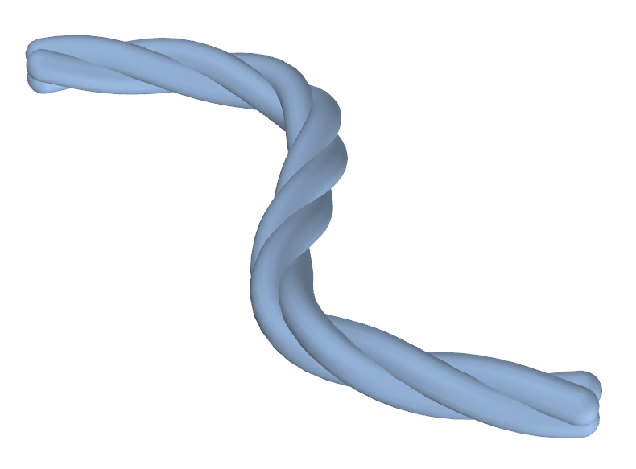 page 88 (shared page)
- 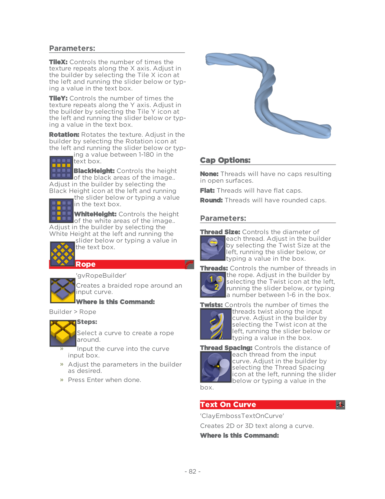 page 88 (shared page)
- 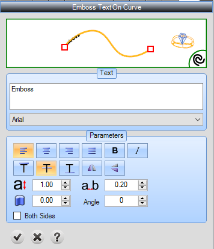 page 89
- 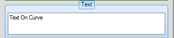 page 89
- 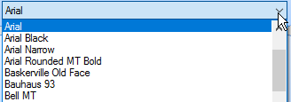 page 89
- 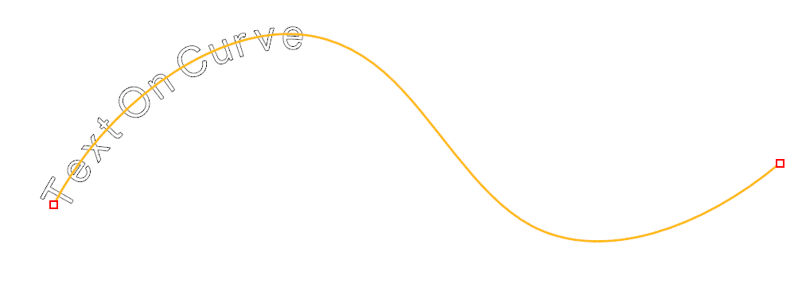 page 89
- 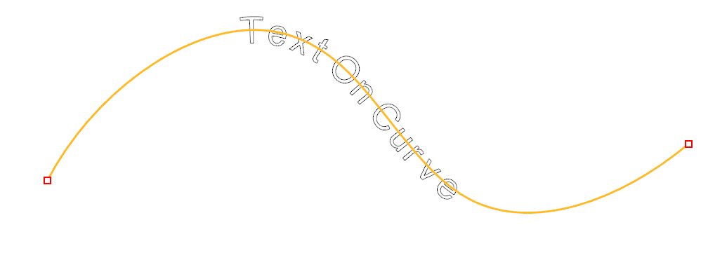 page 89
- 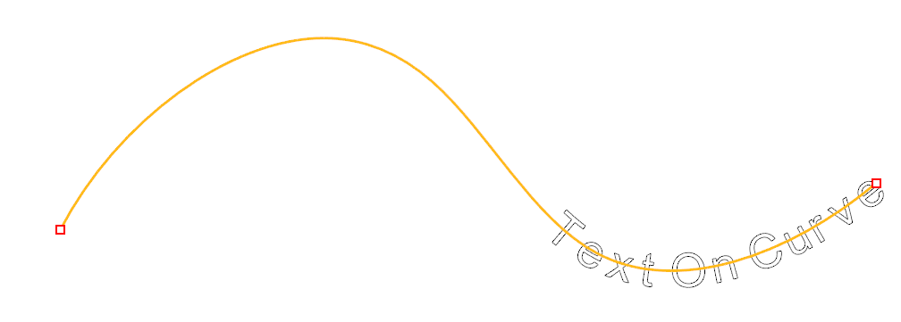 page 89
- 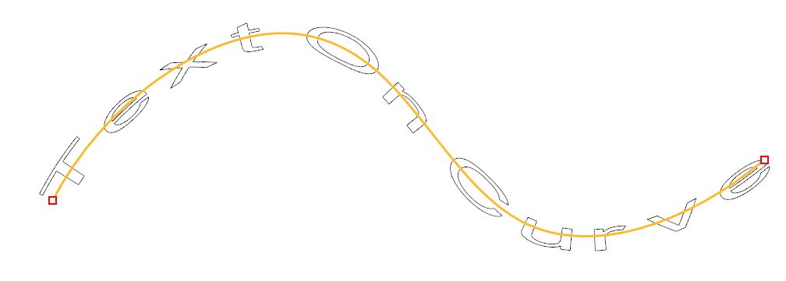 page 89
- 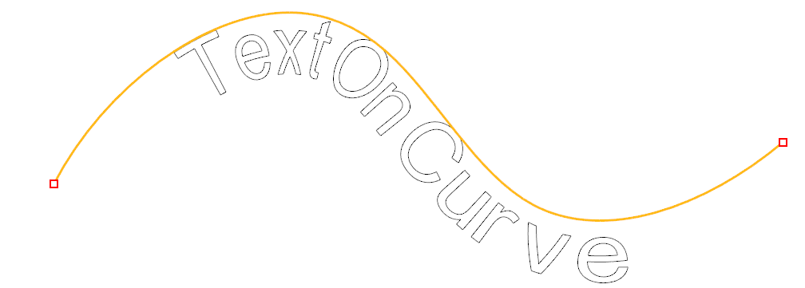 page 90
- 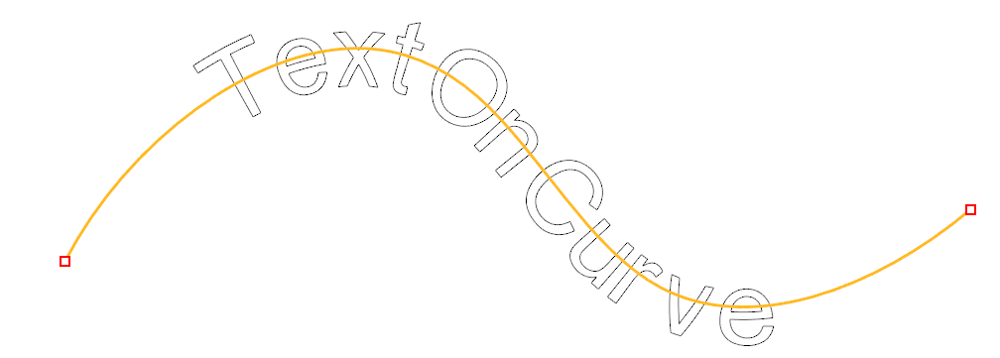 page 90
- 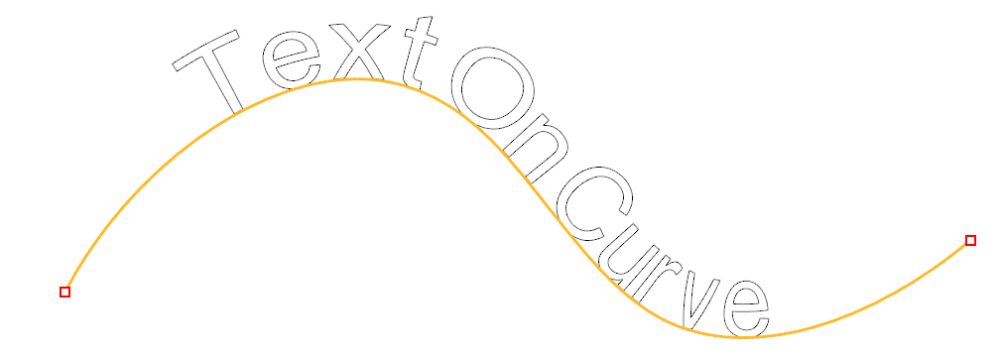 page 90
- 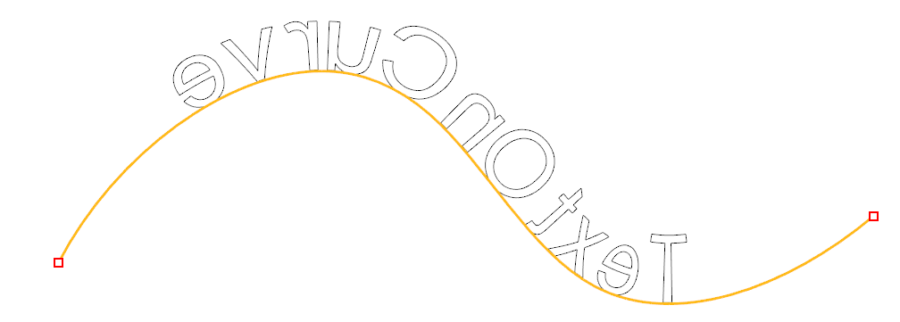 page 90
- 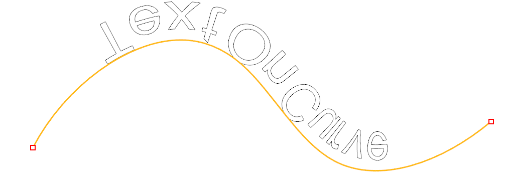 page 90
- 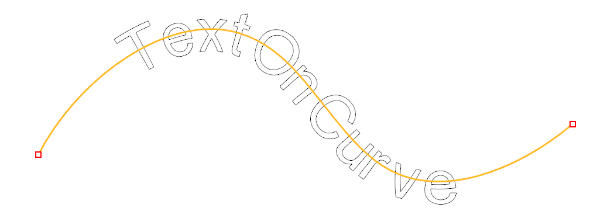 page 90
- 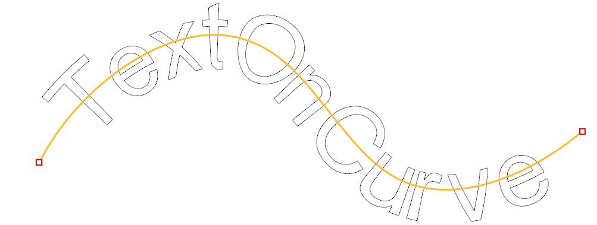 page 90
- 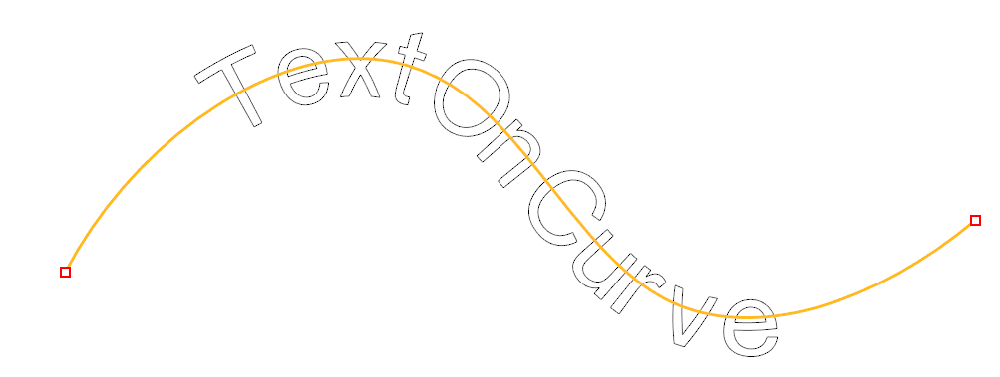 page 90
- 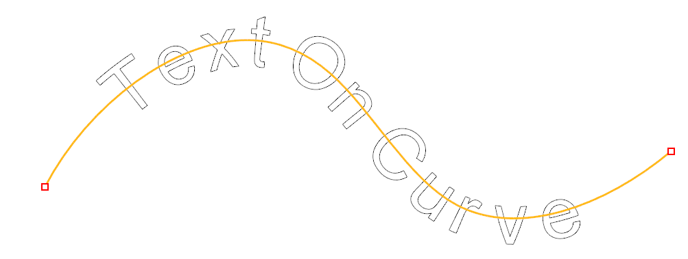 page 90
- 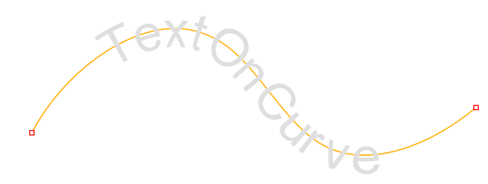 page 90
- 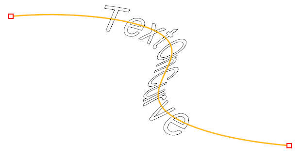 page 90
- 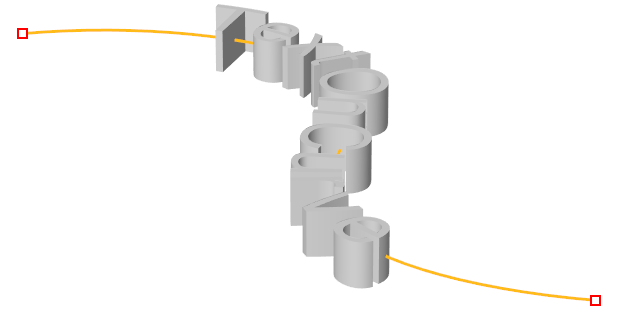 page 90
- 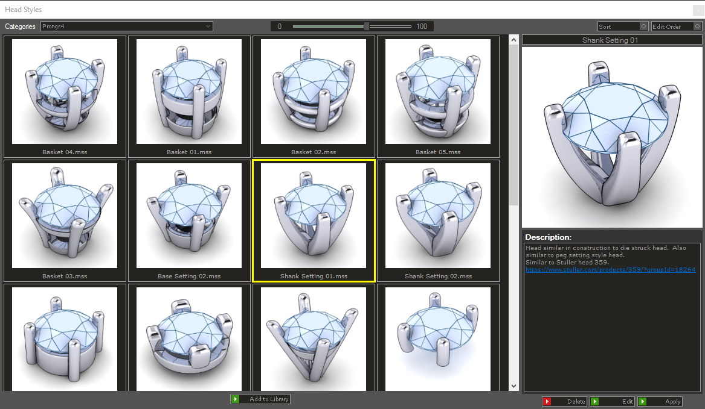 page 91 (shared page)
- 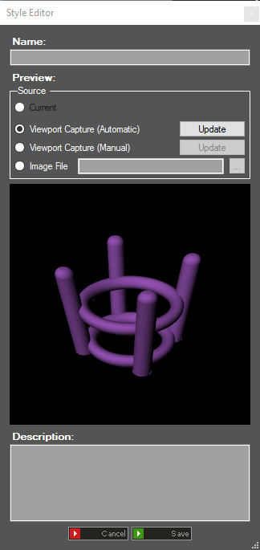 page 91 (shared page)
