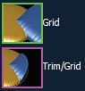
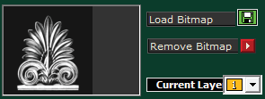
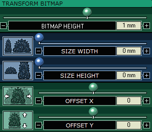
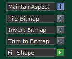
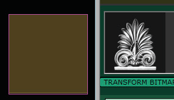
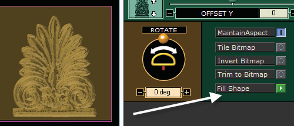
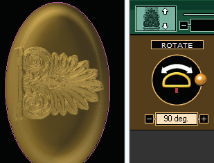
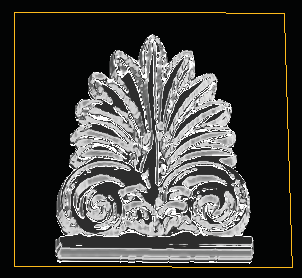

# Picture Menu

- Source PDF: Matrix 8 Instruction Manual Book 2 (matrix_8_book_2.pdf)
- Page range: 104-107
- Section title: Picture Menu
- Section id: m8book2-123-picture-menu
- Note: boundary page(s) are shared with a neighbouring section (two-column layout); text/images may include neighbour content.

---
<!-- section m8book2-123-picture-menu | Picture Menu | m8book2 pages 104-107 -->

<!-- page 104 -->

## Picture Menu
higher layer color so that it only appears where
the lower layer color appears. (See Layer Colors &
the Trim Option, below.)
Grid and Trim / Grid: The Grid setting causes
Matrix Art Picture Menu allows you to import a
bitmap to add texture to your mesh or raise up a
bitmap by creating a 2 1/2-D Mesh Model. Controls
to scale, position, rotate, tile, and invert your image
are available here.
Where is this menu located:
Access this menu from Matrix Art>Picture
Menu
Note: See Introduction & Shared Tools for an
explanation of the shared items at the top of the
page.
Steps:
both layer colors to build up from the
grid (or from any layers either might
already Build up from), so that the
taller layer appears on top. If the
profile of either surface tapers at all,
this makes a more natural overlap between the
two; however, you may want to adjust the “Surface
Height” control for one or both of the layer colors
to make sure the result is to your liking. Trim / Grid
provides the Grid relationship while Trimming the
higher layer color so it only appears where the
lower color appears.
Layer Colors and the Trim Option:
“Trim” with any of the above options “trims” the
surface of the higher layer color so that it ONLY
appears where it overlaps the surface of the lower
color. This means you can trim the background
away from an image if you draw a curve that
outlines the WHOLE bitmap on the higher layer
color; then, trace JUST what you want in the
picture on a LOWER layer color. Trim the higher
layer to the lower one, and you’ve just trimmed
out the parts of the image you don’t want.
Note: This is a “reversal” of the normal strategy
(explained later on in Picture Menu).
### Finishing your project:
• Use Picture Frame (View Menu) to place a bitmap
file in the Matrix viewport.
• Use Duplicate Border (Curve Menu) to create
curves to match the edges of the Picture Frame
surface (for Trim to Bitmap option, if image is
already on a black background). Or, trace the
Picture Frame surface with Rectangle (Curve
menu), if desired, and place on Layers.
• Input the curves in the “Curves” in-box in the
Layers Menu.
• Select a profile shape (flat) and surface height.
• Choose the Picture icon at the top of the Matrix
Art interface.
• Choose Load Bitmap. Find the image file and load
it into Matrix Art. Be sure the “Current” layer is the
Duplicate Border curve layer or desired layer you
wish to place the bitmap.
• Choose “Fill Shape” (green arrow) to fill the entire
closed curve with the bitmap outline.
Note: Using Picture Frame finds the aspect ratio
of an image so the resulting mesh with the applied
image doesn’t appear skewed using Fill Shape.
Adding a “Picture” curve in Layer menu:
Create a curve in Matrix to apply to the picture. If
this will NOT be a tile-able or
Refer to the Introduction and Shared Tools section
for instructions on Creating the Mesh output from
Matrix Art. Adjusting the relationships between
the layers and applying profile shapes for each
layer may give you the desired results. However, if
you wish to add a bitmap image or texture see the
Picture Menu.
repeating texture, for best
results use Picture Frame to
place the image in Matrix
and Duplicate Border to
create the  rectangular
curve. Input curve(s), select a profile shape, and
Surface height in the Layers menu.

<!-- page 105 -->

Steps:
For the 2 1/2 D model: Use the VERY SAME
BITMAP you placed in the viewports during
“Picture Frame.”
For texture: Use whatever curve(s) you have
designated to apply the bitmap to for texture.
Remove Bitmap: Click on the red arrow to
remove a loaded bitmap.
Strategies for Good 2 1/2-D Mesh Models:
• Use Picture Frame in the Matrix Looking Down
viewport. With Picture Frame you can easily re-
size the picture using familiar methods until it’s the
desired size for the final model.
• Trace around the edges of the bitmap using the
Rectangle tool or Duplicate Border.
• Place the tracing curve on the lowest layer
color separate from any other curves. VERY
IMPORTANT: THIS is the curve you will apply the
bitmap to. No matter what else you input into
Matrix Art, be very certain that THIS CURVE is on
its own separate layer color - usually the lowest
color.
• Trace another element in the bitmap and assign
a new layer color, if desired. (See Tips and Tricks
section in Matrix Art.)
The bitmap you load for a 2 1/2 D Mesh model
can’t be just any digital image. For best results,
this should be a high-resolution (at LEAST a
larger-sized picture than the resulting model you
want to make). image with good contrast (large
color differences between the lights and darks
in the image), good lighting, and clear, focused
objects.
Preparing to add a texture:
Simply input the curve(s) as usual. You can add a
texture to any one of these curves; if, however, it
has a “Build” relationship with a layer color above
it, be advised that the texture will ALSO appear
on the higher layer color’s surface as well. To avoid
this, change the relationship between the two to
“Cut” or “Grid”, as described in the Art Layer Menu.
### Applying the Bitmap:
Current Layer: Select in “Current Layer” in
Picture Menu the color curve you wish to use for
the bitmap image. Use the tracing curve or the
designated curve(s) for the texture bitmap.
Load Bitmap: Click on Load Bitmap and
navigate to the location on your computer where
the bitmap is saved. Select it, and click “Open”.
A thumbnail preview of the bitmap will appear
beside the Load Bitmap controls.
Once you have experimented for a while in Matrix
Art, you may wish to do some preprocessing on
an image - trimming out the background, blurring
images that are too “pixel-lated”, brightening
the dark parts, darkening bright parts, or even
painting on lighter or darker colors to change the
way the image will be raised up into a mesh by
Matrix Art. Remember: the “highs and lows” of this
image are what is going to create the shape of the
surface of the mesh.
Note: Use a high resolution, good contrast, large, and
clear image for best results.
Preparing to use Trim to Bitmap: There is a
trick in Matrix Art using the “Trim” functionality in
the Layers menu: place the rectangle around the
outside of the bitmap on a higher layer color and
trace the image(s) you want from the bitmap on a
lower layer color. Trim the higher layer color to the
lower one, and ONLY the part of the bitmap you
Click in the empty picture box or on “Load Bitmap” to
navigate to the saved bitmap file on your computer..

<!-- page 106 -->

want will appear in the mesh, leaving out anything
from the background of the bitmap that you don’t
want in your mesh model.
Offset X, Offset Y: Use “Offset X” and “Offset Y”
sliders to change the placement of the bitmap on
the mesh.
Bitmap with Black Background: If you do
some preprocessing to your image, there’s no
need to run these steps. Simply take the image
into a photo-editing program such as Digital
Goldsmith, Photoshop Elements, or almost any
other similar program, and trace
Maintain Aspect: To
maintain the aspect ratio
of the bitmap (so it
doesn’t skew while you
size it), make sure the
“Maintain Aspect” option
is turned on.
Fill Shape: To fill the curve with the selected
bitmap, click the “Fill Shape” green arrow.
IMPORTANT: If the curve does not match the aspect
ratio of the bitmap, the image WILL be skewed to fill
the extents of the curve when using Fill Shape.
around the edges of the image
from the bitmap that you want.
Paste only this on a pure black
(0,0,0 background, and use this
newly-edited bitmap in the
above procedure (Picture
Frame, trace with Rectangle; input into Curves
menu in Matrix Art; Load same bitmap to this
curve’s layer color). You can then use the “Trim to
Bitmap” command to delete ALL of the pure black
(0,0,0) parts of the bitmap, leaving only the object
you want to raise up as the resulting mesh surface.
Bitmap is
loaded but not
visible in the
mesh preview
before running
“Fill Shape.”
### Transform Bitmap Options
After using “Fill Shape” the bitmap image is now visible in
the mesh preview.
Rotate: Click and hold while moving the ball-
slider or click on “-” and “+” buttons to rotate the
bitmap to acquire the desired angle of rotation.
Bitmap (and
texture)
Height:
“Bitmap Height”
refers to the
height or
thickness of the
texture of the
bitmap. This is
added to the
height assigned to that layer in the Layer Menu in
Matrix Art, so you may wish to scale one of these
settings down if the bitmap causes the surface to
grow too high. It refers to the highest (brightest)
part of the image, so the height will go down from
there based on the lower (darker) parts of the
image.
Width & Height: Use the sliders to control the
“Size Width” and “Size Height” of the bitmap. (Size
Height is the vertical length of the 2D picture and
not the thickness.)
Note: The origin
point of the
bitmap is at the
lower left-hand
corner of the
bitmap -  not its
center - so this
is the origin
around which it
will rotate. Use
Offset X and Y
to re-center the
bitmap.

<!-- page 107 -->

Tile Bitmap: Use “Tile
## Tips and Tricks
Bitmap” to repeat the
bitmap image over the
surface of the mesh. You
may have to adjust the
height and width if Fill
Shape was used at the
start.
Using a Bitmap with Multiple Curves:
To add more shape to a bitmap if, for example,
the image gets darker (the surface goes lower)
where the design should go higher, or to simply
add more definition to a design, you can proceed
to the Effects menu to learn more about editing
the lights and darks of the bitmap. OR, you can
try this: in the Looking Down viewport, trace with
additional closed curves those parts of the image
that are too low or that need more shape and
definition than the bitmap alone can give them.
Invert Bitmap: “Invert Bitmap” will switch the
darks and the lights (lows and highs) of the image,
so that the resulting mesh will instead be low
where the bitmap is light and high where it is dark.
Curve only input (left) results in a flat mesh. Shape curves
and border curve input (right). Add height and shape to
each using Layers menu and the “Build” relationship.
With Invert Bitmap the mesh preview looks like a “candy
mold.” Also, the Bitmap Height is moved to a negative
value to reflect the inverted design.
Trim to Bitmap: Deletes ALL of the pure black
(0,0,0) parts of the bitmap, leaving only the lighter
parts creating an object you want to raise up as
the resulting mesh surface.
Place them on higher layer colors than that of
curve where the bitmap is loaded, so they can
“Build” on the layer color of the bitmap in the
Layer menu - both in texture, height, and profile
shape. Re-input ALL curves into the Layer Menu
in Matrix Art, and place the Bitmap JUST on the
layer color of the rectangle. Adjust the profile
shapes and heights of the additional curves in the
Layer menu (using the Build relationship with the
lower-most color).
When using “Trim to Bitmap” to
remove the black background,
adjust the Surface Height in the
Layer menu until you see the
background drop off. The mesh
output height is controlled by
the Bitmap Height plus “Add
Depth.”

---

## Images

-  page 104
-  page 104
-  page 105
-  page 105
-  page 105
-  page 106
-  page 106
-  page 106
-  page 106
-  page 106
-  page 106
-  page 107 (shared page)
-  page 107 (shared page)
-  page 107 (shared page)
-  page 107 (shared page)
-  page 107 (shared page)
