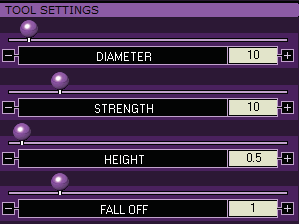
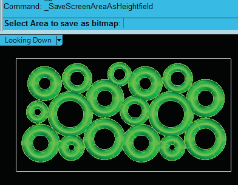
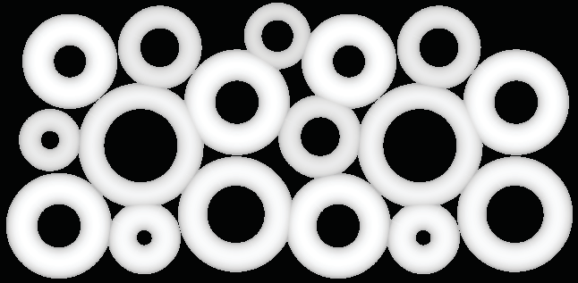
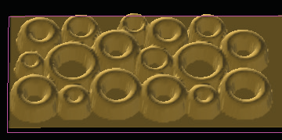

# Convert to Bitmap

- Source PDF: Matrix 8 Instruction Manual Book 2 (matrix_8_book_2.pdf)
- Page range: 112-113
- Section title: Convert to Bitmap
- Section id: m8book2-127-convert-to-bitmap
- Note: boundary page(s) are shared with a neighbouring section (two-column layout); text/images may include neighbour content.

---
<!-- section m8book2-127-convert-to-bitmap | Convert to Bitmap | m8book2 pages 112-113 -->

<!-- page 112 -->

options to change the way the tool works as you
click and drag it over the surface to sculpt.
• Then, use Smooth, Smudge, Fade or Erase if
needed.
Fall Off: “Fall Off” refers to the gradualness
between the painted and un-painted areas. To
blend them together more gradually, set a higher
Fall Off value. To make the difference very swift
and steep, set a lower Fall Off value.
Undo: This will undo the last change made.
Redo: This will redo the last change made.
Reset: This will reset the mesh preview back
to the original state it was before the Sculpt
tools were applied. It will undo ALL instances of
sculpting on your design.
Finishing your Project:
Refer to the Introduction and Shared Tools section
for instructions on Creating the Mesh output from
Matrix Art.
Smooth, Smudge, Fade, and Erase:
Smooth, Smudge, Fade, and Erase only work
AFTER you’ve used Deposit and Carve. These
remaining four tools work to temper, outright
“Erase”, or otherwise edit the work you do with the
other two main carving tools - Deposit and Carve.
They work in increasing degrees of strength, with
“Smooth” being the most subtle, “Smudge” being
a bit more aggressive, and “Fade” being the most
aggressive. “Erase” outright erases any sculpting
you’ve done, leaving the “painted on” part of
the surface the way it was prior to any sculpting
operation.
## Convert to Bitmap
### Tool Settings:
‘SaveScreenAreaAsHeightfield’
This Matrix Art Tool saves a picture of any model
on-screen as a bitmap ready to be used in Matrix
Art. Start by modeling shapes and designs in
Matrix as solid objects.
Where is this tool located:
Access this menu from Matrix Art>Layer,
Picture, Effects or Sculpt Menus
Steps:
Diameter: Raise or lower the “Diameter” slider
which represents the size of the “brush” that will
“paint” the area to be affected by the these tools.
As the cursor approaches the model, you’ll see a
circle appear.
Strength: Raise or lower, respectively, this slider
to change how quickly and easily or slowly and
gradually the paint tool works.
• Create a design using solid objects in Matrix (Torus,
Pyramid, Sphere, etc)
• Run “Convert to Bitmap.”
• Select the Area to save as a Bitmap. Click and drag
your cursor (Rectangle selection box) over the
objects onscreen.
• A File dialog will open. Name and save the bitmap
file.
• Input a curve in Matrix Art.
• Add the bitmap to the curve to create a texture
mesh.
Height: Adjust the height of “Deposit” or “Carve”
by increasing or decreasing this amount.

<!-- page 113 -->

you’ll be prompted to save it. Save it to a location
you can remember for later use in Matrix art.
### About this Rectangle:
The space around the object
Torus shapes were used to create a design used with
“Convert to Bitmap.”
About Convert to Bitmap: This tool simply
takes a snapshot of the active viewport in
grayscale format so you can use it in the Matrix
that you enclose with a
rectangle while this tool is
“taking the picture”
determines how much “black
space” or background you’ll
have in your image. For
instance, if this will be a repeating texture, you
might want very little space around each
repeating object in the case of the Torus texture;
but in the case of a bubble texture, you might
want a little more to space the bubbles out
interestingly over your design. Let the design
determine how much of the viewport you enclose
in this rectangle.
Art > Picture
menu. It is best
used when you
wish to create
your own texture
for use in Matrix
Art - for example,
a torus pattern, pyramids, “bubbles” design, or
other simple shapes which you can draw with
Matrix tools and capture to a bitmap to create an
interesting design.
The mesh preview showing the Torus design with the
bitmap applied.
### Another way to use this tool:
Create the Design in the Viewport:
Create the design in the viewport you wish to
capture as a bitmap (usually the Looking Down
viewport). When setting the viewport up to “take
the picture”, keep in mind that you want the
biggest, highest-quality picture for Matrix Art. It’s
best to maximize the viewport I’m going to take
a picture of and zoom in almost to the extents
of the part; remembering I must still have a
rectangular space around the part in order to tell
the tool where to “snap” the picture so as not to
cut any off.
You will recall that Matrix Art has no “Save Styles”
and no way to save your settings. If you find
yourself in a bind, this tool can capture - as you’ll
recall - ANYTHING in the viewport; including a
Matrix Art preview mesh. So, pose the Matrix Art
preview mesh as large as you can in the Looking
Down viewport and take a snapshot of it using
this tool; re-apply this bitmap using the Matrix Art
> Picture menu next time you run the tool, and
you’ve got a way to save your settings and re-load
them.
Pose the Design and Choose Convert to
Bitmap: With the object “posed” and ready in
the viewport of your choice, start up this tool and
you’ll be prompted to draw a rectangle around the
part to capture. After you’ve captured the image,

---

## Images

-  page 112 (shared page)
-  page 112 (shared page)
-  page 113
-  page 113
-  page 113
-  page 113
