# Layer Menu (Matrix Art)

- Source PDF: Matrix 8 Instruction Manual Book 2 (matrix_8_book_2.pdf)
- Page range: 101-103
- Section title: Layer Menu (Matrix Art)
- Section id: m8book2-122-layer-menu-matrix-art
- Note: boundary page(s) are shared with a neighbouring section (two-column layout); text/images may include neighbour content.

---
<!-- section m8book2-122-layer-menu-matrix-art | Layer Menu (Matrix Art) | m8book2 pages 101-103 -->

<!-- page 101 -->

### Creating the Mesh:
## Layer Menu (Matrix Art)
Capped: This defaults on and caps the back of
the mesh to create a closed mesh.
Matrix Art Layer Menu allows you to input curves
and apply profile shapes to the curves that will be
used to create the mesh. Matrix Art references the
order of the Layers menu in Matrix to establish the
relationship between the curves that are input into
Matrix Art.
Where is this menu located:
Access this menu from Matrix Art>Layer Menu
Steps:
• In Matrix create closed curves that follow a
bitmap image or of any shape you desire.
• Input closed curve(s) into the curve in-box.
Capped is “On” (left) and “Off” (right) when mesh was
created.
Adjust the
relationship
between each
curve Layer color
on the Layer Grid.
Drop Depth: Drop Depth adds the value you
type into the box, in mm, beneath the Looking
Down grid to add height to the resulting mesh.
The mesh must be capped when using Drop
Depth.
Note: See Introduction & Shared Tools for an
explanation of the shared items at the top of the
page.
### Curves:
A Drop Depth of 2 mm was added to the mesh on the right.
Rules for Curves:
1. All curves must be closed.
Create Mesh: Clicking this
green arrow will create the
mesh object. Before doing
so, select one or both
options from Capped and
Drop Depth as needed.
2. All curves must be planar (drawn
flat against the grid).
3. All curves must be drawn in the
Looking Down viewport.
4. All curves must be assigned
a specific Layer color according to the results
desired.
5. After editing curves, input all the curves back
into the Curve in-box.
Convert to Bitmap: Convert to Bitmap saves
the Looking Down image of the heightfield you’ve
been creating, or, the dark to light contour map
of your current design, so you can re-apply it in a
more advanced use of Matrix Art. (See detailed
description in the sub-menu under Matrix Art)
Rules for Ordering Layer Colors:
1. Assign a Layer color (in Matrix main Layer menu)
before the curve is entered into the “Curves” box.
2. Assign the same Layer color to all curves that
will need to be controlled together. These curves
will have the same profile shape and height.
3. If a curve is INSIDE another curve of the same
color, a hole will result.

<!-- page 102 -->

• Mouse over options in the Profile browser to see
the profile shape change.
• Click a profile from the library to select it, and the
library will close. The selected shape will appear in
the “Interactive Profile” window.
Interactive Profile:
A default profile is available or
4. Place the curves that represent the lowest
surfaces of the model on the lowest layer colors
starting with Creation Yellow (1), and then Cutting
Orange (2), Finger Brown (3) and Heads Purple
(4), etc.
5. Place the highest parts of the model on the
higher layer colors (Metal 01 is highest).
6. To change a curve’s layer color after inputting
them, change the color the usual way in the
viewports and then re-input ALL curves back into
Matrix Art to make the changes.
Layer Grid: Each curve’s layer color is
represented by the numbered color.
load a profile from the
browser. After the profile is
loaded it will appear in the
“Interactive Profile box.” This
only represents one half of the profile shape: every
profile is automatically Mirrored.
Profile Edit Options:
Activate a Layer:
You’ll need to make a layer
Edit Interactive Profile: Click and drag the
profile’s control points
color “active” to change the
profile shape and height, or
to control the relationship
between two layer colors
(higher layer must be active
to do this).
(squares) in the interactive
profile window. You’ll see
the changes in real-time in
the viewports as you
change the shape.
Layer 4 (Purple) is active.
Steps:
Edit Profile from Browser: Click the “Edit
• To make a layer active, click its number on the left-
hand side of the grid. The number will become
highlighted with a pink outline around it to show
it’s active.
### Load Profile:
Profile” button just beneath
“Load Profile.” In the Edit
Profile window that appears, use the Curve tools
to draw a new profile shape or edit the existing
shape. If you wish, use the controls in the window
to Save it to the Matrix Art profile library so you
can use it again.
Click on “Load Profile” to change the profile shape
of the active layer. The mesh preview will display
the applied profile shape.
Steps:
Use the Curve tools to edit the profile. After editing click
on Set on Axis, Auto Scale and Return Profile to close the
Profile Editor. If desired, name and save the profile first.
• Click on the green arrow to open the Profile
Browser window.

<!-- page 103 -->

Change Profile Height of Active Layer:
Click again in the grid square (swatch) to continue to
toggle through all the relationship options for Layers 1 & 2,
orange and yellow. “Cut” is shown above.
Click and drag the “Surface Height” slider control,
or type a new value into the text box, to change
the height, in mm, of the active layer. Remember
that if the layer relationship (explained next)
includes the “Build” relationship, the height of the
profile will “Build up on” the height of the layer
colors beneath it, so add this in when adjusting
the profile shapes for layers “on top of” other
layers. Each layer defaults to 1 mm in height and is
noted so on the left side of the grid.
### Adjusting the Relationships between
### Layers
Activate the Dominant Layer Color:
When (at least) two preview surfaces on different
layer colors overlap in Matrix Art, and the result is
undesirable, control the relationship between the
two using the grid interface.
Steps:
Click the swatch where the two colors interact to
toggle through six relationships: Each of the
relationships between these two colors is
displayed in a “key” above the grid. These are
Build, Cut, Grid, Trim/Build, Trim/Cut, Trim/Grid.
The color of these controls (white, blue, green,
yellow, aqua, pink) will be the color of the outline
of the swatch as you click it, and will light up in the
key, revealing which relationship is being displayed
in the viewports.
Build and Trim/ Build: Trim / Build provides
the Build relationship while Trimming
the higher layer color so that it only
appears where the lower layer color
appears. (See Layer Colors & the Trim
Option, below.)
• Activate the dominant (higher) layer color on the
grid so it’s outlined in pink.
•  Find the color of the lower surface that is
interacting with it from among the swatches of
color at the bottom of the grid. The location on
the grid (swatch) where the lower color (in the
bottom row of the grid) and the active color (in
the left column of the grid) line up is where to
click in order to control their interaction.
•  Left-click to move forward through the 6
relationship options.
•  Right-click to move backward through them.
Note: Each option refers to the HIGHER layer color
and its relationship to the lower layer color. “Build”
causes the higher layer’s surface to build up on (or
add to) the profile shape and height of the lower
layer color. It is the default setting for overlapping
surfaces in Matrix Art.
Cut and Trim / Cut: The “Cut” setting allows the
Click in the
grid square
to adjust the
relationship
between
Layers 1 & 2,
orange and
yellow.
(Trim/Build)
higher layer color to cut through the
lower one, ignoring the height and
profile shape of the lower layer color
as if it were not even there. Trim / Cut
provides the Cut relationship
between the two layer colors while Trimming the

---

## Images

- 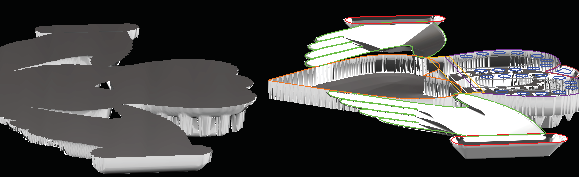 page 101 (shared page)
- 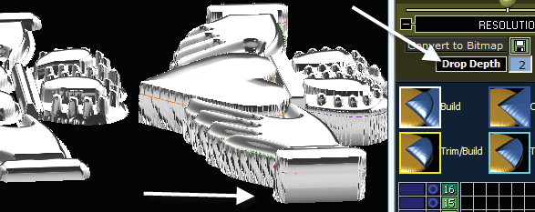 page 101 (shared page)
-  page 101 (shared page)
-  page 101 (shared page)
-  page 101 (shared page)
- 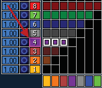 page 102
- 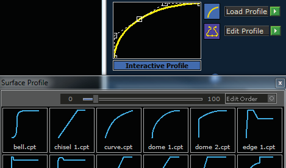 page 102
- 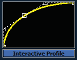 page 102
- 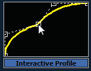 page 102
- 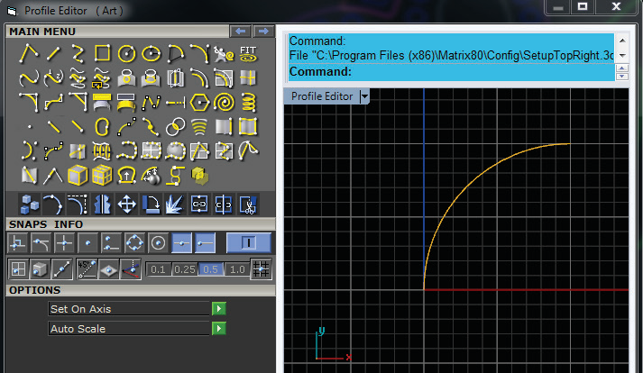 page 102
- 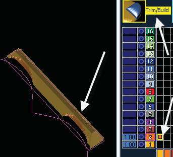 page 103
- 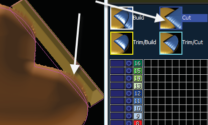 page 103
- 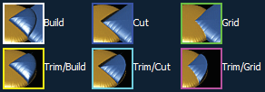 page 103
- 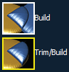 page 103
- 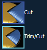 page 103
