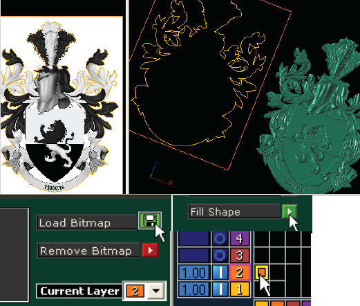
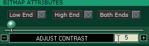
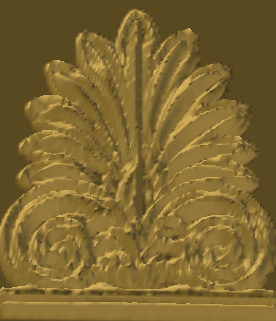
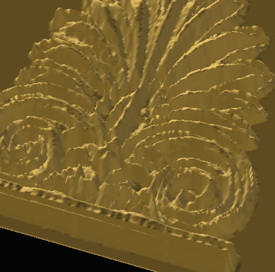
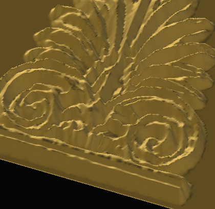
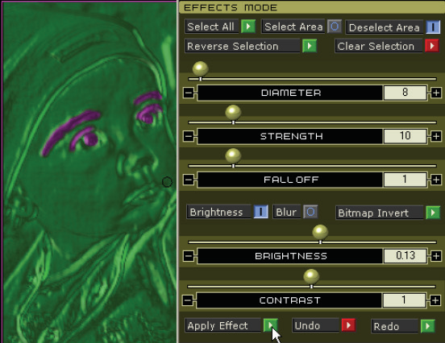
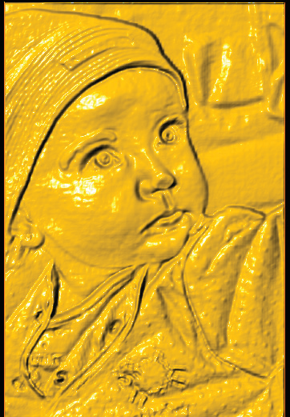

# Effects Menu

- Source PDF: Matrix 8 Instruction Manual Book 2 (matrix_8_book_2.pdf)
- Page range: 108-111
- Section title: Effects Menu
- Section id: m8book2-125-effects-menu
- Note: boundary page(s) are shared with a neighbouring section (two-column layout); text/images may include neighbour content.

---
<!-- section m8book2-125-effects-menu | Effects Menu | m8book2 pages 108-111 -->

<!-- page 108 -->

## Effects Menu
Matrix Art Effects Menu allows you to edit the
picture you imported in the Picture Menu. Change
the brightness, blur and contrast to improve the
look of the mesh.
Using Layer Strategy to Trim to Bitmap:
There is an alternative to preprocessing the
bitmap - or, placing it on a black background -
for use with “Trim to Bitmap”. As shown below,
place the unedited Background Bitmap into the
viewports and trace it with a rectangle curve
as usual (orange rectangle below). Then, trace
around ONLY the parts you want with closed
curves (yellow shape below).
Where is this menu located:
Access this menu from Matrix Art>Effects
Menu
Steps:
• Choose the Effects icon at the top of the Matrix
Art screen.
Note: See Introduction & Shared Tools for an
explanation of the shared items at the top of the
page.
### How the Effects Menu Works:
As you now know, Matrix Art is a heightfield from
bitmap modeler which, simply put, means that the
dark parts of the image create the low parts of the
resulting surface and the light parts of the image
create the high parts of the resulting surface.
IMPORTANT: The layer color of the rectangle must
be HIGHER than the layer color of the parts you want
to keep! Input all curves into Matrix Art, and apply
the bitmap to the RECTANGLE curve in the Picture
menu.
IMPORTANT: Use “Fill Shape” to fill the rectangle
with the picture! Then, in the Layers menu, establish
the relationship between the rectangle curve (higher
color) and the shape you want to keep (lower color)
as Trim/Build. Now, the image will only appear where
the shape you want appears: effectively “trimming”
out the background.
But what if the image you hand it doesn’t make
the best surface? Maybe the contrast isn’t high
enough to make a noticeable difference between
the high and low parts; or maybe the pixels are
too sharp and visible in the image and the results
you want are soft and organic. Maybe, the lighting
in your image makes the surface low where it
should be high, or high where it should be low?
How can you fix all this without lots of trial and
error in a preprocessing image editor?
### Finishing your project:
Refer to the Introduction and Shared Tools section
for instructions on Creating the Mesh output from
Matrix Art. If greater effects are desired in the
mesh proceed to the Effects and/or Sculpt Menus.
The Effects menu can do all this and more. It
directly accesses the bitmap you loaded into
Matrix Art in the Picture menu, allowing you
to adjust aspects of the image such as overall
contrast and blur. It also allows you to “paint”
directly onto the parts of image in the resulting
mesh that you’d like to adjust for brightness, blur,
or contrast and see the results in real-time on-
screen as you work.

<!-- page 109 -->

### Bitmap Attributes
Blur Amount - Low, Medium and High:
This applies Blur to the entire bitmap at once.
Increased blur produces a smoother surface with
less definition.
Adjust Contrast: Select one of the three
following settings - Low End, High End or Both
Ends - and then move the “Adjust Contrast” slider
to increase or decrease that effect.
Before (left) and after (right) Blur is applied to the mesh
(High Blur). The preview mesh is less jagged and more
smooth.
Low End: This allows the Adjust Contrast slider
to raise the low (dark) parts of the bitmap up
toward “gray” or the middle of the color spectrum,
making them less deep. Use this for illustrations
with extra markings in them that you don’t want to
see in your design.
### Effects Mode Tool:
High End: This does the opposite of Low End,
bringing the light areas down toward the middle
or gray.
Use these tools to edit the preview with “painting”
tools controlled by the mouse. Everything
“painted” with this tool will be affected by the
“Brightness, Blur, or Invert” tools at the bottom of
the interface.
High Contrast amount is lowered in this image.
Before (left) and after (right).
Both Ends: This brings the lights down and the
darks up at the same time. Experiment with these
settings each time you load a bitmap into the
Picture menu, as every image is different.
Add Effects to a Bitmap:
Steps:
• “Select Area” should be active, turned ‘ON’.
• Adjust the tool size Diameter you wish to use.
Mouse over the preview and you will see a circle.
• Select Brightness or Blur (only one can be used at
a time). Set a Brightness or Blur value.
• Click and drag over the areas you wish to

<!-- page 110 -->

Diameter: Raise or lower the “Diameter” slider
which represents the size of the “brush” that will
“paint” the area to be affected by the these tools.
As the cursor approaches the model, you’ll see a
circle appear.
Strength: Raise or lower, respectively, this slider
to change how quickly and easily or slowly and
gradually the paint tool works.
affect with Brightness or Blur. The mesh will be
highlighted in pink.
• If needed, choose “Deselect Area”; click and drag
any area you wish to remove “painting” from the
mesh.
• When you see the desired effect, click “Apply.”
• If necessary, use another effect before clearing the
selection.
• Or, choose “Clear Selection” and repeat the steps
above to choose another part of the mesh to
affect with Brightness and Blur.
Fall Off: “Fall Off” refers to the gradualness
between the painted and unpainted areas. To
blend them together more gradually, set a higher
Fall Off value. To make the difference very swift
and steep, set a lower Fall Off value.
Brightness: After clicking and dragging over the
area on the bitmap you wish to change, select
“Brightness.” Additional slider values will appear
(Brightness and Contrast). Adjust these to set
the Brightness of the selected area to your liking.
Increasing the Brightness amount will lighten the
bitmap, thus raising the area you have selected.
Contrast slightly increases or decreases the
Brightness amount.
Original image (left) and completed mesh output (right)
after adding Effects (brows and eyes) and Sculpting (nose,
cheeks, and lips).
Select All: This selects all of the image to be
used for editing.
Blur: After clicking and dragging over the area
on the bitmap you wish to change, select “Blur.”
Additional slider values will appear (Blur size and
Blur Amount). Adjust these to set the Blur of the
selected area to your liking.
Bitmap Invert: This reverses the high and low
parts (dark and light colors) of the selected parts
of the surface.
Select Area: When turned on, click and hold
while moving your cursor over the area on the
bitmap preview that you wish to ‘paint’ for editing.
This area will appear purple.
Apply Effect: Applies the Brightness, Blur or
Bitmap Invert effect made to the selected area.
Be sure to Clear the Selection after applying the
effect, and your changes are complete.
Deselect Area: When turned on, click and hold
while moving your cursor over the selected purple
area on the bitmap preview that you wish to
remove for editing. This area will deselect and not
appear purple.
Reverse Selection: ‘Paint’ only what you DON’T
want selected and click “Reverse Selection” to
select most of the image.
Note: If you paint more of the surface and make
changes, the changes will affect everything that is
selected, so it is better to use “Apply”, then “Clear
Selection”, and then select brand-new areas to
change. Undo and Redo work for each new “Apply
Changes” step.
Undo: This will undo the last change made.
Clear Selection: Click on the red arrow to
remove all selected areas.

<!-- page 111 -->

Redo: This will redo the last change made.
### Finishing your project:
Refer to the Introduction and Shared Tools section
for instructions on Creating the Mesh output from
Matrix Art. Proceed to the Sculpt Menu if desired.
expect you can by looking at the menu. Instead,
to do this, return to the Effects menu. Yet you
CAN use the Sculpt menu to adjust parts of the
mesh that may be textured - raising them up or
lowering them down in a way more fitting to your
design - as when forming the cheeks, nose, or
eye-sockets of a person; the muzzle of a dog; the
surface of a leaf, etc.
## Sculpt Menu
### Sculpt Mode:
Matrix Art Sculpt tools can be used with or
without a picture. Fine-tune a design with a
picture, as you lift up, Deposit, or cut into, Carve,
mesh to sculpt the surface of the mesh.
Where is this menu located:
Access this menu from Matrix Art>Sculpt Menu
Steps:
• Choose the Sculpt icon at the top of the Matrix Art
screen.
Note: See Introduction & Shared Tools for an
explanation of the shared items at the top of the
page.
### Comparing the Sculpt & Effects Menus:
Like the Effects menu, you will click and drag the
“painting” tool connected to the cursor over the
mesh preview in order to change it in the various
modes: Deposit, Carve, Smooth, Smudge, Fade, or
Erase.
Deposit and Carve: Deposit adds to or builds
the height of the preview mesh. Carve takes away
or reduces the height of the preview mesh. All the
changes are as you see them.
Sculpting lifts up the
mesh and bitmap texture.
To create subtle details,
raise Falloff and Height,
lower Strength, and set
the appropriate Diameter
(smaller for nose, larger
for cheeks). See image of
completed mesh in the
Effects menu.
Steps:
Unlike the Effects menu, these changes do NOT
affect the bitmap in any way. Here is the analogy I
like to use. Have you ever seen a cat playing under
a bedspread? You see the little lump where the
cat is moving around, but it doesn’t change the
pattern on the bedspread. This is how the Sculpt
menu works. It does not affect the texture on
the bitmap at all (the pattern on the bedspread);
it merely raises it up or pushes it down (the cat
playing underneath it). To continue this analogy,
the Effects menu actually changes the pattern on
the bedspread.
• Begin by selecting either “Deposit” or “Carve”.
• Click and drag the “tool” over the mesh preview to
change it.
• Use the Diameter, Strength, Height, and Fall Off
For that reason, you CAN’T use the Sculpt menu
to “smooth” a lumpy texture the way you might

---

## Images

-  page 108
-  page 109
-  page 109
-  page 109
-  page 109
-  page 109
-  page 109
-  page 110
-  page 110
-  page 111 (shared page)
-  page 111 (shared page)
