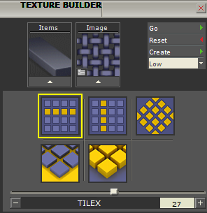
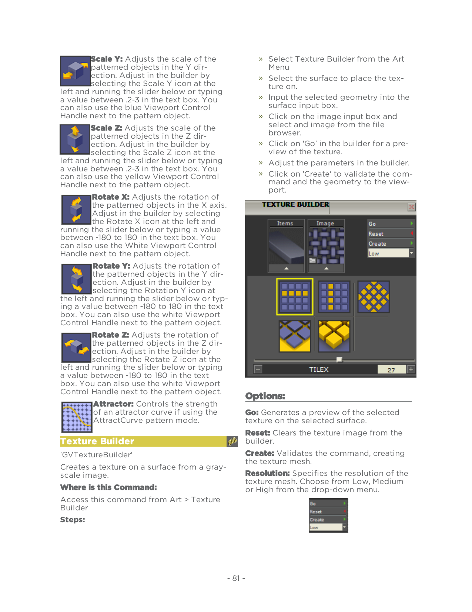

# Texture Builder

- Source PDF: Matrix 9 User Manual Addendum (matrix9.0_addendum.pdf)
- Page range: 87-88
- Section title: Texture Builder
- Section id: m9addendum-083-texture-builder
- Note: boundary page(s) are shared with a neighbouring section (two-column layout); text/images may include neighbour content.

---
<!-- section m9addendum-083-texture-builder | Texture Builder | m9addendum pages 87-88 -->

<!-- page 87 -->

Scale Y: Adjusts the scale of the
patterned objects in the Y dir-
ection. Adjust in the builder by
selecting the Scale Y icon at the
left and running the slider below or typing
a value between .2-3 in the text box. You
can also use the blue Viewport Control
Handle next to the pattern object.
Scale Z: Adjusts the scale of the
patterned objects in the Z dir-
ection. Adjust in the builder by
selecting the Scale Z icon at the
left and running the slider below or typing
a value between .2-3 in the text box. You
can also use the yellow Viewport Control
Handle next to the pattern object.
Select Texture Builder from the Art
Menu
Select the surface to place the tex-
ture on.
Input the selected geometry into the
surface input box.
Click on the image input box and
select and image from the file
browser.
Click on 'Go' in the builder for a pre-
view of the texture.
Adjust the parameters in the builder.
Click on 'Create' to validate the com-
mand and the geometry to the view-
port.
Rotate X: Adjusts the rotation of
the patterned objects in the X axis.
Adjust in the builder by selecting
the Rotate X icon at the left and
running the slider below or typing a value
between -180 to 180 in the text box. You
can also use the White Viewport Control
Handle next to the pattern object.
Rotate Y: Adjusts the rotation of
the patterned objects in the Y dir-
ection. Adjust in the builder by
selecting the Rotation Y icon at
the left and running the slider below or typ-
ing a value between -180 to 180 in the text
box. You can also use the white Viewport
Control Handle next to the pattern object.
Rotate Z: Adjusts the rotation of
the patterned objects in the Z dir-
ection. Adjust in the builder by
selecting the Rotate Z icon at the
left and running the slider below or typing
a value between -180 to 180 in the text
box. You can also use the white Viewport
Control Handle next to the pattern object.
### Options:
Attractor: Controls the strength
of an attractor curve if using the
AttractCurve pattern mode.
Go: Generates a preview of the selected
texture on the selected surface.
Reset: Clears the texture image from the
builder.
### Texture Builder
'GVTextureBuilder'
Create: Validates the command, creating
the texture mesh.
Creates a texture on a surface from a gray-
scale image.
Where is this Command:
Resolution: Specifies the resolution of the
texture mesh. Choose from Low, Medium
or High from the drop-down menu.
Access this command from Art > Texture
Builder
Steps:
- 81 -

<!-- page 88 -->

### Parameters:
TileX: Controls the number of times the
texture repeats along the X axis. Adjust in
the builder by selecting the Tile X icon at
the left and running the slider below or typ-
ing a value in the text box.
TileY: Controls the number of times the
texture repeats along the Y axis. Adjust in
the builder by selecting the Tile Y icon at
the left and running the slider below or typ-
ing a value in the text box.
Rotation: Rotates the texture. Adjust in the
builder by selecting the Rotation icon at
the left and running the slider below or typ-
### Cap Options:
ing a value between 1-180 in the
text box.
None: Threads will have no caps resulting
in open surfaces.
Flat: Threads will have flat caps.
BlackHeight: Controls the height
of the black areas of the image..
Adjust in the builder by selecting the
Black Height icon at the left and running
Round: Threads will have rounded caps.
the slider below or typing a value
in the text box.
### Parameters:
Thread Size:
WhiteHeight: Controls the height
of the white areas of the image..
Adjust in the builder by selecting the
White Height at the left and running the
slider below or typing a value in
the text box.
Controls the diameter of
each thread. Adjust in the builder
by selecting the Twist Size at the
left, running the slider below, or
typing a value in the box.
### Rope
Threads:
'gvRopeBuilder'
Creates a braided rope around an
input curve.
Controls the number of threads in
the rope. Adjust in the builder by
selecting the Twist icon at the left,
running the slider below, or typing
a number between 1-6 in the box.
Where is this Command:
Twists:
Controls the number of times the
Builder > Rope
Steps:
threads twist along the input
curve. Adjust in the builder by
selecting the Twist icon at the
left, running the slider below or
typing a value in the box.
Thread Spacing:
Select a curve to create a rope
around.
Input the curve into the curve
input box.
Adjust the parameters in the builder
as desired.
Press Enter when done.
Controls the distance of
each thread from the input
curve. Adjust in the builder by
selecting the Thread Spacing
icon at the left, running the slider
below or typing a value in the
box.
### Text On Curve
'ClayEmbossTextOnCurve'
Creates 2D or 3D text along a curve.
Where is this Command:
- 82 -

---

## Images

-  page 87 (shared page)
-  page 87 (shared page)
-  page 88 (shared page)
-  page 88 (shared page)
