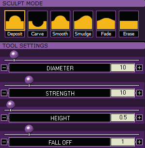
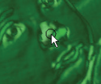
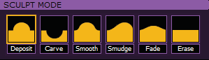

# Sculpt Menu

- Source PDF: Matrix 8 Instruction Manual Book 2 (matrix_8_book_2.pdf)
- Page range: 111-112
- Section title: Sculpt Menu
- Section id: m8book2-126-sculpt-menu
- Note: boundary page(s) are shared with a neighbouring section (two-column layout); text/images may include neighbour content.

---
<!-- section m8book2-126-sculpt-menu | Sculpt Menu | m8book2 pages 111-112 -->

<!-- page 111 -->

Redo: This will redo the last change made.
### Finishing your project:
Refer to the Introduction and Shared Tools section
for instructions on Creating the Mesh output from
Matrix Art. Proceed to the Sculpt Menu if desired.
expect you can by looking at the menu. Instead,
to do this, return to the Effects menu. Yet you
CAN use the Sculpt menu to adjust parts of the
mesh that may be textured - raising them up or
lowering them down in a way more fitting to your
design - as when forming the cheeks, nose, or
eye-sockets of a person; the muzzle of a dog; the
surface of a leaf, etc.
## Sculpt Menu
### Sculpt Mode:
Matrix Art Sculpt tools can be used with or
without a picture. Fine-tune a design with a
picture, as you lift up, Deposit, or cut into, Carve,
mesh to sculpt the surface of the mesh.
Where is this menu located:
Access this menu from Matrix Art>Sculpt Menu
Steps:
• Choose the Sculpt icon at the top of the Matrix Art
screen.
Note: See Introduction & Shared Tools for an
explanation of the shared items at the top of the
page.
### Comparing the Sculpt & Effects Menus:
Like the Effects menu, you will click and drag the
“painting” tool connected to the cursor over the
mesh preview in order to change it in the various
modes: Deposit, Carve, Smooth, Smudge, Fade, or
Erase.
Deposit and Carve: Deposit adds to or builds
the height of the preview mesh. Carve takes away
or reduces the height of the preview mesh. All the
changes are as you see them.
Sculpting lifts up the
mesh and bitmap texture.
To create subtle details,
raise Falloff and Height,
lower Strength, and set
the appropriate Diameter
(smaller for nose, larger
for cheeks). See image of
completed mesh in the
Effects menu.
Steps:
Unlike the Effects menu, these changes do NOT
affect the bitmap in any way. Here is the analogy I
like to use. Have you ever seen a cat playing under
a bedspread? You see the little lump where the
cat is moving around, but it doesn’t change the
pattern on the bedspread. This is how the Sculpt
menu works. It does not affect the texture on
the bitmap at all (the pattern on the bedspread);
it merely raises it up or pushes it down (the cat
playing underneath it). To continue this analogy,
the Effects menu actually changes the pattern on
the bedspread.
• Begin by selecting either “Deposit” or “Carve”.
• Click and drag the “tool” over the mesh preview to
change it.
• Use the Diameter, Strength, Height, and Fall Off
For that reason, you CAN’T use the Sculpt menu
to “smooth” a lumpy texture the way you might

<!-- page 112 -->

options to change the way the tool works as you
click and drag it over the surface to sculpt.
• Then, use Smooth, Smudge, Fade or Erase if
needed.
Fall Off: “Fall Off” refers to the gradualness
between the painted and un-painted areas. To
blend them together more gradually, set a higher
Fall Off value. To make the difference very swift
and steep, set a lower Fall Off value.
Undo: This will undo the last change made.
Redo: This will redo the last change made.
Reset: This will reset the mesh preview back
to the original state it was before the Sculpt
tools were applied. It will undo ALL instances of
sculpting on your design.
Finishing your Project:
Refer to the Introduction and Shared Tools section
for instructions on Creating the Mesh output from
Matrix Art.
Smooth, Smudge, Fade, and Erase:
Smooth, Smudge, Fade, and Erase only work
AFTER you’ve used Deposit and Carve. These
remaining four tools work to temper, outright
“Erase”, or otherwise edit the work you do with the
other two main carving tools - Deposit and Carve.
They work in increasing degrees of strength, with
“Smooth” being the most subtle, “Smudge” being
a bit more aggressive, and “Fade” being the most
aggressive. “Erase” outright erases any sculpting
you’ve done, leaving the “painted on” part of
the surface the way it was prior to any sculpting
operation.
## Convert to Bitmap
### Tool Settings:
‘SaveScreenAreaAsHeightfield’
This Matrix Art Tool saves a picture of any model
on-screen as a bitmap ready to be used in Matrix
Art. Start by modeling shapes and designs in
Matrix as solid objects.
Where is this tool located:
Access this menu from Matrix Art>Layer,
Picture, Effects or Sculpt Menus
Steps:
Diameter: Raise or lower the “Diameter” slider
which represents the size of the “brush” that will
“paint” the area to be affected by the these tools.
As the cursor approaches the model, you’ll see a
circle appear.
Strength: Raise or lower, respectively, this slider
to change how quickly and easily or slowly and
gradually the paint tool works.
• Create a design using solid objects in Matrix (Torus,
Pyramid, Sphere, etc)
• Run “Convert to Bitmap.”
• Select the Area to save as a Bitmap. Click and drag
your cursor (Rectangle selection box) over the
objects onscreen.
• A File dialog will open. Name and save the bitmap
file.
• Input a curve in Matrix Art.
• Add the bitmap to the curve to create a texture
mesh.
Height: Adjust the height of “Deposit” or “Carve”
by increasing or decreasing this amount.

---

## Images

-  page 111 (shared page)
-  page 111 (shared page)
-  page 112 (shared page)
-  page 112 (shared page)
