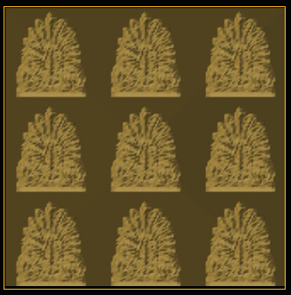
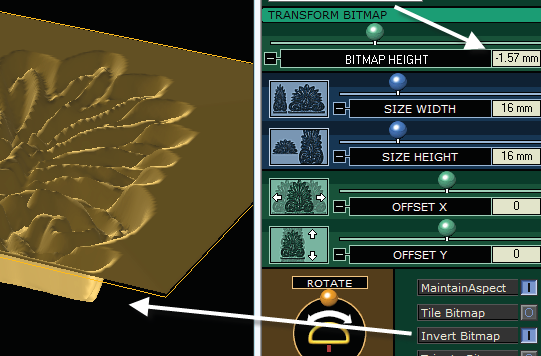
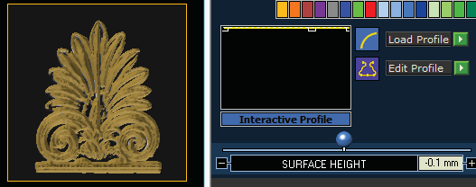
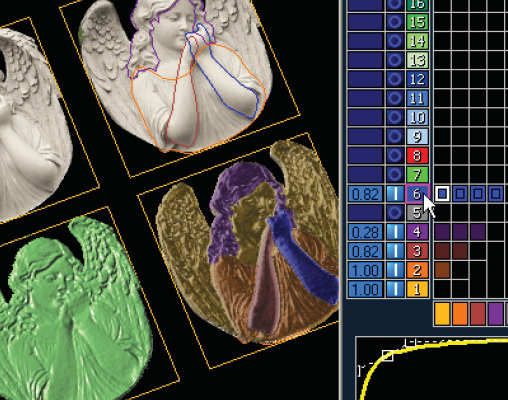

# Tips and Tricks

- Source PDF: Matrix 8 Instruction Manual Book 2 (matrix_8_book_2.pdf)
- Page range: 107-107
- Section title: Tips and Tricks
- Section id: m8book2-124-tips-and-tricks
- Note: boundary page(s) are shared with a neighbouring section (two-column layout); text/images may include neighbour content.

---
<!-- section m8book2-124-tips-and-tricks | Tips and Tricks | m8book2 pages 107-107 -->

<!-- page 107 -->

Tile Bitmap: Use “Tile
## Tips and Tricks
Bitmap” to repeat the
bitmap image over the
surface of the mesh. You
may have to adjust the
height and width if Fill
Shape was used at the
start.
Using a Bitmap with Multiple Curves:
To add more shape to a bitmap if, for example,
the image gets darker (the surface goes lower)
where the design should go higher, or to simply
add more definition to a design, you can proceed
to the Effects menu to learn more about editing
the lights and darks of the bitmap. OR, you can
try this: in the Looking Down viewport, trace with
additional closed curves those parts of the image
that are too low or that need more shape and
definition than the bitmap alone can give them.
Invert Bitmap: “Invert Bitmap” will switch the
darks and the lights (lows and highs) of the image,
so that the resulting mesh will instead be low
where the bitmap is light and high where it is dark.
Curve only input (left) results in a flat mesh. Shape curves
and border curve input (right). Add height and shape to
each using Layers menu and the “Build” relationship.
With Invert Bitmap the mesh preview looks like a “candy
mold.” Also, the Bitmap Height is moved to a negative
value to reflect the inverted design.
Trim to Bitmap: Deletes ALL of the pure black
(0,0,0) parts of the bitmap, leaving only the lighter
parts creating an object you want to raise up as
the resulting mesh surface.
Place them on higher layer colors than that of
curve where the bitmap is loaded, so they can
“Build” on the layer color of the bitmap in the
Layer menu - both in texture, height, and profile
shape. Re-input ALL curves into the Layer Menu
in Matrix Art, and place the Bitmap JUST on the
layer color of the rectangle. Adjust the profile
shapes and heights of the additional curves in the
Layer menu (using the Build relationship with the
lower-most color).
When using “Trim to Bitmap” to
remove the black background,
adjust the Surface Height in the
Layer menu until you see the
background drop off. The mesh
output height is controlled by
the Bitmap Height plus “Add
Depth.”

---

## Images

-  page 107 (shared page)
-  page 107 (shared page)
-  page 107 (shared page)
-  page 107 (shared page)
-  page 107 (shared page)
