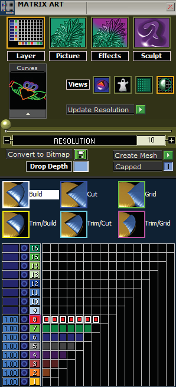
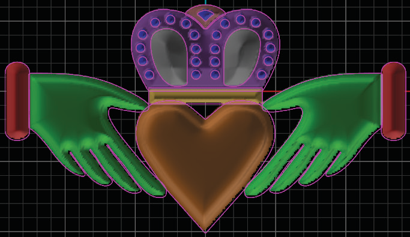
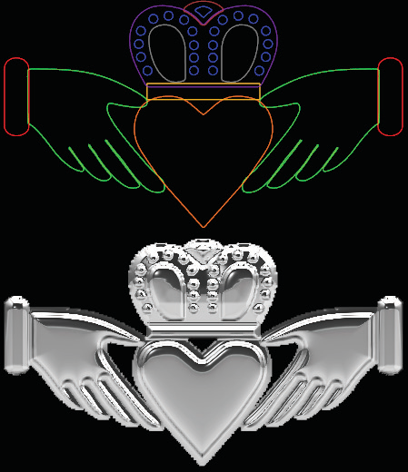
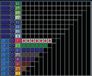
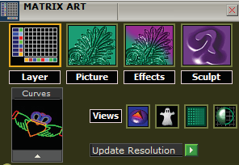
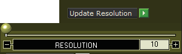
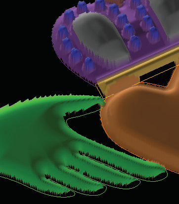
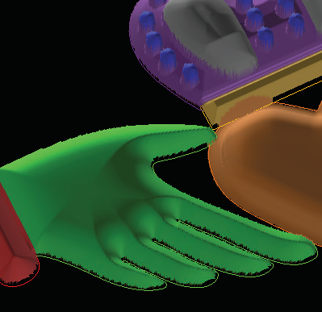
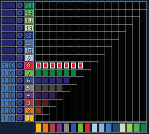

# Matrix Art

- Source PDF: Matrix 8 Instruction Manual Book 2 (matrix_8_book_2.pdf)
- Page range: 99-101
- Section title: Matrix Art
- Section id: m8book2-121-matrix-art
- Note: boundary page(s) are shared with a neighbouring section (two-column layout); text/images may include neighbour content.

---
<!-- section m8book2-121-matrix-art | Matrix Art | m8book2 pages 99-101 -->

<!-- page 99 -->

# CHAPTER 24
# Matrix Art
### Matrix Art creates a 2 1/2-D Mesh Model from closed curves and uses a picture to
### place texture in the mesh that resembles the picture.
program “sees” your selected profile as
lighter in color at the high parts of the
curve and darker at the lower parts of
the curve.
Matrix Art
Matrix Art is a Heightfield from
Bitmap modeler exclusive to
Matrix. Matrix Art’s Heightfield
from Bitmap Modeling produces
a mesh, which gets its height
by referring to a table of color
values, where the dark colors
represent the low parts of the
resulting mesh surface and the
light colors represent the high
parts of the resulting mesh
surface.
When using an image within Matrix
Art, it is possible to edit the image that
you’ve input with some easy-to-use yet
powerful photo-editing tools: you can
adjust the blur, contrast, brightness,
and even reverse the lows and highs of
selected parts of the image. You can
also place the image wherever you’d
like it in relation to the shapes you
input.
Use curves on Layers to produce a
mesh in Matrix Art.
Finally, using either
method, you can
“sculpt” the resulting
surface with sculpting
tools like Deposit,
Carve, Smooth,
Smudge, and Fade,
which work with the
mouse directly on
the preview mesh to
interactively sculpt it
in real time.
This is why it is possible to add
a picture to a shape that has
been input into Matrix Art, and have the program
output a mesh that is textured to resemble the
picture, where the light parts of the picture are the
high parts of the mesh and the dark parts of the
picture are the low parts of the mesh.
### Skills & Commands in this Chapter
Matrix Art:
Layer Menu, Picture Menu, Effects Menu, Sculpt
Menu
However, the program also works quickly and
easily with closed curves alone to create smooth,
chiseled, or otherwise contoured surfaces from
profiles you can select, edit, or create from scratch.
Because the same heightfield from bitmap
modeling technology creates the mesh when
only curves are used, you can imagine that the

<!-- page 100 -->

## Matrix Art
Note: Upon creating the mesh, the preview is simply
toggled OFF. So, to edit your current settings and
try the mesh again, turn it back on WITHOUT closing
Matrix Art. (Closing the builder clears your settings.)
Matrix Art creates 2 1/2-D Mesh Model (a 3-D
model with a flat back) from closed curves and
uses a picture to place texture in the mesh that
resembles the picture.
Where is this menu located:
Access this menu from Main Menu>Matrix Art
Steps:
Matrix Art Mesh Preview is On.
• Select Matrix Art in the Main Menu. The Matrix Art
Interface will open to the right of the viewports.
### Adjusting Resolution:
To get a sharper look to the resulting mesh for
items like chiseled profiles adjust the Resolution
slider to raise it. Lower the resolution for items like
people, animals, or organic textures.
### Shared Tools found in all Menus
Steps:
### Changing Views:
Select from one of these views while creating your
Matrix Art project.
• Click and drag the Resolution slider to the desired
setting. Make small increment changes for best
results.
• Click on the Update Resolution green arrow to
apply the setting change.
NOTE: Experiment with resolution settings to get the
best look for each design you work on. Make each
change in small increments for best results.
Colors View: Colors view displays the
mesh as a preview while you work. Colors
creates a color-coded representation of the
heightfield displaying the high and low parts
allowing you to easily see changes in Height and
Sculpting. With this off, each part of the preview
model is the color of its curve.
Ghosted View: Ghosted view makes the
current view see-through to better view the
curves or bitmap beneath.
Preview View: Preview view keeps the
preview mesh at a lower resolution to ease
the load on your processor while you work; yet the
output mesh will still be at the resolution you set.
Matrix Art Resolution is set at the default amount of 10
(left) and increased to 20 (right) resulting in a sharper,
more defined mesh.
Toggle: Toggle the Preview On and Off
with the Shade globe.

<!-- page 101 -->

### Creating the Mesh:
## Layer Menu (Matrix Art)
Capped: This defaults on and caps the back of
the mesh to create a closed mesh.
Matrix Art Layer Menu allows you to input curves
and apply profile shapes to the curves that will be
used to create the mesh. Matrix Art references the
order of the Layers menu in Matrix to establish the
relationship between the curves that are input into
Matrix Art.
Where is this menu located:
Access this menu from Matrix Art>Layer Menu
Steps:
• In Matrix create closed curves that follow a
bitmap image or of any shape you desire.
• Input closed curve(s) into the curve in-box.
Capped is “On” (left) and “Off” (right) when mesh was
created.
Adjust the
relationship
between each
curve Layer color
on the Layer Grid.
Drop Depth: Drop Depth adds the value you
type into the box, in mm, beneath the Looking
Down grid to add height to the resulting mesh.
The mesh must be capped when using Drop
Depth.
Note: See Introduction & Shared Tools for an
explanation of the shared items at the top of the
page.
### Curves:
A Drop Depth of 2 mm was added to the mesh on the right.
Rules for Curves:
1. All curves must be closed.
Create Mesh: Clicking this
green arrow will create the
mesh object. Before doing
so, select one or both
options from Capped and
Drop Depth as needed.
2. All curves must be planar (drawn
flat against the grid).
3. All curves must be drawn in the
Looking Down viewport.
4. All curves must be assigned
a specific Layer color according to the results
desired.
5. After editing curves, input all the curves back
into the Curve in-box.
Convert to Bitmap: Convert to Bitmap saves
the Looking Down image of the heightfield you’ve
been creating, or, the dark to light contour map
of your current design, so you can re-apply it in a
more advanced use of Matrix Art. (See detailed
description in the sub-menu under Matrix Art)
Rules for Ordering Layer Colors:
1. Assign a Layer color (in Matrix main Layer menu)
before the curve is entered into the “Curves” box.
2. Assign the same Layer color to all curves that
will need to be controlled together. These curves
will have the same profile shape and height.
3. If a curve is INSIDE another curve of the same
color, a hole will result.

---

## Images

-  page 99
-  page 99
-  page 99
-  page 99
-  page 100
-  page 100
-  page 100
-  page 100
-  page 101 (shared page)
-  page 101 (shared page)
-  page 101 (shared page)
-  page 101 (shared page)
-  page 101 (shared page)
