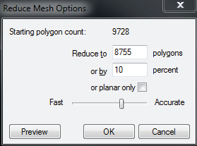
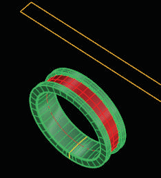

# Mesh Reduce 

- Source PDF: Matrix 8 Instruction Manual Book 1 (matrix8_book_1.pdf)
- Page range: 118-118
- Section title: Mesh Reduce 
- Section id: m8book1-120-mesh-reduce
- Note: boundary page(s) are shared with a neighbouring section (two-column layout); text/images may include neighbour content.

---
<!-- section m8book1-120-mesh-reduce | Mesh Reduce  | m8book1 pages 118-118 -->

<!-- page 118 -->

## Mesh Reduce
Note: With large meshes, use 2 or 3 percent
reduction at a time for your mesh settings. Doing
multiple times until the desired output is obtained.
Undo Reduce Mesh by using the Undo button.
‘ReduceMesh’
Mesh Reduce is an easy way to reduce the
polygon count (size) of mesh objects.
Mesh Reducer in the Tools menu functions similar to
Mesh Reduce but is not identical to this command
.
## Apply Mesh UVN
Where is this Command:
Access this command from Utilities>Mesh
Reduce
Steps:
‘ApplyMeshUVN’
Apply Mesh UVN transfers a mesh object up onto
a surface, exactly fitting the length, width and
curvature of that surface.
Where is this Command:
Access this command from Utilities>Apply
Mesh UVN
• Select Mesh
Reduce from
the Utilities
menu
• Select mesh
objects
• Set the new
polygon count.
Steps:
### Menu Options:
Or Planar Only: Restricts the reduction to
planar polygons.
• Select Apply Mesh UVN from the Utilities menu.
• Select a mesh object to Apply.
• Press Enter.
• Select the target surface..
• The mesh object now flows on the selected
surface.
Fast - Accurate: Fast trades speed for accuracy
during conversion. Reduction is performed more
randomly, involving fewer calculations, and is
therefore faster. Accurate produces the fewest
visible artifacts. This involves more calculations
and is slower.
Preview: Click to display a preview of the output.
Do this after any setting change to see the
updated preview.
Example: Apply
a brick pattern,
from a bitmap
file created into
3Dgeometry in
Matrix Art, with a
UV curve (created
from the rings
target surface).
Create the mesh
and use it with
Apply Mesh UVN.
Note: Start with a surface that is not split or trimmed
for the best results.
Use Create UV Curves (Curves Menu) for a preview
to see how the size of your mesh objects will fit
on the surface. Or, use it in Matrix Art to apply a
textured bitmap.
Note: The resolution settings in Matrix Art or other
program used to create the mesh will determine
how many triangles (or other polygons) are used to
make the mesh and how large or small they are. If
the resolution is high, there will be smaller triangles
used - and hence more of them - in order to try and
capture the shape of that surface as accurately as
possible. If the resolution is low, there will be fewer,
larger triangles used, which means less information
the computer has to work with and greater speed
and ease while modeling - as well as less surface
definition and accuracy in the resulting shape.

---

## Images

-  page 118 (shared page)
-  page 118 (shared page)
