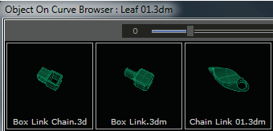
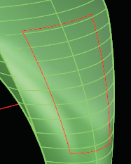
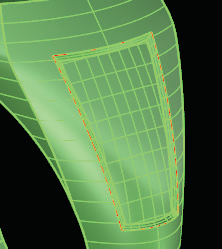
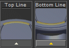

# Mesh Reducer 

- Source PDF: Matrix 8 Instruction Manual Book 2 (matrix_8_book_2.pdf)
- Page range: 167-168
- Section title: Mesh Reducer 
- Section id: m8book2-176-mesh-reducer
- Note: boundary page(s) are shared with a neighbouring section (two-column layout); text/images may include neighbour content.

---
<!-- section m8book2-176-mesh-reducer | Mesh Reducer  | m8book2 pages 167-168 -->

<!-- page 167 -->

Browser: This option (default) opens a library of
objects that can be laid out along the curve
Tolerance: Use this option when the resulting
surface is undesirable. Setting the value higher
allows a greater variance. Choose a value between
0.01 and 0.1.
Splits: Increasing the number of splits gives the
surface more reference points when creating the
inset. Use this when the sides of the inset are
twisted.
## Surface Inset
Surface - Sweep/Loft: Choose whether the
surface is created with a Sweep or Loft. Each may
be more successful in different scenarios.
‘gvInset’
Creates an inset surface from an existing surface
and a curve.
Steps:
Direction: The “Direction” option lets you assign
a direction for the pitch of the angle on the “walls”
of the inset surface. Two prompts to “Pick Point”
will appear. Click twice on-screen, and then finish
out the command by selecting the curve.
## Mesh Reducer
• Select Surface Inset from the Tools menu.
• Select a surface to inset.
• Adjust the inset parameters in the Command Line
before selecting the curve.
• Select the curve (must be on the surface of the
object you wish to inset).
Matrix’s Mesh Reducer is an easy way to reduce
the polygon count (size) of mesh objects.
Where is this Builder:
Access this Builder from Tools>Mesh Reducer
Note: For this command to work you need a closed
curve on the surface of an object. Use your curve
commands such as Pullback, Project or Extract
IsoCurve to get the curve on the surface of the
model.
Steps:
### Command Line Options:
• Select Mesh Reducer from the Tools menu.
• Input the mesh into the Mesh box in
Angle: This indicates the value in degrees for the
taper on the sides of the inset.
Length: This indicates the length of the side walls
of the inset surface.
the Mesh Reducer builder.
• Select a percentage of the original
size for reducing the mesh using the
“Mesh Reducer” slider. Also, see the
polygon count Input and Output
numbers.
• Click “Reduce” in the builder.
• Select any Command Line options if necessary.
• Click in the Command Line and press Enter when
done. Wait as the new mesh is created. This can
take several minutes depending on the size of the
mesh.
Tolerance of 0.02 needed to make inset.
Curve on Surface (left). Inset completed (right).

<!-- page 168 -->

ModelUnits: Choose from all available
measurements in the program. This defaults to
Millimeters.
## Mesh Mapper
Note: It’s better to select smaller increments multiple
times for larger mesh objects. So, limit to 3 percent
up to 10 percent for each time you run Mesh Reducer
for the best results.
### Options:
Mesh Mapper is a simple way to get a mesh object
- either created in Matrix Art or imported from
another program - onto a surface or between two
curves in space.
Delete: When ON this deletes the original mesh
object.
Where is this Builder:
Access this Builder from Tools>Mesh Mapper
Reduce: Choose “Reduce” to reduce the mesh of
the object selected.
Select: This selects the mesh object.
Note: The ‘Top Line’ curve and the ‘Bottom Line’
curve can be either to the left and right of where you
want to locate your mesh or at the top and bottom.
In the case that they are to the left and right they
should be the height you want the mesh to start and
end. If they are at the top and bottom the curves
should be the length that you desire your mesh.
Undo: This will undo the last action performed.
Steps:
### Command Line Options:
• Select Mesh Mapper from the Tools
menu.
• Input the Mesh into the Mesh In-box.
• Input the Top Line into the Top Line in-
box (curve must have a start point at
the left and direction to the
Weld=Yes/No: Weld (Yes) removes creases from
a mesh by merging coincident mesh vertices. It
creates new vertex normals at each welded vertex
that is the average of the adjacent face normals.
One vertex is shared by more than one face after
welding. Specify the angle tolerance value when
Weld is ON. The default setting is NO Weld.
WeldAngle: If two naked mesh edge points of
a selected mesh are coincident (joined), and their
neighboring faces are within the angle tolerance
of each other, they will be replaced by a single
mesh point. If the two points are from different
“sub-meshes” of a joined mesh, the meshes
become one mesh that cannot explode. As the
tolerance angle is changed, the mesh edges that
are within the tolerance, will be welded. Lowering
or raising the value of the angle to give better
results is dependent on the shape of the mesh
faces.
right. Or, side cures must
have start point at the top
and direction to the bottom).
This can be a Top curve or
Left curve.
• Input the Bottom Line into the top Line in-box
(curve must have a start point at the left and
direction to the right. Or, side cures must have
start point at the top and direction to the bottom).
This can be a Bottom curve or Right curve.
• Choose whether or not you want to keep the
current Z height of the mesh (Maintain Z ON or
OFF).
• Click Transform.
• To continue working with the Mesh, click Select. Or,
to Undo the builder, click Undo.
SplitDisjointMeshes=Yes/No: In rare incidents,
a mesh face (triangle or quadrilateral) may not join
to neighboring faces. When turned ON, this allows
for that face to split and re-shape in order to join
the neighboring faces.
Curve direction is left to right

---

## Images

-  page 167 (shared page)
-  page 167 (shared page)
-  page 167 (shared page)
-  page 167 (shared page)
-  page 168 (shared page)
-  page 168 (shared page)
-  page 168 (shared page)
