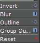
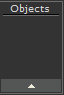
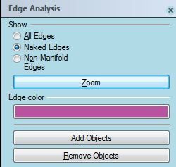

# Object Checker 

- Source PDF: Matrix 8 Instruction Manual Book 2 (matrix_8_book_2.pdf)
- Page range: 150-151
- Section title: Object Checker 
- Section id: m8book2-156-object-checker
- Note: boundary page(s) are shared with a neighbouring section (two-column layout); text/images may include neighbour content.

---
<!-- section m8book2-156-object-checker | Object Checker  | m8book2 pages 150-151 -->

<!-- page 150 -->

Invert: Inverts the values of the
Adjust in the builder by clicking on the Corner
Soften icon at the left and running the slider
below.
image before it attempts to
trace. Light pixels become dark
and vice versa.
### Optional Sliders:
Group Output: With this
option, the output curves are grouped together.
These only appear when their corresponding
option is toggled on.
Reset: Returns the builder to its default settings.
Blur/ Blue Radius: Toggle ON to blur the image
## Object Checker
before it is traced; the effect is similar to
corner soften. It makes sharp corners
appear rounder. Adjust in the builder by
clicking on the Blur Radius icon at the
left and running the slider below.
Object Checker reports whether or not the object
is valid. An invalid object has a problematic
surface - a bad surface, or an open surface,
etc. The invalid object has to be fixed before
performing Boolean operations.
Outline/ Outline Radius: Use this option
Where is this Command:
Access this command from Tools>Object
Checker
Steps:
• Select Object Checker from the Tools
when your image has a thick outline.
Instead of outputting one curve
(representing the thick outline) it will
create two curves (an outline of the
first). When this option is selected you can specify
the outline radius. Adjust in the builder by clicking
on the Outline Radius icon at the left and running
the slider below.
### Command Line Options:
Menu.
• Select the object you would like to
check and put into the object input
box.
Preprocess Method: There are three
Preprocess methods from which
to choose - None, Grayscale (default) or Quantize.
Each method may give you better results
depending on the quality of the image.
The object checker
will display a pass/
fail for both the
Shell and Naked Edges.
Process Method=None: Traces the image as is
- with no preprocessing.
Process Method=Grayscale: Converts the
image to a range of gray shades from white to
black before tracing.
Process Method=Quantize: Converts the
image to a more limited range of values before
attempting to trace.
Prescale1X, Prescale2X, Prescale3X:
This resizes the image before
the image is traced. 1X (default) = 100%, 2X=200%
and 3X=300% of the original. This may give better
results to some images.

<!-- page 151 -->

### Options:
Extended Repair: This option will make the
mesh repair function take longer, but will make it
more likely to be successful on complicated
repairs. A progress notice will appear in the
Command Line while the function is working.
DeleteInputObjects=On/Off: With delete
input ON your NURBS objects will be deleted
after the mesh has been created.
An Edge Analysis box appears if Naked edges
are present and the object will highlight. Naked
edges are unjoined and therefore open edges of
a surface. The shell is checking for the validity of
the model. A model can be invalid for a variety of
reasons.
Mesh Tolerance: Control the tolerance for the
mesh created. A finer tolerance will create a mesh
that is closer to the NURBS object, but creates a
larger file size. Finer creates more polygons and
less fine creates fewer polygons with less design
definition.
Hint: Use Join 2 Naked Edges (Utilities menu) to
repair Naked Edges. Or, use Extract Bad Surface
(Utilities menu) to extract the problematic surface in
order to repair and replace it.
## Mesh Repair
‘gvMeshRepair’
Creates a single water tight mesh ready for 3D
printing. This multi-function tool repairs open
meshes, overlapping vertices, and more.
Simple Planes, Optimize Milgrain, Milgrain
Grid Count: These options all serve to minimize
the size of your output mesh. 3D printers have
a finite amount of memory and large, complex
meshes can limit the number of models you can
print at once. Use these options to make meshes
with a smaller polygon count and smaller file size.
## 3D Printing
Where is this Command:
Access this command from Tools>Mesh Repair
Steps:
This one button opens a menu with a series of
tools used to create supports for a model before
sending it to a 3D printer.
Where is this Command:
Access this command from Tools>3D Printing
• Select Repair Mesh from the Tools menu.
• Select object for Mesh repair.
• Press Enter.
• An Object Properties dialog will appear with
detailed information. Choose “Check Mesh” to
view the details.
## Support Region Analysis
‘gvViewSupportRegions’
Located within the 3D Printing command within
the Tools menu, Support Region Analysis (Show
Support Regions) is a Shade Mode that displays
the downward facing geometry of a model-
indicating where supports may be needed.

---

## Images

-  page 150 (shared page)
-  page 150 (shared page)
-  page 150 (shared page)
-  page 151 (shared page)
-  page 151 (shared page)
