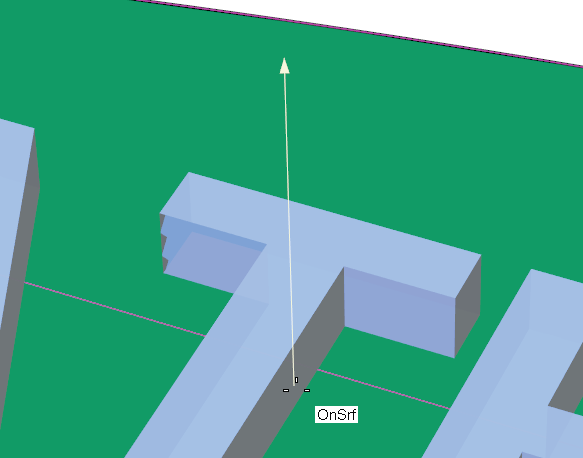
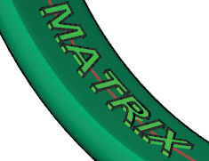
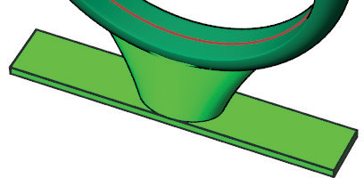
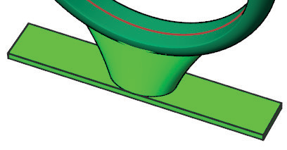
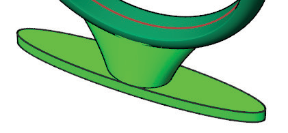
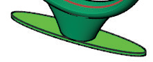

# Ring Support Sprue 

- Source PDF: Matrix 8 Instruction Manual Book 2 (matrix_8_book_2.pdf)
- Page range: 153-154
- Section title: Ring Support Sprue 
- Section id: m8book2-162-ring-support-sprue
- Note: boundary page(s) are shared with a neighbouring section (two-column layout); text/images may include neighbour content.

---
<!-- section m8book2-162-ring-support-sprue | Ring Support Sprue  | m8book2 pages 153-154 -->

<!-- page 153 -->

Thickness: Sets the Thickness of the text in
Millimeters.
SpanDegree: Controls how
much the text spans along the
inside of the ring rail. The number must be greater
than 10 and less than 100.
PlacementStartAngle: Controls where the text
is oriented along the ring rail. 0/360 will orient the
text on the top of the inside of the band. 180 will
orient the text to the bottom of the inside of the
band.
Note: The arrow that appears when you are picking
the point for your text indicates the surface
normal of the target surface. If your text is reading
backwards and the arrow pointing towards the
surface your surface normals are flipped and may
need to be corrected (see Direction). The Output
font is grouped.
## Ring Support Sprue
## Ring Rail Text
‘gvRPSupportSprue’
Adds a support sprue and base to a model to
prepare it for Rapid Prototyping.
‘gvRPFingerRailText’
Ring Rail Text allows you to quickly orient text
along the ring rail.
Where is this Command:
Access this command from Tools>3D Printing
>Ring Support Sprue
Where is this Command:
Access this command from Tools>3D Printing
>Ring Rail Text
Steps:
Steps:
• Select 3D Printing from the Tools menu.
• Select Ring Rail Text from the 3D Printing menu,
(along the left-hand side below Projects).
• Select the Ring Rail Text command.
• Type the desired text into the Command Line.
• Specify a Font Size and Thickness in the
Command Line.
• Press Enter.
• Select 3D Printing from the Tools menu.
• Select Ring Support Sprue from the 3D Printing
menu, (along the left-hand side below Projects).
• Select the ring to sprue.
• Press Enter.
• The Ring Support Sprue command will analyze the
shape of the ring and create a sprue that will work
for your particular design. You can modify this
result by adjusting the options in the Command
Line.
• Specify the desired options for the sprue in the
Command Line.
• Press Enter when done.
### Command Line Options:
### Command Line Options:
TopLength: Controls the size of the sprue in
Millimeters along the X axis at the top of the sprue.
FontSize: Sets the Height of the text in
Millimeters.

<!-- page 154 -->

TopWidth: Controls the size of the sprue in
Millimeters along the Y axis at the top of the sprue.
Where is this Command:
Access this command from Tools>3D Printing
>Support Base
Steps:
BottomLength: Controls the size of the sprue in
Millimeters along the X axis at the bottom of the
sprue.
BottomWidth: Controls the size of the sprue in
Millimeters along the Y axis at the bottom of the
sprue.
Height: Controls the height of the sprue from the
ring to the base support. Measured in Millimeters.
• Select 3D Printing from the Tools menu.
• Select Support Base from the 3D Printing menu,
(along the left-hand side below Projects)..
• Select the model to build a base.
• Press Enter.
• Specify the desired options for the support base in
the Command Line.
• Press Enter when done.
### BaseShape:
Controls the shape of the base.
None: Creates no
support base.
### Command Line Options:
Shape: Controls the shape of the base.
Rectangle: Adds a rectangular support base at
the specified offset distance.
Rectangle: Adds a
rectangular support
base at the bottom of
the sprue.
Oval: Adds an oval support base at the specified
offset distance. (See picture above.)
Ellipse: Adds an
elliptical support base
to the bottom of the
sprue.
Outline: Adds a silhouette of your model to serve
as a support base at the specified offset distance.
This is helpful for supporting non-ring models.
BaseThickness: Controls the thickness of the
support base, measured in Millimeters.
Outline: Adds a
silhouette of your
model to serve as a
support base. This is
helpful for supporting
non-ring models
Offset: Distance from the model to the support
base measured in Millimeters.
BaseThickness: Controls the Thickness of the
## Support Ring
support base, measured in
Millimeters.
## Support Base
‘gvRPSupportRing’
Adds a main support anchor (tree trunk) with
support fingers (tree branches) to a model to
prepare it for Rapid Prototyping.
‘gvRPSupportBase’
Adds a support base to a model to prepare it for
Rapid Prototyping.
Where is this Command:
Access this command from Tools>3D Printing
>Support Ring

---

## Images

-  page 153 (shared page)
-  page 153 (shared page)
-  page 153 (shared page)
-  page 154 (shared page)
-  page 154 (shared page)
-  page 154 (shared page)
-  page 154 (shared page)
-  page 154 (shared page)
