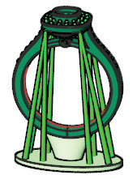
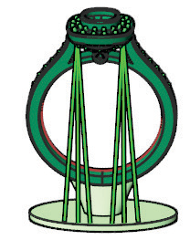

# Supports 

- Source PDF: Matrix 8 Instruction Manual Book 2 (matrix_8_book_2.pdf)
- Page range: 159-160
- Section title: Supports 
- Section id: m8book2-169-supports
- Note: boundary page(s) are shared with a neighbouring section (two-column layout); text/images may include neighbour content.

---
<!-- section m8book2-169-supports | Supports  | m8book2 pages 159-160 -->

<!-- page 159 -->

### Medium Tapered Supports Modes:
StartDiameter: Set the diameter of the support
start point.
Medium Tapered Support: This places a
single tapered support in the viewport.
EndDiameter: Set the diameter of the support
end point.
Medium Tapered Support Shared Start
Point: This adds tapered supports while
keeping a common start location.
AutoProject: Projects the support end to the
support surface. (AutoProject must be turned
OFF to activate Shared Start Point.)
## Medium Tapered Supports
Medium Tapered Support Shared
Start Point Mirrored X: This adds
tapered, mirrored supports (across X) while
keeping a common start location.
‘gvRPSupportLine’
Creates a medium, tapered support for
unsupported geometry with a larger diameter at
the base and narrower at the top.
Medium Tapered Support Shared
Start Point Quad Mirror: This adds
tapered, mirrored supports (across both X and Y)
while keeping a common start location.
### Command Line Options:
Where is this Command:
Access this command from Tools>3D Printing >
Medium Tapered Supports
Mirror X=Off/On: When option is ON, support
mirrors across the X axis.
Steps:
Mirror Y=Off/On: When option is ON, support
mirrors across the Y axis.
SharedStartPoint=Off/On: Shared Start
Point is ON with mirrored supports ON, shares
the start point with every set of supports placed.
(AutoProject must be turned OFF to activate
Shared Start.)
• Select 3D Printing from the Tools menu.
• Select Medium Tapered Support from the 3D
Printing menu, (along the left-hand side below
Projects).
• Select a Start Point (places the support tip on the
object).
• Choose your settings..
• Select an End Point.
• Continue selecting start and ends points, placing
multiple supports if needed.
• Press Enter to complete the command.
StartDiameter: Set the diameter of the support
start point.
Note: By default the tapered supports automatically
project to the Base support surface. To share a start
point turn AutoProject off.
EndDiameter: Set the diameter of the support
end point.
AutoProject: Projects the support end to the
support surface. (AutoProject must be turned
OFF to activate Shared Start Point.)
## Supports
‘gvRPSupportLine’
Creates straight supports for unsupported
geometry.
Medium Tapered Support Shared Start Point Quad
Mirror

<!-- page 160 -->

### Command Line Options:
Where is this Command:
Access this command from Tools>3D Printing >
Supports
Mirror X=Off/On: When option is ON, support
mirrors across the X axis.
Steps:
Mirror Y=Off/On: When option is ON, support
mirrors across the Y axis.
SharedStartPoint=Off/On: Shared Start
Point is ON with mirrored supports ON, shares
the start point with every set of supports placed.
(AutoProject must be turned OFF to activate
Shared Start.)
StartDiameter: Set the diameter of the support
start point.
• Select 3D Printing from the Tools menu.
• Select Supports from the 3D Printing menu, (along
the left-hand side below Projects).
• Select a Start point (places the support tip on the
object).
• Choose your settings..
• Select an End point.
• Continue selecting start and ends points, placing
multiple supports if needed.
• Press Enter to complete the command.
Note: By default the supports automatically project
to the Base support surface. To share a start point
turn AutoProject off.
EndDiameter: Set the diameter of the support
end point. (Default End Diameter is the same as
the Start Diameter.)
AutoProject: Projects the support end to the
support surface. (AutoProject must be turned
OFF to activate Shared Start Point.)
## Profile
Support Shared Start Point Mirrored X
‘gvProfile’
Use Curve tools to create your own Profile and
instantly make it a Profile so that it has Viewport
Control Handles and can be used with compatible
profile commands.
### Supports Modes:
Where is this Command:
Access this command from Tools>Profile
Support: This places a single, straight
support in the viewport.
### Profile Options:
Support Shared Start Point: This adds
straight supports while keeping a common
start location. (AutoProject must be turned OFF
to activate Shared Start.)
There are two options to create Profiles using this
tool. Draw a closed, planar curve for Option 1. Or,
use a existing library Profile and edit the profile
using Curve tools in Option 2.
### Option 1:
Support Shared Start Point Mirrored
X: This adds straight, mirrored supports
(across X) while keeping a common start location.
Hand-Drawn Curve Steps:
• Select the Profile tool from the Tools menu.
• Select a closed, planar curve and input into the
Curve in-box by clicking on the white triangle.
Support Shared Start Point Quad
Mirror: This adds straight, mirrored
supports (across both X and Y) while keeping a
common start location.

---

## Images

-  page 159 (shared page)
-  page 160 (shared page)
