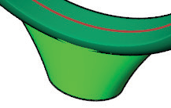
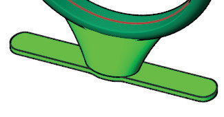

# Support Base 

- Source PDF: Matrix 8 Instruction Manual Book 2 (matrix_8_book_2.pdf)
- Page range: 154-154
- Section title: Support Base 
- Section id: m8book2-163-support-base
- Note: boundary page(s) are shared with a neighbouring section (two-column layout); text/images may include neighbour content.

---
<!-- section m8book2-163-support-base | Support Base  | m8book2 pages 154-154 -->

<!-- page 154 -->

TopWidth: Controls the size of the sprue in
Millimeters along the Y axis at the top of the sprue.
Where is this Command:
Access this command from Tools>3D Printing
>Support Base
Steps:
BottomLength: Controls the size of the sprue in
Millimeters along the X axis at the bottom of the
sprue.
BottomWidth: Controls the size of the sprue in
Millimeters along the Y axis at the bottom of the
sprue.
Height: Controls the height of the sprue from the
ring to the base support. Measured in Millimeters.
• Select 3D Printing from the Tools menu.
• Select Support Base from the 3D Printing menu,
(along the left-hand side below Projects)..
• Select the model to build a base.
• Press Enter.
• Specify the desired options for the support base in
the Command Line.
• Press Enter when done.
### BaseShape:
Controls the shape of the base.
None: Creates no
support base.
### Command Line Options:
Shape: Controls the shape of the base.
Rectangle: Adds a rectangular support base at
the specified offset distance.
Rectangle: Adds a
rectangular support
base at the bottom of
the sprue.
Oval: Adds an oval support base at the specified
offset distance. (See picture above.)
Ellipse: Adds an
elliptical support base
to the bottom of the
sprue.
Outline: Adds a silhouette of your model to serve
as a support base at the specified offset distance.
This is helpful for supporting non-ring models.
BaseThickness: Controls the thickness of the
support base, measured in Millimeters.
Outline: Adds a
silhouette of your
model to serve as a
support base. This is
helpful for supporting
non-ring models
Offset: Distance from the model to the support
base measured in Millimeters.
BaseThickness: Controls the Thickness of the
## Support Ring
support base, measured in
Millimeters.
## Support Base
‘gvRPSupportRing’
Adds a main support anchor (tree trunk) with
support fingers (tree branches) to a model to
prepare it for Rapid Prototyping.
‘gvRPSupportBase’
Adds a support base to a model to prepare it for
Rapid Prototyping.
Where is this Command:
Access this command from Tools>3D Printing
>Support Ring

---

## Images

-  page 154 (shared page)
-  page 154 (shared page)
-  page 154 (shared page)
-  page 154 (shared page)
-  page 154 (shared page)
