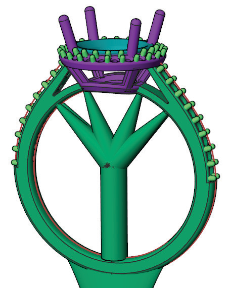
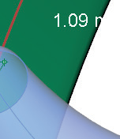
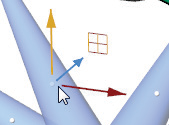
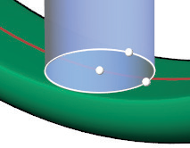

# Support Ring 

- Source PDF: Matrix 8 Instruction Manual Book 2 (matrix_8_book_2.pdf)
- Page range: 154-155
- Section title: Support Ring 
- Section id: m8book2-164-support-ring
- Note: boundary page(s) are shared with a neighbouring section (two-column layout); text/images may include neighbour content.

---
<!-- section m8book2-164-support-ring | Support Ring  | m8book2 pages 154-155 -->

<!-- page 154 -->

TopWidth: Controls the size of the sprue in
Millimeters along the Y axis at the top of the sprue.
Where is this Command:
Access this command from Tools>3D Printing
>Support Base
Steps:
BottomLength: Controls the size of the sprue in
Millimeters along the X axis at the bottom of the
sprue.
BottomWidth: Controls the size of the sprue in
Millimeters along the Y axis at the bottom of the
sprue.
Height: Controls the height of the sprue from the
ring to the base support. Measured in Millimeters.
• Select 3D Printing from the Tools menu.
• Select Support Base from the 3D Printing menu,
(along the left-hand side below Projects)..
• Select the model to build a base.
• Press Enter.
• Specify the desired options for the support base in
the Command Line.
• Press Enter when done.
### BaseShape:
Controls the shape of the base.
None: Creates no
support base.
### Command Line Options:
Shape: Controls the shape of the base.
Rectangle: Adds a rectangular support base at
the specified offset distance.
Rectangle: Adds a
rectangular support
base at the bottom of
the sprue.
Oval: Adds an oval support base at the specified
offset distance. (See picture above.)
Ellipse: Adds an
elliptical support base
to the bottom of the
sprue.
Outline: Adds a silhouette of your model to serve
as a support base at the specified offset distance.
This is helpful for supporting non-ring models.
BaseThickness: Controls the thickness of the
support base, measured in Millimeters.
Outline: Adds a
silhouette of your
model to serve as a
support base. This is
helpful for supporting
non-ring models
Offset: Distance from the model to the support
base measured in Millimeters.
BaseThickness: Controls the Thickness of the
## Support Ring
support base, measured in
Millimeters.
## Support Base
‘gvRPSupportRing’
Adds a main support anchor (tree trunk) with
support fingers (tree branches) to a model to
prepare it for Rapid Prototyping.
‘gvRPSupportBase’
Adds a support base to a model to prepare it for
Rapid Prototyping.
Where is this Command:
Access this command from Tools>3D Printing
>Support Ring

<!-- page 155 -->

Steps:
Set End Tip Diameter: Select the white Torus
on the end of the support. Move
your mouse in or out. Then, click to
set a new diameter. The diameter of
the support appears in white to the
right of the support end.
Adjust Arc Amount: Select the white sphere
• Select 3D Printing from the Tools menu.
• Select Support Ring from the 3D Printing menu,
(along the left-hand side below Projects).
• Set the location for the Support Anchor sprue (top
of the tree trunk).
• Pick End point for Support Tip. This adds a
support flowing from the support anchor to the
design (the tree’s branches).
• Repeat and select as many end point (branches)
as you want to add.
• Press Enter.
• Edit supports if needed (See below).
• Press Enter to complete the command.
at the mid of the support.
Use the Viewport Control
Handles to adjust the
position of the middle of
the support. Press Enter
when done.
Edit Sprue Height: This changes the location of
### Placing Support
### Options:
Mirror X=Off/On:
When this option is
turned ON, supports
mirror across the X axis.
the top of the Support
Anchor. Select the white
sphere at the top of the
support anchor. Then, left
click to pick a new point
along the sprue line.
Mirror Y=Off/On:
When this option is
turned ON, supports
mirror across the Y axis.
Edit Top Sprue Diameter: Change the
thickness of the top of the Support Anchor and
the bottom of the supports by clicking on the
white torus at the top of the sprue anchor.
### Editing Supports:
Steps:
Edit Sprue Start Y Width: Change the width
of the Anchor Sprue along the Y axis. Click on the
small white sphere at the base of the Support
Anchor. Left-click to set a new diameter. The
Builder won’t allow you to make the support sprue
less than 0.7 mm.
• After you have positioned your supports, press
Enter.
• The Edit options will appear in the Command Line.
• Edit each size and position using the Viewport
Control Handles.
Note: If you positioned the supports using Mirror X/Y
the supports have history. The parent support is
indicated by being a blue color and the children are
gray. If you want your supports to move in a mirrored
relationship make sure you adjust the blue supports.
Edit Support Tip Position: Click on the white
Edit Sprue
Start X Width:
Change the width
of the Anchor
Sprue along the X
axis. Click on the
small white sphere base of the Anchor Sprue. Left-
click to set a new diameter. The Builder won’t allow
you to make the support sprue less than 0.7 mm.
sphere at the end of the support.
Then, click on a new point on the
model to reposition the support tip
location.
Edit Sprue Mid Height: This adjusts the
position of the bottom of the support sprue. Click
on the white sphere at the center of the base of

---

## Images

-  page 154 (shared page)
-  page 154 (shared page)
-  page 154 (shared page)
-  page 154 (shared page)
-  page 154 (shared page)
-  page 155
-  page 155
-  page 155
-  page 155
-  page 155
-  page 155
