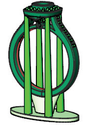

# Cylinder Supports 

- Source PDF: Matrix 8 Instruction Manual Book 2 (matrix_8_book_2.pdf)
- Page range: 157-158
- Section title: Cylinder Supports 
- Section id: m8book2-166-cylinder-supports
- Note: boundary page(s) are shared with a neighbouring section (two-column layout); text/images may include neighbour content.

---
<!-- section m8book2-166-cylinder-supports | Cylinder Supports  | m8book2 pages 157-158 -->

<!-- page 157 -->

and is the default. The blend is somewhat tangent
and smooth.
Blend Supports Large Shared Start:
This adds supports with a larger start
diameter while keeping a common start location.
Select start and end diameters in the Command
Line.
Position: This is a G0 blended curve that is
perpendicular to the tip curves (sharp corners).
Tangency: This is a G2 curve and has most
tangent blend (or smoothness).
Blend Support Large Shared Start
Quad Mirror: This adds mirrored supports
(across both X and Y) with a larger start diameter
while keeping a common start location.
## Cylinder Supports
### Command Line Options:
‘gvRPSupportCylinder’
Add cylinder-shaped supports for unsupported
geometry.
Mirror X=Off/On: When option is ON, supports
mirror across the X axis.
Mirror Y=Off/On: When option is ON, supports
mirror across the Y axis.
Where is this Command:
Access this command from Tools>3D Printing >
Cylinder Supports
Steps:
Chain Supports=On/Off: When Chain
Supports is on each time you set an end point for
a support it becomes the new start point for the
next support. When Chain Supports is set to OFF,
the start point stays the same for each support
you add.
ArmLength: ArmLength controls how far the
support extends off the models before the blend
between the support start and support end
begins. The value must be between 0.25 and 3.
• Select 3D Printing from the Tools menu.
• Select Cylinder Supports from the 3D Printing
menu, (along the left-hand side below Projects).
• Hold down Shift, and select the Start Point for the
Cylinder Support (base).
• While holding Shift, move your mouse, and click
again to set the support Diameter.
• Continue to hold Shift, and move your mouse up
or down to set the Height of the support.
Note: It remembers the last settings used. So, if you
need to position many cylinders of the same size and
height you can simply restart the command (press
Enter). Then, click to select a position. If you do not
hold Shift you will not be required to set a width and
height.
BlendTension: BlendTension controls the shape
of the blend between the start and end of the
support. A small value will give you a tighter bend
where larger values will give you a soft curve.
The value must be between 0.1 and 3.
StartDiameter: Controls the size of the support
diameter at the start.
EndDiameter: Controls the size of the support
diameter at the end.
Cylinder Support Quad Mirror
BlendContinuity: Controls the smoothness of
the blend of the support. The support shape is a
blend of two curve segments (tips) with a blended
curve (top) in between them.
Continuity: This represents a G1 blended curve

<!-- page 158 -->

### Cylinder Supports Modes:
Note: By default the tapered supports automatically
project to the Base support surface. To share a start
point turn AutoProject off.
Cylinder Support: This places a single
support in the viewport.
Cylinder Support Mirror X: This places a
set of mirrored supports (across X) in the
viewport.
Cylinder Support Quad Mirror: This
places a two sets of mirrored supports
(across both X and Y) in the viewport.
### Command Line Options:
Large Tapered Support Shared Start Point Quad
Mirror (without Shared supports)
Mirror X=Off/On: When option is ON, supports
mirror across the X axis.
### Large Tapered Supports Modes:
Mirror Y=Off/On: When option is ON, supports
mirror across the Y axis.
Large Tapered Support: This places a
single tapered support in the viewport.
Diameter: Type in a value for the Diameter of the
support.
Large Tapered Support Shared Start
Point: This adds tapered supports while
keeping a common start location.
## Large Tapered Supports
‘gvRPSupportLine’
Creates a large, tapered support for unsupported
geometry with a larger diameter at the base and
narrower at the top.
Large Tapered Support Shared Start
Point Mirrored X: This adds tapered,
mirrored supports (across X) while keeping a
common start location.
Where is this Command:
Access this command from Tools>3D Printing >
Large Tapered Supports
Large Tapered Support Shared Start
Point Quad Mirror: This adds tapered,
mirrored supports (across both X and Y) while
keeping a common start location.
Steps:
### Command Line Options:
Mirror X=Off/On: When option is ON, support
mirrors across the X axis.
Mirror Y=Off/On: When option is ON, support
mirrors across the Y axis.
• Select 3D Printing from the Tools menu.
• Select Large Tapered Support from the 3D
Printing menu, (along the left-hand side below
Projects).
• Select a Start Point (places the support tip on the
object).
• Choose your settings.
• Select an End Point.
• Continue selecting start and ends points, placing
multiple supports if needed.
• Press Enter to complete the command.
SharedStartPoint=Off/On: Shared Start
Point is ON with mirrored supports ON, shares
the start point with every set of supports placed.
(AutoProject must be turned OFF to activate
Shared Start.)

---

## Images

-  page 157 (shared page)
-  page 158 (shared page)
