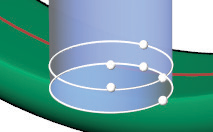
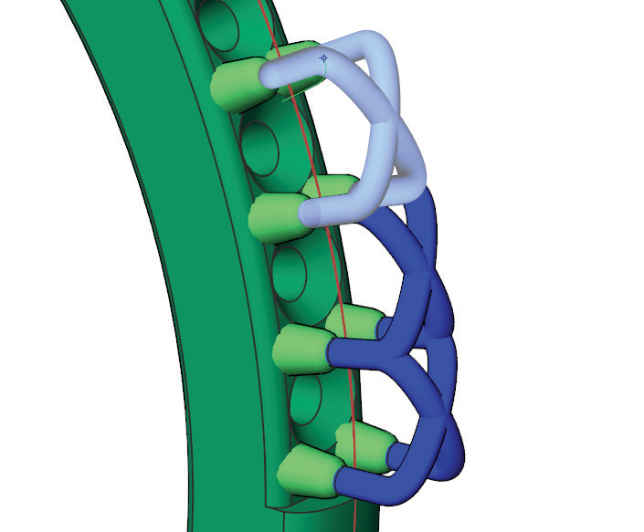
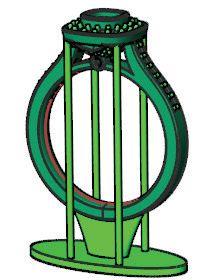

# Blend Supports 

- Source PDF: Matrix 8 Instruction Manual Book 2 (matrix_8_book_2.pdf)
- Page range: 156-157
- Section title: Blend Supports 
- Section id: m8book2-165-blend-supports
- Note: boundary page(s) are shared with a neighbouring section (two-column layout); text/images may include neighbour content.

---
<!-- section m8book2-165-blend-supports | Blend Supports  | m8book2 pages 156-157 -->

<!-- page 156 -->

## Blend Supports
the support sprue. Move your mouse along the
sprue support line and left-click to pick a new
position.
‘gvRPSupport’
Add supports for prongs and other unsupported
geometry.
### Command Line Options:
AddNewSupports: Allows you to add
additional supports to the model while in Support
Edit mode.
Where is this Command:
Access this command from Tools>3D Printing>
Blend Supports
Steps:
Steps:
• Pick support Anchor Point on sprue line.
Note: If you wish the supports you are adding to
have the same support anchor as your first
set of supports select the SnapToSprueTip option in
the Command Line.
• Pick the End Point for the support tip.
• Press Enter when done.
• Select 3D Printing from the Tools menu.
• Select Blend Supports from the 3D Printing menu,
(along the left-hand side below Projects).
• Pick a Start Point on the object.
• Pick any additional points on object to continue
adding anchor supports.
• Select any settings adjustments.
• Press Enter to complete.
RemoveSupports: Allows you to remove
supports from you model while in Support Edit
mode.
Steps:
• Select any support to delete it.
• Press Enter to return to Support Edit mode.
Reset: Clears all the supports.
Extender=Off/On: When ON a second set of
handles are added to the Anchor sprue base.
This allows you to make adjustments to another
location on the Anchor Sprue.
Steps:
Quad Mirror places sets of supports on both
shoulders of the ring.
### Blend Support Modes:
• Select the center white sphere on the Extender
handle.
• Move the handles up or down to place in the
desired location.
• Make Width and Diameter adjustments following
“Edit Sprue Start” instructions above.
Blend Supports Quad Mirror: This adds
mirrored supports across both X and Y. See
picture above.
Blend Supports Shared Start: This
adds supports while keeping a common
start location.
Extender = ON
Blend Supports Shared Start Quad
Mirror: This adds mirrored supports across
both X and Y while keeping a common start
location.

<!-- page 157 -->

and is the default. The blend is somewhat tangent
and smooth.
Blend Supports Large Shared Start:
This adds supports with a larger start
diameter while keeping a common start location.
Select start and end diameters in the Command
Line.
Position: This is a G0 blended curve that is
perpendicular to the tip curves (sharp corners).
Tangency: This is a G2 curve and has most
tangent blend (or smoothness).
Blend Support Large Shared Start
Quad Mirror: This adds mirrored supports
(across both X and Y) with a larger start diameter
while keeping a common start location.
## Cylinder Supports
### Command Line Options:
‘gvRPSupportCylinder’
Add cylinder-shaped supports for unsupported
geometry.
Mirror X=Off/On: When option is ON, supports
mirror across the X axis.
Mirror Y=Off/On: When option is ON, supports
mirror across the Y axis.
Where is this Command:
Access this command from Tools>3D Printing >
Cylinder Supports
Steps:
Chain Supports=On/Off: When Chain
Supports is on each time you set an end point for
a support it becomes the new start point for the
next support. When Chain Supports is set to OFF,
the start point stays the same for each support
you add.
ArmLength: ArmLength controls how far the
support extends off the models before the blend
between the support start and support end
begins. The value must be between 0.25 and 3.
• Select 3D Printing from the Tools menu.
• Select Cylinder Supports from the 3D Printing
menu, (along the left-hand side below Projects).
• Hold down Shift, and select the Start Point for the
Cylinder Support (base).
• While holding Shift, move your mouse, and click
again to set the support Diameter.
• Continue to hold Shift, and move your mouse up
or down to set the Height of the support.
Note: It remembers the last settings used. So, if you
need to position many cylinders of the same size and
height you can simply restart the command (press
Enter). Then, click to select a position. If you do not
hold Shift you will not be required to set a width and
height.
BlendTension: BlendTension controls the shape
of the blend between the start and end of the
support. A small value will give you a tighter bend
where larger values will give you a soft curve.
The value must be between 0.1 and 3.
StartDiameter: Controls the size of the support
diameter at the start.
EndDiameter: Controls the size of the support
diameter at the end.
Cylinder Support Quad Mirror
BlendContinuity: Controls the smoothness of
the blend of the support. The support shape is a
blend of two curve segments (tips) with a blended
curve (top) in between them.
Continuity: This represents a G1 blended curve

---

## Images

-  page 156
-  page 156
-  page 157 (shared page)
