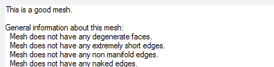
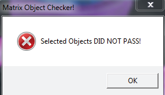

# Support Region Analysis 

- Source PDF: Matrix 8 Instruction Manual Book 2 (matrix_8_book_2.pdf)
- Page range: 151-151
- Section title: Support Region Analysis 
- Section id: m8book2-159-support-region-analysis
- Note: boundary page(s) are shared with a neighbouring section (two-column layout); text/images may include neighbour content.

---
<!-- section m8book2-159-support-region-analysis | Support Region Analysis  | m8book2 pages 151-151 -->

<!-- page 151 -->

### Options:
Extended Repair: This option will make the
mesh repair function take longer, but will make it
more likely to be successful on complicated
repairs. A progress notice will appear in the
Command Line while the function is working.
DeleteInputObjects=On/Off: With delete
input ON your NURBS objects will be deleted
after the mesh has been created.
An Edge Analysis box appears if Naked edges
are present and the object will highlight. Naked
edges are unjoined and therefore open edges of
a surface. The shell is checking for the validity of
the model. A model can be invalid for a variety of
reasons.
Mesh Tolerance: Control the tolerance for the
mesh created. A finer tolerance will create a mesh
that is closer to the NURBS object, but creates a
larger file size. Finer creates more polygons and
less fine creates fewer polygons with less design
definition.
Hint: Use Join 2 Naked Edges (Utilities menu) to
repair Naked Edges. Or, use Extract Bad Surface
(Utilities menu) to extract the problematic surface in
order to repair and replace it.
## Mesh Repair
‘gvMeshRepair’
Creates a single water tight mesh ready for 3D
printing. This multi-function tool repairs open
meshes, overlapping vertices, and more.
Simple Planes, Optimize Milgrain, Milgrain
Grid Count: These options all serve to minimize
the size of your output mesh. 3D printers have
a finite amount of memory and large, complex
meshes can limit the number of models you can
print at once. Use these options to make meshes
with a smaller polygon count and smaller file size.
## 3D Printing
Where is this Command:
Access this command from Tools>Mesh Repair
Steps:
This one button opens a menu with a series of
tools used to create supports for a model before
sending it to a 3D printer.
Where is this Command:
Access this command from Tools>3D Printing
• Select Repair Mesh from the Tools menu.
• Select object for Mesh repair.
• Press Enter.
• An Object Properties dialog will appear with
detailed information. Choose “Check Mesh” to
view the details.
## Support Region Analysis
‘gvViewSupportRegions’
Located within the 3D Printing command within
the Tools menu, Support Region Analysis (Show
Support Regions) is a Shade Mode that displays
the downward facing geometry of a model-
indicating where supports may be needed.

---

## Images

-  page 151 (shared page)
-  page 151 (shared page)
