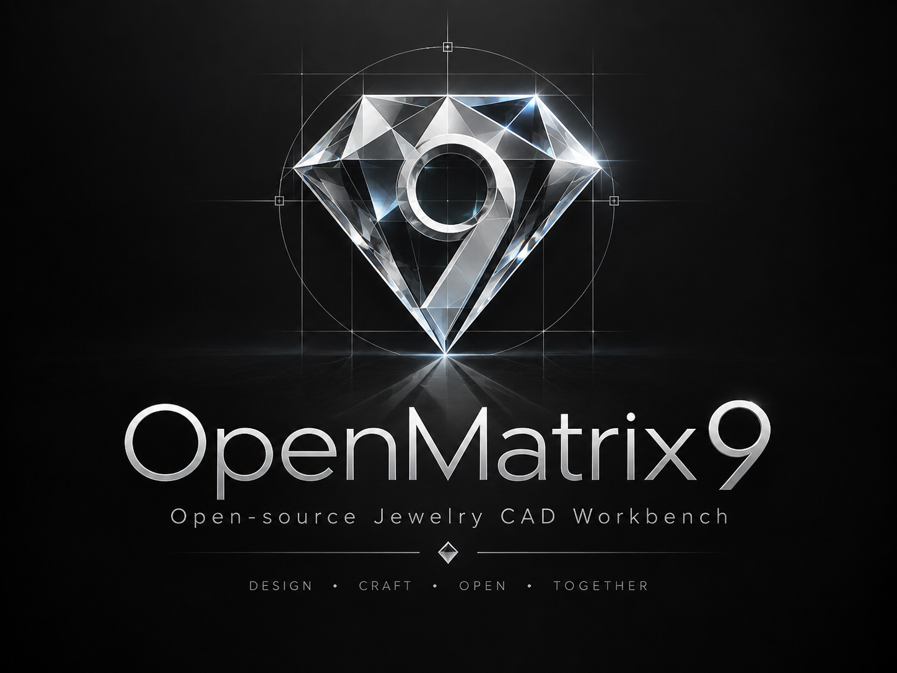

# OpenMatrix9

**Open-source jewelry CAD for FreeCAD.** Rust owns the logic; FreeCAD provides native geometry and UI.

[Tiếng Việt](README.vi.md) · [Installation](#installation) · [Releases](https://github.com/MYuitsu/OpenMatrix9/releases)



## Contents

- [Donate](#donate)
- [Detailed installation](#installation)
- [Progress](#progress)
- [Release notes](#release-notes)
- [License](#license)

<a id="donate"></a>
## Donate

Support CAD, 3DM and jewelry tools. Contributions are voluntary. Thank you!

- **PayPal:** send to **`nguyenthaiduy277@gmail.com`** through PayPal.
- **MoMo:** recipient **NGUYEN THAI DUY**; scan the QR code below.


<a id="installation"></a>
## Installation

**New launcher r2:** checks GitHub only when opening OM9 through its icon or `Start-OM9.cmd`, once per launch. Click **Update** to download, verify and install automatically. Save and close OM9 when asked; the updater waits, installs and reopens the same host/profile. **Later** keeps the offer for the next launch; **Cancel** retains the installed version. There is no periodic monitoring. See [launcher instructions](launcher/README.md). Existing published ZIPs keep their original launcher; install the new r2 bundle once to enable automatic download/install.

### 1. Prepare FreeCAD

The current release targets **Windows x64 and official FreeCAD 1.1.4**.
Using the package requires no FreeCAD source checkout, Rust or Visual Studio.

1. Open the [FreeCAD 1.1.4 release](https://github.com/FreeCAD/FreeCAD/releases/tag/1.1.4),
   download the **Windows x64** installer and follow its installation steps.
2. Start FreeCAD once. Check **Help → About FreeCAD** for version **1.1.4**.
   Its installation folder may be called `FreeCAD 1.1` despite the patch version.
3. Save your projects and close FreeCAD before installing or replacing the OM9 plugin.

### 2. Download SetupLauncher

Open **[Release 0.3.4-202610120606](https://github.com/MYuitsu/OpenMatrix9/releases/tag/v0.3.4-202610120606)**, expand **Assets** and download **SetupLauncher**:

| File | Download |
|---|---|
| **Launcher — recommended** | [OpenMatrix9-0.3.4-202610120606-SetupLauncher-Windows-x64.zip](https://github.com/MYuitsu/OpenMatrix9/releases/download/v0.3.4-202610120606/OpenMatrix9-0.3.4-202610120606-SetupLauncher-Windows-x64.zip) |
| SHA256 verification | [SHA256SUMS.txt](https://github.com/MYuitsu/OpenMatrix9/releases/download/v0.3.4-202610120606/SHA256SUMS.txt) |

**Source code** downloads are for development; install OM9 using the **SetupLauncher** ZIP above. This release is marked **Pre-release**.

### 3. Install with the launcher

1. Right-click the **SetupLauncher** ZIP → **Extract All**.
   Extract the entire bundle before opening the launcher.
2. Keep **`OpenMatrix9`**, **`launcher-manifest.json`** and all **`Start-OM9`**
   files together in the extracted folder.
3. Double-click **`Start-OM9.cmd`**.
4. The launcher installs OM9 in `%APPDATA%\FreeCAD\v1-1\Mod\OpenMatrix9`, creates
   **OpenMatrix9** shortcuts on **Desktop** and in **Start Menu**, then opens the workbench.
5. Use the **OpenMatrix9** shortcut afterwards. Once installation succeeds, the
   extracted download folder can be removed; the plugin is installed in AppData.

OM9 uses your user directory; Administrator access is unnecessary for the launcher
or FreeCAD. If the launcher reports that the plugin is in use, save and close
FreeCAD and retry. It leaves your running application open.

### 4. Open and check the installation

1. Use the installed **OpenMatrix9** shortcut, or open FreeCAD 1.1.4 and select
   **OpenMatrix9** from the workbench selector.
2. Create a document with **File → New**.
3. Select **Line**, place two points, then try **Undo** and **Redo**.
4. Check the sidebar, **Command** area, viewports and **Layers** panel.
   Disabled menu entries represent functionality still being developed.
5. Save a `.FCStd` project. Finish or cancel a modeling command before changing documents.

To check which plugin was loaded, open **View → Panels → Python console** and enter:

```python
import OpenMatrix9Gui
print(OpenMatrix9Gui.__file__)
```

For this installation, the path should end in `v1-1\Mod\OpenMatrix9\bin\OpenMatrix9Gui.pyd`.

### 5. Update, restore or uninstall

- **Update:** download the next Release's SetupLauncher, extract the complete
  bundle, save and close FreeCAD, then run `Start-OM9.cmd`. The launcher checks
  for updates in the background; downloading and installing remain explicit actions.
- **Previous installations:** the launcher keeps them in
  `%APPDATA%\FreeCAD\v1-1\OM9-backups`. To restore one, close FreeCAD, move the
  current plugin outside `Mod`, then place the chosen backup in `Mod\OpenMatrix9`
  keeping the folder named `OpenMatrix9`.
- **Launcher logs:** `%APPDATA%\FreeCAD\v1-1\OM9-launcher`.
- **Uninstall:** close FreeCAD and move `OpenMatrix9` outside `Mod`.
  Remove OM9 shortcuts if you no longer intend to use the installed launcher.
  Your saved `.FCStd` projects remain intact.

### 6. Verify downloads and troubleshoot

Download `SHA256SUMS.txt` from the same Release. In PowerShell in Downloads:

```powershell
Get-FileHash -LiteralPath '.\OpenMatrix9-0.3.4-202610120606-SetupLauncher-Windows-x64.zip' -Algorithm SHA256
Get-Content -LiteralPath '.\SHA256SUMS.txt'
```

Compare `Hash` with the line for that exact ZIP in `SHA256SUMS.txt`.

| Symptom | Check |
|---|---|
| OpenMatrix9 is missing | FreeCAD 1.1.4, `v1-1\Mod`, `InitGui.py`, then restart. |
| `No module named OpenMatrix9Gui` | Rerun `Start-OM9.cmd` from the fully extracted SetupLauncher bundle. |
| `DLL load failed` | The Windows x64 package for FreeCAD 1.1.4; read the **Report view** message. |
| Missing icons or menus | The `Resources` directory and the complete package contents. |
| `3DM import worker is missing` | `bin\OM9ThreeDmImportWorker.exe`; re-extract it from the same ZIP if absent. |
| Launcher does not install | Keep OpenMatrix9, the manifest and Start-OM9 files together; inspect step 5 logs. |
| Update says files are in use | Save and close FreeCAD using OM9, then rerun the launcher. |

Open **View → Panels → Report view** for errors. Include the FreeCAD version,
ZIP filename and panel message when reporting a problem. Match the plugin to
its host; do not replace dependencies with DLLs from another FreeCAD version.

**For developers:** [build OM9 against the shared SDK](docs/build-windows.md), in Vietnamese.

<a id="progress"></a>
## Progress

**In progress:** Core/History — object lifecycle, rollback and resource budgets.


**Workspace snapshot: 2026-10-12.** Counts describe validated supported scope,
rather than full features. Identifiers can repeat across groups. Consult the Release for binary scope.

| Group | Done / Total | Progress |
|---|---:|---|
| [Quick tools](docs/releases/2026-10-12-development.md#quick-tools--thao-tác-nhanh) | **3/11** | ▰▰▰▱▱▱▱▱▱▱ 27.3% |
| [File](docs/releases/2026-10-12-development.md#file) | **5/13** | ▰▰▰▰▱▱▱▱▱▱ 38.5% |
| [View](docs/releases/2026-10-12-development.md#view) | **10/15** | ▰▰▰▰▰▰▰▱▱▱ 66.7% |
| [Utilities](docs/releases/2026-10-12-development.md#utilities) | **0/22** | ▱▱▱▱▱▱▱▱▱▱ 0.0% |
| [Measure](docs/releases/2026-10-12-development.md#measure) | **2/17** | ▰▱▱▱▱▱▱▱▱▱ 11.8% |
| [Curve](docs/releases/2026-10-12-development.md#curve) | **7/58** | ▰▱▱▱▱▱▱▱▱▱ 12.1% |
| [Surface](docs/releases/2026-10-12-development.md#surface) | **3/40** | ▰▱▱▱▱▱▱▱▱▱ 7.5% |
| [Solid](docs/releases/2026-10-12-development.md#solid) | **6/30** | ▰▰▱▱▱▱▱▱▱▱ 20.0% |
| [Transform](docs/releases/2026-10-12-development.md#transform) | **0/41** | ▱▱▱▱▱▱▱▱▱▱ 0.0% |
| [Clayoo / SubD](docs/releases/2026-10-12-development.md#clayoo--subd) | **0/58** | ▱▱▱▱▱▱▱▱▱▱ 0.0% |
| [Emboss](docs/releases/2026-10-12-development.md#emboss) | **0/7** | ▱▱▱▱▱▱▱▱▱▱ 0.0% |
| [Builders](docs/releases/2026-10-12-development.md#builder) | **0/16** | ▱▱▱▱▱▱▱▱▱▱ 0.0% |
| [Jewelry tools](docs/releases/2026-10-12-development.md#tools) | **1/31** | ▱▱▱▱▱▱▱▱▱▱ 3.2% |
| [Gems](docs/releases/2026-10-12-development.md#gems) | **0/35** | ▱▱▱▱▱▱▱▱▱▱ 0.0% |
| [Settings](docs/releases/2026-10-12-development.md#settings--ổ-đá-và-chấu) | **0/12** | ▱▱▱▱▱▱▱▱▱▱ 0.0% |
| [Cutters](docs/releases/2026-10-12-development.md#cutters) | **0/11** | ▱▱▱▱▱▱▱▱▱▱ 0.0% |
| [Render](docs/releases/2026-10-12-development.md#render) | **0/23** | ▱▱▱▱▱▱▱▱▱▱ 0.0% |
| [Core / project / selection](docs/releases/2026-10-12-development.md#core--project--selection) | **5/11** | ▰▰▰▰▰▱▱▱▱▱ 45.5% |
| [Additional display](docs/releases/2026-10-12-development.md#view-và-display-bổ-sung) | **10/22** | ▰▰▰▰▰▱▱▱▱▱ 45.5% |
| [Snaps / constraints](docs/releases/2026-10-12-development.md#snap--ràng-buộc) | **4/17** | ▰▰▱▱▱▱▱▱▱▱ 23.5% |
| [Properties / history / layers](docs/releases/2026-10-12-development.md#properties--history--settings--layers) | **7/26** | ▰▰▰▱▱▱▱▱▱▱ 26.9% |
| [3DM / keyboard](docs/releases/2026-10-12-development.md#3dm-chuyên-biệt--keyboard) | **1/3** | ▰▰▰▱▱▱▱▱▱▱ 33.3% |

<a id="release-notes"></a>
## Release notes

- [Release 0.3.4-202610120606](https://github.com/MYuitsu/OpenMatrix9/releases/tag/v0.3.4-202610120606): changes, downloads and release-specific limitations.
- [Development checkpoints](docs/releases/2026-10-12-development.md): command tables, history and evidence moved from the README; includes Vietnamese notes.
- [Ledger](docs/openmatrix9-progress.json) · [Native reports](docs/validation/) · [Spec](OpenMatrix9_Codex_Spec_v1/INDEX.md).

<a id="license"></a>
## License

[LGPL-2.1-or-later](LICENSE) · [Third-party notices](THIRD_PARTY_NOTICES.md).
OpenMatrix9 is an independent project using Matrix9 as a functional reference;
it does not claim vendor affiliation, clean-room development or legal clearance.
[Source context](docs/public-source-review.md).
