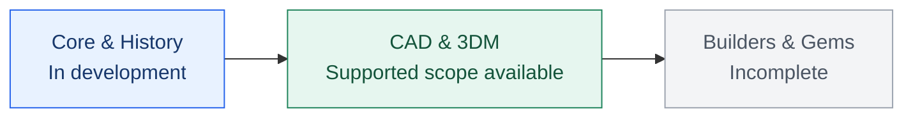

# OpenMatrix9

<!-- measure-annotation-transform-20261027 -->
Standalone 2026-10-27: Measure mở rộng, 13 annotation/model-space commands (owner OM9-L2-03-21), ArrayCrv Spacing/Roadlike và SetPt control coordinates/preview đã qua kiểm tra tự động. 019/025/037 vẫn khóa với lý do đúng; M03-UI chưa ký. [Phạm vi và bằng chứng](docs/validation/2026-10-26-measure-completion/README.md).

**Open-source jewelry CAD for FreeCAD.** Rust owns the logic; FreeCAD provides native geometry and UI.

[Tiếng Việt](README.vi.md) · [Installation](#installation) · [Releases](https://github.com/MYuitsu/OpenMatrix9/releases)


## Contents

- [Contributors](#contributors)
- [Donate](#donate)
- [Detailed installation](#installation)
- [Progress](#progress)
- [Release notes](#release-notes)
- [License](#license)

<a id="contributors"></a>
## Contributors

- CrimsonJCAD
- [nguyenthaiduy277](https://www.facebook.com/nguyenthaiduy277)
- [Jayhuynh](https://linktr.ee/Jayhuynh)

<a id="donate"></a>
## Donate

Support CAD, 3DM and jewelry tools. Contributions are voluntary. Thank you!

- **PayPal:** send to **`nguyenthaiduy277@gmail.com`** through PayPal.
- **MoMo:** recipient **NGUYEN THAI DUY**; scan the QR code below.


<a id="installation"></a>
## Installation

### 1. Prepare FreeCAD

The current release targets **Windows x64 and official FreeCAD 1.1.4**.
Using the package requires no FreeCAD source checkout, Rust or Visual Studio.

1. Open the [FreeCAD 1.1.4 release](https://github.com/FreeCAD/FreeCAD/releases/tag/1.1.4),
   download the **Windows x64** installer and follow its installation steps.
2. Start FreeCAD once. Check **Help → About FreeCAD** for version **1.1.4**.
   Its installation folder may be called `FreeCAD 1.1` despite the patch version.
3. Save your projects and close FreeCAD before installing or replacing the OM9 plugin.

### 2. Download SetupLauncher

Open **[Release 0.3.5-202610121520](https://github.com/MYuitsu/OpenMatrix9/releases/tag/v0.3.5-202610121520)**, expand **Assets** and download **SetupLauncher**:

| File | Download |
|---|---|
| **Launcher — recommended** | [OpenMatrix9-0.3.5-202610121520-SetupLauncher-Windows-x64.zip](https://github.com/MYuitsu/OpenMatrix9/releases/download/v0.3.5-202610121520/OpenMatrix9-0.3.5-202610121520-SetupLauncher-Windows-x64.zip) |
| SHA256 verification | [SHA256SUMS.txt](https://github.com/MYuitsu/OpenMatrix9/releases/download/v0.3.5-202610121520/SHA256SUMS.txt) |

**Source code** downloads are for development; install OM9 using the **SetupLauncher** ZIP above. This release is marked **Pre-release**.

### 3. Install with the launcher

1. Right-click the **SetupLauncher** ZIP → **Extract All**.
   Extract the entire bundle before opening the launcher.
2. Keep **`OpenMatrix9`**, **`launcher-manifest.json`** and all **`Start-OM9`**
   files together in the extracted folder.
3. Double-click **`Start-OM9.cmd`**.
4. The launcher installs OM9 in `%APPDATA%\FreeCAD\v1-1\Mod\OpenMatrix9`, creates
   **OpenMatrix9** shortcuts on **Desktop** and in **Start Menu**, then opens the workbench.
5. Use the **OpenMatrix9** shortcut afterwards. Once installation succeeds, the
   extracted download folder can be removed; the plugin is installed in AppData.

OM9 uses your user directory; Administrator access is unnecessary for the launcher
or FreeCAD. If the launcher reports that the plugin is in use, save and close
FreeCAD and retry. It leaves your running application open.

### 4. Open and check the installation

1. Use the installed **OpenMatrix9** shortcut, or open FreeCAD 1.1.4 and select
   **OpenMatrix9** from the workbench selector.
2. Create a document with **File → New**.
3. Select **Line**, place two points, then try **Undo** and **Redo**.
4. Check the sidebar, **Command** area, viewports and **Layers** panel.
   Disabled menu entries represent functionality still being developed.
5. Save a `.FCStd` project. Finish or cancel a modeling command before changing documents.

To check which plugin was loaded, open **View → Panels → Python console** and enter:

```python
import OpenMatrix9Gui
print(OpenMatrix9Gui.__file__)
```

For this installation, the path should end in `v1-1\Mod\OpenMatrix9\bin\OpenMatrix9Gui.pyd`.

### 5. Update, restore or uninstall

- **Update:** download the next Release's SetupLauncher, extract the complete
  bundle, save and close FreeCAD, then run `Start-OM9.cmd`. The launcher checks
  for updates in the background; downloading and installing remain explicit actions.
- **Previous installations:** the launcher keeps them in
  `%APPDATA%\FreeCAD\v1-1\OM9-backups`. To restore one, close FreeCAD, move the
  current plugin outside `Mod`, then place the chosen backup in `Mod\OpenMatrix9`
  keeping the folder named `OpenMatrix9`.
- **Launcher logs:** `%APPDATA%\FreeCAD\v1-1\OM9-launcher`.
- **Uninstall:** close FreeCAD and move `OpenMatrix9` outside `Mod`.
  Remove OM9 shortcuts if you no longer intend to use the installed launcher.
  Your saved `.FCStd` projects remain intact.

### 6. Verify downloads and troubleshoot

Download `SHA256SUMS.txt` from the same Release. In PowerShell in Downloads:

```powershell
Get-FileHash -LiteralPath '.\OpenMatrix9-0.3.5-202610121520-SetupLauncher-Windows-x64.zip' -Algorithm SHA256
Get-Content -LiteralPath '.\SHA256SUMS.txt'
```

Compare `Hash` with the line for that exact ZIP in `SHA256SUMS.txt`.

| Symptom | Check |
|---|---|
| OpenMatrix9 is missing | FreeCAD 1.1.4, `v1-1\Mod`, `InitGui.py`, then restart. |
| `No module named OpenMatrix9Gui` | Rerun `Start-OM9.cmd` from the fully extracted SetupLauncher bundle. |
| `DLL load failed` | The Windows x64 package for FreeCAD 1.1.4; read the **Report view** message. |
| Missing icons or menus | The `Resources` directory and the complete package contents. |
| `3DM import worker is missing` | `bin\OM9ThreeDmImportWorker.exe`; re-extract it from the same ZIP if absent. |
| Launcher does not install | Keep OpenMatrix9, the manifest and Start-OM9 files together; inspect step 5 logs. |
| Update says files are in use | Save and close FreeCAD using OM9, then rerun the launcher. |

Open **View → Panels → Report view** for errors. Include the FreeCAD version,
ZIP filename and panel message when reporting a problem. Match the plugin to
its host; do not replace dependencies with DLLs from another FreeCAD version.

**For developers:** [build OM9 against the shared SDK](docs/build-windows.md), in Vietnamese.

<a id="progress"></a>
## Progress

**Standalone Rectangle fix (2026-10-26):** preview/commit preserve CPlane drag direction, and typed CMD corners use the shared coordinate parser. **42 focused tests passed**, including 5 regressions with 24 quadrant cases; icon/mouse and typed CMD creation were checked in the new Windows GPU app. Continuous frame/present timing and full manual acceptance remain open. [Evidence](docs/validation/2026-10-26-rectangle-fix/README.md).

**Gumball 0.3.5**: Shift-click or window-select multiple objects to use one shared Gumball in all four views. Move, Scale and Rotate use the selection center; one Undo restores the whole batch. Local validation: **848 Rust tests**, **31 native cases / 1,099 checks**. [Evidence](docs/validation/2026-10-12-gumball-multi-selection.md). GitHub Actions builds and packages only.


**In progress:** Core/History — object lifecycle, rollback and resource budgets.



**Workspace snapshot: 2026-10-12.** Counts describe validated supported scope,
rather than full features. Identifiers can repeat across groups. Consult the Release for binary scope.

| Group | Done / Total | Progress |
|---|---:|---|
| [Quick tools](docs/releases/2026-10-12-development.md#quick-tools--thao-tác-nhanh) | **3/11** | ▰▰▰▱▱▱▱▱▱▱ 27.3% |
| [File](docs/releases/2026-10-12-development.md#file) | **5/13** | ▰▰▰▰▱▱▱▱▱▱ 38.5% |
| [View](docs/releases/2026-10-12-development.md#view) | **10/15** | ▰▰▰▰▰▰▰▱▱▱ 66.7% |
| [Utilities](docs/releases/2026-10-12-development.md#utilities) | **0/22** | ▱▱▱▱▱▱▱▱▱▱ 0.0% |
| [Measure](docs/releases/2026-10-12-development.md#measure) | **2/17** | ▰▱▱▱▱▱▱▱▱▱ 11.8% |
| [Curve](docs/releases/2026-10-12-development.md#curve) | **7/58** | ▰▱▱▱▱▱▱▱▱▱ 12.1% |
| [Surface](docs/releases/2026-10-12-development.md#surface) | **3/40** | ▰▱▱▱▱▱▱▱▱▱ 7.5% |
| [Solid](docs/releases/2026-10-12-development.md#solid) | **6/30** | ▰▰▱▱▱▱▱▱▱▱ 20.0% |
| [Transform](docs/releases/2026-10-12-development.md#transform) | **0/41** | ▱▱▱▱▱▱▱▱▱▱ 0.0% |
| [Clayoo / SubD](docs/releases/2026-10-12-development.md#clayoo--subd) | **0/58** | ▱▱▱▱▱▱▱▱▱▱ 0.0% |
| [Emboss](docs/releases/2026-10-12-development.md#emboss) | **0/7** | ▱▱▱▱▱▱▱▱▱▱ 0.0% |
| [Builders](docs/releases/2026-10-12-development.md#builder) | **0/16** | ▱▱▱▱▱▱▱▱▱▱ 0.0% |
| [Jewelry tools](docs/releases/2026-10-12-development.md#tools) | **1/31** | ▱▱▱▱▱▱▱▱▱▱ 3.2% |
| [Gems](docs/releases/2026-10-12-development.md#gems) | **0/35** | ▱▱▱▱▱▱▱▱▱▱ 0.0% |
| [Settings](docs/releases/2026-10-12-development.md#settings--ổ-đá-và-chấu) | **0/12** | ▱▱▱▱▱▱▱▱▱▱ 0.0% |
| [Cutters](docs/releases/2026-10-12-development.md#cutters) | **0/11** | ▱▱▱▱▱▱▱▱▱▱ 0.0% |
| [Render](docs/releases/2026-10-12-development.md#render) | **0/23** | ▱▱▱▱▱▱▱▱▱▱ 0.0% |
| [Core / project / selection](docs/releases/2026-10-12-development.md#core--project--selection) | **5/11** | ▰▰▰▰▰▱▱▱▱▱ 45.5% |
| [Additional display](docs/releases/2026-10-12-development.md#view-và-display-bổ-sung) | **10/22** | ▰▰▰▰▰▱▱▱▱▱ 45.5% |
| [Snaps / constraints](docs/releases/2026-10-12-development.md#snap--ràng-buộc) | **4/17** | ▰▰▱▱▱▱▱▱▱▱ 23.5% |
| [Properties / history / layers](docs/releases/2026-10-12-development.md#properties--history--settings--layers) | **7/26** | ▰▰▰▱▱▱▱▱▱▱ 26.9% |
| [3DM / keyboard](docs/releases/2026-10-12-development.md#3dm-chuyên-biệt--keyboard) | **1/3** | ▰▰▰▱▱▱▱▱▱▱ 33.3% |

<a id="release-notes"></a>
## Release notes

- [Release 0.3.5-202610121520](https://github.com/MYuitsu/OpenMatrix9/releases/tag/v0.3.5-202610121520): changes, downloads and release-specific limitations.
- [Development checkpoints](docs/releases/2026-10-12-development.md): command tables, history and evidence moved from the README; includes Vietnamese notes.
- [Ledger](docs/openmatrix9-progress.json) · [Native reports](docs/validation/) · [Milestone foundation](<OM9_Milestones/M01 - CAD Shell, Viewport/L1.json>).

<a id="license"></a>
## License

[LGPL-2.1-or-later](LICENSE) · [Third-party notices](THIRD_PARTY_NOTICES.md).
OpenMatrix9 is an independent project using Matrix9 as a functional reference;
it does not claim vendor affiliation, clean-room development or legal clearance.
[Source context](docs/public-source-review.md).

Owned layer state schema4 checkpoint: 394 workspace tests/34 focused subsets; four bounded OM9 cold children; 8 separate SDK export tests/18 jobs. [Measured scope](docs/validation/2026-10-14-owned-layer-state.md). Actual Layers panel/CMD/current-output/modal/selection and full RCORE acceptance remain open. Older receipts below retain historical source checkpoints.

Owned Layers widget checkpoint: 414 workspace tests/37 focused subsets;13 actual native Layers checks and6 viewport-menu regressions, four bounded cold OM9 children. [Measured scope](docs/validation/2026-10-14-owned-layers-ui.md). Advanced dialogs, other command families and full Layers/M9IMG/RCORE gates remain open; earlier SDK/UI receipts retain historical checkpoints.

## Owned Layers modal checkpoint — 2026-10-14

Owned Advanced Rename/Color and selective Show now have [measured modal evidence](docs/validation/2026-10-14-owned-layer-modals.md): 439 workspace tests/61 focused subsets;10 native dialog checks plus13 Layers and6 viewport regressions;five bounded cold OM9 children. The earlier unavailable-dialog limitation is historical for this owned-root slice. Token/session/stale guards, Cancel/no-op/Undo/Redo, bounded RGB and snapshot storage, fixed single-line rows and reusable UI owners are verified. Full Layer output families, interactive Save/Open, OS IME/DPI, async capture/global budgets and complete Layers/M9IMG/RCORE gates remain open.

## Owned File lifecycle service — 2026-10-14

Đã thêm [service vòng đời File](docs/validation/2026-10-14-owned-file-service.md): 458 test workspace;17 ca controller và hai tiến trình OM9 mở lạnh mới. New/Open/Save/Save As có dirty, Save/Discard/Cancel, token từng phản hồi và atomic I/O. Menu/CMD/hộp chọn tệp File chưa bật; .3dm, persistence view/material và nghiệm thu toàn bộ File/RCORE còn tiếp tục. Ba replay native hiện có là hồi quy Layers/viewport, không phải nghiệm thu File UI.

## Owned File UI and native cancellation — 2026-10-14

Đã nối [giao diện File native OM9](docs/validation/2026-10-14-owned-file-ui.md): 475 test workspace,16 ca widget và8 kiểm tra File trong cửa sổ native;3 dialog Windows mở/hủy/đóng sạch. Đã sửa Enter lặp và IME chuyển focus có thể tự xác nhận Save/New. Chọn/lưu/mở thành công bằng OS, xử lý lỗi native, persistence đầy đủ, đóng cửa sổ chưa lưu và `.3dm` còn tiếp tục; toàn goal chưa hoàn tất.

## Selected Win32 File adapter and replay guards — 2026-10-14

Đã thêm [adapter chọn tệp Win32](docs/validation/2026-10-14-owned-file-win32.md): 483 test workspace; HRESULT lỗi được báo rõ, Cancel tách riêng và overwrite do token OM9 xác nhận. Replay Layers chờ focus thật và dừng khi dialog chưa mở;3 dialog Windows hủy/đóng sạch. Chọn/lưu/mở thành công bằng OS, startup từ tệp, budgets, close/async, persistence đầy đủ và `.3dm` vẫn tiếp tục; toàn goal chưa hoàn tất.

## Owned window close — 2026-10-14

Đã nối [luồng đóng cửa sổ khi chưa lưu](docs/validation/2026-10-14-owned-file-close.md) qua Save/Discard/Cancel, kể cả nhánh thu nhỏ cửa sổ. 494 test workspace;2 yêu cầu WM_CLOSE thật và4 dialog Windows hủy sạch trong replay mới. Lưu lỗi hoặc hủy giữ tài liệu/bản nháp/cửa sổ. Goal đầy đủ vẫn đang thực hiện; chọn/lưu/mở thành công qua OS, startup, teardown/budgets/persistence/.3dm và các gate đầy đủ còn mở.

## Native File selection and startup — 2026-10-14

Đã kiểm chứng [chọn/lưu/mở tệp qua Windows thật](docs/validation/2026-10-14-owned-file-selection.md): 498 test workspace,3 đường dẫn được Show/GetResult trả về, SaveAs sang tệp khác chỉ nhận đường dẫn sau Replace và giữ nguyên SHA256 tệp gốc. Tiến trình mới chạy --ui path giữ đúng dữ liệu/đường dẫn/tiêu đề và bốn viewport. Goal đầy đủ tiếp tục: persistence hoàn chỉnh/.3dm, missing-module startup, teardown/budgets/async và các gate đầy đủ còn mở.

<a id="development-checkpoints"></a>
## Development checkpoints

Development main integration (2026-10-12): selected local native SDK proof, 1218 Rust tests and 1066 native checks. [Evidence and host requirements](docs/validation/2026-10-12-main-command-integration.md).


Plugin SDK developer slice (2026-10-21): independent Rust SDK/C ABI, `.om9p` loader and packager, standalone SDK ZIP, migration skill and real Windows DLL example. Core/scene/SDK tests: 509 passed; Controller: 4; packaged DLL: 3 (overlapping coverage). Mac runtime and SDK UI extensions remain unverified; the broad app batch has two reset-dock 300/360px failures in unchanged layout code. [SDK guide](sdk/README.md) · [API inventory](sdk/API-INVENTORY.md) · [Evidence](docs/validation/2026-10-21-plugin-sdk.md).

Windows standalone release (2026-10-21): [v0.3.6-202610211407](https://github.com/MYuitsu/OpenMatrix9/releases/tag/v0.3.6-202610211407) is published as a pre-release. Both Windows builds and tagged publication passed; the downloaded ZIP checksum and all 432 payload hashes match the tagged commit. The build uses pinned OCCT/openNURBS, MSVC x64, `--locked` and `-j 2`. [Build instructions](tools/ci/README.md) · [Verification](docs/validation/2026-10-21-standalone-release-published.json). CI provenance is build-only; UI/geometry/performance gates remain separate.

Viewport navigation runtime (2026-10-21): direct drag, analytic wheel zoom, one nonblocking window scheduler, adaptive resolution/MSAA, retained GPU occurrences, per-pass camera snapshots and generation-checked full-quality publication after GPU completion are implemented. Automated regressions pass; presentation, physical DPI/RDP and full performance acceptance remain open. Preview conservatively retains LOD0. [Approved plan](implementation/design/M01/VIEWPORT-NAVIGATION-IMPLEMENTATION-PLAN.md) · [Evidence and limitations](implementation/evidence/M01/2026-10-21-navigation-implementation.md).

Navigation forensics review (historical analysis checkpoint, 2026-10-21): `nav-pointer-125.jsonl` was the latest navigation capture in that inspected checkout; 326 camera records were reanalyzed. Per-pane timing defaults, incomplete frame telemetry and wheel interpolation need correction before accepting the proposed navigation refactor. [Review and proposed architecture](implementation/design/M01/VIEWPORT-NAVIGATION-FORENSICS-REVIEW-2026-10-21.md); [measured log summary](implementation/evidence/M01/2026-10-21-navigation-forensics-review.json). Analysis only; no new runtime or UI acceptance.

Slim sidebar scrollbar (2026-10-20): always-visible 4pt solid bar with a reserved 2pt gap, no hover overlay, and retained wheel/drag offset. Rightmost controls stay inside the reduced content viewport; default dock remains 360pt. 11 Rust tests, native narrow-dock and maximize/restore checks pass. [Evidence](docs/validation/2026-10-20-slim-sidebar-scrollbar.md).

Live icon resize fix (2026-10-20): fixed-column Main Menu and Display/Snaps/Info now follow window size within their existing row capacity. Native Windows maximize/restore 1280x720 -> 2560x1369 -> 1280x720 passed; Main Menu 28->31->28pt, toolbar 23->32->23pt, reference palettes approximately 25->28->25pt. 16 Rust tests pass. Default dock remains 360pt; reference slot counts/order retained. [Evidence](docs/validation/2026-10-20-fullscreen-icon-resize.md).

Icon size audit (2026-10-20): 1280x720, 1366x768, Full HD and QHD at simulated 100/125/150%, default dock 360pt. Actual Main Menu slots at 100% are 28/28/31/31pt (ten-column fit), toolbar 23/23/32/32pt, fixed palettes approximately 28pt. Five Rust tests pass; 22 category pages and 20 toolbar tabs checked per matrix case. Runtime sizing unchanged; physical monitor/DPI acceptance pending. [Measurements](docs/validation/2026-10-20-icon-screen-sizes.md).

Reference sidebar slots (2026-10-20): Display 11 icons (6+5); Snaps 16 command icons plus master/four step controls; Info & Settings 22 icons in two 7+4 rows, with history top right and manipulators bottom right. Fixed rows retain order and gaps across dock widths. 35 targeted Rust tests and native 100/125/150 captures passed (125/150 simulated); unavailable controls remain disabled. [Evidence](implementation/evidence/M01/2026-10-20-fixed-sidebar-palettes.json).

Left dock default (2026-10-20): fresh/factory layout and Reset Menus now use 360 outer logical pixels (previously 300); saved custom widths reload as before. 47 targeted Rust tests, validator self-test and native 1280x720 replay passed; measured outer/inner widths 360/355. [Evidence](implementation/evidence/M01/2026-10-20-left-dock-360.json).

UI font smoothing (2026-10-20): installed Segoe UI/Segoe UI Semibold/Consolas with bundled fallbacks, smooth hinting and one glyph pass instead of synthetic overprint. 28 targeted tests passed; native images reviewed at 100/125/150% (125/150 simulated). Full layout oracle still flags the older 22pt icon expectation against captured 24pt icons. [Evidence](implementation/evidence/M01/2026-10-20-smooth-fonts.json).

Dock text readability (2026-10-20): gold headings, warm cream body text and pale mint secondary labels on green, with clearer disabled labels and one clean layer name per row (category retained in tooltip). 32 focused Rust tests and three native GPU scenarios passed. [Evidence](implementation/evidence/M01/2026-10-20-dock-text-readability.json); formal M01-UI review pending.

Green dock theme (2026-10-20): left/right dock backgrounds and floating menu bodies share the Command dark green (`#01391C`), with green section bars (`#005126`). Group/icon/layer colours retained. 14 focused Rust checks and three native GPU scenarios passed. [Evidence](implementation/evidence/M01/2026-10-20-green-docks.json); formal M01-UI review pending.

Command colours (2026-10-20): user-selected dark green history (`#01391C`), green input (`#005126`) and gold text/caret (`#FDD880`), including selection and option tokens. Eight focused Rust tests and one native GPU replay passed. [Evidence](implementation/evidence/M01/2026-10-20-command-green-gold.json); formal M01-UI review pending.

Menu icon emphasis (2026-10-20): larger glyphs inside the existing slots, brighter card outlines and top highlights; original SVG colours and availability retained. 17 targeted Rust checks and one native GPU replay passed. [Evidence](implementation/evidence/M01/2026-10-20-menu-icon-emphasis.json); formal M01-UI review pending.

Main Menu readability (2026-10-20): larger, brighter category labels with stronger strokes, retaining the compact card height and category colours. 66 targeted Rust checks and one native GPU replay passed; formal M01-UI review remains pending. [Evidence](implementation/evidence/M01/2026-10-20-menu-text-contrast.json).

M02 selection / generic handles (2026-10-19): video-driven picking/Gumball and nested shared/mirrored occurrence paths now include canonical native BRep source and UUID topology mapping. The BRep batch passes 176 Rust tests, nine router tests and native BRep/Gumball replays on GPU 100/150% and painter 100%. Save/Open preserves source, topology IDs and placement; reopened OCCT box volume is 6000 mm³. [Verified scope and limits](implementation/evidence/M02/2026-10-19-brep-selection.md). Planned external M02-UI reviewer acceptance remains pending; full M02 is not declared complete. Rotation angle overdraw was subsequently corrected and checked with 18 targeted Rust tests and native CPU/GPU replay ([rotation fix](implementation/evidence/M02/2026-10-19-rotation-feedback.md)).

Mesh CSG kernel (2026-10-23): the original 16,384-triangle curved fixture now passes union/difference/intersection and self-overlap repair at the unchanged 1e-8 tolerance. Actual finite-triangle probe clearance replaces a false supporting-plane rejection; repaired shell has 15,724 triangles with UV seams. 514 core tests, 5 app utility tests and 17 release geometry tests pass. Input/work/output caps remain 25K/20M/50K, with closed topology and intersection checks retained. No new UI/SDK or general manufacturing guarantee. [Fix, measurements and limits](docs/validation/2026-10-23-mesh-csg-curved.md).

**Active direction (2026-10-19):** [M01 CAD Shell, Viewport](<OM9_Milestones/M01 - CAD Shell, Viewport/L1.json>) supplies the foundation contracts; exact features use their `OM9_Milestones` owner. Standalone Rust OM9 owns the document/history/UI/scene, with selected OCCT/openNURBS adapters. Matrix9 milestone references and the approved workspace/layers contracts define UI behavior. Existing FreeCAD support tables/runtime reports below remain historical evidence.

Polyline Command options (2026-10-25): `M` and clicking `Mode` now toggle Line/Arc through one Rust session; `P`/`H` toggle their displayed values. Arc segments remain analytic curves in a mixed Polycurve, with preview, Direction/Center input and one Enter/Undo transaction. Command input keeps nonempty drafts, paste and IME. Helpers tracking, continuously closed PersistentClose preview and full M03-UI acceptance remain open. [Validation and limits](docs/validation/2026-10-25-command-polyline-shortcuts/README.md).

Polyline parameter interface (2026-10-25): all eight Polyline parameters now share typed descriptors for names, keys, kinds, current values and activation. Keyboard, pointer and typed-name input use the same session parser; accepted Length/Direction/Center values update the prompt. A 24-scenario route/parameter matrix and 216 app tests pass. [Interface evidence](docs/validation/2026-10-25-polyline-parameter-interface/README.md).

Desktop viewports now use the GPU renderer by default; the CPU scene/shading fallback has been removed. A suitable GPU is required, while OCCT remains optional for the default app. [GPU-only implementation, validation and approved rule](implementation/evidence/M02/2026-10-19-gpu-only.md).

Standalone foundation development (2026-10-14): `crates/` (repository root) owns model/transactions/archive/scene and a native Matrix9 UI slice. The measured checkpoint has 360 workspace Rust tests plus 23 separately executed native integration tests. [Execution evidence and remaining gates](docs/validation/2026-10-13-standalone-foundation-progress.md). Selected retained-current 3DM export verifies original/current records, units, frames, raw spans and dirty conservative bounds in a fresh process before atomic publication with an explicit loss report. [Retained-current receipt](docs/validation/2026-10-14-standalone-retained-current.json). The S6 viewport title menu now has typed labels, scoped Maximize/Wireframe and protected keyboard/dismissal interaction; [native menu evidence](docs/validation/2026-10-14-viewport-title-menu.md). Full Matrix9, native family/remapping, clipboard, archive and performance acceptance remain pending; all full RCORE-00 gates stay open. [Build and launch](docs/standalone-foundation.md); released plugin instructions below retain their legacy scope.

Rhino 3DM import (2026-10-22): the standalone Rust host now has a registered 14-test 3DM acceptance suite over authored binary Rhino 5 archives — signature/version, units/tolerance conversion, layers/attributes, exact curves and NURBS surfaces, editable OCCT B-Rep (6000 mm³ box), meshes and shared blocks, retained-userdata diagnostics, atomic import/Undo, File-menu pickers and import summary, plus a golden roundtrip. All 66 planned L4 records have receipts under `implementation/evidence/M03/OM9-L3-01-13-*`. The M03-UI manual review of the native picker and warning presentation is still unsigned; V6+, macOS execution and exact host `Curve::Polycurve` re-export remain open. [Module evidence](implementation/design/M03/OM9-L2-01-13/README.md) · [milestone](<OM9_Milestones/M03 - Geometry 3DM/L2-01-13 - 14-febe-import-rhino-3dm/L2.json>).

Freeform surface workflows (2026-10-22): the standalone Rust host now owns portable NURBS services for sweep1/sweep2, loft and four-sided network, revolve/rail revolve/extrude, planar/patch, trim/split/untrim/shrink, rebuild/refit/softedit, G0/G1/G2 match/blend/join, offset/fillet/chamfer/thicken, UV reverse/isocurve/seam, and normal extrude/unroll. 16 core tests and 6 OCCT kernel tests pass; all 55 planned L4 records have receipts under `implementation/evidence/M03/OM9-L3-02-05-*`. All ten M03-UI selection/preview/commit workflows remain unsigned; n-sided networks, full surface optimization, true periodic seams and exact developable unroll are explicitly out of the supported scope. [Module evidence](implementation/design/M03/OM9-L2-02-05/README.md) · [milestone](<OM9_Milestones/M03 - Geometry 3DM/L2-02-05 - 05/L2.json>).

Top 11 (2026-10-28): the sidebar has an ordered row above DISPLAY; object actions can start before selection; Move Vertical, Rotate Copy and Mirror CPlane axes have focused tests. Explode separates an OCCT BRep into faces; Join sews connected BReps using document tolerance; Split Point supports one line, and Split can process multiple curve targets in one transaction. Targeted tests include Undo/Redo; broader geometry and manual UI acceptance remain open. [Sidebar and clean UI regression](docs/validation/2026-10-28-top11-sidebar-ui.md) · [Multi-curve Split evidence](docs/validation/2026-10-28-top11-split-multiple.md).

Command toolbar icons (2026-10-28): toolbar slots and artwork have been reduced to 75% of their previous responsive size. Standard, Visibility and Display have reference-order button rows; Display's Wireframe and Shaded use the active viewport owner. SubD has ten authored toolbar icons and four flyouts preserving its existing catalog; Sculpt and Emboss have nine and six authored SVGs respectively. Unsupported operations remain disabled. Full group coverage, individual button functionality and real UI review remain open. [Evidence and remaining work](docs/validation/2026-10-28-toolbar-icons-partial.md).

Rhino transform/orient workflows (2026-10-22): typed reference-point Move/Copy, signed-axis Rotate and Scale 1D/2D/3D sessions now live in `transform_session`; Mirror/linear/polar array and two/three-point Orient use the exact kernel math, with SetPt/align-to-plane/axis and AlignRequest rotate/scale variants added. The three-point orientation frame composition was corrected to `target_frame^T * source_frame` and is now tested with a non-identity rotation; the `Move 1,2` parser leak through the top11 command path is closed. 8 core session tests, 3 kernel transform tests, 11 prior transform-math tests and 17 app gumball checks pass; all 31 planned L4 records have receipts under `implementation/evidence/M03/OM9-L3-02-06-*`. All six M03-UI reference-picker/preview/commit workflows remain unsigned. [Module evidence](implementation/design/M03/OM9-L2-02-06/README.md) · [milestone](<OM9_Milestones/M03 - Geometry 3DM/L2-02-06 - 06-febe-rhino/L2.json>).

Matrix Curve menu bindings (2026-10-23): all 58 documented Curve Tools rows now have one stable command id/icon, an owner candidate and a visible disabled reason when no interactive command session exists. Line and Point remain functional through the existing session; the other 56 rows are verified disabled placeholders so the menu cannot silently no-op. 4 catalog/UI tests pass and all 174 planned L4 records have receipts under `implementation/evidence/M03/OM9-L3-03-16-*`. Human M03-UI click/preview review remains unsigned. [Module evidence](implementation/design/M03/OM9-L2-03-16/README.md) · [milestone](<OM9_Milestones/M03 - Geometry 3DM/L2-03-16 - 08/L2.json>).

Curve completion input (2026-10-28): viewport right-click submits the same input as Enter for a running Curve command; right-drag remains navigation. All 58 menu commands were exercised on suitable fixtures: 42 have pending sessions and 16 complete immediately. Right-click and Enter produced equivalent initial-stage state and geometry in all 42 pending sessions; Polyline and Curve also have completion geometry tests. Further stages and the interactive executable remain to be verified; Curve's existing parser does not accept typed point coordinates.

Matrix Surface menu bindings (2026-10-26): all 38 documented Surface Tools rows have one stable command id and authored icon, an owner candidate and a documented Matrix script name. Sweep 1/2, Sweep 1 History, Sweep 2 History, Sweep 4, Profile Sweep, Sweep Multi, Merge, Patch, Planar, Variable Offset, Variable Blend, Shrink, Untrim, Chamfer, Fillet, Variable Fillet, Variable Chamfer, Edge Curves, Cutting Plane, Split, Drape, Tangent, Extrude All, Rail Revolve, Match, Seam, Soft Edit, Tween, Extend, Rebuild, Blend, Loft, Network, Unroll, Offset, Extrude Normal and Plane from Corners run through `surface_edit`/`surface_ops`, with scene tessellation for display/picking and one transaction/Undo each; all 38 rows are functional and cannot silently no-op. The Matrix menu click and the typed script/label now resolve to the same row (`rebuild`/`soft edit` follow the selected object), Sweep 1/2 History only offer `Closed` for a closed rail plus two profiles, Soft Edit exposes `UDistance`/`VDistance`/`Copy`/`FixEdges`/`DirConstraint`, and Match Surfaces supports Position/Tangency/Curvature. 61 catalog/UI tests pass and all 114 planned L4 records have receipts under `implementation/evidence/M03/OM9-L3-03-17-*`. Human M03-UI click/preview review remains unsigned. [Module evidence](implementation/design/M03/OM9-L2-03-17/README.md) · [milestone](<OM9_Milestones/M03 - Geometry 3DM/L2-03-17 - 09-febe/L2.json>).

Matrix gem shapes and loader (2026-10-27): gem assets are now typed Rust records, not display plumbing. `om9_core::gem` defines the `om9.gem_spec.v1` cut/shape/dimension schema (round/oval/emerald/baguette/octagon/square/cushion/princess/pear/marquise/trillion/heart × diamond/simple/gem/cabochon), procedurally generated closed meshes with edge-consistent outward winding (so `volume_mm3` is the true enclosed volume), a canonical size library and a girdle/table/facet reference API; `gvLoader`, `gvEmerald`, `gvBaguette`, `gvGemPositioner` and `gvCustomGem` run through one gem session that paints its preview mesh in the viewport without writing, commits one transaction, converts a duplicate into a shared definition, and routes new gems to the `Gem 01` layer. With the OCCT kernel enabled, Apply stores an editable `Geometry::Brep` sewn from that same authored mesh (`BRep=No` keeps the portable mesh); the sewn body is validated as one closed solid with the mesh volume. F6 Gem Properties edits label/material/colour/size in one Undo step and keeps the body kind. 21 core, 2 kernel, 25 app and 2 preview-projection tests pass; no Matrix gemstone asset is read, copied or shipped. Evidence under `implementation/evidence/M05/OM9-L3-04-09-*`; three backend L3 are `AUTO_ONLY`, the five UI L3 keep the M05-UI gate open (loader, custom profile, emerald/baguette, positioner, properties). [Module evidence](implementation/evidence/M05/OM9-L2-04-09/README.md) · [milestone](<OM9_Milestones/M05 - Gems and Layout/L2-04-09 - 01-febe-gem-asset-shapes-and-loader/L2.json>).

Matrix halo/cluster/baguette layouts (2026-10-27): the seven builder L3 now share one geometry-free owner, `om9_core::gem_cluster`. A halo closes its ring (including the last-to-first gap), honours the fixed 12:00/3:00 stone, angle/rotation/height/placement and shape override; a cluster maps Bottom/Top/Left/Right to 6/12/9/3 o'clock, treats positive Z as down, rotates each stone by Degree and spaces one or two rings; a baguette channel derives its width from the wall gap, builds a tapered trapezoid profile, and supports banking, Flip, Middle and Point A/B, while Gems Between Two Curves reuses the same engine with round stones touching both walls. Orient to Gem reuses the exact gem basis. `gvHaloBuilder`, `gvClusterBuilder`, `gvTaperBagChannel`, `gvTaperBagBetweenTwoCurves`, `gvGemsBetween2Crvs` and `gvOrientGems` paint a live viewport preview and commit children plus the persisted `om9.gem.cluster` feature in one Undo step; editing regenerates the plan and keeps the child ids that still exist. 12 core and 11 app tests pass. Metal channel/prong geometry remains M06/M07 work (this owner records every manual channel/prong parameter), halo style presets (`Load`) await a style catalogue, and all seven L3 keep the M05-UI manual gate open. [Module evidence](implementation/evidence/M05/OM9-L2-04-11/README.md) · [milestone](<OM9_Milestones/M05 - Gems and Layout/L2-04-11 - 03-febe-gem-halo-cluster/L2.json>).

Matrix pavé layout and azure (2026-10-28): the eight pavé L3 now share `om9_core::gem_pave`. Auto Pavé fills a selected surface with a local-metric UV lattice (Hex/Square/Tri/Hex-Pent/All-Directions/Hex-Reverse, seeds, margin/border, angle, taper/equalize/perturb, pre/post correction and relaxation); Manual Pavé uses the same owner with an exact stone count. Azure emits four closed profiles per stone (top/through/bottom/seat) as 48-point circles or 6-point hexagons; Prong derives Shared/Center/Unshared markers from the stone contact graph; Sphere uses a Fibonacci layout with removal A/B and no surface requirement; Gem Springs repels overlapping stones and projects them back onto the surface. `gvPaveDialog`, `gvPaveBuilder`, `gvPaveAzureBuilder`, `gvPaveProngBuilder`, `gvPaveSphere` and `gvGemSprings` share one preview session and commit children plus the persisted `om9.gem.pave` feature in one Undo step; `Refresh` re-evaluates stored UVs after a surface edit, keeps child ids and reports conflicts instead of dropping stones. 11 core and 11 app tests pass. Azure cutting/prong solids remain M06/M07 work, pavé style presets await a catalogue, the sphere builder has no viewport drag handles yet, and all eight L3 keep the M05-UI manual gate open. [Module evidence](implementation/evidence/M05/OM9-L2-04-12/README.md) · [milestone](<OM9_Milestones/M05 - Gems and Layout/L2-04-12 - 04-febe-gem-pave-layout-and-azure/L2.json>).


Solid follow-up (2026-10-23): exact circle/NURBS extrusion, atomic ExtrudeAll, and Text/Boolean Two Objects menu prompts are verified. Span-aware integration measures ellipsoid (2,3,4) at 100.530964914874 mm³. Kernel 71 passed; app 191 passed; three native saved files cold-measured. [Report](docs/validation/2026-10-23-solid-ui-followup.md) · [M03-UI human worksheet](implementation/evidence/M03/solid-ui-followup-2026-10-23/M03-UI-CHECKLIST.md). Human signoff remains pending.

Pyramid Solid option (2026-10-29): OM9 Solid=No creates a topology-validated open shell for center, circumscribed, edge and star construction; Solid=Yes remains the OM9 default. The source text is interleaved with a neighboring command and does not establish the original Pyramid option. Controller, simulated option routes and viewport tests pass; Matrix original behavior and desktop validation remain open. [Evidence](docs/validation/2026-10-29-solid-pyramid-open.md).

Pyramid AroundCurve (2026-10-29): an OM9 interpretation lets a selected curve supply the base center and tangent-aligned construction frame, including star and open-shell cases; a stale source blocks preview and commit. The interleaved source text does not establish that this is an original Pyramid option. Edge combined with AroundCurve and original Matrix/desktop checks remain open. [Evidence](docs/validation/2026-10-29-solid-pyramid-around-curve.md).

Solid Multi Pipe (2026-10-29): the recovered menu entry and `_Pipe _Multiple` macro now start the shared multiple-curve Pipe session. Simulated menu, command, viewport, geometry and undo checks pass; full Pipe coverage and desktop validation remain open. [Evidence](docs/validation/2026-10-29-solid-multi-pipe-menu.md).

Box variants (2026-10-29): four recovered icon IDs and `_Box` mode macros now reach the shared Box session, with simulated icon, command, geometry and undo checks on world-XY fixtures. CPlane and desktop validation remain open. [Evidence](docs/validation/2026-10-29-solid-box-menu-variants.md).

Box signed height (2026-10-29): world-XY default/Diagonal and Center height preview and point commit now retain direction; typed Center dimensions accept negative height. Rotated planes and other modes remain open. [Evidence](docs/validation/2026-10-29-solid-box-signed-pick.md).

Box CPlane follow-up (2026-10-29): default/Diagonal and Center capture the construction frame for preview, CMD coordinates and commit; a rotated-plane fixture and Solid input regressions pass. Other modes and desktop validation remain open. [Evidence](docs/validation/2026-10-29-solid-box-cplane.md).

Box edge modes (2026-10-29): 3Point and Vertical accept signed width by point or number, and use the corresponding base normal for signed height. Rotated-plane geometry and a simulated Vertical viewport pass; edge-on views and desktop validation remain open. [Evidence](docs/validation/2026-10-29-solid-box-edge-width.md).

Box Cube preview (2026-10-29): Cube uses the captured frame for preview and commits on its second valid corner, including the antiparallel diagonal; 3Point/Vertical first-edge preview follows that frame. Controller and simulated menu tests pass; 3D viewport picking remains open. [Evidence](docs/validation/2026-10-29-solid-box-cube-preview.md).

Box Cube viewport (2026-10-29): a second corner picked in another viewport now uses that viewport's construction plane while the cube keeps its captured orientation. Two simulated cross-view fixtures pass; snap and physical desktop coverage remain open. [Evidence](docs/validation/2026-10-29-solid-box-cube-viewport.md).

Box units (2026-10-29): typed dimensions use document units once, Enter reuses converted dimensions, and invalid base geometry retains the session for correction. Centimeter fixtures and simulated viewport regressions pass; other units and desktop validation remain open. [Evidence](docs/validation/2026-10-29-solid-box-units.md).

Box unit routes (2026-10-29): inline, 3Point and Center numeric dimensions have measured coverage across six document units; Width in inches also passes simulated keyboard, pointer and CMD routes. Other option routes and desktop validation remain open. [Evidence](docs/validation/2026-10-29-solid-box-unit-routes.md).

Sphere variants (2026-10-29): six recovered menu entries and `_Sphere` mode macros use the shared Sphere session; numeric radii 2, 3 and 4 work after center selection. Controller, simulated menu and icon audits pass; full solver and desktop coverage remain open. [Evidence](docs/validation/2026-10-29-solid-sphere-menu-variants.md).

Sphere units (2026-10-29): Center and 2Point numeric dimensions use document units, with typed center and 2Point diameter aligned to the CPlane. Six-unit fixtures and simulated inch Radius options pass; Tangent/3Point unit paths remain open. [Evidence](docs/validation/2026-10-29-solid-sphere-units.md).

Sphere 3Point Radius (2026-10-29): after a radius in document units, a direction selects the side of the chord; preview and commit share the geometry. Controller, simulated option and viewport checks pass; broader solver and desktop checks remain open. [Evidence](docs/validation/2026-10-29-solid-sphere-3point-radius.md).

Sphere Tangent units (2026-10-29): numeric Radius is converted from document units in five existing tangent paths; centimeter line/point fixtures and simulated option routes pass. General tangent solvers and desktop validation remain open. [Evidence](docs/validation/2026-10-29-solid-sphere-tangent-units.md).

Sphere placed curves (2026-10-29): AroundCurve and existing curve-based Tangent modes sample entity placement in world coordinates and reject completion when captured sources become stale. Translated and rotated line fixtures pass; broader geometry and desktop interaction remain open. [Evidence](docs/validation/2026-10-29-solid-sphere-placed-curve.md).

Sphere AroundCurve picks (2026-10-29): controller and named-path points are projected onto the placed curve with bounded world-space search; translated line, endpoint and circle fixtures pass. Arbitrary curves and real desktop interaction remain open. [Evidence](docs/validation/2026-10-29-solid-sphere-aroundcurve-pick.md).

Sphere AroundCurve fraction and preview (2026-10-29): curve parameters evaluate on the placed curve and the radius preview shares the commit geometry; a translated-circle controller fixture passes. BRep edges and desktop interaction remain open. [Evidence](docs/validation/2026-10-29-solid-sphere-aroundcurve-fraction-preview.md).

Sphere AroundCurve BRep edges (2026-10-29): named straight BRep edges work through the fraction and point session; box-edge controller fixtures pass. Curved edges and direct viewport selection remain open. [Evidence](docs/validation/2026-10-29-solid-sphere-straight-brep-edge.md).

Sphere AroundCurve circular edges (2026-10-29): a bounded OCCT query supplies oriented circular BRep geometry; closed cylinder-edge controller and kernel editing checks pass. Trimmed arcs and direct viewport selection remain open. [Evidence](docs/validation/2026-10-29-solid-sphere-circular-brep-edge.md).

Sphere AroundCurve viewport selection (2026-10-29): a curve or BRep edge can be selected, then a center picked; simulated line and box-edge pointer tests pass. Desktop and overlapping-edge cases remain open. [Evidence](docs/validation/2026-10-29-solid-sphere-viewport-edge.md).

Sphere AroundCurve overlapping center hits (2026-10-29): after selecting a BRep edge, simulated viewport picking filters overlapping hits by that edge. Initial ambiguous source selection remains open. [Evidence](docs/validation/2026-10-29-solid-sphere-overlapping-edge.md).

Sphere AroundCurve ambiguous sources (2026-10-29): overlapping BRep source edges use a source-checked candidate popup; simulated coincident-box selection and stale-session checks pass. Desktop and same-object overlaps remain open. [Evidence](docs/validation/2026-10-29-solid-sphere-ambiguous-source.md).

Sphere AroundCurve curve world hit (2026-10-29): the center uses a revalidated world hit on the selected curve; an elevated line in a simulated Perspective viewport passes. General curves and desktop remain open. [Evidence](docs/validation/2026-10-29-solid-sphere-curve-world-hit.md).

Sphere AroundCurve trimmed arc (2026-10-29): one rotated and translated circular BRep arc passes oriented endpoints, fraction, off-arc pick and Undo checks. Seam-crossing and general curves remain open. [Evidence](docs/validation/2026-10-29-solid-sphere-trimmed-arc.md).

Slab foundation (2026-10-29): Rust computes a straight-line offset perimeter and extrusion, with measured BRep fixtures. The Slab command remains unavailable pending the full interaction and curve support. [Evidence](docs/validation/2026-10-29-solid-slab-line-foundation.md).

Slab polyline foundation (2026-10-29): safe Rust forms mitered open-polyline strips with bounded validation; measured L-shaped fixtures pass. Slab interaction and general curves remain open. [Evidence](docs/validation/2026-10-29-solid-slab-polyline-foundation.md).

Slab internal publication (2026-10-29): source-checked open-polyline BRep creation and Undo/Redo pass controller tests; the command remains unavailable pending interaction and general curve support. [Evidence](docs/validation/2026-10-29-solid-slab-internal-publication.md).

Slab staged development (2026-10-29): hidden preselected-line numeric sessions pass centimeter, BothSides and Undo/Cancel checks; the user command remains unavailable. The earlier no-OCCT Sphere/Box build failure was subsequently fixed. [Evidence](docs/validation/2026-10-29-solid-slab-staged-development.md).

Slab point preview (2026-10-29): hidden development sessions support point offset/height and matching wire preview; controller and simulated viewport fixtures pass. Slab remains unavailable pending complete interaction and curve support. [Evidence](docs/validation/2026-10-29-solid-slab-point-preview.md).

Slab nearest segment (2026-10-29): the hidden point session chooses the closest polyline segment and refuses ambiguous corners; controller and simulated viewport fixtures pass. The Slab user command remains unavailable. [Evidence](docs/validation/2026-10-29-solid-slab-nearest-segment.md).

Slab Distance and ThroughPoint (2026-10-29): the hidden session separates distance from side selection and supports a through-point; controller and simulated viewport tests pass. User command remains unavailable. [Evidence](docs/validation/2026-10-29-solid-slab-distance-throughpoint.md).

Slab source pick (2026-10-29): hidden sessions support preselection and simulated viewport selection, including session-scoped ambiguity. User command and general curves remain open. [Evidence](docs/validation/2026-10-29-solid-slab-source-pick.md).

Slab source plane (2026-10-29): hidden sessions derive the placed polyline plane and accept compatible InCPlane; YZ controller and simulated viewport fixtures pass. Slab remains unavailable. [Evidence](docs/validation/2026-10-29-solid-slab-source-plane.md).

Slab circle publication (2026-10-29): a hidden adapter builds exact full-circle annular BReps, with volume and Undo checks. Circle interaction and the user command remain unavailable. [Evidence](docs/validation/2026-10-29-solid-slab-circle-publication.md).

Slab circle session (2026-10-29): hidden sessions accept full circles with radial point input and wire preview; controller and simulated viewport tests pass. User command and general curves remain open. [Evidence](docs/validation/2026-10-29-solid-slab-circle-session.md).

Slab arc publication (2026-10-29): a hidden adapter extrudes exact circular-arc strips with measured volume and Undo/Redo; arc interaction and user command remain open. [Evidence](docs/validation/2026-10-29-solid-slab-arc-publication.md).

Slab arc session (2026-10-29): hidden sessions accept circular arcs with bounded point offset and wire preview; quarter-circle and seam-crossing checks pass. The user command and general curves remain open. [Evidence](docs/validation/2026-10-29-solid-slab-arc-session.md).

Slab NURBS publication (2026-10-29): a hidden adapter fits and sample-checks open planar NURBS offsets; a measured rational quarter-circle fixture passes. Global accuracy, interaction and user command remain open. [Evidence](docs/validation/2026-10-29-solid-slab-nurbs-publication.md).

Rib straight planar foundation (2026-10-29): Rust strip-to-planar-boundary adapter passes measured shell fixtures within 61 kernel tests; original semantics and public command remain open. See `docs/validation/2026-10-29-solid-rib-straight-planar-foundation.md`.

Rib development follow-up (2026-10-29): a hidden session handles disjoint linear curves against a planar boundary in one atomic document transaction. Offset modes, taper, full interaction and the public command remain open. [Evidence](docs/validation/2026-10-29-solid-rib-development-session.md).

Periodic knot certification precision (2026-10-29): period-scaled roundoff checks reject a tiny nonperiodic mismatch; 9 core, 3 kernel, 32 Slab and 16 simulated viewport tests passed. See `docs/validation/2026-10-29-solid-periodic-knot-certification-scale.md`.

Periodic double-seam parameter scale (2026-10-29): exact OCCT splitting normalizes narrow or translated knot domains; 3 kernel, 32 Slab controller/core and 16 simulated viewport tests passed. See `docs/validation/2026-10-29-solid-periodic-double-seam-parameter-scale.md`.

Periodic double-seam viewport (2026-10-29): 16 simulated viewport and 3 kernel extrusion tests pass, including reversed input, signed height and two knot scales. Desktop and arbitrary periodic forms remain open; see `docs/validation/2026-10-29-solid-periodic-double-seam-viewport.md`.

Periodic double-seam extrusion (2026-10-29): exact trimmed B-spline segments yield measured BReps and a hidden Slab fixture; 3 kernel, 32 controller/core and 15 simulated viewport tests passed. See `docs/validation/2026-10-29-solid-periodic-double-seam-extrusion.md`.

Periodic NURBS repeated seam (2026-10-29): right-boundary evaluation handles repeated knots; a later exact trimmed-segment adapter fixes the tested double-seam tessellation failure; wider coverage remains open. See `docs/validation/2026-10-29-solid-periodic-repeated-seam-evaluation.md`.

Slab certified periodic NURBS subset (2026-10-29): repeated-pole periodic basis supports evaluator, scene and hidden Slab; 31 controller/core and 15 simulated viewport tests passed. Other periodic representations remain open; see `docs/validation/2026-10-29-solid-slab-certified-periodic-nurbs.md`.

Slab shifted seam viewport (2026-10-29): 14 simulated viewport tests pass, including shifted-seam ellipse selection and Undo in both directions; periodic NURBS and desktop remain open. See `docs/validation/2026-10-29-solid-slab-shifted-seam-viewport.md`.

Slab shifted NURBS seam (2026-10-29): hidden session supports full-domain closed nonperiodic NURBS with shifted seam; 30 controller/core and 13 simulated viewport tests passed. Periodic and desktop cases remain open; see `docs/validation/2026-10-29-solid-slab-closed-nurbs-shifted-seam.md`.

Slab closed NURBS preview guard (2026-10-29): sampled collapsed offsets are suppressed before acceptance; 29 controller/core and 13 simulated viewport tests passed. Fit/OCCT and global topology remain open; see `docs/validation/2026-10-29-solid-slab-closed-nurbs-preview-guard.md`.

Slab closed NURBS session (2026-10-29): hidden session previews and publishes clamped closed NURBS; 28 controller/core and 13 simulated viewport tests passed. Sampled fit/topology and public command remain open; see `docs/validation/2026-10-29-solid-slab-closed-nurbs-session.md`.

Slab closed NURBS publication (2026-10-29): hidden adapter inserts a source-checked ellipse Slab with Undo/Redo; 27 Slab controller/core and 12 simulated viewport tests passed. Closed NURBS interaction and global topology remain open; see `docs/validation/2026-10-29-solid-slab-closed-nurbs-publication.md`.

Slab closed NURBS foundation (2026-10-29): sampled offset rings produce measured ellipse BReps in both directions; 26 Slab controller/core and 12 simulated viewport tests passed. Publication and global topology remain open; see `docs/validation/2026-10-29-solid-slab-closed-nurbs-foundation.md`.

Slab concave closed options (2026-10-29): a controller fixture verifies Distance, ThroughPoint, preview bounds, volume, Undo and Cancel; 25 Slab controller/core tests passed. General topology and public command remain open; see `docs/validation/2026-10-29-solid-slab-concave-closed-options.md`.

Slab closed-polyline session (2026-10-29): hidden session previews and publishes closed line polycurves and degree-one NURBS; 24 controller/core and 12 simulated viewport tests passed. Public command remains disabled; see `docs/validation/2026-10-29-solid-slab-closed-polyline-session.md`.

Slab closed-polyline publication (2026-10-29): hidden adapter publishes placed closed polycurves or degree-one NURBS with Undo/Redo; 23 Slab controller/core and 11 simulated viewport tests passed. Closed-source interaction remains open; see `docs/validation/2026-10-29-solid-slab-closed-polyline-publication.md`.

Slab closed-polyline foundation (2026-10-29): nested mitered rings pass measured rectangle and concave-L BRep fixtures; 22 Slab controller/core and 11 simulated viewport tests passed. Closed source interaction and publication remain open; see `docs/validation/2026-10-29-solid-slab-closed-polyline-foundation.md`.

Slab collinear segments (2026-10-29): hidden polyline geometry accepts disjoint collinear segments and rejects overlaps; 21 Slab controller/core and 11 simulated viewport tests passed. Closed sources remain open; see `docs/validation/2026-10-29-solid-slab-collinear-segments.md`.

Slab degree-one viewport (2026-10-29): 11 simulated viewport tests pass, including rational degree-one selection, BRep volume and Undo in both directions; no-default app check passes. Desktop and public command remain open; see `docs/validation/2026-10-29-solid-slab-degree-one-viewport.md`.

Slab degree-one NURBS (2026-10-29): hidden session and publication use the mitered polyline path for continuous open degree-one curves; 20 controller and 10 simulated viewport tests passed. Public command remains disabled; see `docs/validation/2026-10-29-solid-slab-degree-one-nurbs.md`.

Slab ambiguous NURBS pick (2026-10-29): hidden session rejects conflicting equal-distance offsets; 19 controller and 10 simulated viewport tests passed. Search remains approximate; see `docs/validation/2026-10-29-solid-slab-nurbs-ambiguous-pick.md`.

Slab competing NURBS spans (2026-10-29): hidden side picking refines every active knot span within a work budget; 18 controller and 10 simulated viewport tests passed. Multimodal and ambiguous cases remain open; see `docs/validation/2026-10-29-solid-slab-nurbs-competing-spans.md`.

Slab NURBS knot pick (2026-10-29): hidden session uses knot-aware sample stations and local refinement for side picks; 17 controller and 10 simulated viewport tests passed. Global nearest-point and topology guarantees remain open; see `docs/validation/2026-10-29-solid-slab-nurbs-knot-pick.md`.

Slab NURBS knot preview (2026-10-29): hidden preview includes active knot-span stations and handles reversed fractions; 17 controller and 10 simulated viewport tests passed. Closest-point picking and global fit remain open; see `docs/validation/2026-10-29-solid-slab-nurbs-knot-preview.md`.

Slab NURBS plane inference (2026-10-29): hidden session derives the source plane and checks InCPlane using the placed control hull; 17 controller and 10 simulated viewport tests passed. This remains conservative for trimmed curves; see `docs/validation/2026-10-29-solid-slab-nurbs-plane-inference.md`.

Slab NURBS planarity (2026-10-29): the hidden offset path checks the full positive-weight control hull against the source plane, conservatively rejecting narrow unsampled deviations. 17 controller and 10 simulated viewport tests passed; see `docs/validation/2026-10-29-solid-slab-nurbs-planarity.md`.

Slab reversed NURBS (2026-10-29): hidden development session preserves the chosen side for reversed open nonperiodic planar NURBS; 16 controller and 10 simulated viewport tests passed. Public command and global fit/topology validation remain open; see `docs/validation/2026-10-29-solid-slab-reversed-nurbs.md`.

Slab NURBS session (2026-10-29): hidden sessions support sampled preview and point selection on open NURBS; a rational quarter-circle controller and simulated viewport fixture pass. General accuracy and user command remain open. [Evidence](docs/validation/2026-10-29-solid-slab-nurbs-session.md).

Solid no-OCCT developer build (2026-10-29): compilation now passes and Sphere/Box Menu and CMD requests are rejected without changes; default OCCT regression checks pass. Other commands and desktop remain unverified. [Evidence](docs/validation/2026-10-29-solid-no-occt-build.md).

Historical checkpoint — Exact ellipsoid and Solid regression (2026-10-23): Rust now constructs a rational biquadratic 9×5 net; OCCT builds one valid closed solid with seam/pole topology. Adaptive canonical B-Rep measurement replaces fixed quadrature. Six axis fixtures and 498 analytic diameters pass; volume error is about 9.3e-12 relative. Kernel 69 passed (1 pre-existing ignored), app library 176 passed, Solid 7 passed, and the native UI saved-file check passed. Real Windows menu/CMD, Undo/Redo, cancel and invalid-input feedback were observed; human M03-UI signoff remains pending. [Evidence](docs/validation/2026-10-23-exact-ellipsoid.md).

Owned Layers primitive checkpoint: 375 workspace tests pass; 15 focused checks are subsets, including an independent owned-process cold metadata reopen. [Measured scope and pending panel/schema](docs/validation/2026-10-14-owned-layer-primitives.md). Native/UI/exchange receipts above retain their earlier checkpoint.


Development Box clarification (2026-10-12): default two opposite base corners then Height, optional four methods; staged wire preview in four views and Top-view height drag. [Rust and native evidence](docs/validation/2026-10-12-box-default-video.md).

Shared Command parameter interface (2026-10-25): all 39 existing option declaration groups now use `CommandOptionInterface` for current values, shortcuts, pointer/typed activation and value entry. 466 distinct tests passed; one old Box workflow assertion is reproduced on pre-expansion sources and remains open, and two manual fixture tests remain ignored. The new debug binary was verified in the real Windows UI; the user release stays intact. [Evidence and limits](docs/validation/2026-10-25-command-parameter-interface/README.md).

Polyline option-owner check (2026-10-26): an older running release can display Line buttons over a Polyline prompt by consulting the previous Line repeat slot. The common interface already prevents this. A Line-to-Polyline regression now covers menu/CMD ownership and first-point Length availability; eight interface tests and native replay pass. [Version diagnosis and evidence](docs/validation/2026-10-26-polyline-option-owner/README.md).

Command interaction handoff specification (2026-10-26): a detailed Vietnamese Polyline-based specification and GPT Luna prompt cover active owner/run identity, typed values, value/point/text entry, inline prompt/spans, all 39 existing option declaration groups, 19 extra pending-owner audit rows, 13 future work packages and 50 unexecuted acceptance templates. Documentation/source consistency checks pass; no production migration or gate promotion is claimed. [Specification and handoff](implementation/design/M01/command-options-polyline-standard-20261026/README.md).

Command integration skill rule (2026-10-26): user-authorized guidance now requires icon/variant mapping, correct default invocation and working owner parameters with Polyline-style underlined shortcuts before declaring a command integrated. The source and installed rule sections/reference are synchronized; four skill validators pass. This is a skill update, not product acceptance. [Rule and scope](skills/openmatrix9-feature-port/references/command-integration-contract.md).
