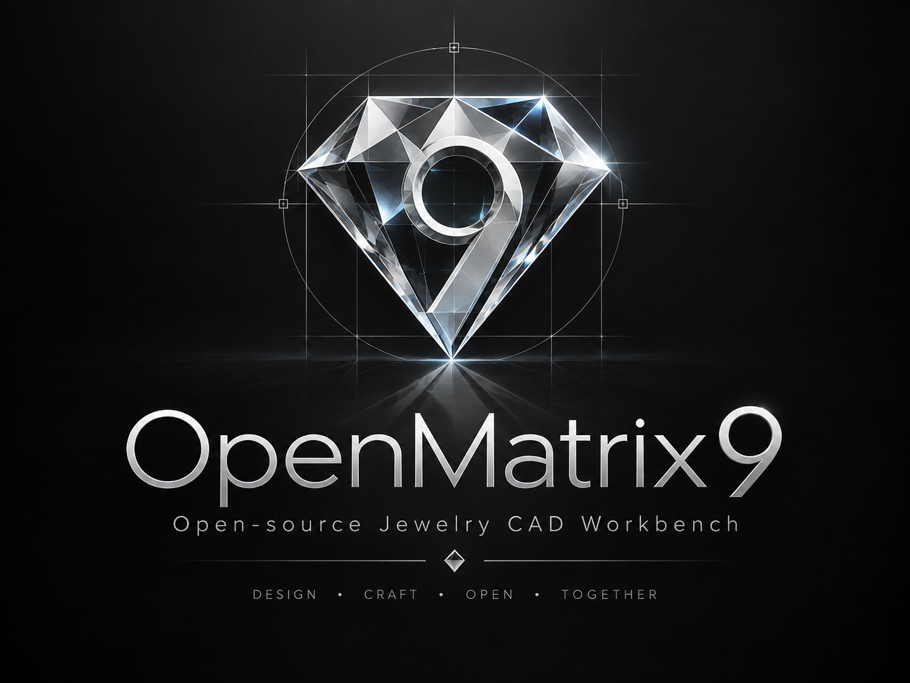
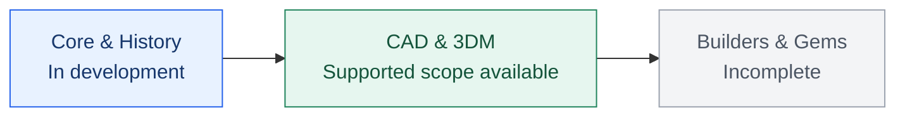

# OpenMatrix9

**Add-on integration 2026-11-05:** PR #3 integrated with the `hieu-nang-2` foundations; targeted tests and remaining desktop verification are recorded in [integration evidence](docs/validation/2026-11-05-pr3-hieu-nang-2-integration.md).

**Regression fixes 2026-11-05:** all 21 recorded Rust failures now pass; affected validation 669 passed/0 failed/1 ignored and release build passed. [Fixes and evidence](docs/validation/2026-11-05-fix21-regressions.md). Full-workspace rerun and desktop/WPR acceptance are not claimed.

**Validation 2026-11-05, hieu-nang:** release build passed; one workspace test run: **4,497 passed, 21 failed, 183 ignored**. Native adapter builds, but its first inventory fixture is rejected by packet preflight. [Results, failures and scope](docs/validation/2026-11-05-workspace-build-test-commit.md). This checkpoint is not a green regression baseline.

Interactive startup now derives its managed byte limit from physical RAM, with an explicitly reported conservative fallback; [coverage and remaining RAM gaps](docs/validation/2026-11-04-interactive-ram-transition.md).

Document and display points have separate structural quotas while their memory remains jointly charged; [tested paths and limitations](docs/validation/2026-11-04-interactive-ram-transition.md#independent-document-and-scene-point-quotas).

The native project writer uses bounded geometric buffer growth; a >256 MiB in-memory synthetic mesh passed a release Save/New/Open fixture after structural-limit fixes. [Evidence](docs/validation/2026-11-04-interactive-ram-transition.md#large-mesh-release-savenewopen-after-structural-separation).

Save verification now keeps per-document structural limits, and archive parser tokens have a separate input/byte bound; [checks and remaining limits](docs/validation/2026-11-04-interactive-ram-transition.md#structural-limits-during-save-verification-and-json-preflight).

Open reserves archive input, schema-4 preflight, estimated document validation and restoration memory; [coverage and remaining RAM gaps](docs/validation/2026-11-04-open-archive-input-reservation.md).

Open reserves estimated candidate controller and scene overhead and transfers its reservation under the replacement-publication lock; [tests and remaining ownership gaps](docs/validation/2026-11-04-open-archive-input-reservation.md#candidate-controller-overhead-follow-up).

Open keeps replaced document versions and estimated old-controller auxiliary memory accounted through destruction; [coverage and limitations](docs/validation/2026-11-04-open-archive-input-reservation.md#retired-controller-auxiliary-reservation-follow-up).

Direct and scoped staged document versions are registered for shared-account peers; [coverage and remaining lifecycle limits](docs/validation/2026-11-04-open-archive-input-reservation.md#scoped-staged-version-peer-visibility-follow-up).

Scope Finish rechecks shared reservations before publishing; [tested race and remaining limits](docs/validation/2026-11-04-open-archive-input-reservation.md#scope-finish-shared-account-recheck).

Core coordinator `open_document` registers new documents for peers; [tests and limits](docs/validation/2026-11-04-open-archive-input-reservation.md#coordinator-open-document-peer-inventory).

Account adoption registers retained documents in both directions and retires stale joining-account handles; [remaining memory limits](docs/validation/2026-11-04-open-archive-input-reservation.md#retired-joining-account-handles).

Save admits serializer buffers and verification scratch by phase on the shared memory account, leaving unused headroom available to other work; [scope and limits](docs/validation/2026-11-05-scene-picking-save-phases.md).

STL capture retains a reservation for its copied selection IDs; [scope and limits](docs/validation/2026-11-04-stl-capture-selection-reservation.md).

STL soup construction eliminates a per-triangle source flag allocation; [validation and limits](docs/validation/2026-11-04-stl-triangle-flags.md).

STL construction reuses the first B-rep snapshot point buffer; [validation and limits](docs/validation/2026-11-04-stl-reuse-brep-points.md).

Initial release process-memory probes cover simple Boolean, Fillet and Loft; [fixtures and limits](docs/validation/2026-11-04-kernel-operation-memory-probe.md).

OCCT snapshot copies and grouped topology arrays share an admission check; [scope and limits](docs/validation/2026-11-04-occt-snapshot-copy-preflight.md#grouped-topology-accounting).

The experimental STL worker caps its native snapshot budget at its reservation; [scope and limits](docs/validation/2026-11-03-stl-worker-sampled-reservation.md#native-adapter-ceiling-from-worker-reservation).

STL admission checks known soup, remap, output buffers and indexed topology capacities, including fan traversal; [scope and limits](docs/validation/2026-11-04-stl-soup-snapshot-admission.md#indexed-fan-adjacency-and-traversal-admission).

STL streaming also checks known quantized-position table slots; [scope and limits](docs/validation/2026-11-04-stl-soup-snapshot-admission.md#quantized-position-table-admission-during-stl-writing).

The STL writer buffer is also included in per-export admission, and staged verification avoids an extra heap read buffer; [evidence](docs/validation/2026-11-04-stl-soup-snapshot-admission.md#stl-streaming-and-staged-verification-buffers).

Retained STL receipt notes and the output path are included in later admission checks. [Evidence](docs/validation/2026-11-04-stl-soup-snapshot-admission.md#receipt-notes-and-output-path-during-stl-validation).

Skipped-object note allocation now has an earlier partial budget check; [scope and limits](docs/validation/2026-11-04-stl-soup-snapshot-admission.md#skipped-object-note-allocation).

Existing STL receipt notes now reduce the allowance for later geometry construction; [scope and limits](docs/validation/2026-11-04-stl-soup-snapshot-admission.md#receipt-notes-during-later-geometry-construction).

STL warning creation now checks known soup and receipt storage before allocation; [scope and limits](docs/validation/2026-11-04-stl-soup-snapshot-admission.md#warning-note-allocation).

Converted STL native sources are released before receipt warnings are built; [scope and limits](docs/validation/2026-11-04-stl-soup-snapshot-admission.md#converted-native-source-lifetime).

The STL writer accounts for its retained temporary path and avoids duplicating it; [scope and limits](docs/validation/2026-11-04-stl-soup-snapshot-admission.md#temporary-output-path-during-stl-writing).

Controller/captured and detached STL reserve managed buffer/scratch phases instead of remaining headroom; native allocations before copy callbacks and other owners remain open. [Evidence](docs/validation/2026-11-05-stl-staged-memory.md).

STL capture reuses the shared admission peer instead of constructing and adopting a temporary account, avoiding unnecessary cache reclamation at the tested budget boundary. [Scope and remaining R1a work](docs/validation/2026-11-05-stl-shared-admission-peer.md).

Root selection tree/order now have a live shared-account owner, so detached STL admission observes subsequent selection changes and releases. Selection semantics stay unchanged; [evidence and remaining auxiliary ownership](docs/validation/2026-11-05-live-root-selection-memory.md).

Subobject selection slots and nested path buffers now have a live CPU owner; slot growth moves path ownership without cloning or double charging retained paths. [Validated scope and remaining RAM gaps](docs/validation/2026-11-05-live-subselection-memory.md).

STL admission no longer carries a historical viewport scene peak; capture requires registered scene ownership and uses the shared live owners. Auxiliary capture estimates remain open. [Scope and fixture limitations](docs/validation/2026-11-05-remove-scene-high-water.md).

The synchronous STL route also shares the background worker's single-export permit; [scope and limits](docs/validation/2026-11-04-stl-soup-snapshot-admission.md#shared-synchronous-and-worker-export-gate).

Direct STL capture export now also takes the shared permit; [scope and limits](docs/validation/2026-11-04-stl-soup-snapshot-admission.md#direct-capture-export-gate).

A controlled live worker test covers competing STL routes and permit release; [scope and limits](docs/validation/2026-11-04-stl-soup-snapshot-admission.md#running-worker-and-competing-export-routes).

Native B-rep payloads share storage across document versions and stream their serialized chunks. A generated sphere passes snapshot and OCCT reconstruction checks; [evidence and limits](docs/validation/2026-11-04-native-brep-shared-payload.md).

Undo's tracked-memory inventory deduplicates shared B-rep source allocations across the live document and history, and recognizes live tracked captures; [coverage and accounting limits](docs/validation/2026-11-03-undo-tracked-capture-attribution.md).

The managed RAM account initializes a 60% physical-RAM ceiling when available. The tested interactive paths support more than the legacy 256 MiB cap; remaining local limits, OS safety margins and the unverified-GPU fallback have separate purposes. Owner/native accounting remains incomplete. [Current RAM plan and limits](implementation/design/M01/viewport-export-separation-20261102/PLAN.md).

Large-scene background hover tracks its document and a conservative snapshot reservation; nearest-object picking keeps only its best result. [Tests and remaining memory/latency limits](docs/validation/2026-11-04-hover-snapshot-reservation.md).

Hover results are invalidated when their document, camera, viewport or Gumball preview changes; [headless evidence and desktop limits](docs/validation/2026-11-03-published-scene-picking.md#hover-preview-freshness).

An obsolete hover highlight is also cleared while a prior picking job remains pending; [evidence and limits](docs/validation/2026-11-03-published-scene-picking.md#clear-old-hover-while-a-worker-is-pending).

Active viewport hover state is cleared while its published scene is outdated; [GPU/egui evidence and limits](docs/validation/2026-11-03-published-scene-picking.md#hover-state-while-the-published-scene-is-outdated).

Hover also refreshes for pointer movement smaller than three logical points; [precision and performance limits](docs/validation/2026-11-03-published-scene-picking.md#small-pointer-movements-and-hover-freshness).

Hover from a previous view is cleared when the newly active viewport has no pointer; [tested scope](docs/validation/2026-11-03-published-scene-picking.md#hover-state-on-active-viewport-change).

An opt-in synthetic probe measures sustained hover motion; [results and limitations](docs/validation/2026-11-03-published-scene-picking.md#sustained-hover-motion-probe).

Paced synthetic hover probes include point and shared B-rep instance scenes; [results and limits](docs/validation/2026-11-03-published-scene-picking.md#paced-hover-probes-with-points-and-b-rep-instances).

The same probe measures hover on a B-rep sphere's display mesh; [results and limits](docs/validation/2026-11-03-published-scene-picking.md#paced-hover-of-a-b-rep-target).

Background hover requires a current physical-RAM sample; [platform limits](docs/validation/2026-11-04-hover-snapshot-reservation.md#required-ram-sample-before-optional-hover-worker).

Open scene planning samples available RAM before its temporary reservation; [evidence and limits](docs/validation/2026-11-04-open-archive-input-reservation.md#physical-headroom-at-open-scene-planning).

Open also reserves the larger sequential validation or scene-planning scratch estimate; [evidence and limits](docs/validation/2026-11-04-open-archive-input-reservation.md#open-candidate-preflight-scratch).

New reserves identified candidate and scene preparation before construction; [evidence and limits](docs/validation/2026-11-04-open-archive-input-reservation.md#new-candidate-preparation-reservation).

World scene capture samples available RAM at planning and construction admission; [scope and limits](docs/validation/2026-11-03-scene-managed-ceiling.md#physical-ram-samples-for-world-scene-capture).

The explicit document-validation step also reserves its known scratch estimate; [scope and limits](docs/validation/2026-11-03-scene-managed-ceiling.md#world-scene-document-validation-scratch-reservation).

On Windows, optional hover retries after temporary memory refusal even with a stationary pointer; [test scope](docs/validation/2026-11-04-hover-snapshot-reservation.md#stationary-hover-retry-after-temporary-refusal).

The retry renews its repaint deadline through intervening egui frames; [evidence and limits](docs/validation/2026-11-04-hover-snapshot-reservation.md#retry-repaint-after-intervening-frames).

The STL encoder preserves representable nonzero tiny triangles without a fixed area floor; [scope and accuracy limits](docs/validation/2026-11-04-stl-small-triangle-normal.md).

STL quantization checks Euclidean error in output units; a [large-coordinate fixture](docs/validation/2026-11-03-stl-f64-quantization.md#three-axis-quantization-at-large-coordinates-2026-11-04) covers refusal without replacing the destination.

A [reflected cavity fixture](docs/validation/2026-11-04-stl-mirrored-cavity-orientation.md) checks encoded outer and inner shell orientation independently.

Valid concave mesh quads use the same interior diagonal for viewport picking and STL export; [coverage and limits](docs/validation/2026-11-04-concave-quad-display-export.md).

STL and experimental Surface snap captures use explicit lifetime handles; [accounting integration and limitations](docs/validation/2026-11-03-tracked-external-captures.md) remain open.

Viewport Gumball press routing rejects tested same-layer controls covering a handle; offscreen interaction passes while [desktop validation remains open](docs/validation/2026-11-03-perspective-gumball-early-gate.md#same-layer-overlay-press).

Offscreen Gumball testing also covers focus loss during a batched press and a fresh drag after focus returns; [scope and limits](docs/validation/2026-11-03-perspective-gumball-early-gate.md#focus-loss-during-batched-gumball-input).

The latest separate desktop follow-up bundle passed fixture startup; [capture limitation and remaining gate](docs/validation/2026-11-03-perspective-gumball-early-gate.md#desktop-follow-up-build-and-capture-availability).

STL receipts report OCCT topology tolerance metadata and conditional encoded-coordinate topology checks; neither is a global error or printability certificate. [Tolerance evidence](docs/validation/2026-11-03-stl-occt-source-tolerance.md), [encoded topology limits](docs/validation/2026-11-03-stl-encoded-vertex-identity.md#conditional-encoded-combinatorial-result).

STL export supports independent per-request linear and angular meshing settings through the menu, command and Controller/MCP; [coverage and remaining work](docs/validation/2026-11-03-stl-angular-profile.md).

The OCCT snapshot adapter supports explicit angular deflection; [adapter evidence](docs/validation/2026-11-03-occt-angular-adapter.md).

NURBS surface STL export uses the OCCT face conversion instead of a fixed sampled grid; [test coverage and limits](docs/validation/2026-11-03-stl-nurbs-occt.md).

STL export captures its source at invocation; the picker and export remain synchronous. [Evidence](docs/validation/2026-11-03-stl-capture-invocation.md).

STL bytes are streamed into a temporary destination instead of assembled as a full in-memory file; geometry processing still uses memory. [Evidence](docs/validation/2026-11-03-stl-streamed-writer.md).

A cooperative STL cancellation API protects publication, but is not yet wired to a background job or UI. [Evidence](docs/validation/2026-11-03-stl-cancellation-foundation.md).

STL weld and topology loops periodically check cancellation and avoid a duplicate topology pass. [Evidence](docs/validation/2026-11-03-stl-cancel-topology.md).

Optional diagnostics can sample DXGI or Vulkan memory for the active wgpu device when supported; GPU budget enforcement is not yet implemented. [Evidence](docs/validation/2026-11-03-vulkan-selected-device-memory.md).

A background STL job foundation exists with captured source and reservation lifetime; it is not yet used by the UI. [Evidence](docs/validation/2026-11-03-stl-background-job-foundation.md).

Controlled tests cover reservation lifetime on STL worker cancellation and panic. [Evidence](docs/validation/2026-11-03-stl-worker-reservation-lifetime.md).

Explicit external scratch reservations are now charged to coordinator-retained usage; the interactive STL UI does not yet use them. [Evidence](docs/validation/2026-11-03-transaction-external-reservations.md).

Authored STL mesh quads use a checked diagonal for tested concave faces. [Evidence and limits](docs/validation/2026-11-03-stl-concave-quad.md).

The RAM-budget prototype accounts for concurrent pending requests and can sample available Windows physical memory, but is not yet integrated into interactive allocation. [Evidence](docs/validation/2026-11-03-memory-available-reservations.md).

STL capture accounting follows controller replacement; global owner and export scratch budgets remain incomplete. [Evidence](docs/validation/2026-11-03-capture-across-replacement.md).

Retained Undo versions no longer sum point counts in the tested transaction paths; [evidence and remaining limits](docs/validation/2026-11-03-undo-point-limit.md).

STL export preserves authored mesh vertex identities and reports or rejects collapsed generated triangles; [verification and limits](docs/validation/2026-11-03-stl-weld-authored-mesh.md).

STL welding checks source and actual point distance within a document-derived limit; [verification and limitations](docs/validation/2026-11-03-stl-weld-distance.md).

STL B-rep meshing requests a document-derived tolerance independently of display deflection; [sampled verification and limits](docs/validation/2026-11-03-stl-document-deflection.md).

STL writing retains f64 positions until binary encoding and checks a document-derived quantization budget; [coverage and remaining accuracy work](docs/validation/2026-11-03-stl-f64-quantization.md).

STL topology checks detect repeated indexed faces, including opposite winding; [test coverage and limits](docs/validation/2026-11-03-stl-duplicate-faces.md).

STL export reports edge-incidence, winding and disconnected-vertex defects; [verification and limitations](docs/validation/2026-11-03-stl-edge-topology.md).

STL export keeps weld keys separate for selected objects; [coverage and remaining topology limits](docs/validation/2026-11-03-stl-source-welding.md).

STL export corrects triangle winding after reflected placement; [test coverage and open accuracy work](docs/validation/2026-11-03-stl-reflection-winding.md).

Undo supports a minimum step count and a soft memory budget through Options: defaults of 1 step and 1024 MB, a configurable ceiling of 50% physical RAM, and full tracked-memory reconciliation every 100 MB of accounted growth. Retaining the minimum can exceed the soft quota; Undo shares the overall managed 60% ceiling. [Validation and limits](docs/validation/2026-11-02-undo-ram-cap-and-inventory.md). The [viewport/export plan](implementation/design/M01/viewport-export-separation-20261102/PLAN.md) removes verified work from the remaining checklist, including [FileState/Open regressions](docs/validation/2026-11-05-live-file-state-memory.md). It groups export-path RAM/native work and UI background export into one functional delivery, with focused tests during edits and a combined integration batch at the milestone boundary. Wider audits remain separate; implementation stays paused. This documentation update does not close the remaining implementation or accuracy gates.

Codex can attach through `--mcp-live` to one running interactive OM9 window, with the same document and Undo; [setup, validation and limits](docs/validation/2026-11-02-mcp-live-window.md).

The Windows MSVC build reserves additional GUI-thread stack for debug command processing; [Sphere crash regression and limits](docs/validation/2026-11-02-mcp-sphere-stack-fix.md).

Boolean Difference cuts provably disjoint cutter sets in one OCCT operation; a 21-cavity MCP dice comparison with normal Undo and its limits is in [validation](docs/validation/2026-11-02-boolean-multi-cutter-dice.md).

OCCT Boolean now uses oriented bounding-box filtering; [debug dice experiments and limits](docs/validation/2026-11-02-boolean-obb-blender-rhino.md) include Blender and bounded Rhino 5 reference review.

Retained-document validation proofs now avoid revalidating unchanged Undo owners under compatible budgets; a 21-cavity debug MCP run took 40.038 s versus 239.924 s previously, with Undo enabled. [Evidence and limits](docs/validation/2026-11-02-undo-validated-owner-cache.md).

Boolean operand checks now avoid full area/volume integration; a 21-cavity MCP debug comparison and its limitations are recorded in [validation](docs/validation/2026-11-02-boolean-dice-topology-performance.md).

With Undo enabled, the 21-cavity dice MCP debug fixture completed in 239.924 s after avoiding repeated B-Rep validation during storage inventory, versus 1212.506 s before; [validation and limits](docs/validation/2026-11-02-undo-brep-inventory-optimization.md).

An opt-in MCP benchmark without Undo completed the 21-cavity dice in 120.182 s versus 1212.506 s with Undo in single debug runs; ordinary sessions retain Undo. [Validation and limits](docs/validation/2026-11-02-dice-undo-benchmark.md).

MCP dice profiling found growing retained-validation cost; buffered fingerprint writes reduce a four-cavity debug fixture's latency while preserving the digest. Full-dice and release performance remain open. [Validation](docs/validation/2026-11-02-dice-fingerprint-performance.md).

The command option parser is available as a separate Rust crate; its extraction and preliminary build timings are recorded in [validation](docs/validation/2026-11-02-command-options-crate.md).

Viewport orbit and wheel sensitivity now use Rhino-inspired defaults; automated input checks pass, while real desktop and DPI comparison remains open. [Validation](docs/validation/2026-11-01-rhino-inspired-navigation.md).

Gumball navigation refinement no longer repeatedly invalidates pending viewport publication; Perspective desktop acceptance remains open. [Validation](docs/validation/2026-11-01-gumball-navigation-refinement.md).

Gumball reuses the selected geometry's exact pivot while the scene and selection are unchanged. The dice microbenchmark improved, but visible debug navigation still falls below 30 FPS; [reference comparison and evidence](docs/validation/2026-11-02-gumball-reference-pivot-cache.md).

Indexed icon lookup removes repeated toolbar scans; a short visible dice zoom improved, while sustained 30 FPS and physical orbit/pan remain unverified. [Evidence](docs/validation/2026-11-02-toolbar-icon-index-navigation.md).

Selection avoids duplicate picking and repeated current-document validation; exact BRep Object Info is measured in a bounded background worker. One debug dice click comparison and its limits are in [validation](docs/validation/2026-11-02-selection-highlight-latency.md).

User-recorded viewport trace captured Present calls for an earlier OM9 build; display latency and optimized-build performance remain open. [Trace scope](docs/validation/2026-11-01-user-viewport-present-trace.md).

Viewport navigation reuses unchanged view textures and records opt-in resource counters; visible desktop performance remains unverified. [Validation](docs/validation/2026-11-01-viewport-navigation-cache.md).

Object Info now measures selected root BRep dimensions through OCCT with placement and document units; desktop acceptance remains open. [Validation](docs/validation/2026-11-01-object-info-brep-bounds.md).

Viewport navigation targets 30/24 FPS while retaining full-resolution preview; actual performance and desktop sharpness remain to be measured. [Validation](docs/validation/2026-11-01-viewport-navigation-sharpness.md).

<!-- measure-annotation-transform-20261027 -->
Standalone 2026-11-01: kiểm tra 26 mục lệnh qua menu, Command Line và hình học đo được — 21/21 dòng chạy bằng MCP PASS; STL xuất mesh/B-Rep/retained payload/surface thích nghi với 10 test, trimesh độc lập 10/10, dialog Windows thật và GPU render; Gumball có Snappy 3D, Drag strength 1–200%, cửa sổ settings, lưu preferences và acceptance OS mouse trên GPU (3 lần PASS); Command line có gợi ý command khả dụng khi gõ. Đã sửa dispatch Top11 và Cancel solid. [Bằng chứng và giới hạn](docs/validation/2026-11-01-stl-gumball-completion/README.md).
Standalone 2026-10-27: Measure mở rộng, 13 annotation/model-space commands (owner OM9-L2-03-21), ArrayCrv Spacing/Roadlike và SetPt control coordinates/preview đã qua kiểm tra tự động. 019/025/037 vẫn khóa với lý do đúng; M03-UI chưa ký. [Phạm vi và bằng chứng](docs/validation/2026-10-26-measure-completion/README.md).

**Open-source jewelry CAD for FreeCAD.** Rust owns the logic; FreeCAD provides native geometry and UI.

[Tiếng Việt](README.vi.md) · [Installation](#installation) · [Releases](https://github.com/MYuitsu/OpenMatrix9/releases)



## Contents

- [Contributors](#contributors)
- [Donate](#donate)
- [Detailed installation](#installation)
- [Progress](#progress)
- [Release notes](#release-notes)
- [License](#license)

<a id="contributors"></a>
## Contributors

- CrimsonJCAD
- [nguyenthaiduy277](https://www.facebook.com/nguyenthaiduy277)
- [Jayhuynh](https://linktr.ee/Jayhuynh)

<a id="donate"></a>
## Donate

Support CAD, 3DM and jewelry tools. Contributions are voluntary. Thank you!

- **PayPal:** send to **`nguyenthaiduy277@gmail.com`** through PayPal.
- **MoMo:** recipient **NGUYEN THAI DUY**; scan the QR code below.


<a id="installation"></a>
## Installation

### 1. Prepare FreeCAD

The current release targets **Windows x64 and official FreeCAD 1.1.4**.
Using the package requires no FreeCAD source checkout, Rust or Visual Studio.

1. Open the [FreeCAD 1.1.4 release](https://github.com/FreeCAD/FreeCAD/releases/tag/1.1.4),
   download the **Windows x64** installer and follow its installation steps.
2. Start FreeCAD once. Check **Help → About FreeCAD** for version **1.1.4**.
   Its installation folder may be called `FreeCAD 1.1` despite the patch version.
3. Save your projects and close FreeCAD before installing or replacing the OM9 plugin.

### 2. Download SetupLauncher

Open **[Release 0.3.5-202610121520](https://github.com/MYuitsu/OpenMatrix9/releases/tag/v0.3.5-202610121520)**, expand **Assets** and download **SetupLauncher**:

| File | Download |
|---|---|
| **Launcher — recommended** | [OpenMatrix9-0.3.5-202610121520-SetupLauncher-Windows-x64.zip](https://github.com/MYuitsu/OpenMatrix9/releases/download/v0.3.5-202610121520/OpenMatrix9-0.3.5-202610121520-SetupLauncher-Windows-x64.zip) |
| SHA256 verification | [SHA256SUMS.txt](https://github.com/MYuitsu/OpenMatrix9/releases/download/v0.3.5-202610121520/SHA256SUMS.txt) |

**Source code** downloads are for development; install OM9 using the **SetupLauncher** ZIP above. This release is marked **Pre-release**.

### 3. Install with the launcher

1. Right-click the **SetupLauncher** ZIP → **Extract All**.
   Extract the entire bundle before opening the launcher.
2. Keep **`OpenMatrix9`**, **`launcher-manifest.json`** and all **`Start-OM9`**
   files together in the extracted folder.
3. Double-click **`Start-OM9.cmd`**.
4. The launcher installs OM9 in `%APPDATA%\FreeCAD\v1-1\Mod\OpenMatrix9`, creates
   **OpenMatrix9** shortcuts on **Desktop** and in **Start Menu**, then opens the workbench.
5. Use the **OpenMatrix9** shortcut afterwards. Once installation succeeds, the
   extracted download folder can be removed; the plugin is installed in AppData.

OM9 uses your user directory; Administrator access is unnecessary for the launcher
or FreeCAD. If the launcher reports that the plugin is in use, save and close
FreeCAD and retry. It leaves your running application open.

### 4. Open and check the installation

1. Use the installed **OpenMatrix9** shortcut, or open FreeCAD 1.1.4 and select
   **OpenMatrix9** from the workbench selector.
2. Create a document with **File → New**.
3. Select **Line**, place two points, then try **Undo** and **Redo**.
4. Check the sidebar, **Command** area, viewports and **Layers** panel.
   Disabled menu entries represent functionality still being developed.
5. Save a `.FCStd` project. Finish or cancel a modeling command before changing documents.

To check which plugin was loaded, open **View → Panels → Python console** and enter:

```python
import OpenMatrix9Gui
print(OpenMatrix9Gui.__file__)
```

For this installation, the path should end in `v1-1\Mod\OpenMatrix9\bin\OpenMatrix9Gui.pyd`.

### 5. Update, restore or uninstall

- **Update:** download the next Release's SetupLauncher, extract the complete
  bundle, save and close FreeCAD, then run `Start-OM9.cmd`. The launcher checks
  for updates in the background; downloading and installing remain explicit actions.
- **Previous installations:** the launcher keeps them in
  `%APPDATA%\FreeCAD\v1-1\OM9-backups`. To restore one, close FreeCAD, move the
  current plugin outside `Mod`, then place the chosen backup in `Mod\OpenMatrix9`
  keeping the folder named `OpenMatrix9`.
- **Launcher logs:** `%APPDATA%\FreeCAD\v1-1\OM9-launcher`.
- **Uninstall:** close FreeCAD and move `OpenMatrix9` outside `Mod`.
  Remove OM9 shortcuts if you no longer intend to use the installed launcher.
  Your saved `.FCStd` projects remain intact.

### 6. Verify downloads and troubleshoot

Download `SHA256SUMS.txt` from the same Release. In PowerShell in Downloads:

```powershell
Get-FileHash -LiteralPath '.\OpenMatrix9-0.3.5-202610121520-SetupLauncher-Windows-x64.zip' -Algorithm SHA256
Get-Content -LiteralPath '.\SHA256SUMS.txt'
```

Compare `Hash` with the line for that exact ZIP in `SHA256SUMS.txt`.

| Symptom | Check |
|---|---|
| OpenMatrix9 is missing | FreeCAD 1.1.4, `v1-1\Mod`, `InitGui.py`, then restart. |
| `No module named OpenMatrix9Gui` | Rerun `Start-OM9.cmd` from the fully extracted SetupLauncher bundle. |
| `DLL load failed` | The Windows x64 package for FreeCAD 1.1.4; read the **Report view** message. |
| Missing icons or menus | The `Resources` directory and the complete package contents. |
| `3DM import worker is missing` | `bin\OM9ThreeDmImportWorker.exe`; re-extract it from the same ZIP if absent. |
| Launcher does not install | Keep OpenMatrix9, the manifest and Start-OM9 files together; inspect step 5 logs. |
| Update says files are in use | Save and close FreeCAD using OM9, then rerun the launcher. |

Open **View → Panels → Report view** for errors. Include the FreeCAD version,
ZIP filename and panel message when reporting a problem. Match the plugin to
its host; do not replace dependencies with DLLs from another FreeCAD version.

**For developers:** [build OM9 against the shared SDK](docs/build-windows.md), in Vietnamese.

<a id="progress"></a>
## Progress

**Standalone Rectangle fix (2026-10-26):** preview/commit preserve CPlane drag direction, and typed CMD corners use the shared coordinate parser. **42 focused tests passed**, including 5 regressions with 24 quadrant cases; icon/mouse and typed CMD creation were checked in the new Windows GPU app. Continuous frame/present timing and full manual acceptance remain open. [Evidence](docs/validation/2026-10-26-rectangle-fix/README.md).

**Rectangle numeric input (2026-11-01):** after the first corner, Corners accepts a bare length and width, or Enter to use equal sides. Focused controller geometry tests passed; the running executable was locked and remains to be rebuilt and checked. [Evidence](docs/validation/2026-11-01-rectangle-numeric-input.md).

**Gumball 0.3.5**: Shift-click or window-select multiple objects to use one shared Gumball in all four views. Move, Scale and Rotate use the selection center; one Undo restores the whole batch. Local validation: **848 Rust tests**, **31 native cases / 1,099 checks**. [Evidence](docs/validation/2026-10-12-gumball-multi-selection.md). GitHub Actions builds and packages only.


**In progress:** Core/History — object lifecycle, rollback and resource budgets.



**Workspace snapshot: 2026-10-12.** Counts describe validated supported scope,
rather than full features. Identifiers can repeat across groups. Consult the Release for binary scope.

| Group | Done / Total | Progress |
|---|---:|---|
| [Quick tools](docs/releases/2026-10-12-development.md#quick-tools--thao-tác-nhanh) | **3/11** | ▰▰▰▱▱▱▱▱▱▱ 27.3% |
| [File](docs/releases/2026-10-12-development.md#file) | **5/13** | ▰▰▰▰▱▱▱▱▱▱ 38.5% |
| [View](docs/releases/2026-10-12-development.md#view) | **10/15** | ▰▰▰▰▰▰▰▱▱▱ 66.7% |
| [Utilities](docs/releases/2026-10-12-development.md#utilities) | **0/22** | ▱▱▱▱▱▱▱▱▱▱ 0.0% |
| [Measure](docs/releases/2026-10-12-development.md#measure) | **2/17** | ▰▱▱▱▱▱▱▱▱▱ 11.8% |
| [Curve](docs/releases/2026-10-12-development.md#curve) | **7/58** | ▰▱▱▱▱▱▱▱▱▱ 12.1% |
| [Surface](docs/releases/2026-10-12-development.md#surface) | **3/40** | ▰▱▱▱▱▱▱▱▱▱ 7.5% |
| [Solid](docs/releases/2026-10-12-development.md#solid) | **6/30** | ▰▰▱▱▱▱▱▱▱▱ 20.0% |
| [Transform](docs/releases/2026-10-12-development.md#transform) | **0/41** | ▱▱▱▱▱▱▱▱▱▱ 0.0% |
| [Clayoo / SubD](docs/releases/2026-10-12-development.md#clayoo--subd) | **0/58** | ▱▱▱▱▱▱▱▱▱▱ 0.0% |
| [Emboss](docs/releases/2026-10-12-development.md#emboss) | **0/7** | ▱▱▱▱▱▱▱▱▱▱ 0.0% |
| [Builders](docs/releases/2026-10-12-development.md#builder) | **0/16** | ▱▱▱▱▱▱▱▱▱▱ 0.0% |
| [Jewelry tools](docs/releases/2026-10-12-development.md#tools) | **1/31** | ▱▱▱▱▱▱▱▱▱▱ 3.2% |
| [Gems](docs/releases/2026-10-12-development.md#gems) | **0/35** | ▱▱▱▱▱▱▱▱▱▱ 0.0% |
| [Settings](docs/releases/2026-10-12-development.md#settings--ổ-đá-và-chấu) | **0/12** | ▱▱▱▱▱▱▱▱▱▱ 0.0% |
| [Cutters](docs/releases/2026-10-12-development.md#cutters) | **0/11** | ▱▱▱▱▱▱▱▱▱▱ 0.0% |
| [Render](docs/releases/2026-10-12-development.md#render) | **0/23** | ▱▱▱▱▱▱▱▱▱▱ 0.0% |
| [Core / project / selection](docs/releases/2026-10-12-development.md#core--project--selection) | **5/11** | ▰▰▰▰▰▱▱▱▱▱ 45.5% |
| [Additional display](docs/releases/2026-10-12-development.md#view-và-display-bổ-sung) | **10/22** | ▰▰▰▰▰▱▱▱▱▱ 45.5% |
| [Snaps / constraints](docs/releases/2026-10-12-development.md#snap--ràng-buộc) | **4/17** | ▰▰▱▱▱▱▱▱▱▱ 23.5% |
| [Properties / history / layers](docs/releases/2026-10-12-development.md#properties--history--settings--layers) | **7/26** | ▰▰▰▱▱▱▱▱▱▱ 26.9% |
| [3DM / keyboard](docs/releases/2026-10-12-development.md#3dm-chuyên-biệt--keyboard) | **1/3** | ▰▰▰▱▱▱▱▱▱▱ 33.3% |

<a id="release-notes"></a>
## Release notes

- [Release 0.3.5-202610121520](https://github.com/MYuitsu/OpenMatrix9/releases/tag/v0.3.5-202610121520): changes, downloads and release-specific limitations.
- [Development checkpoints](docs/releases/2026-10-12-development.md): command tables, history and evidence moved from the README; includes Vietnamese notes.
- [Ledger](docs/openmatrix9-progress.json) · [Native reports](docs/validation/) · [Milestone foundation](<OM9_Milestones/M01 - CAD Shell, Viewport/L1.json>).

<a id="license"></a>
## License

[LGPL-2.1-or-later](LICENSE) · [Third-party notices](THIRD_PARTY_NOTICES.md).
OpenMatrix9 is an independent project using Matrix9 as a functional reference;
it does not claim vendor affiliation, clean-room development or legal clearance.
[Source context](docs/public-source-review.md).

Owned layer state schema4 checkpoint: 394 workspace tests/34 focused subsets; four bounded OM9 cold children; 8 separate SDK export tests/18 jobs. [Measured scope](docs/validation/2026-10-14-owned-layer-state.md). Actual Layers panel/CMD/current-output/modal/selection and full RCORE acceptance remain open. Older receipts below retain historical source checkpoints.

Owned Layers widget checkpoint: 414 workspace tests/37 focused subsets;13 actual native Layers checks and6 viewport-menu regressions, four bounded cold OM9 children. [Measured scope](docs/validation/2026-10-14-owned-layers-ui.md). Advanced dialogs, other command families and full Layers/M9IMG/RCORE gates remain open; earlier SDK/UI receipts retain historical checkpoints.

## Owned Layers modal checkpoint — 2026-10-14

Owned Advanced Rename/Color and selective Show now have [measured modal evidence](docs/validation/2026-10-14-owned-layer-modals.md): 439 workspace tests/61 focused subsets;10 native dialog checks plus13 Layers and6 viewport regressions;five bounded cold OM9 children. The earlier unavailable-dialog limitation is historical for this owned-root slice. Token/session/stale guards, Cancel/no-op/Undo/Redo, bounded RGB and snapshot storage, fixed single-line rows and reusable UI owners are verified. Full Layer output families, interactive Save/Open, OS IME/DPI, async capture/global budgets and complete Layers/M9IMG/RCORE gates remain open.

## Owned File lifecycle service — 2026-10-14

Đã thêm [service vòng đời File](docs/validation/2026-10-14-owned-file-service.md): 458 test workspace;17 ca controller và hai tiến trình OM9 mở lạnh mới. New/Open/Save/Save As có dirty, Save/Discard/Cancel, token từng phản hồi và atomic I/O. Menu/CMD/hộp chọn tệp File chưa bật; .3dm, persistence view/material và nghiệm thu toàn bộ File/RCORE còn tiếp tục. Ba replay native hiện có là hồi quy Layers/viewport, không phải nghiệm thu File UI.

## Owned File UI and native cancellation — 2026-10-14

Đã nối [giao diện File native OM9](docs/validation/2026-10-14-owned-file-ui.md): 475 test workspace,16 ca widget và8 kiểm tra File trong cửa sổ native;3 dialog Windows mở/hủy/đóng sạch. Đã sửa Enter lặp và IME chuyển focus có thể tự xác nhận Save/New. Chọn/lưu/mở thành công bằng OS, xử lý lỗi native, persistence đầy đủ, đóng cửa sổ chưa lưu và `.3dm` còn tiếp tục; toàn goal chưa hoàn tất.

## Selected Win32 File adapter and replay guards — 2026-10-14

Đã thêm [adapter chọn tệp Win32](docs/validation/2026-10-14-owned-file-win32.md): 483 test workspace; HRESULT lỗi được báo rõ, Cancel tách riêng và overwrite do token OM9 xác nhận. Replay Layers chờ focus thật và dừng khi dialog chưa mở;3 dialog Windows hủy/đóng sạch. Chọn/lưu/mở thành công bằng OS, startup từ tệp, budgets, close/async, persistence đầy đủ và `.3dm` vẫn tiếp tục; toàn goal chưa hoàn tất.

## Owned window close — 2026-10-14

Đã nối [luồng đóng cửa sổ khi chưa lưu](docs/validation/2026-10-14-owned-file-close.md) qua Save/Discard/Cancel, kể cả nhánh thu nhỏ cửa sổ. 494 test workspace;2 yêu cầu WM_CLOSE thật và4 dialog Windows hủy sạch trong replay mới. Lưu lỗi hoặc hủy giữ tài liệu/bản nháp/cửa sổ. Goal đầy đủ vẫn đang thực hiện; chọn/lưu/mở thành công qua OS, startup, teardown/budgets/persistence/.3dm và các gate đầy đủ còn mở.

## Native File selection and startup — 2026-10-14

Đã kiểm chứng [chọn/lưu/mở tệp qua Windows thật](docs/validation/2026-10-14-owned-file-selection.md): 498 test workspace,3 đường dẫn được Show/GetResult trả về, SaveAs sang tệp khác chỉ nhận đường dẫn sau Replace và giữ nguyên SHA256 tệp gốc. Tiến trình mới chạy --ui path giữ đúng dữ liệu/đường dẫn/tiêu đề và bốn viewport. Goal đầy đủ tiếp tục: persistence hoàn chỉnh/.3dm, missing-module startup, teardown/budgets/async và các gate đầy đủ còn mở.

<a id="development-checkpoints"></a>
## Development checkpoints

Development main integration (2026-10-12): selected local native SDK proof, 1218 Rust tests and 1066 native checks. [Evidence and host requirements](docs/validation/2026-10-12-main-command-integration.md).


Plugin SDK developer slice (2026-10-21): independent Rust SDK/C ABI, `.om9p` loader and packager, standalone SDK ZIP, migration skill and real Windows DLL example. Core/scene/SDK tests: 509 passed; Controller: 4; packaged DLL: 3 (overlapping coverage). Mac runtime and SDK UI extensions remain unverified; the broad app batch has two reset-dock 300/360px failures in unchanged layout code. [SDK guide](sdk/README.md) · [API inventory](sdk/API-INVENTORY.md) · [Evidence](docs/validation/2026-10-21-plugin-sdk.md).

Windows standalone release (2026-10-21): [v0.3.6-202610211407](https://github.com/MYuitsu/OpenMatrix9/releases/tag/v0.3.6-202610211407) is published as a pre-release. Both Windows builds and tagged publication passed; the downloaded ZIP checksum and all 432 payload hashes match the tagged commit. The build uses pinned OCCT/openNURBS, MSVC x64, `--locked` and `-j 2`. [Build instructions](tools/ci/README.md) · [Verification](docs/validation/2026-10-21-standalone-release-published.json). CI provenance is build-only; UI/geometry/performance gates remain separate.

Viewport navigation runtime (2026-10-21): direct drag, analytic wheel zoom, one nonblocking window scheduler, adaptive resolution/MSAA, retained GPU occurrences, per-pass camera snapshots and generation-checked full-quality publication after GPU completion are implemented. Automated regressions pass; presentation, physical DPI/RDP and full performance acceptance remain open. Preview conservatively retains LOD0. [Approved plan](implementation/design/M01/VIEWPORT-NAVIGATION-IMPLEMENTATION-PLAN.md) · [Evidence and limitations](implementation/evidence/M01/2026-10-21-navigation-implementation.md).

Navigation forensics review (historical analysis checkpoint, 2026-10-21): `nav-pointer-125.jsonl` was the latest navigation capture in that inspected checkout; 326 camera records were reanalyzed. Per-pane timing defaults, incomplete frame telemetry and wheel interpolation need correction before accepting the proposed navigation refactor. [Review and proposed architecture](implementation/design/M01/VIEWPORT-NAVIGATION-FORENSICS-REVIEW-2026-10-21.md); [measured log summary](implementation/evidence/M01/2026-10-21-navigation-forensics-review.json). Analysis only; no new runtime or UI acceptance.

Slim sidebar scrollbar (2026-10-20): always-visible 4pt solid bar with a reserved 2pt gap, no hover overlay, and retained wheel/drag offset. Rightmost controls stay inside the reduced content viewport; default dock remains 360pt. 11 Rust tests, native narrow-dock and maximize/restore checks pass. [Evidence](docs/validation/2026-10-20-slim-sidebar-scrollbar.md).

Live icon resize fix (2026-10-20): fixed-column Main Menu and Display/Snaps/Info now follow window size within their existing row capacity. Native Windows maximize/restore 1280x720 -> 2560x1369 -> 1280x720 passed; Main Menu 28->31->28pt, toolbar 23->32->23pt, reference palettes approximately 25->28->25pt. 16 Rust tests pass. Default dock remains 360pt; reference slot counts/order retained. [Evidence](docs/validation/2026-10-20-fullscreen-icon-resize.md).

Icon size audit (2026-10-20): 1280x720, 1366x768, Full HD and QHD at simulated 100/125/150%, default dock 360pt. Actual Main Menu slots at 100% are 28/28/31/31pt (ten-column fit), toolbar 23/23/32/32pt, fixed palettes approximately 28pt. Five Rust tests pass; 22 category pages and 20 toolbar tabs checked per matrix case. Runtime sizing unchanged; physical monitor/DPI acceptance pending. [Measurements](docs/validation/2026-10-20-icon-screen-sizes.md).

Reference sidebar slots (2026-10-20): Display 11 icons (6+5); Snaps 16 command icons plus master/four step controls; Info & Settings 22 icons in two 7+4 rows, with history top right and manipulators bottom right. Fixed rows retain order and gaps across dock widths. 35 targeted Rust tests and native 100/125/150 captures passed (125/150 simulated); unavailable controls remain disabled. [Evidence](implementation/evidence/M01/2026-10-20-fixed-sidebar-palettes.json).

Left dock default (2026-10-20): fresh/factory layout and Reset Menus now use 360 outer logical pixels (previously 300); saved custom widths reload as before. 47 targeted Rust tests, validator self-test and native 1280x720 replay passed; measured outer/inner widths 360/355. [Evidence](implementation/evidence/M01/2026-10-20-left-dock-360.json).

UI font smoothing (2026-10-20): installed Segoe UI/Segoe UI Semibold/Consolas with bundled fallbacks, smooth hinting and one glyph pass instead of synthetic overprint. 28 targeted tests passed; native images reviewed at 100/125/150% (125/150 simulated). Full layout oracle still flags the older 22pt icon expectation against captured 24pt icons. [Evidence](implementation/evidence/M01/2026-10-20-smooth-fonts.json).

Dock text readability (2026-10-20): gold headings, warm cream body text and pale mint secondary labels on green, with clearer disabled labels and one clean layer name per row (category retained in tooltip). 32 focused Rust tests and three native GPU scenarios passed. [Evidence](implementation/evidence/M01/2026-10-20-dock-text-readability.json); formal M01-UI review pending.

Green dock theme (2026-10-20): left/right dock backgrounds and floating menu bodies share the Command dark green (`#01391C`), with green section bars (`#005126`). Group/icon/layer colours retained. 14 focused Rust checks and three native GPU scenarios passed. [Evidence](implementation/evidence/M01/2026-10-20-green-docks.json); formal M01-UI review pending.

Command colours (2026-10-20): user-selected dark green history (`#01391C`), green input (`#005126`) and gold text/caret (`#FDD880`), including selection and option tokens. Eight focused Rust tests and one native GPU replay passed. [Evidence](implementation/evidence/M01/2026-10-20-command-green-gold.json); formal M01-UI review pending.

Menu icon emphasis (2026-10-20): larger glyphs inside the existing slots, brighter card outlines and top highlights; original SVG colours and availability retained. 17 targeted Rust checks and one native GPU replay passed. [Evidence](implementation/evidence/M01/2026-10-20-menu-icon-emphasis.json); formal M01-UI review pending.

Main Menu readability (2026-10-20): larger, brighter category labels with stronger strokes, retaining the compact card height and category colours. 66 targeted Rust checks and one native GPU replay passed; formal M01-UI review remains pending. [Evidence](implementation/evidence/M01/2026-10-20-menu-text-contrast.json).

M02 selection / generic handles (2026-10-19): video-driven picking/Gumball and nested shared/mirrored occurrence paths now include canonical native BRep source and UUID topology mapping. The BRep batch passes 176 Rust tests, nine router tests and native BRep/Gumball replays on GPU 100/150% and painter 100%. Save/Open preserves source, topology IDs and placement; reopened OCCT box volume is 6000 mm³. [Verified scope and limits](implementation/evidence/M02/2026-10-19-brep-selection.md). Planned external M02-UI reviewer acceptance remains pending; full M02 is not declared complete. Rotation angle overdraw was subsequently corrected and checked with 18 targeted Rust tests and native CPU/GPU replay ([rotation fix](implementation/evidence/M02/2026-10-19-rotation-feedback.md)).

Mesh CSG kernel (2026-10-23): the original 16,384-triangle curved fixture now passes union/difference/intersection and self-overlap repair at the unchanged 1e-8 tolerance. Actual finite-triangle probe clearance replaces a false supporting-plane rejection; repaired shell has 15,724 triangles with UV seams. 514 core tests, 5 app utility tests and 17 release geometry tests pass. Input/work/output caps remain 25K/20M/50K, with closed topology and intersection checks retained. No new UI/SDK or general manufacturing guarantee. [Fix, measurements and limits](docs/validation/2026-10-23-mesh-csg-curved.md).

**Active direction (2026-10-19):** [M01 CAD Shell, Viewport](<OM9_Milestones/M01 - CAD Shell, Viewport/L1.json>) supplies the foundation contracts; exact features use their `OM9_Milestones` owner. Standalone Rust OM9 owns the document/history/UI/scene, with selected OCCT/openNURBS adapters. Matrix9 milestone references and the approved workspace/layers contracts define UI behavior. Existing FreeCAD support tables/runtime reports below remain historical evidence.

Ctrl shortcuts (2026-11-01): Ctrl+Z routes to document Undo when the command input is idle; focused text editing retains its shortcut. This has a scoped egui test, while desktop validation and Ctrl+C/V for selected geometry remain open. [Evidence](docs/validation/2026-11-01-ctrl-shortcuts.md).

Selected 3DM export foundation (2026-11-01): the exchange host can capture selected current objects and referenced block definitions; a point export and filtering tests pass. Clipboard publication and Ctrl+C/V remain open. [Evidence](docs/validation/2026-11-01-clipboard-selected-export.md).

Windows clipboard (2026-11-01): Ctrl+C copies selected OM9 objects, Ctrl+Shift+C copies Rhino 3DM, and Ctrl+V chooses a supported clipboard format; Edit and the Standard toolbar use the same actions. Self-contained gem, UV, trimmed-surface and extrusion data, four-rail profiles with all rails selected, and matching 3DM layer sidecars are supported. Automatic transfer of dependent metadata, differing 3DM layer sidecars and real Rhino interoperability remain open. [Evidence](docs/validation/2026-11-01-clipboard-metadata.md).

Polyline Command options (2026-10-25): `M` and clicking `Mode` now toggle Line/Arc through one Rust session; `P`/`H` toggle their displayed values. Arc segments remain analytic curves in a mixed Polycurve, with preview, Direction/Center input and one Enter/Undo transaction. Command input keeps nonempty drafts, paste and IME. Helpers tracking, continuously closed PersistentClose preview and full M03-UI acceptance remain open. [Validation and limits](docs/validation/2026-10-25-command-polyline-shortcuts/README.md).

Polyline parameter interface (2026-10-25): all eight Polyline parameters now share typed descriptors for names, keys, kinds, current values and activation. Keyboard, pointer and typed-name input use the same session parser; accepted Length/Direction/Center values update the prompt. A 24-scenario route/parameter matrix and 216 app tests pass. [Interface evidence](docs/validation/2026-10-25-polyline-parameter-interface/README.md).

Desktop viewports now use the GPU renderer by default; the CPU scene/shading fallback has been removed. A suitable GPU is required, while OCCT remains optional for the default app. [GPU-only implementation, validation and approved rule](implementation/evidence/M02/2026-10-19-gpu-only.md).

Standalone foundation development (2026-10-14): `crates/` (repository root) owns model/transactions/archive/scene and a native Matrix9 UI slice. The measured checkpoint has 360 workspace Rust tests plus 23 separately executed native integration tests. [Execution evidence and remaining gates](docs/validation/2026-10-13-standalone-foundation-progress.md). Selected retained-current 3DM export verifies original/current records, units, frames, raw spans and dirty conservative bounds in a fresh process before atomic publication with an explicit loss report. [Retained-current receipt](docs/validation/2026-10-14-standalone-retained-current.json). The S6 viewport title menu now has typed labels, scoped Maximize/Wireframe and protected keyboard/dismissal interaction; [native menu evidence](docs/validation/2026-10-14-viewport-title-menu.md). Full Matrix9, native family/remapping, clipboard, archive and performance acceptance remain pending; all full RCORE-00 gates stay open. [Build and launch](docs/standalone-foundation.md); released plugin instructions below retain their legacy scope.

Rhino 3DM import (2026-10-22): the standalone Rust host now has a registered 14-test 3DM acceptance suite over authored binary Rhino 5 archives — signature/version, units/tolerance conversion, layers/attributes, exact curves and NURBS surfaces, editable OCCT B-Rep (6000 mm³ box), meshes and shared blocks, retained-userdata diagnostics, atomic import/Undo, File-menu pickers and import summary, plus a golden roundtrip. All 66 planned L4 records have receipts under `implementation/evidence/M03/OM9-L3-01-13-*`. The M03-UI manual review of the native picker and warning presentation is still unsigned; V6+, macOS execution and exact host `Curve::Polycurve` re-export remain open. [Module evidence](implementation/design/M03/OM9-L2-01-13/README.md) · [milestone](<OM9_Milestones/M03 - Geometry 3DM/L2-01-13 - 14-febe-import-rhino-3dm/L2.json>).

Freeform surface workflows (2026-10-22): the standalone Rust host now owns portable NURBS services for sweep1/sweep2, loft and four-sided network, revolve/rail revolve/extrude, planar/patch, trim/split/untrim/shrink, rebuild/refit/softedit, G0/G1/G2 match/blend/join, offset/fillet/chamfer/thicken, UV reverse/isocurve/seam, and normal extrude/unroll. 16 core tests and 6 OCCT kernel tests pass; all 55 planned L4 records have receipts under `implementation/evidence/M03/OM9-L3-02-05-*`. All ten M03-UI selection/preview/commit workflows remain unsigned; n-sided networks, full surface optimization, true periodic seams and exact developable unroll are explicitly out of the supported scope. [Module evidence](implementation/design/M03/OM9-L2-02-05/README.md) · [milestone](<OM9_Milestones/M03 - Geometry 3DM/L2-02-05 - 05/L2.json>).

Top 11 (2026-10-28): the sidebar has an ordered row above DISPLAY; object actions can start before selection; Move Vertical, Rotate Copy and Mirror CPlane axes have focused tests. Explode separates an OCCT BRep into faces; Join sews connected BReps using document tolerance; Split Point supports one line, and Split can process multiple curve targets in one transaction. Targeted tests include Undo/Redo; broader geometry and manual UI acceptance remain open. [Sidebar and clean UI regression](docs/validation/2026-10-28-top11-sidebar-ui.md) · [Multi-curve Split evidence](docs/validation/2026-10-28-top11-split-multiple.md).

Top 11 Mirror mesh (2026-10-31): face winding and per-corner UVs remain aligned after reflection, including quads. A mesh without UVs passed real 3DM export/import through CMD and sidebar invocation with Copy Yes/No; populated mesh UV export remains unsupported. The staged writer also preserves tested contiguous polycurve segment domains. [Evidence](docs/validation/2026-10-31-top11-mirror-mesh-uv-3dm.md) · [Native mesh roundtrip](docs/validation/2026-10-31-top11-mirror-mesh-native-roundtrip.md).

Top 11 line domains (2026-10-31): Mirror and placed-curve Join retain line parameter domains, including tested polycurve segments; a custom-domain Mirror fixture passed native 3DM export/import. [Evidence](docs/validation/2026-10-31-top11-mirror-line-domains.md).

Top 11 circular transforms (2026-10-31): a circle remains a circle with its angular parameters when its transformed in-plane axes have the same scale and remain orthogonal; a mirrored custom-domain arc passed native 3DM export/import. General affine ellipse parameter fidelity remains open. [Evidence](docs/validation/2026-10-31-top11-circle-plane-similarity.md).

Top 11 Join reversal (2026-10-31): reversing tested line and circle segments retains their parameter domains; joining oppositely directed custom-domain lines passes CMD, toolbar and Undo/Redo tests. [Evidence](docs/validation/2026-10-31-top11-reversed-domains.md).

Top 11 Join 3DM (2026-10-31): tested joined and mixed polycurves with independent segment domains survive native 3DM export/import with uniform parent fraction mapping; native polycurves with unequal parent intervals are retained rather than silently reparameterized. [Evidence](docs/validation/2026-10-31-top11-polycurve-independent-domains-3dm.md).

Top 11 Ring Rail (2026-10-31): sidebar and CMD entrypoints reach the M04 builder and create the tested diameter-20 rail with history, Undo/Redo and `.om9` persistence; its geometry also passed 3DM export/import with history loss reported. Desktop acceptance remains open. [Evidence](docs/validation/2026-10-31-top11-ringrail-entrypoint.md).

Top 11 Split precision (2026-10-31): tested point cuts near long-curve endpoints, polycurve joints and closed seams retain their locations. Curve and BRep cutters now classify and merge tested intersections by document tolerance along the placed curve; broader solver behavior remains open. [Point evidence](docs/validation/2026-10-31-top11-split-point-precision.md) · [Cutter evidence](docs/validation/2026-10-31-top11-cutter-intersection-precision.md).

Top 11 line intersections (2026-10-31): tested short and near-parallel line pairs no longer lose their crossing to an absolute determinant cutoff; Split and Trim use the corrected result. [Evidence](docs/validation/2026-10-31-top11-line-intersection-conditioning.md).

Top 11 arc intersections (2026-10-31): Split and Trim check the actual angular intervals of tested circle arcs instead of using crossings outside those arcs; general sampled and overlapping-arc cases remain open. [Evidence](docs/validation/2026-10-31-top11-arc-intersection-domains.md).

Top 11 line/circle and closed Split (2026-10-31): tested near-tangent line/circle crossings are retained, and closed curves are split at actual crossings without an extra seam piece. [Evidence and limits](docs/validation/2026-10-31-top11-line-circle-and-closed-split.md).

Top 11 polycurve intersections (2026-10-31): tested short segments no longer disappear between whole-curve samples; Split/Trim and a native 3DM roundtrip retain the crossings. [Evidence and limits](docs/validation/2026-10-31-top11-polycurve-intersection-segments.md).

Top 11 NURBS intersections (2026-10-31): knot-aware sampling and corrected refinement retain the tested crossings in narrow knot spans through Split/Trim and 3DM. [Evidence and limits](docs/validation/2026-10-31-top11-nurbs-knot-intersections.md).

Top 11 quadratic NURBS tangency (2026-10-31): tested line/quadratic crossings and tangencies use an algebraic solver, preserving distinct roots and refusing ambiguous precision. [Evidence and limits](docs/validation/2026-10-31-top11-quadratic-nurbs-tangency.md).

Top 11 multi-span tangency (2026-10-31): tested nonperiodic quadratic NURBS spans retain one tangent hit, including reversed and rational fixtures; mapped hits are checked against the source curve. [Evidence and limits](docs/validation/2026-10-31-top11-multispan-quadratic-tangency.md).

Top 11 periodic tangency and closed Trim (2026-10-31): tested periodic and reseamed quadratic curves retain tangent cuts; Trim removes a picked cyclic interval across the parameter seam. [Evidence and limits](docs/validation/2026-10-31-top11-periodic-tangent-and-closed-trim.md).

Top 11 Trim at seam (2026-10-31): an actual cutter at a closed curve's seam now bounds the selected interval, rather than causing the adjacent interval to be removed too. [Evidence and limits](docs/validation/2026-10-31-top11-closed-trim-seam-cutter.md).

Top 11 BRep seam and small arcs (2026-10-31): tested moved-seam NURBS Trim with a BRep cutter retains the expected arc through 3DM, and small open circular arcs no longer become closed solely because of their scale. [Evidence and limits](docs/validation/2026-10-31-top11-brep-seam-tiny-arc.md).

Top 11 periodic retained data (2026-10-31): geometry-only 3DM export now reports retained native omissions in the shared receipt as well as the desktop workflow; unrelated native data remains in `.om9`, not the new 3DM. [Evidence and limits](docs/validation/2026-10-31-top11-periodic-retained-export.md).

Top 11 periodic grips 3DM (2026-10-31): tested periodic edits now roundtrip the two omitted expanded outer knots using disclosed OM9 user data; external editors may remove it. [Evidence and limits](docs/validation/2026-10-31-top11-periodic-grips-3dm.md).

Top 11 periodic curve grips (2026-10-31): Edit Points and Control Points handle tested certified periodic quadratic NURBS with `.om9` and Undo/Redo. [Original implementation evidence](docs/validation/2026-10-31-top11-periodic-curve-grips.md).

Top 11 reseamed parameterization (2026-10-31): compatible exact NURBS pieces retain tested source fraction ratios across the old seam; nested Trim passes real 3DM checks at interior fractions. Fallback and general composite parameterization remain open. [Evidence and limits](docs/validation/2026-10-31-top11-reseamed-affine-parameter.md).

Top 11 nested reseamed NURBS (2026-10-31): knot-aware display and tested Split/Trim support changed-seam nested curves; the tested Split result survives native 3DM. [Evidence and limits](docs/validation/2026-10-31-top11-nested-reseamed-nurbs.md).

Top 11 nested closed curves (2026-10-31): tested full circles and unseamed periodic NURBS now display in polycurves; closed-curve Split accepts a cutter at the seam. CMD/toolbar, `.om9` and Split 3DM fixtures pass. [Evidence and limits](docs/validation/2026-10-31-top11-nested-closed-curves.md).

Top 11 nested mixed curves (2026-10-31): tested nested arcs and continuous NURBS display and support Split/Trim from CMD and toolbar, with `.om9` and Split 3DM checks. [Evidence and limits](docs/validation/2026-10-31-top11-nested-mixed-curves.md).

Top 11 nested polycurves (2026-10-31): Split and Trim handle the tested connected nested line target through CMD and toolbar, with `.om9` and Undo/Redo checks. [Evidence and limits](docs/validation/2026-10-31-top11-nested-polycurves.md).

Top 11 desktop and 3DM investigation (2026-10-31): one real desktop Duplicate/Move and toolbar Undo/Redo sequence was visually observed; saving and broader acceptance remain open. The short-line 3DM refusal originates in the pinned SDK's line validity tolerance. [Evidence and limits](docs/validation/2026-10-31-top11-desktop-and-short-line-investigation.md).

Top 11 small NURBS and polycurves (2026-10-31): tested small open curves remain open for Split/Trim; native 3DM still refuses the tested very short line cutters. [Evidence and limits](docs/validation/2026-10-31-top11-small-nurbs-polycurve-closure.md).

Top 11 Trim (2026-10-30): selection of a cut interval now measures distance to each piece instead of its midpoint; an uneven line cut is covered through the core and CMD/Undo paths. Curved projection and UI acceptance remain open. [Evidence](docs/validation/2026-10-30-top11-trim-picked-interval.md).

Top 11 Split/Trim (2026-10-30): differently placed curve, surface and BRep cutters now use the target frame, and Trim picks in world space. Translated fixtures pass; tolerance scaling, general intersections and UI acceptance remain open. [Evidence](docs/validation/2026-10-30-top11-placed-cutters.md).

Top 11 polycurve cuts (2026-10-30): cutting by intersections uses the same segment-uniform parameters as curve evaluation while preserving the older length-based Trim API; unequal-segment Split/Trim and Undo/Redo have regression coverage. [Evidence](docs/validation/2026-10-30-top11-polycurve-trim-parameter.md).

Top 11 Split Point (2026-10-30): open curves accept one point; closed curves collect multiple distinct points and commit on Enter. Circle, arc, rectangular polycurve and tested periodic or reseamed NURBS fixtures pass; general numerical projection and UI acceptance remain open. [Reseamed evidence](docs/validation/2026-10-31-top11-reseamed-nurbs-split.md) · [Periodic evidence](docs/validation/2026-10-31-top11-split-periodic-points.md).

`Split Point` and `Split P` can also start before selection; the Point mode survives selection and retry. Controller geometry and simulated CMD/viewport picking checks pass; native focus and desktop acceptance remain unverified. [Evidence](docs/validation/2026-10-30-top11-split-point-selection.md).

Split Point projection (2026-10-30) measures the picked point in world space while retaining the original curve parameter; scaled line and circle fixtures pass. General nonlinear closest-point certification remains open. [Evidence](docs/validation/2026-10-30-top11-split-point-world-projection.md).

Polycurve point projection (2026-10-30) checks every segment before choosing the nearest, including reversed and scaled fixtures; a 128-segment Split Point regression verifies geometry and Undo/Redo. Nonlinear segment search remains bounded. [Evidence](docs/validation/2026-10-30-top11-polycurve-point-projection.md).

NURBS point projection (2026-10-30) samples knot boundaries and span midpoints as well as uniform fractions; a narrow-span Split Point fixture passes. Global closest-point certification remains open. [Evidence](docs/validation/2026-10-30-top11-nurbs-knot-projection.md).

Split/Trim cutter intersections (2026-10-30) use the document's absolute tolerance in world space, with mapped source parameters for affine arcs and reversed polycurves. Complex numerical and desktop cases remain open. [Evidence](docs/validation/2026-10-30-top11-cutter-world-tolerance.md).

Trim multiple curves (2026-10-30) lets selected curves cut one another and recomputes their intersections after each pick; endpoint-only open residuals, including short lines below document tolerance, can be removed with Undo. Surface/BRep targets, numerical edge cases and desktop acceptance remain open. [Evidence](docs/validation/2026-10-30-top11-trim-short-line.md).

Top11 Trim supports mixed curve and surface-region picks for a single-face surface/BRep with curve cutters, recomputing partitions after edits and supporting per-pick Undo. General surface/BRep cases and desktop acceptance remain open. [Evidence and limits](docs/validation/2026-10-30-top11-trim-mixed-curve-surface.md).

Two or more selected single-face surfaces can also trim one another with per-pick recomputation and Undo; planar fixtures include simulated viewport clicks. [Evidence and limits](docs/validation/2026-10-30-top11-trim-mutual-surfaces.md).

Curve and multiple single-face surface targets now share a Trim session with transactional recomputation. [Evidence and limits](docs/validation/2026-10-30-top11-trim-multiple-surfaces-curves.md).

A single multi-face open BRep can be trimmed with curve cutters while preserving tested authored face boundaries. [Evidence and limits](docs/validation/2026-10-30-top11-trim-multiface-boundaries.md).

Multiple open multi-face BReps can now participate in the same Trim session with curves; the planar fixture checks separate authored edges and Undo. [Evidence](docs/validation/2026-10-30-top11-trim-multiple-multiface.md).

Trim can also remove a region from a solid BRep boundary, producing an open BRep; box fixtures cover surface, line and overlapping-solid cutters. [Evidence and limits](docs/validation/2026-10-30-top11-trim-solid-boundary.md).

Curved sphere and cylinder fixtures preserve the trimmed result through `.om9` save/open; viewport Trim now resolves surface clicks on the exact BRep along the camera ray. [Evidence](docs/validation/2026-10-30-top11-trim-curved-viewport.md).

For a single original face, committed Trim results merge adjacent kept regions while preserving disjoint remnants; the active session retains regions for subsequent picks. [Evidence](docs/validation/2026-10-30-top11-trim-unify-regions.md).

When a curve pierces a surface or solid BRep without dividing the surface, Trim can remove portions of the curve and recomputes the remaining intersections. [Evidence and limits](docs/validation/2026-10-30-top11-trim-piercing-curves.md).

The planar circular-cut fixture also passes with nonuniform placement using adaptive exact-BRep area integration. [Evidence](docs/validation/2026-10-30-top11-trim-affine-area.md).

The kernel geometry-tool splitter is connected to Top11 Trim and Split for tested surface/BRep cutters. Top11 Split supports tested surface and connected polysurface targets, retaining authored face seams and using one Undo transaction; isocurve options and general topology remain open. [Surface evidence](docs/validation/2026-10-31-top11-split-surface.md) · [Polysurface evidence](docs/validation/2026-10-31-top11-split-polysurface.md).

Split also recognizes tested cutters coincident with an existing polysurface seam, while retaining seams crossed by the cutter. [Evidence and limits](docs/validation/2026-10-31-top11-split-existing-seam.md).

For a selected typed NURBS surface or single-face BRep, Top11 Split offers Isocurve with U, V, Both and Toggle. General face cases remain open. [Typed surface evidence](docs/validation/2026-10-31-top11-split-isocurve.md) · [BRep evidence](docs/validation/2026-10-31-top11-split-brep-isocurve.md).

Curve Join uses an endpoint sweep for tested spread-out selections; dense-cluster scaling remains open. [Evidence](docs/validation/2026-10-31-top11-join-sweep.md).

Top11 Join sews tested adjacent surfaces and BReps with an OCCT supporting-surface preservation guard; tested repeated-basis periodic surfaces retain periodic metadata across Join and .om9. [Evidence and limits](docs/validation/2026-10-31-top11-periodic-metadata.md).

Top11 Duplicate and Trim report an empty finish as no changes, with command feedback shown in status and history. [Evidence and limits](docs/validation/2026-10-31-top11-empty-finish-feedback.md).

Top11 Split and Trim support tested certified periodic NURBS with BRep intersections and periodic cutting boundaries on planar faces. [Evidence and limits](docs/validation/2026-10-31-top11-periodic-brep-cutters.md).

Top11 Mirror handles tested nested block instances, point clouds, hatches, lights and retained native BRep records, including Copy and Undo/Redo; a nested mesh/BRep case matches a separate reference in four offscreen views. [Transformed BRep 3DM evidence and limits](docs/validation/2026-10-31-top11-transformed-brep-3dm.md) · [Retained-object evidence](docs/validation/2026-10-31-top11-mirror-retained-objects.md) · [Controller evidence](docs/validation/2026-10-31-top11-mirror-block-cloud.md) · [Render evidence and limits](docs/validation/2026-10-31-top11-mirror-block-render.md).

Top11 prepares its candidate scene before publishing edits, with tested budget failure leaving the document and scene intact. [Evidence and limits](docs/validation/2026-10-31-top11-scene-atomic.md).

Top11 Explode retains blocks on the toolbar and can unpack tested block instances through CMD, including hidden and locked members. [Evidence and limits](docs/validation/2026-10-31-top11-explode-block-permissions.md).

Top11 Explode preserves tested group memberships across mixed curve/mesh/BRep replacement, and keeps isolated mesh vertices. [Evidence and limits](docs/validation/2026-10-31-top11-explode-mixed.md).

Top11 Explode separates tested meshes at unwelded edges while preserving vertex and corner channels. [Evidence and limits](docs/validation/2026-10-31-top11-explode-mesh.md).

Curve Join heals tested toleranced endpoints at their world-space midpoint, including near-closed loops and tested rational NURBS including unclamped support and certified periodic seams, trimmed periodic intervals and selected discontinuous trim starts. [Evidence and limits](docs/validation/2026-10-31-top11-join-discontinuous-start.md).

Curve Join uses document tolerance in world space for tested independently placed curves and can order a tested continuous loop-and-tail selection. [Placement evidence](docs/validation/2026-10-31-top11-join-world-curves.md) · [Trail evidence](docs/validation/2026-10-31-top11-join-trail.md).

Move, Mirror and Rotate retain tested prompts after rejected points; Rotate uses CPlane-projected reference directions. [Evidence](docs/validation/2026-10-31-top11-transform-retry.md).

Duplicate retains its prompt after tested rejected placements so the user can retry. [Evidence](docs/validation/2026-10-31-top11-duplicate-retry.md).

Synthetic viewport click, Shift-selection, Delete and grip drag have targeted regression coverage. [Pointer evidence](docs/validation/2026-10-31-top11-control-grip-pointer.md).

Control Points can delete tested NURBS curve poles and complete surface control-net rows or columns in one Undo; general curve and surface deletion remain open. [Surface evidence](docs/validation/2026-10-31-top11-surface-control-delete.md). [Single-point evidence](docs/validation/2026-10-31-top11-control-point-delete.md) · [Multiple-point evidence](docs/validation/2026-10-31-top11-multiple-control-delete.md).

Control editing fuses tested smooth joined line, arc and rational NURBS segments into one NURBS curve. General fusion cases remain open. [Evidence](docs/validation/2026-10-31-top11-smooth-control-fuse.md) · [Rational regressions](docs/validation/2026-10-31-top11-smooth-fusion-rational.md).

Edit Points and Control Points preserve tested polycurve joints within the document tolerance in world space, including closed, reversed and nonuniformly placed examples. [Tolerance evidence](docs/validation/2026-10-31-top11-grip-world-joint-tolerance.md). [Edit evidence](docs/validation/2026-10-31-top11-polycurve-edit-joint.md) · [Control evidence and limits](docs/validation/2026-10-31-top11-polycurve-control-joint.md).

Top11 Edit Points retains the representation of tested rational NURBS curves and moves tested circle/arc endpoints through the requested location by converting them to NURBS; periodic curve edits and general grip behavior remain open. [NURBS evidence](docs/validation/2026-10-31-top11-nurbs-edit-points.md) · [Circle/arc evidence](docs/validation/2026-10-31-top11-circle-edit-point.md).

Split Shrink=Yes restricts tested nonperiodic typed NURBS and BRep results, including connected multi-face boundary components, with Isocurve or object cutters as applicable; periodic and general topology cases remain open. [Multi-face evidence](docs/validation/2026-10-31-top11-split-shrink-shell.md). [NURBS evidence](docs/validation/2026-10-31-top11-split-shrink-nurbs.md) · [BRep evidence](docs/validation/2026-10-31-top11-split-shrink-brep.md) · [Cutter evidence](docs/validation/2026-10-31-top11-split-cutter-shrink.md).

Isocurve viewport picks now intersect the viewing ray with the exact selected face before splitting, including tested curved BRep and NURBS cases. [Evidence and limits](docs/validation/2026-10-31-top11-isocurve-viewport-ray.md).

Command toolbar icons (2026-10-28): toolbar slots and artwork have been reduced to 75% of their previous responsive size. Standard, Visibility and Display have reference-order button rows; Display's Wireframe and Shaded use the active viewport owner. SubD has ten authored toolbar icons and four flyouts preserving its existing catalog; Sculpt and Emboss have nine and six authored SVGs respectively. Unsupported operations remain disabled. Full group coverage, individual button functionality and real UI review remain open. [Evidence and remaining work](docs/validation/2026-10-28-toolbar-icons-partial.md).

Rhino transform/orient workflows (2026-10-22): typed reference-point Move/Copy, signed-axis Rotate and Scale 1D/2D/3D sessions now live in `transform_session`; Mirror/linear/polar array and two/three-point Orient use the exact kernel math, with SetPt/align-to-plane/axis and AlignRequest rotate/scale variants added. The three-point orientation frame composition was corrected to `target_frame^T * source_frame` and is now tested with a non-identity rotation; the `Move 1,2` parser leak through the top11 command path is closed. 8 core session tests, 3 kernel transform tests, 11 prior transform-math tests and 17 app gumball checks pass; all 31 planned L4 records have receipts under `implementation/evidence/M03/OM9-L3-02-06-*`. All six M03-UI reference-picker/preview/commit workflows remain unsigned. [Module evidence](implementation/design/M03/OM9-L2-02-06/README.md) · [milestone](<OM9_Milestones/M03 - Geometry 3DM/L2-02-06 - 06-febe-rhino/L2.json>).

Matrix Curve menu bindings (2026-10-23): all 58 documented Curve Tools rows now have one stable command id/icon, an owner candidate and a visible disabled reason when no interactive command session exists. Line and Point remain functional through the existing session; the other 56 rows are verified disabled placeholders so the menu cannot silently no-op. 4 catalog/UI tests pass and all 174 planned L4 records have receipts under `implementation/evidence/M03/OM9-L3-03-16-*`. Human M03-UI click/preview review remains unsigned. [Module evidence](implementation/design/M03/OM9-L2-03-16/README.md) · [milestone](<OM9_Milestones/M03 - Geometry 3DM/L2-03-16 - 08/L2.json>).

Curve completion input (2026-10-28): viewport right-click submits the same input as Enter for a running Curve command; right-drag remains navigation. All 58 menu commands were exercised on suitable fixtures: 42 have pending sessions and 16 complete immediately. Right-click and Enter produced equivalent initial-stage state and geometry in all 42 pending sessions; Polyline and Curve also have completion geometry tests. Further stages and the interactive executable remain to be verified; Curve's existing parser does not accept typed point coordinates.

Matrix Surface menu bindings (2026-10-26): all 38 documented Surface Tools rows have one stable command id and authored icon, an owner candidate and a documented Matrix script name. Sweep 1/2, Sweep 1 History, Sweep 2 History, Sweep 4, Profile Sweep, Sweep Multi, Merge, Patch, Planar, Variable Offset, Variable Blend, Shrink, Untrim, Chamfer, Fillet, Variable Fillet, Variable Chamfer, Edge Curves, Cutting Plane, Split, Drape, Tangent, Extrude All, Rail Revolve, Match, Seam, Soft Edit, Tween, Extend, Rebuild, Blend, Loft, Network, Unroll, Offset, Extrude Normal and Plane from Corners run through `surface_edit`/`surface_ops`, with scene tessellation for display/picking and one transaction/Undo each; all 38 rows are functional and cannot silently no-op. The Matrix menu click and the typed script/label now resolve to the same row (`rebuild`/`soft edit` follow the selected object), Sweep 1/2 History only offer `Closed` for a closed rail plus two profiles, Soft Edit exposes `UDistance`/`VDistance`/`Copy`/`FixEdges`/`DirConstraint`, and Match Surfaces supports Position/Tangency/Curvature. 61 catalog/UI tests pass and all 114 planned L4 records have receipts under `implementation/evidence/M03/OM9-L3-03-17-*`. Human M03-UI click/preview review remains unsigned. [Module evidence](implementation/design/M03/OM9-L2-03-17/README.md) · [milestone](<OM9_Milestones/M03 - Geometry 3DM/L2-03-17 - 09-febe/L2.json>).

Matrix gem shapes and loader (2026-10-27): gem assets are now typed Rust records, not display plumbing. `om9_core::gem` defines the `om9.gem_spec.v1` cut/shape/dimension schema (round/oval/emerald/baguette/octagon/square/cushion/princess/pear/marquise/trillion/heart × diamond/simple/gem/cabochon), procedurally generated closed meshes with edge-consistent outward winding (so `volume_mm3` is the true enclosed volume), a canonical size library and a girdle/table/facet reference API; `gvLoader`, `gvEmerald`, `gvBaguette`, `gvGemPositioner` and `gvCustomGem` run through one gem session that paints its preview mesh in the viewport without writing, commits one transaction, converts a duplicate into a shared definition, and routes new gems to the `Gem 01` layer. With the OCCT kernel enabled, Apply stores an editable `Geometry::Brep` sewn from that same authored mesh (`BRep=No` keeps the portable mesh); the sewn body is validated as one closed solid with the mesh volume. F6 Gem Properties edits label/material/colour/size in one Undo step and keeps the body kind. 21 core, 2 kernel, 25 app and 2 preview-projection tests pass; no Matrix gemstone asset is read, copied or shipped. Evidence under `implementation/evidence/M05/OM9-L3-04-09-*`; three backend L3 are `AUTO_ONLY`, the five UI L3 keep the M05-UI gate open (loader, custom profile, emerald/baguette, positioner, properties). [Module evidence](implementation/evidence/M05/OM9-L2-04-09/README.md) · [milestone](<OM9_Milestones/M05 - Gems and Layout/L2-04-09 - 01-febe-gem-asset-shapes-and-loader/L2.json>).

Matrix halo/cluster/baguette layouts (2026-10-27): the seven builder L3 now share one geometry-free owner, `om9_core::gem_cluster`. A halo closes its ring (including the last-to-first gap), honours the fixed 12:00/3:00 stone, angle/rotation/height/placement and shape override; a cluster maps Bottom/Top/Left/Right to 6/12/9/3 o'clock, treats positive Z as down, rotates each stone by Degree and spaces one or two rings; a baguette channel derives its width from the wall gap, builds a tapered trapezoid profile, and supports banking, Flip, Middle and Point A/B, while Gems Between Two Curves reuses the same engine with round stones touching both walls. Orient to Gem reuses the exact gem basis. `gvHaloBuilder`, `gvClusterBuilder`, `gvTaperBagChannel`, `gvTaperBagBetweenTwoCurves`, `gvGemsBetween2Crvs` and `gvOrientGems` paint a live viewport preview and commit children plus the persisted `om9.gem.cluster` feature in one Undo step; editing regenerates the plan and keeps the child ids that still exist. 12 core and 11 app tests pass. Metal channel/prong geometry remains M06/M07 work (this owner records every manual channel/prong parameter), halo style presets (`Load`) await a style catalogue, and all seven L3 keep the M05-UI manual gate open. [Module evidence](implementation/evidence/M05/OM9-L2-04-11/README.md) · [milestone](<OM9_Milestones/M05 - Gems and Layout/L2-04-11 - 03-febe-gem-halo-cluster/L2.json>).

Matrix pavé layout and azure (2026-10-28): the eight pavé L3 now share `om9_core::gem_pave`. Auto Pavé fills a selected surface with a local-metric UV lattice (Hex/Square/Tri/Hex-Pent/All-Directions/Hex-Reverse, seeds, margin/border, angle, taper/equalize/perturb, pre/post correction and relaxation); Manual Pavé uses the same owner with an exact stone count. Azure emits four closed profiles per stone (top/through/bottom/seat) as 48-point circles or 6-point hexagons; Prong derives Shared/Center/Unshared markers from the stone contact graph; Sphere uses a Fibonacci layout with removal A/B and no surface requirement; Gem Springs repels overlapping stones and projects them back onto the surface. `gvPaveDialog`, `gvPaveBuilder`, `gvPaveAzureBuilder`, `gvPaveProngBuilder`, `gvPaveSphere` and `gvGemSprings` share one preview session and commit children plus the persisted `om9.gem.pave` feature in one Undo step; `Refresh` re-evaluates stored UVs after a surface edit, keeps child ids and reports conflicts instead of dropping stones. 11 core and 11 app tests pass. Azure cutting/prong solids remain M06/M07 work, pavé style presets await a catalogue, the sphere builder has no viewport drag handles yet, and all eight L3 keep the M05-UI manual gate open. [Module evidence](implementation/evidence/M05/OM9-L2-04-12/README.md) · [milestone](<OM9_Milestones/M05 - Gems and Layout/L2-04-12 - 04-febe-gem-pave-layout-and-azure/L2.json>).


Solid follow-up (2026-10-23): exact circle/NURBS extrusion, atomic ExtrudeAll, and Text/Boolean Two Objects menu prompts are verified. Span-aware integration measures ellipsoid (2,3,4) at 100.530964914874 mm³. Kernel 71 passed; app 191 passed; three native saved files cold-measured. [Report](docs/validation/2026-10-23-solid-ui-followup.md) · [M03-UI human worksheet](implementation/evidence/M03/solid-ui-followup-2026-10-23/M03-UI-CHECKLIST.md). Human signoff remains pending.

Pyramid Solid option (2026-10-29): OM9 Solid=No creates a topology-validated open shell for center, circumscribed, edge and star construction; Solid=Yes remains the OM9 default. The source text is interleaved with a neighboring command and does not establish the original Pyramid option. Controller, simulated option routes and viewport tests pass; Matrix original behavior and desktop validation remain open. [Evidence](docs/validation/2026-10-29-solid-pyramid-open.md).

Pyramid AroundCurve (2026-10-29): an OM9 interpretation lets a selected curve supply the base center and tangent-aligned construction frame, including star and open-shell cases; a stale source blocks preview and commit. The interleaved source text does not establish that this is an original Pyramid option. Edge combined with AroundCurve and original Matrix/desktop checks remain open. [Evidence](docs/validation/2026-10-29-solid-pyramid-around-curve.md).

Solid Multi Pipe (2026-10-29): the recovered menu entry and `_Pipe _Multiple` macro now start the shared multiple-curve Pipe session. Simulated menu, command, viewport, geometry and undo checks pass; full Pipe coverage and desktop validation remain open. [Evidence](docs/validation/2026-10-29-solid-multi-pipe-menu.md).

Box variants (2026-10-29): four recovered icon IDs and `_Box` mode macros now reach the shared Box session, with simulated icon, command, geometry and undo checks on world-XY fixtures. CPlane and desktop validation remain open. [Evidence](docs/validation/2026-10-29-solid-box-menu-variants.md).

Box signed height (2026-10-29): world-XY default/Diagonal and Center height preview and point commit now retain direction; typed Center dimensions accept negative height. Rotated planes and other modes remain open. [Evidence](docs/validation/2026-10-29-solid-box-signed-pick.md).

Box CPlane follow-up (2026-10-29): default/Diagonal and Center capture the construction frame for preview, CMD coordinates and commit; a rotated-plane fixture and Solid input regressions pass. Other modes and desktop validation remain open. [Evidence](docs/validation/2026-10-29-solid-box-cplane.md).

Box edge modes (2026-10-29): 3Point and Vertical accept signed width by point or number, and use the corresponding base normal for signed height. Rotated-plane geometry and a simulated Vertical viewport pass; edge-on views and desktop validation remain open. [Evidence](docs/validation/2026-10-29-solid-box-edge-width.md).

Box Cube preview (2026-10-29): Cube uses the captured frame for preview and commits on its second valid corner, including the antiparallel diagonal; 3Point/Vertical first-edge preview follows that frame. Controller and simulated menu tests pass; 3D viewport picking remains open. [Evidence](docs/validation/2026-10-29-solid-box-cube-preview.md).

Box Cube viewport (2026-10-29): a second corner picked in another viewport now uses that viewport's construction plane while the cube keeps its captured orientation. Two simulated cross-view fixtures pass; snap and physical desktop coverage remain open. [Evidence](docs/validation/2026-10-29-solid-box-cube-viewport.md).

Box units (2026-10-29): typed dimensions use document units once, Enter reuses converted dimensions, and invalid base geometry retains the session for correction. Centimeter fixtures and simulated viewport regressions pass; other units and desktop validation remain open. [Evidence](docs/validation/2026-10-29-solid-box-units.md).

Box unit routes (2026-10-29): inline, 3Point and Center numeric dimensions have measured coverage across six document units; Width in inches also passes simulated keyboard, pointer and CMD routes. Other option routes and desktop validation remain open. [Evidence](docs/validation/2026-10-29-solid-box-unit-routes.md).

Sphere variants (2026-10-29): six recovered menu entries and `_Sphere` mode macros use the shared Sphere session; numeric radii 2, 3 and 4 work after center selection. Controller, simulated menu and icon audits pass; full solver and desktop coverage remain open. [Evidence](docs/validation/2026-10-29-solid-sphere-menu-variants.md).

Sphere units (2026-10-29): Center and 2Point numeric dimensions use document units, with typed center and 2Point diameter aligned to the CPlane. Six-unit fixtures and simulated inch Radius options pass; Tangent/3Point unit paths remain open. [Evidence](docs/validation/2026-10-29-solid-sphere-units.md).

Sphere 3Point Radius (2026-10-29): after a radius in document units, a direction selects the side of the chord; preview and commit share the geometry. Controller, simulated option and viewport checks pass; broader solver and desktop checks remain open. [Evidence](docs/validation/2026-10-29-solid-sphere-3point-radius.md).

Sphere Tangent units (2026-10-29): numeric Radius is converted from document units in five existing tangent paths; centimeter line/point fixtures and simulated option routes pass. General tangent solvers and desktop validation remain open. [Evidence](docs/validation/2026-10-29-solid-sphere-tangent-units.md).

Sphere placed curves (2026-10-29): AroundCurve and existing curve-based Tangent modes sample entity placement in world coordinates and reject completion when captured sources become stale. Translated and rotated line fixtures pass; broader geometry and desktop interaction remain open. [Evidence](docs/validation/2026-10-29-solid-sphere-placed-curve.md).

Sphere AroundCurve picks (2026-10-29): controller and named-path points are projected onto the placed curve with bounded world-space search; translated line, endpoint and circle fixtures pass. Arbitrary curves and real desktop interaction remain open. [Evidence](docs/validation/2026-10-29-solid-sphere-aroundcurve-pick.md).

Sphere AroundCurve fraction and preview (2026-10-29): curve parameters evaluate on the placed curve and the radius preview shares the commit geometry; a translated-circle controller fixture passes. BRep edges and desktop interaction remain open. [Evidence](docs/validation/2026-10-29-solid-sphere-aroundcurve-fraction-preview.md).

Sphere AroundCurve BRep edges (2026-10-29): named straight BRep edges work through the fraction and point session; box-edge controller fixtures pass. Curved edges and direct viewport selection remain open. [Evidence](docs/validation/2026-10-29-solid-sphere-straight-brep-edge.md).

Sphere AroundCurve circular edges (2026-10-29): a bounded OCCT query supplies oriented circular BRep geometry; closed cylinder-edge controller and kernel editing checks pass. Trimmed arcs and direct viewport selection remain open. [Evidence](docs/validation/2026-10-29-solid-sphere-circular-brep-edge.md).

Sphere AroundCurve viewport selection (2026-10-29): a curve or BRep edge can be selected, then a center picked; simulated line and box-edge pointer tests pass. Desktop and overlapping-edge cases remain open. [Evidence](docs/validation/2026-10-29-solid-sphere-viewport-edge.md).

Sphere AroundCurve overlapping center hits (2026-10-29): after selecting a BRep edge, simulated viewport picking filters overlapping hits by that edge. Initial ambiguous source selection remains open. [Evidence](docs/validation/2026-10-29-solid-sphere-overlapping-edge.md).

Sphere AroundCurve ambiguous sources (2026-10-29): overlapping BRep source edges use a source-checked candidate popup; simulated coincident-box selection and stale-session checks pass. Desktop and same-object overlaps remain open. [Evidence](docs/validation/2026-10-29-solid-sphere-ambiguous-source.md).

Sphere AroundCurve curve world hit (2026-10-29): the center uses a revalidated world hit on the selected curve; an elevated line in a simulated Perspective viewport passes. General curves and desktop remain open. [Evidence](docs/validation/2026-10-29-solid-sphere-curve-world-hit.md).

Sphere AroundCurve trimmed arc (2026-10-29): one rotated and translated circular BRep arc passes oriented endpoints, fraction, off-arc pick and Undo checks. Seam-crossing and general curves remain open. [Evidence](docs/validation/2026-10-29-solid-sphere-trimmed-arc.md).

Slab foundation (2026-10-29): Rust computes a straight-line offset perimeter and extrusion, with measured BRep fixtures. The Slab command remains unavailable pending the full interaction and curve support. [Evidence](docs/validation/2026-10-29-solid-slab-line-foundation.md).

Slab polyline foundation (2026-10-29): safe Rust forms mitered open-polyline strips with bounded validation; measured L-shaped fixtures pass. Slab interaction and general curves remain open. [Evidence](docs/validation/2026-10-29-solid-slab-polyline-foundation.md).

Slab internal publication (2026-10-29): source-checked open-polyline BRep creation and Undo/Redo pass controller tests; the command remains unavailable pending interaction and general curve support. [Evidence](docs/validation/2026-10-29-solid-slab-internal-publication.md).

Slab staged development (2026-10-29): hidden preselected-line numeric sessions pass centimeter, BothSides and Undo/Cancel checks; the user command remains unavailable. The earlier no-OCCT Sphere/Box build failure was subsequently fixed. [Evidence](docs/validation/2026-10-29-solid-slab-staged-development.md).

Slab point preview (2026-10-29): hidden development sessions support point offset/height and matching wire preview; controller and simulated viewport fixtures pass. Slab remains unavailable pending complete interaction and curve support. [Evidence](docs/validation/2026-10-29-solid-slab-point-preview.md).

Slab nearest segment (2026-10-29): the hidden point session chooses the closest polyline segment and refuses ambiguous corners; controller and simulated viewport fixtures pass. The Slab user command remains unavailable. [Evidence](docs/validation/2026-10-29-solid-slab-nearest-segment.md).

Slab Distance and ThroughPoint (2026-10-29): the hidden session separates distance from side selection and supports a through-point; controller and simulated viewport tests pass. User command remains unavailable. [Evidence](docs/validation/2026-10-29-solid-slab-distance-throughpoint.md).

Slab source pick (2026-10-29): hidden sessions support preselection and simulated viewport selection, including session-scoped ambiguity. User command and general curves remain open. [Evidence](docs/validation/2026-10-29-solid-slab-source-pick.md).

Slab source plane (2026-10-29): hidden sessions derive the placed polyline plane and accept compatible InCPlane; YZ controller and simulated viewport fixtures pass. Slab remains unavailable. [Evidence](docs/validation/2026-10-29-solid-slab-source-plane.md).

Slab circle publication (2026-10-29): a hidden adapter builds exact full-circle annular BReps, with volume and Undo checks. Circle interaction and the user command remain unavailable. [Evidence](docs/validation/2026-10-29-solid-slab-circle-publication.md).

Slab circle session (2026-10-29): hidden sessions accept full circles with radial point input and wire preview; controller and simulated viewport tests pass. User command and general curves remain open. [Evidence](docs/validation/2026-10-29-solid-slab-circle-session.md).

Slab arc publication (2026-10-29): a hidden adapter extrudes exact circular-arc strips with measured volume and Undo/Redo; arc interaction and user command remain open. [Evidence](docs/validation/2026-10-29-solid-slab-arc-publication.md).

Slab arc session (2026-10-29): hidden sessions accept circular arcs with bounded point offset and wire preview; quarter-circle and seam-crossing checks pass. The user command and general curves remain open. [Evidence](docs/validation/2026-10-29-solid-slab-arc-session.md).

Slab NURBS publication (2026-10-29): a hidden adapter fits and sample-checks open planar NURBS offsets; a measured rational quarter-circle fixture passes. Global accuracy, interaction and user command remain open. [Evidence](docs/validation/2026-10-29-solid-slab-nurbs-publication.md).

Rib straight planar foundation (2026-10-29): Rust strip-to-planar-boundary adapter passes measured shell fixtures within 61 kernel tests; original semantics and public command remain open. See `docs/validation/2026-10-29-solid-rib-straight-planar-foundation.md`.

Rib development follow-up (2026-10-29): a hidden session handles disjoint linear curves against a planar boundary in one atomic document transaction. Offset modes, taper, full interaction and the public command remain open. [Evidence](docs/validation/2026-10-29-solid-rib-development-session.md).

Box display (2026-10-30): a six-face rectangular box receives display-only face midpoint guides; selection shows magenta outlines and guides. The measured representation and GPU checks are scoped in the [evidence](docs/validation/2026-10-30-rectangular-box-display.md).

Sphere display (2026-10-30): recognized full spherical display meshes show three display-only great circles, green normally and magenta when selected. [Evidence and limits](docs/validation/2026-10-30-sphere-viewport-guides.md).

Sphere construction grid (2026-11-01): the preview shows six meridian arcs and three latitude circles, changing to four arcs and one equator on the completed recognized sphere. [Evidence](docs/validation/2026-11-01-sphere-preview-grid.md).

Viewport object lines (2026-10-30): object lines and points are green when unselected and magenta when selected, independently of stored object or layer colour. [Evidence](docs/validation/2026-10-30-object-line-colours.md).

Box base preview (2026-10-30): the first-to-second corner preview shows the base rectangle; the height stage previews the 3D box. Controller checks passed and the rebuilt GUI was launched; actual pointer preview remains unverified. [Evidence](docs/validation/2026-10-30-box-base-preview.md).

Box pointer preview (2026-11-01): the hovered viewport computes the current pointer before painting command previews; simulated egui tests cover top and perspective views. [Evidence and limits](docs/validation/2026-11-01-box-pointer-preview-frame.md).

Box viewport preparation (2026-11-01): removed unused GPU batches and an empty pass; a small offscreen Box fixture was measured before and after. Interactive Matrix9 parity remains open. [Evidence](docs/validation/2026-11-01-box-matrix-reference-performance.md).

Box height transition (2026-11-01): the height-picking plane is anchored to the second base corner, avoiding a jump when the pointer stays still. Perspective, rotated CPlane and simulated mouse tests pass. [Evidence](docs/validation/2026-11-01-box-height-transition.md).

Periodic knot certification precision (2026-10-29): period-scaled roundoff checks reject a tiny nonperiodic mismatch; 9 core, 3 kernel, 32 Slab and 16 simulated viewport tests passed. See `docs/validation/2026-10-29-solid-periodic-knot-certification-scale.md`.

Periodic double-seam parameter scale (2026-10-29): exact OCCT splitting normalizes narrow or translated knot domains; 3 kernel, 32 Slab controller/core and 16 simulated viewport tests passed. See `docs/validation/2026-10-29-solid-periodic-double-seam-parameter-scale.md`.

Periodic double-seam viewport (2026-10-29): 16 simulated viewport and 3 kernel extrusion tests pass, including reversed input, signed height and two knot scales. Desktop and arbitrary periodic forms remain open; see `docs/validation/2026-10-29-solid-periodic-double-seam-viewport.md`.

Periodic double-seam extrusion (2026-10-29): exact trimmed B-spline segments yield measured BReps and a hidden Slab fixture; 3 kernel, 32 controller/core and 15 simulated viewport tests passed. See `docs/validation/2026-10-29-solid-periodic-double-seam-extrusion.md`.

Periodic NURBS repeated seam (2026-10-29): right-boundary evaluation handles repeated knots; a later exact trimmed-segment adapter fixes the tested double-seam tessellation failure; wider coverage remains open. See `docs/validation/2026-10-29-solid-periodic-repeated-seam-evaluation.md`.

Slab certified periodic NURBS subset (2026-10-29): repeated-pole periodic basis supports evaluator, scene and hidden Slab; 31 controller/core and 15 simulated viewport tests passed. Other periodic representations remain open; see `docs/validation/2026-10-29-solid-slab-certified-periodic-nurbs.md`.

Slab shifted seam viewport (2026-10-29): 14 simulated viewport tests pass, including shifted-seam ellipse selection and Undo in both directions; periodic NURBS and desktop remain open. See `docs/validation/2026-10-29-solid-slab-shifted-seam-viewport.md`.

Slab shifted NURBS seam (2026-10-29): hidden session supports full-domain closed nonperiodic NURBS with shifted seam; 30 controller/core and 13 simulated viewport tests passed. Periodic and desktop cases remain open; see `docs/validation/2026-10-29-solid-slab-closed-nurbs-shifted-seam.md`.

Slab closed NURBS preview guard (2026-10-29): sampled collapsed offsets are suppressed before acceptance; 29 controller/core and 13 simulated viewport tests passed. Fit/OCCT and global topology remain open; see `docs/validation/2026-10-29-solid-slab-closed-nurbs-preview-guard.md`.

Slab closed NURBS session (2026-10-29): hidden session previews and publishes clamped closed NURBS; 28 controller/core and 13 simulated viewport tests passed. Sampled fit/topology and public command remain open; see `docs/validation/2026-10-29-solid-slab-closed-nurbs-session.md`.

Slab closed NURBS publication (2026-10-29): hidden adapter inserts a source-checked ellipse Slab with Undo/Redo; 27 Slab controller/core and 12 simulated viewport tests passed. Closed NURBS interaction and global topology remain open; see `docs/validation/2026-10-29-solid-slab-closed-nurbs-publication.md`.

Slab closed NURBS foundation (2026-10-29): sampled offset rings produce measured ellipse BReps in both directions; 26 Slab controller/core and 12 simulated viewport tests passed. Publication and global topology remain open; see `docs/validation/2026-10-29-solid-slab-closed-nurbs-foundation.md`.

Slab concave closed options (2026-10-29): a controller fixture verifies Distance, ThroughPoint, preview bounds, volume, Undo and Cancel; 25 Slab controller/core tests passed. General topology and public command remain open; see `docs/validation/2026-10-29-solid-slab-concave-closed-options.md`.

Slab closed-polyline session (2026-10-29): hidden session previews and publishes closed line polycurves and degree-one NURBS; 24 controller/core and 12 simulated viewport tests passed. Public command remains disabled; see `docs/validation/2026-10-29-solid-slab-closed-polyline-session.md`.

Slab closed-polyline publication (2026-10-29): hidden adapter publishes placed closed polycurves or degree-one NURBS with Undo/Redo; 23 Slab controller/core and 11 simulated viewport tests passed. Closed-source interaction remains open; see `docs/validation/2026-10-29-solid-slab-closed-polyline-publication.md`.

Slab closed-polyline foundation (2026-10-29): nested mitered rings pass measured rectangle and concave-L BRep fixtures; 22 Slab controller/core and 11 simulated viewport tests passed. Closed source interaction and publication remain open; see `docs/validation/2026-10-29-solid-slab-closed-polyline-foundation.md`.

Slab collinear segments (2026-10-29): hidden polyline geometry accepts disjoint collinear segments and rejects overlaps; 21 Slab controller/core and 11 simulated viewport tests passed. Closed sources remain open; see `docs/validation/2026-10-29-solid-slab-collinear-segments.md`.

Slab degree-one viewport (2026-10-29): 11 simulated viewport tests pass, including rational degree-one selection, BRep volume and Undo in both directions; no-default app check passes. Desktop and public command remain open; see `docs/validation/2026-10-29-solid-slab-degree-one-viewport.md`.

Slab degree-one NURBS (2026-10-29): hidden session and publication use the mitered polyline path for continuous open degree-one curves; 20 controller and 10 simulated viewport tests passed. Public command remains disabled; see `docs/validation/2026-10-29-solid-slab-degree-one-nurbs.md`.

Slab ambiguous NURBS pick (2026-10-29): hidden session rejects conflicting equal-distance offsets; 19 controller and 10 simulated viewport tests passed. Search remains approximate; see `docs/validation/2026-10-29-solid-slab-nurbs-ambiguous-pick.md`.

Slab competing NURBS spans (2026-10-29): hidden side picking refines every active knot span within a work budget; 18 controller and 10 simulated viewport tests passed. Multimodal and ambiguous cases remain open; see `docs/validation/2026-10-29-solid-slab-nurbs-competing-spans.md`.

Slab NURBS knot pick (2026-10-29): hidden session uses knot-aware sample stations and local refinement for side picks; 17 controller and 10 simulated viewport tests passed. Global nearest-point and topology guarantees remain open; see `docs/validation/2026-10-29-solid-slab-nurbs-knot-pick.md`.

Slab NURBS knot preview (2026-10-29): hidden preview includes active knot-span stations and handles reversed fractions; 17 controller and 10 simulated viewport tests passed. Closest-point picking and global fit remain open; see `docs/validation/2026-10-29-solid-slab-nurbs-knot-preview.md`.

Slab NURBS plane inference (2026-10-29): hidden session derives the source plane and checks InCPlane using the placed control hull; 17 controller and 10 simulated viewport tests passed. This remains conservative for trimmed curves; see `docs/validation/2026-10-29-solid-slab-nurbs-plane-inference.md`.

Slab NURBS planarity (2026-10-29): the hidden offset path checks the full positive-weight control hull against the source plane, conservatively rejecting narrow unsampled deviations. 17 controller and 10 simulated viewport tests passed; see `docs/validation/2026-10-29-solid-slab-nurbs-planarity.md`.

Slab reversed NURBS (2026-10-29): hidden development session preserves the chosen side for reversed open nonperiodic planar NURBS; 16 controller and 10 simulated viewport tests passed. Public command and global fit/topology validation remain open; see `docs/validation/2026-10-29-solid-slab-reversed-nurbs.md`.

Slab NURBS session (2026-10-29): hidden sessions support sampled preview and point selection on open NURBS; a rational quarter-circle controller and simulated viewport fixture pass. General accuracy and user command remain open. [Evidence](docs/validation/2026-10-29-solid-slab-nurbs-session.md).

Solid no-OCCT developer build (2026-10-29): compilation now passes and Sphere/Box Menu and CMD requests are rejected without changes; default OCCT regression checks pass. Other commands and desktop remain unverified. [Evidence](docs/validation/2026-10-29-solid-no-occt-build.md).

Historical checkpoint — Exact ellipsoid and Solid regression (2026-10-23): Rust now constructs a rational biquadratic 9×5 net; OCCT builds one valid closed solid with seam/pole topology. Adaptive canonical B-Rep measurement replaces fixed quadrature. Six axis fixtures and 498 analytic diameters pass; volume error is about 9.3e-12 relative. Kernel 69 passed (1 pre-existing ignored), app library 176 passed, Solid 7 passed, and the native UI saved-file check passed. Real Windows menu/CMD, Undo/Redo, cancel and invalid-input feedback were observed; human M03-UI signoff remains pending. [Evidence](docs/validation/2026-10-23-exact-ellipsoid.md).

Owned Layers primitive checkpoint: 375 workspace tests pass; 15 focused checks are subsets, including an independent owned-process cold metadata reopen. [Measured scope and pending panel/schema](docs/validation/2026-10-14-owned-layer-primitives.md). Native/UI/exchange receipts above retain their earlier checkpoint.


Development Box clarification (2026-10-12): default two opposite base corners then Height, optional four methods; staged wire preview in four views and Top-view height drag. [Rust and native evidence](docs/validation/2026-10-12-box-default-video.md).

Shared Command parameter interface (2026-10-25): all 39 existing option declaration groups now use `CommandOptionInterface` for current values, shortcuts, pointer/typed activation and value entry. 466 distinct tests passed; one old Box workflow assertion is reproduced on pre-expansion sources and remains open, and two manual fixture tests remain ignored. The new debug binary was verified in the real Windows UI; the user release stays intact. [Evidence and limits](docs/validation/2026-10-25-command-parameter-interface/README.md).

Polyline option-owner check (2026-10-26): an older running release can display Line buttons over a Polyline prompt by consulting the previous Line repeat slot. The common interface already prevents this. A Line-to-Polyline regression now covers menu/CMD ownership and first-point Length availability; eight interface tests and native replay pass. [Version diagnosis and evidence](docs/validation/2026-10-26-polyline-option-owner/README.md).

Command interaction handoff specification (2026-10-26): a detailed Vietnamese Polyline-based specification and GPT Luna prompt cover active owner/run identity, typed values, value/point/text entry, inline prompt/spans, all 39 existing option declaration groups, 19 extra pending-owner audit rows, 13 future work packages and 50 unexecuted acceptance templates. Documentation/source consistency checks pass; no production migration or gate promotion is claimed. [Specification and handoff](implementation/design/M01/command-options-polyline-standard-20261026/README.md).

Command integration skill rule (2026-10-26): user-authorized guidance now requires icon/variant mapping, correct default invocation and working owner parameters with Polyline-style underlined shortcuts before declaring a command integrated. The source and installed rule sections/reference are synchronized; four skill validators pass. This is a skill update, not product acceptance. [Rule and scope](skills/openmatrix9-feature-port/references/command-integration-contract.md).

Top11 periodic Preserve checkpoint (2026-10-31): validated owned periodic knot metadata can be edited and roundtripped through the retained-current native API; unrelated user data remains retained. GUI export is still geometry-only and desktop acceptance remains open. [Evidence and limits](docs/validation/2026-10-31-top11-periodic-preserve.md).

Top11 small-curve inspection (2026-10-31): geometry-only 3DM validation now rejects collapsed tiny line endpoints and NURBS poles; 50 real-native 3DM integration cases pass. Native short-line interchange remains open. [Evidence](docs/validation/2026-10-31-top11-small-curve-inspection.md).

Top11 short-line 3DM checkpoint (2026-10-31): selected short lines and Split cutters roundtrip using disclosed degree-one NURBS metadata. General Preserve-mode editing and external-editor interoperability remain open. [Evidence and limits](docs/validation/2026-10-31-top11-short-line-3dm.md).

Top11 short-line Preserve checkpoint (2026-10-31): an exactly owned short-line marker can be edited and saved through the retained-current API; additional foreign userdata remains retained. The normal GUI still uses Geometry import/export. [Evidence and limits](docs/validation/2026-10-31-top11-short-line-preserve.md).

Top11 Split/Trim endpoint tolerance (2026-10-31): nonparallel finite lines now use their nearest endpoints when the infinite-line intersection lies outside a segment, subject to the document tolerance. [Evidence and limits](docs/validation/2026-10-31-top11-line-endpoint-tolerance.md).

Top11 grip-drag checkpoint (2026-10-31): Control and Edit Point dragging preserves visible small motions and anchors off-center presses; simulated viewport tests cover preview and Undo. [Evidence and limits](docs/validation/2026-10-31-top11-small-grip-drag.md).

Top11 viewport-plane checkpoint (2026-10-31): grip dragging uses the clicked viewport's CPlane and reports an edge-on plane without losing grip selection. [Evidence and limits](docs/validation/2026-10-31-top11-grip-viewport-plane.md).

Top11 grip lifetime checkpoint (2026-10-31): stale drag previews cancel on selection, document, viewport or focus changes instead of overwriting newer edits. [Evidence and limits](docs/validation/2026-10-31-top11-grip-gesture-lifetime.md).

Top11 mixed selection checkpoint (2026-10-31): compatible grips remain usable alongside other selected objects, and curve Join is disabled for unsupported mixed selections. [Evidence and limits](docs/validation/2026-10-31-top11-mixed-selection.md).

Top11 typed-point checkpoint (2026-10-31): Copy and Mirror accept CMD coordinates through their shared point handler, and rejected Top11 points no longer replace the relative base. [Evidence and limits](docs/validation/2026-10-31-top11-copy-mirror-typed-points.md).

Top11 transform preview checkpoints (2026-10-31): Copy/Move share their translation calculation with point acceptance; Mirror/Rotate preview uses their plane and rotation calculations. [Copy/Move evidence](docs/validation/2026-10-31-top11-copy-move-preview.md); [Mirror/Rotate evidence and limits](docs/validation/2026-10-31-top11-mirror-rotate-preview.md). Desktop acceptance remains open.

Top11 viewport preview also shares snapped-point projection with click acceptance; [Move egui evidence and limits](docs/validation/2026-10-31-top11-projected-snap-preview.md).

Top11 transform hover across viewports uses the pointed viewport's CPlane; [egui evidence and limits](docs/validation/2026-10-31-top11-inactive-view-cplane.md).

Top11 Mirror normalizes plane directions before crossing, avoiding rejection caused by small plane-defining edges; [geometry evidence and limits](docs/validation/2026-10-31-top11-mirror-plane-scale.md).

Top11 Copy and Rotate handle tested small and large direction vectors without a fixed displacement-length cutoff; [evidence and limits](docs/validation/2026-10-31-top11-copy-rotate-direction-scale.md).

Top11 disables unavailable topology edits on retained native BReps while keeping supported placement transforms; [availability evidence and limits](docs/validation/2026-10-31-top11-native-brep-availability.md).

Sphere STL memory investigation (2026-11-03): export uses OCCT's alternate triangulator for valid one-face spherical solids without changing requested meshing tolerances. [Measurements, precision checks and limits](docs/validation/2026-11-03-sphere-stl-mesher-memory.md).

Surface-snap precision (2026-11-03): the display-triangle intersection now uses scale-relative parallelism for small visible candidates and occluders. [Regression evidence and limits](docs/validation/2026-11-03-brep-picking-precision.md#scale-dependent-display-triangle-intersections).

STL staging (2026-11-03): before replacement, the streamed temporary file is read back for byte, length and count consistency, and decoded triangles are checked for finite coordinates, area and normal orientation; this is not a topology or geometric-error certificate. [Evidence and limits](docs/validation/2026-11-03-stl-staging-readback.md).

Retained-memory admission (2026-11-03): immutable resource payloads shared by coordinator-held document versions and live captures are no longer charged once per version. The interactive 256 MiB ceiling and other owner-accounting work remain open. [Evidence and limits](docs/validation/2026-11-03-retained-shared-resource-admission.md).

Sampled external reservations (2026-11-03): the shared account retains a learned 60%-of-total-RAM ceiling across later reservations and relevant retained-owner checks; complete session-wide admission is still open. [Evidence and limits](docs/validation/2026-11-03-sampled-reservation-60-percent.md).

Transaction memory publication (2026-11-03): the commit path rechecks shared admission after its acceptance guard before publishing; preparation and other allocation paths remain open. [Evidence and limits](docs/validation/2026-11-03-transaction-ram-commit-race.md).

B-rep display sharing (2026-11-04): document and history clones share immutable, source-bound display data, with scoped owner accounting and regression tests. The separate evictable display cache, native peak accounting and v5 migration remain open. [Evidence and limits](docs/validation/2026-11-04-brep-shared-display.md).

STL snapshot transfer (2026-11-04): unique OCCT display buffers move into export without copying; a shared snapshot is refused instead of cloned without memory admission. Native peak accounting remains open. [Evidence and limits](docs/validation/2026-11-04-brep-shared-display.md#snapshot-handoff-follow-up).

Pavé Reset (2026-11-04): typed and floating-window reset use the active session limits and retain the current preview on refusal; large previews and desktop click validation remain open. [Evidence](docs/validation/2026-11-04-interactive-ram-transition.md#pavé-reset-uses-session-limits).

Large geometry lifecycle (2026-11-04): an optimized release test saved and reopened a 288,314,639-byte synthetic mesh archive through the Controller; representative models, desktop and complete managed-memory admission remain open. [Evidence](docs/validation/2026-11-04-interactive-ram-transition.md#release-geometry-archive-larger-than-256-mib).

Prepared transaction owners (2026-11-04): a prepared document version is registered with the shared RAM account before being returned to a caller. Complete pre-allocation admission and desktop/performance verification remain open. [Evidence](docs/validation/2026-11-04-interactive-ram-transition.md#prepared-transaction-candidate-peer-accounting).

Transaction document copies (2026-11-04): estimated participant document clones are reserved before copying and transferred to candidate owners under the shared account lock. Other temporary/native allocations and large-model desktop performance remain open. [Evidence](docs/validation/2026-11-04-interactive-ram-transition.md#transaction-document-clone-reservation).

Transaction free-RAM check (2026-11-04): Controller transactions sample physical headroom before reserving document-copy storage. The check is point-in-time; other temporary and native memory remain separate open work. [Evidence](docs/validation/2026-11-04-interactive-ram-transition.md#sample-physical-headroom-before-transaction-document-clone).

Transaction planning (2026-11-04): estimated temporary indexes now reserve shared RAM before construction; empty transactions retain the prior Undo/Redo behavior. Other scratch and native owners remain open. [Evidence](docs/validation/2026-11-04-interactive-ram-transition.md#transaction-planning-index-reservation).

Viewport overlay accounting (2026-11-04): opt-in diagnostics track deduplicated live and in-flight overlay buffers. GPU budget enforcement and desktop verification remain open. [Evidence](docs/validation/2026-11-03-viewport-snapshot-diagnostics.md#overlay-buffers-in-encoded-and-submitted-work).

Viewport camera accounting (2026-11-04): opt-in diagnostics track actual scene camera buffers until GPU queue completion; staging, budget enforcement and desktop verification remain open. [Evidence](docs/validation/2026-11-03-viewport-snapshot-diagnostics.md#scene-camera-buffers-in-flight).

Viewport arena capacity (2026-11-04): vertex and index buffers use independent size classes, avoiding an equal-size allocation for asymmetric meshes. Real-scene savings and GPU budget enforcement remain open. [Evidence](docs/validation/2026-11-03-viewport-snapshot-diagnostics.md#independent-vertex-and-index-arena-capacities).

Empty viewport geometry (2026-11-04): scene geometry buffers are created on first mesh rather than for an empty scene. Other viewport resources still exist, and GPU budget enforcement remains open. [Evidence](docs/validation/2026-11-03-viewport-snapshot-diagnostics.md#allocate-geometry-arenas-only-for-nonempty-scenes).

Viewport minimum target guard (2026-11-04): an individually impossible full-resolution target set is refused while the previous same-document image is retained. This is not complete GPU budget enforcement or batching. [Evidence](docs/validation/2026-11-03-viewport-snapshot-diagnostics.md#minimum-viewport-target-budget-guard).

Vulkan target budget (2026-11-04): a single device-local heap's OS budget also constrains the minimum viewport target guard; the 256 MiB hardware fallback remains unverified. [Evidence](docs/validation/2026-11-03-viewport-snapshot-diagnostics.md#vulkan-local-heap-budget-in-minimum-target-guard).

GPU target headroom (2026-11-04): the viewport minimum also respects sampled remaining OS budget when available. This does not reserve GPU memory or establish a window-wide cap. [Evidence](docs/validation/2026-11-03-viewport-snapshot-diagnostics.md#sampled-os-headroom-in-minimum-target-guard).

Window target inventory (2026-11-04): before target allocation the normal UI counts known live and in-flight targets across viewports. Other GPU owners and complete batching remain open. [Evidence](docs/validation/2026-11-03-viewport-snapshot-diagnostics.md#window-target-inventory-during-allocation).

Scene buffers in target admission (2026-11-04): known live, encoded and in-flight geometry and instance buffers are included even when diagnostics are disabled. Other owners and measured overhead remain open. [Evidence](docs/validation/2026-11-03-viewport-snapshot-diagnostics.md#known-scene-buffers-in-viewport-target-admission).

Overlay and camera buffers (2026-11-04): known live or submitted buffers join the same deduplicated target-admission inventory without requiring logging. Worker/staging and driver owners remain open. [Evidence](docs/validation/2026-11-03-viewport-snapshot-diagnostics.md#overlay-and-camera-buffers-in-viewport-target-admission).

Viewport worker inventory (2026-11-04): target allocation waits while GPU preparation is active and accounts for completed results pending receipt. Worker admission, staging and driver owners remain open. [Evidence](docs/validation/2026-11-03-viewport-snapshot-diagnostics.md#viewport-worker-preparation-inventory).

Vulkan adapter identity (2026-11-04): exact Vulkan LUID matching to DXGI corrected a false 256 MiB fallback on the tested RTX 3060; the previously stalled 729-object fixture completed twice in release. Unknown-adapter batching and desktop acceptance remain open. [Evidence](docs/validation/2026-11-04-gpu-vulkan-luid-replay.md).

Shared viewport world lines (2026-11-04): four views reuse unselected scene edges; the tested 729-object release replay reduced maximum sampled overlay-buffer inventory from 1,490,910,976 to 372,741,744 bytes. Full GPU budgeting, broader Perspective coverage and desktop acceptance remain open. [Evidence](docs/validation/2026-11-04-shared-viewport-world-lines.md).

Perspective image comparison (2026-11-04): one mixed-geometry GPU fixture matches the previous line path pixel-for-pixel for specified selection, visibility and camera changes. Broader geometry and desktop acceptance remain open. [Evidence](docs/validation/2026-11-04-shared-viewport-world-lines.md#controlled-perspective-image-comparison).

Selected viewport overlays (2026-11-04): selected lines, guides and Gumball ghosts are shared across views. A controlled offscreen fixture reduced logical overlay bytes by about 74.9% and matched Perspective pixels; physical VRAM, desktop behavior and complete GPU budgeting remain open. [Evidence](docs/validation/2026-11-04-shared-selected-world-lines.md).

Large geometry Open pressure (2026-11-04): a release test rejects a 288 MB synthetic archive under a controlled low budget and preserves usable Undo/Redo. OS-wide pressure and desktop behavior remain unverified. [Evidence](docs/validation/2026-11-04-interactive-ram-transition.md#geometry-archive-above-256-mib-fixture-development).

CLI inspect and audit (2026-11-04): these use staged archive and report reservations with RAM-derived limits without constructing a scene; release tests cover a large synthetic archive and cold-process regressions. [Evidence](docs/validation/2026-11-04-interactive-ram-transition.md#cli-inspect-and-audit-open-admission).

Plugin CLI RAM admission (2026-11-04): batch plugin document Open and Save use the same RAM-derived limits and reservations as the Controller. A real plugin passed a small controlled refusal and retry; large-model and native memory coverage remain open. [Evidence](docs/validation/2026-11-04-plugin-cli-ram-admission.md).

Inline hover RAM admission (2026-11-04): small scenes reserve estimated picking workspace even when a single mesh is large, and retry after managed pressure. Persistent scene accounting and desktop cost remain open. [Evidence](docs/validation/2026-11-04-inline-hover-ram-admission.md).

STL capture session (2026-11-04): the pending UI capture and Controller export reject a capture from a previous runtime session even if the same file is reopened. [Evidence](docs/validation/2026-11-04-stl-capture-session-identity.md).

STL session cancellation (2026-11-04): detached and experimental worker captures are invalidated by document replacement or close, serialized with the final file rename. Background UI integration and full native memory admission remain open. [Evidence](docs/validation/2026-11-04-stl-capture-session-identity.md#session-invalidation-through-final-publication).

STL Controller lifetime (2026-11-04): destroying a Controller invalidates its captures, including on headless replacement; a failed headless Open preserves them. [Evidence](docs/validation/2026-11-04-stl-capture-session-identity.md#controller-owner-destruction).

Detached STL admission (2026-11-04): direct capture export now reserves shared managed headroom and observes registered document versions. Scene estimates can become stale, and native memory and background UI remain open. [Evidence](docs/validation/2026-11-04-detached-stl-shared-reservation.md).

Viewport snapshot RAM lifetime (2026-11-04): GPU preparation workers for the same scene version share a tracked snapshot lease; controlled pressure/recovery checks pass. Current-scene double charging, GPU staging and desktop validation remain open. [Evidence](docs/validation/2026-11-04-viewport-snapshot-ram-owners.md).

Viewport pressure retry (2026-11-04): repeated snapshot RAM refusals back off while a changed scene can retry immediately; offscreen pressure tests pass. [Evidence](docs/validation/2026-11-04-viewport-snapshot-ram-owners.md#admission-pressure-retry-backoff).

Viewport preview snapshots (2026-11-04): GPU workers share one scene snapshot across preview motion and skip unused bounds; offscreen preview/picking/Gumball tests pass. Full scene accounting and desktop measurement remain open. [Evidence](docs/validation/2026-11-04-viewport-snapshot-ram-owners.md#share-across-preview-revisions).

Legacy migration RAM admission (2026-11-04): explicit schema-1/2/3 CLI migration uses RAM-derived managed headroom; a schema-3 point cloud passed refusal preservation and retry. Schema-5 migration and large-file coverage remain open. [Evidence](docs/validation/2026-11-04-legacy-cli-ram-admission.md).

STL instance traversal (2026-11-04): ancestor tracking uses the existing recursive frames instead of a separate heap stack; full export admission and native-memory peaks remain open. [Evidence](docs/validation/2026-11-04-stl-capture-selection-reservation.md#instance-traversal-without-a-heap-stack).

STL selection capture (2026-11-04): its ID-array reservation samples physical RAM when available; the entire direct export and native allocation peak are not yet covered. [Evidence](docs/validation/2026-11-04-stl-capture-selection-reservation.md#physical-ram-sample-for-selection-capture).

OCCT memory samples (2026-11-04): multi-edge fillet and curved loft were measured in isolated release processes with geometry checks. These samples do not bound native memory. [Evidence](docs/validation/2026-11-04-kernel-operation-memory-probe.md#twelve-edge-fillet-and-curved-32-section-loft).

STL export snapshots (2026-11-04): skip sampled viewport edge polylines while retaining triangle/topology bindings; process-memory savings remain unmeasured. [Evidence](docs/validation/2026-11-04-stl-export-no-display-edge-sampling.md).

Scene preflight and commit (2026-11-04): incremental mesh/surface sizes are counted without constructing them, and single-entity scene construction holds a shared reservation through commit. Published-scene lifetime and actual peak RAM remain open. [Evidence](docs/validation/2026-11-04-interactive-ram-transition.md#incremental-scene-reservation-through-commit).

Large-mesh history limits (2026-11-04): node counts are no longer summed across document versions while retained bytes remain charged; a release fixture over 256 MiB passed edit, Undo/Redo and save/reopen. [Evidence](docs/validation/2026-11-04-interactive-ram-transition.md#per-document-node-limits-across-retained-history).

Multiple-document quotas (2026-11-04): point and node limits are applied per document, with a shared byte budget; large multi-document and desktop validation remain open. [Evidence](docs/validation/2026-11-04-interactive-ram-transition.md#independent-node-and-point-quotas-for-multiple-documents).

Layer and property scene admission (2026-11-04): metadata-scene updates hold a shared reservation through commit; persistent scene ownership and desktop validation remain open. [Evidence](docs/validation/2026-11-04-interactive-ram-transition.md#layer-and-property-scene-reservations).

Scene display buffers (2026-11-04): major mesh, B-rep, surface and curve arrays use fallible capacity requests. Other memory paths and OS-wide exhaustion remain open. [Evidence](docs/validation/2026-11-04-interactive-ram-transition.md#fallible-display-buffer-allocation).

Scene capacity check (2026-11-04): actual incremental scene capacity is reconciled with its shared reservation before commit, excluding reused buffers. Allocation-time excess and persistent ownership remain open. [Evidence](docs/validation/2026-11-04-interactive-ram-transition.md#reconcile-incremental-scene-capacity-before-commit).

Full candidate scene capacity (2026-11-04): the shared construction reservation is also reconciled before commit on full scene rebuilds. This is after allocation and is not persistent scene-owner accounting. [Evidence](docs/validation/2026-11-04-interactive-ram-transition.md#reconcile-full-candidate-scene-capacity-before-commit).

Undo/Redo scene handoff (2026-11-04): scene construction reservation stays held through history and scene publication. Published scene ownership remains open. [Evidence](docs/validation/2026-11-04-interactive-ram-transition.md#continuous-undo-and-redo-scene-reservation).

Worker snapshots (2026-11-04): viewport and hover scene metadata use fallible allocation while sharing geometry. Injected pre-allocation failures preserve the source; real allocator failure and persistent ownership remain open. [Evidence](docs/validation/2026-11-04-interactive-ram-transition.md#fallible-viewport-and-hover-scene-snapshots).

STL capture and document quotas (2026-11-04): selected scene-growth observations reduce detached-export headroom, and structural node/point quotas apply independently per document. Live scene ownership, native peaks and full RAM admission remain open. [Evidence](docs/validation/2026-11-04-stl-scene-high-water-and-structural-quotas.md).

Native 3DM clipboard follow-up (2026-11-04): the three previously ignored native clipboard regression cases pass with a configured adapter on small fixtures. [Evidence and limits](docs/validation/2026-11-04-stl-scene-high-water-and-structural-quotas.md#native-3dm-clipboard-follow-up).

Top11 scene admission (2026-11-04): changed-document Top11 scene builds use the existing shared construction reservation and avoid double-subtracting the candidate document's object quota. Persistent published-scene ownership and native peaks remain open. [Evidence](docs/validation/2026-11-04-top11-scene-admission.md).

Clipboard scene admission (2026-11-04): paste uses shared candidate-scene construction admission; controlled pressure preserves selection and history. Live scene ownership and native peaks remain open. [Evidence](docs/validation/2026-11-04-clipboard-scene-admission.md).

Plugin scene admission (2026-11-04): plugin edits retain shared scene-construction reservations through staged selection checks and publication. Persistent scene ownership remains open. [Evidence](docs/validation/2026-11-04-plugin-scene-admission.md).

Viewport buffer lease (2026-11-05): the current scene and its viewport worker snapshots share one render-buffer reservation in the tested path. Cross-epoch deduplication and complete owner coverage remain open. [Evidence](docs/validation/2026-11-05-viewport-shared-buffer-lease.md).

Incremental scene leases (2026-11-05): buffer reservations now follow retained buffers across incremental scene versions; other rebuild paths remain open. [Evidence](docs/validation/2026-11-05-viewport-shared-buffer-lease.md#incremental-scene-follow-up).

Hover buffer sharing (2026-11-05): background hover and viewport preparation share the current scene buffer lease; worker scratch stays separately reserved. [Evidence](docs/validation/2026-11-05-hover-shared-buffer-lease.md).

Initial scene registration (2026-11-05): nonempty startup and New/Open scene buffers are registered before viewport use; detached STL no longer recharges the registered buffer in the tested path. Full scene ownership remains incomplete. [Evidence](docs/validation/2026-11-05-initial-scene-buffer-registration.md).

Full candidate scene buffers (2026-11-05): common full-scene edits and plugin publication retain buffer leases from construction through commit. History and snapshot/Master follow-ups are recorded below. [Evidence](docs/validation/2026-11-05-full-candidate-buffer-publication.md).

History scene buffers (2026-11-05): Undo/Redo retain buffer leases through publication and old-worker completion. [Evidence](docs/validation/2026-11-05-history-scene-buffer-registration.md).

Snapshot/Master publication (2026-11-05): reserved replacement retains observers/history on refusal and registers new buffers while old workers keep their own leases. First incremental edits register buffers before viewport work. Selected R0 checks pass; metadata/cache, pending/live accounting, native peaks and desktop remain open. [Evidence](docs/validation/2026-11-05-snapshot-master-reservation.md).

RAM phases (2026-11-05): the production shared account distinguishes pending allocations from allocated scene buffers without reducing their managed charge. Physical samples refresh under the shared lock; transaction-clone handoff clears its pending allowance atomically. Snapshot metadata and Windows commit follow-ups are recorded below; main-scene metadata/cache, staged Save/STL budgets and desktop remain open. [Evidence](docs/validation/2026-11-05-pending-allocated-ram.md).

Snapshot metadata and system commit (2026-11-05): viewport/hover metadata excludes source picking caches and reconciles actual capacity; hover keeps scratch until worker completion. Windows shared-account admission checks system commit separately from physical RAM. Native/account/Controller checks, UI/GPU/STL regressions and one real 270 MiB resource fixture pass within the report's source scopes. Main-scene metadata/lazy caches and remaining plan gates stay open. [Evidence](docs/validation/2026-11-05-snapshot-metadata-system-commit.md).

Scene/picking and Save phases (2026-11-05): main scenes and viewport/hover snapshots retain metadata/arena owners; preview reuses picking storage, with explicit eviction/re-admission and cold commit refusal tested. Save now reserves buffer/decoder phases instead of remaining headroom; a 1 MiB payload saves while a peer retains 16 MiB under a 32 MiB limit, and phase refusal preserves destination/document/Redo. Final scene, archive and file regressions pass. Automatic pressure eviction, other owner audits, captured/detached STL budgets, native/release/desktop and P1–P5 remain open. This follow-up supersedes the open main-scene ownership scope in the earlier entries above. [Evidence](docs/validation/2026-11-05-scene-picking-save-phases.md).

STL phase admission (2026-11-05): Controller/captured and detached export now share per-stage reservations, including Rust copies from native snapshots/sources. A two-thread backend test edits and performs Undo/Redo while an export lease and 16 MiB competing capacity are held, preserving captured STL bytes; refusal preserves destination/history. Final kernel/STL/document/file regressions pass. This supersedes the whole-headroom STL limitation above; native peak, scratch/hash ownership, pressure eviction, staged UI worker, release/desktop and the full plan remain open. [Evidence](docs/validation/2026-11-05-stl-staged-memory.md).

Picking cache pressure (2026-11-05): shared-account admission now reclaims idle picking arenas or unused quotas and retries per cache. Owned read handles pin arena data/leases through preview/eviction/Scene drop; lazy reads re-admit and can release another cold quota on commit pressure. Active readers are protected, concurrent requests cannot spend the same reclaimed bytes, and weak owner slots retire before metadata charge returns. This supersedes the open picking-pressure integration above. Near-ceiling churn/QoS, other owners/diagnostics, native/worker/GPU and release/desktop gates remain open. [Evidence](docs/validation/2026-11-05-picking-cache-pressure-reclamation.md).

Picking cache recency/QoS (2026-11-05): admission returns unused quotas before retiring materialized arenas; actual picking reads promote the existing weak index by recency. Passive render bounds cannot allocate, reclaim or promote a cache. Two reproduced policy failures now pass, with four-snapshot pressure/pinning checks and cold/warm GPU publication coverage. This supersedes the registration-order policy above; model-scale churn/latency, other owners/native/GPU, UI export and release/desktop remain open. [Evidence](docs/validation/2026-11-05-picking-cache-recency-qos.md).

RAM metadata roots (2026-11-05): the active shared account now inventories its fixed allocation bodies/counters once; startup admits those owners before creating them. Expired external Document Weak handles retain a charged fixed Arc block until pruning, while expired validation proofs retire immediately. Three regressions reproduce the previous omissions; selected current-source checks total 641 distinct passes/7 ignored, including core 312 and GPU 29. Retired account handles, other owners/diagnostics, native/RSS, UI export and full plan remain open. [Evidence](docs/validation/2026-11-05-account-root-and-weak-document-memory.md).

On-demand memory diagnostics (2026-11-05): `om9_memory` reads known managed storage, external pending/materialized classes, cached Undo policy/inventory and independent physical/commit probes with age/status. It never admits a request, changes policy, reclaims caches or changes document/history. Current checks: 452 distinct passes; headless binary accepts 9 JSON-RPC replies with unchanged Point fixture and measured Windows probes. Actual failure/codec attribution, missing owners, large-model UI responsiveness and native/RSS remain open; the live desktop binary was preserved. [Evidence](docs/validation/2026-11-05-on-demand-memory-diagnostics.md).

External RAM refusal provenance (2026-11-05): `om9_memory.last_external_refusal` retains one final external-reservation/grow refusal with historical operands/headroom, caller authority/epoch and age. Successful eviction retries do not create a new event; the cheap getter does no storage walk/probes. Final checks: 440 distinct passes including GPU 29, plus headless binary/9 replies with unchanged Point state. Other admission/recheck/codec/native/job provenance and full R1/P1-P5 remain open; this does not mean an entire CAD command failed. [Evidence](docs/validation/2026-11-05-external-memory-refusal-provenance.md).

Presentation Weak allocation (2026-11-05): Scene storage is boxed and remains under its existing lease; the small presentation allocation/guard is charged through cache Weak and strong-reader lifetimes. Expired entries retire before admitting successors. One reproduced undercharge is fixed; 176 distinct selected checks pass/1 opt-in measurement ignored, including GPU 29 and picking/Gumball. Cache-container/auxiliary/peer ownership, native/RSS and desktop gates remain open. Incremental buffer-chain leakage was not reproduced and is not claimed fixed. [Evidence](docs/validation/2026-11-05-presentation-weak-allocation-lifetime.md).
